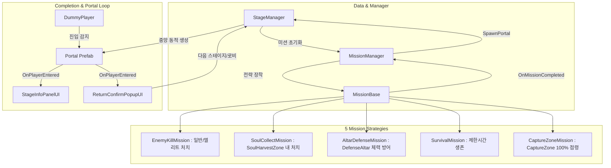

# 🎮 Unity 2D 탑다운 액션 - 스테이지/미션 시스템 인수인계 & 협업 지침서

> **문서 목적**: 본 문서는 Google Drive 동기화 등을 통해 새로 연결된 Gemini AI가 프로젝트의 진행 상태와 아키텍처를 즉시 파악하고, 사용자(작업자)와 원활하게 협업할 수 있도록 작성된 종합 컨텍스트 문서입니다.

---

## 1. 프로젝트 개요 및 협업 환경 규칙

### 1) 프로젝트 환경
* **엔진 버전**: Unity 6 (6000.3.22f1 LTS)
* **장르**: 2D 탑다운 액션 슈팅 (WASD 이동, 마우스 조작, 심도/스테이지 이동 루프)
* **협업 방식**: 팀 단위 협업 진행 중 (레벨 디자인 / 스테이지 로직 / 임무 매니저 담당)
* **테스트 전략**: 다른 팀원의 실시간 플레이어/몬스터 완료를 기다리지 않고, 독립적인 더미(Dummy) 오브젝트를 활용해 단계별로 로직을 검증 및 구축.

### 2) ★ 절대 준수 협업 지침 (Gemini AI 필독)
1. **작업 폴더 제한**:
   - 팀원들과의 Git 충돌을 방지하기 위해 **오직 `Assets/01_Scripts/Stage/` 폴더 내부의 스크립트만 수정하거나 추가**합니다.
   - 외부 폴더(Player, Enemy, UI 등)의 코드는 일절 건드리지 않고, 이벤트 및 느슨한 결합(Loose Coupling)으로 연동합니다.
2. **코드 제공 방식**:
   - 사용자가 직접 유니티 및 IDE에 복사-붙여넣기(Copy & Paste)할 수 있도록, **생략 없는 완전한 C# 코드 블록**을 제공합니다.
3. **인스펙터 세팅 가이드 필수 포함**:
   - 스크립트 작성 시 사용자가 해야 할 일(하이에라키 오브젝트 생성, 컴포넌트 추가, Collider 설정, 인스펙터 슬롯 연결, 테스트 단축키)을 항상 단계별로 상세히 안내합니다.
4. **언어**: 한국어로 응답합니다.

---

## 2. 현재까지 완료된 작업 내역 (100% 검증 완료)

현재 `Assets/01_Scripts/Stage/` 내에 모든 핵심 스크립트가 구현되어 에디터 실행 테스트까지 완료된 상태입니다.

```text
Assets/01_Scripts/Stage/
├── MissionBase.cs              // 5종 미션 공통 추상 클래스 (Strategy Pattern)
├── MissionManager.cs           // 미션 라이프사이클 총괄 & 포탈 생성 연동
├── EnemyKillMission.cs         // 미션 1: 일반 및 엘리트 적 처치
├── SoulCollectMission.cs       // 미션 2: 지정 구역 내 적 처치 시 영혼 수집
├── SoulHarvestZone.cs          // 영혼 수집 물리 트리거 구역 (Gizmo 시각화)
├── AltarDefenseMission.cs      // 미션 3: 중앙 제단 HP 방어 (제한시간 버티기)
├── DefenseAltar.cs             // 중앙 제단 컴포넌트 (피격 판정, 좌/우클릭 및 K키 테스트)
├── SurvivalMission.cs          // 미션 4: 제한시간 동안 생존 (L키 사망 테스트)
├── CaptureZoneMission.cs       // 미션 5: 거점 밟기 100% 점령 (1초 주기 진행률 로그)
├── CaptureZone.cs              // 거점 점령 물리 트리거 구역 (골드 반투명 Gizmo)
├── StageManager.cs             // 싱글톤 매니저, 포탈 생성 및 안전한 씬 전환
├── Portal.cs                   // 포탈 Collider2D 감지 (진입/이탈 정적 이벤트)
├── StageInfoPanelUI.cs         // 우측 상단 정보 UI (CanvasGroup, 자동 텍스트 바인딩)
├── ReturnConfirmPopupUI.cs     // 우측 하단 [복귀] / [계속 진행] 선택 팝업 (CanvasGroup)
├── CameraFollow.cs             // LateUpdate + Lerp 기반 부드러운 플레이어 추적 카메라
├── DummyPlayer.cs              // WASD 이동 및 태그 "Player" (L키 사망 기능)
└── DummyEnemy.cs               // 마우스 좌클릭 피격/사망, IsElite 등급 지원
```

### 최근 완료된 주요 개선 및 버그 픽스 (PR 리뷰 피드백 반영 완료)
1. **정적 이벤트 중복 구독 방지**: `Initialize()` 호출 시 `DummyEnemy.OnEnemyDied` 및 `DummyPlayer.OnDummyPlayerDied`의 중복 구독 방지(`-=` 후 `+=`) 및 `OnDestroy()` 정리 구현 완료.
2. **안전한 씬 전환 (Fail-safe)**: `StageManager`에 기본 씬 상수 및 `Application.CanStreamedLevelBeLoaded` 예외 처리를 추가하여 씬 이름 누락 시에도 루프가 깨지지 않도록 보강.
3. **제단 디펜스 진행률 보정**: 제단 파괴/실패 시 `GetProgressRatio()`가 0%를 반환하도록 상태 불일치 해결.
4. **UI 편의성 극대화**: `StageInfoPanelUI`에 자식 오브젝트 자동 탐색(`AutoFindTextReferences`) 및 인스펙터 빈칸 시 영문 디폴트 자동 복원 기능 탑재.

---

## 3. 전체 시스템 아키텍처 및 데이터 흐름



---

## 4. 앞으로 진행할 작업 (Roadmap)

사용자가 전달할 **"스테이지 기획 텍스트"**를 바탕으로 다음 작업을 순차적으로 진행합니다:

### 1단계: 더미 몬스터 다양화 및 기본 AI 구현
* **더미 몬스터 2종 추가 제작**:
  - 기본형 더미 외에 원거리형, 돌진형 등 특성이 다른 몬스터 추가.
* **추격(Tracking) 및 기본 공격 패턴 구현**:
  - 몬스터가 플레이어를 인식하고 부드럽게 추격하는 이동 로직.
  - 플레이어나 제단(DefenseAltar)에 접근했을 때의 기본 공격 판정.

### 2단계: 다음 스테이지 기획 데이터 구체화
* 사용자가 전달할 스테이지별 속성(화염, 냉기, 번개 등), 심도, 위험도 스펙 반영.

### 3단계: ScriptableObject 데이터 바인딩 (마일스톤 4)
* **`StageDataSO.cs`**: 심도, 스테이지명, 속성, 위험도, 미션 타입 & 목표치, 출현 몬스터 리스트.
* **`MonsterDataSO.cs`**: 몬스터 이름, 속성, 프리팹, 스폰 이펙트.
* 하드코딩 완전 제거: `StageManager`가 SO 데이터를 읽어 `MissionManager`, `MonsterSpawner`, `StageInfoPanelUI`에 자동 공급하는 완전한 데이터 주도(Data-Driven) 파이프라인 완성.

---

## 5. Gemini AI의 작업 수행 지침 (How to Work)

Gemini는 사용자와 대화할 때 항상 다음 프로세스를 따릅니다:

1. **사전 확인**: 사용자가 전달한 기획 텍스트를 분석하고 요구사항을 명확히 요약.
2. **코드 작성 (복사-붙여넣기 전용)**:
   - 반드시 **`Assets/01_Scripts/Stage/` 폴더 내에 위치할 단일/완성형 C# 코드**를 작성.
   - 코드에 클래스 역할과 주요 함수에 대한 주석을 충실히 기재.
3. **인스펙터 가이드 제공**:
   - 유니티 에디터에서 사용자가 생성해야 할 GameObject 이름.
   - 붙여야 할 컴포넌트 목록 및 `Collider2D` 설정(Is Trigger 여부 등).
   - 인스펙터 슬롯에 연결할 오브젝트/프리팹 안내.
4. **검증(테스트) 절차 안내**:
   - `Play` 후 어떤 키를 누르고 어떤 로그를 확인해야 성공인지 1-2-3 단계로 제시.
