# 튜토리얼 구현 — 기술 설계

> 상태: **설계 (미구현)** · 상세도 **Level 1.5 (구현 가이드)** · 기준 브랜치 `feature/growth` · 작성일 2026-10-12
> 갱신: P1~P14 승인과 단순화 S1~S6 승인을 반영했다 (2026-10-12). Level 1.5로 보강하면서 코드를 다시 확인해 수정 위치·연결 방식을 추가했고, P5 확인 위치 정정과 연결 방식(P14)도 승인되었다. 룬 제한은 S3에 따라 지급 자원 방식으로 바뀌었고, 6.4에서 보완한 오버레이 연결은 P10~P13으로 승인되었다.
> 기준 문서: [TutorialFlow.md](TutorialFlow.md) (단계 구조·규칙·시안 수정 요청). 이 문서는 그 설계를 코드로 옮기는 방법만 다룬다. 첫 단계가 뜨기까지의 시작 흐름은 [TutorialStartup.md](TutorialStartup.md)에 따로 설계한다.
> 이 문서는 설계만 다룬다. 코드는 아직 구현하지 않았다. 표기 `제안`은 아직 코드에 없는 신규 요소, `확인 필요`는 구현 시 코드로 다시 확인할 가정이다.
> UI 프리팹은 이미 구현되어 있다 (`Assets/10_UI/Prefabs/Tutorial/`, 커밋 `d70826fb9` ~ `8facea1d7`, `558a7852d`). 이 문서의 대상은 프리팹을 구동하는 C# 코드이다.

## 1. 기능 개요

신규 플레이어가 첫 런에서 시작 석상 선택부터 1층 포탈 진입까지 10개 필수 단계를 강제 진행하고, 이후 처음 마주치는 상황마다 번호 없는 "새 기록 카드"를 한 번씩 보게 하는 튜토리얼이다. 완료하거나 건너뛰면 이후 런에서는 나오지 않으며, 협회 지침서(Esc 메뉴)에서 기록을 다시 볼 수 있다.

## 2. 구현 요구사항

### 기획서에서 확정된 규칙 ([TutorialFlow.md](TutorialFlow.md))

| 항목 | 규칙 |
|---|---|
| 단계 | 필수 10단계(`NN / 10`, 강제) + 번호 없는 새 기록 카드. 같은 카드 시스템으로 통일 |
| T1 원소 반응 | 필수 흐름에 포함. 04에서 원소 룬 2개 장착, 06 전투에서 첫 반응을 보여 준다 |
| T2 임무 실패 | 실패 없음. 타이머 0이어도 실패 처리하지 않고 "시간 연장 + 정령 추가 스폰", 체력은 하한 고정. 1층에서만 적용 |
| 룬 선택 범위 | 사용 가능한 원소 룬 워드 2개만 열고 나머지는 `???` 잠금. 추천 조합 1개 |
| 건너뛰기 | 일시정지 메뉴의 "튜토리얼 건너뛰기". 건너뛰면 기본 원소(불)와 기본 룬 워드를 자동 지급. 길게 누르기 힌트는 상시 노출하지 않음 |
| 입력 | 확정은 F로 통일, Space는 대시 전용. 룬북(Tab)은 04 이전 잠금 + HUD 힌트 숨김 |
| 기록 위치 | 룬북은 장착용, 협회 지침서는 도감용. 원소 반응 기록은 한 곳에서만 노출 |
| 카드 배치 | 기본 앵커 좌상단, 가리킬 때만 화살표. 주 안내는 하나만, "지난 단계" 카드는 몇 초 뒤 사라짐 |

### 이번 설계에서 정한 사항 (사용자 승인 완료)

| # | 쟁점 | 결정 |
|---|---|---|
| I1 | 노출 횟수 | **최초 1회.** 완료하거나 건너뛰면 이후 런에서는 나오지 않는다. 다시 보려면 협회 지침서를 쓴다 |
| I2 | 텍스트 보관 | **ScriptableObject.** 단계·기록 카드 문구는 SO에 둔다 (CSV 방식은 쓰지 않는다) |

### 기존 구조에서 확인한 사실

- **진행 흐름이 두 구간으로 나뉜다.** 단계 1~4는 시작 석상(출발 준비)에서, 단계 5~10은 `StageManager` 1층에서 일어난다. `StageManager.Start`는 `_waitForPreparation`이 켜져 있으면 `IsWaitingForPreparation = true`로 1층 준비를 미루고, 석상이 무너진 뒤 `BeginPreparedRun()`을 불러 `StartStage(1)`을 시작한다 ([StageManager.cs:257](../../../Assets/01_Scripts/Stage/StageManager.cs), [ExpeditionStatue.cs:525](../../../Assets/01_Scripts/Preparation/ExpeditionStatue.cs)).
- **단계 2~4의 훅이 이미 공개돼 있다.** `ExpeditionStatue.Interacted`(석상 상호작용), `MainElementSelectView.Confirmed(ReactionElement)`(원소 확정), `RuneBookV2Presenter.Confirmed`(룬북 확정)가 `public event`이다. `ExpeditionStatue` 자체는 수정하지 않아도 된다.
- **단계 5의 훅.** 시작 오브젝트 상호작용은 `StageManager.HandleStartActivated()`가 처리하고 `StagePhase.InMission`으로 바꾼 뒤 `PhaseChanged`를 낸다. `Ready` 단계에서는 타이머가 멈춰 있다.
- **임무 실패 경로.** `StageManager.UpdateMissionTimer()`가 `_remainingTime <= 0f`이고 `SurvivalMission`이 아니면 `EndRun(RunEndReason.MissionFailed)`를 부른다 ([StageManager.cs:440](../../../Assets/01_Scripts/Stage/StageManager.cs)). 이미 `SetMissionRewardProvider(IMissionRewardProvider)`처럼 StageManager에 인터페이스를 주입하는 패턴이 있다.
- **임무 종류 고정 수단이 없다.** `MissionManager.PrepareRandomMission(depth)`가 private `PickMissionType()`으로 임무를 정한다. 튜토리얼 1층 임무를 고정하려면 수정이 필요하다.
- **체력.** `PlayerHealth.ApplyDamage`는 `_currentHealth - finalDamage <= 0f`이면 `_currentHealth = 0f` 후 `Death()`를 부른다. 하한 개념이 없다. `Damaged(float)` 이벤트가 있다.
- **룬북 잠금.** `RuneBookV2Toggle.IsBlocked()`가 일시정지·화면 가림·`_blockers`를 검사한다. 잠금 플래그는 없다. Tab 힌트는 `HudMenuHints.Create(toggle)`이 `RuneBookV2Toggle`에서 만든다.
- **룬 워드 공개 수준.** `GameRuneBookV2DataSource.GetEntries()`가 항목마다 `RuneWordRevealLevel`을 정하고(완성품 보유 시 `Detailed`) 툴팁은 `Listed`에서 설명을 `???`로 가린다.
- **원소 반응 훅이 없다.** 반응 실행은 `Bullet.ExecuteReaction(primary, secondary, context)` 한 곳으로 모이지만 이벤트가 없다 ([Bullet.cs:249](../../../Assets/01_Scripts/Bullet/Bullet.cs)). `BulletBackup.ElementReactionRequested`는 백업 클래스라 쓰지 않는다.
- **기타 이벤트.** `PlayerInputHandler.DashPressed`/`InteractionRequested`, `EnemyHealth.OnDeath`(static), `EnemyHealth.OnDamageDealt`(static), `Portal.OnPlayerEntered`(static), `RewardSelectUI.OnOptionConfirmed`, `RuneStoneInventory.OnInventoryChanged`, `MissionManager.OnMissionStarted`가 있다.
- **일시정지 메뉴.** `PauseController`가 `_resumeButton`, `_settingsButton`, `_abandonButton`, `_quitButton`을 `SerializeField`로 두고 `ConfirmDialogView`(확인 대화상자)를 이미 쓴다.
- **룬 워드 장착은 룬석이 필요하다.** 룬북 UI의 `FindEquipSlot`이 룬석이 부족하면 `EquipError.NotEnoughRuneStones`로 칸에 넣는 단계에서 막고, 확정(`CanConfirm()`)은 `HasEnoughRuneStones(_pendingUse)`를 요구한다. `RuneLoadout.TryEquip`도 `ConsumeRuneStones(effect.RuneWord)`를 호출하며, 해제(`TryUnequip`)는 룬석을 돌려주지 않는다. 룬석은 새 게임에서 비워지고(`PlayerRuneManager.ResetForNewGame`) 지급 경로는 적 픽업(`PlayerAcquire`), 상점, 에디터 테스트 키뿐이다. 주력 원소는 `EquipPrimaryElement`로 룬석 없이 장착된다.
- **룬북 열기 경로가 둘이다.** Tab 입력은 `RuneBookV2Toggle.HandleOpenRuneBookPressed()`(176줄)가 `Open()`을 부르고, 시작 석상은 `HandleElementConfirmed`에서 `_runeBookToggle.Open()`을 직접 부른다. 두 경로가 같은 `Open()`과 `IsBlocked()`(149줄)를 거치므로, P5의 잠금을 `IsBlocked()`에 두면 석상의 룬북 열기까지 막힌다. 그래서 잠금은 Tab 입력 경로(`HandleOpenRuneBookPressed`)에서만 확인한다 (6.3).
- **임무 종류 고정 수단이 이미 일부 있다.** `MissionManager`에 `_useForcedMissionType`/`_forcedMissionType`(테스트용 인스펙터 옵션)이 있고 `PickMissionType()`(150줄)이 이를 확인한다. P2는 이 옵션을 건드리지 않고 한 번만 쓰는 고정값을 앞에 둔다.
- **반응 실행 메서드는 델리게이트로 전달된다.** `Bullet.ExecuteReaction`(249줄)은 직접 호출되지 않고 `BulletHitEffects` 생성자에 델리게이트로 넘겨진다(75줄). 이벤트는 메서드 본문 시작에서 낸다.
- **일시정지 메뉴는 상태 머신이다.** `PauseController`는 `State { Closed, Menu, Settings, Confirm, Countdown }`로 Esc를 처리하고, 설정 패널은 `Cancel()`과 `Closed` 이벤트로 메뉴에 돌아온다. 확인 대화상자는 `ShowConfirm(title, body, confirmLabel, onConfirm)`(352줄)이다. 지침서도 같은 패턴으로 붙인다.
- **저장.** 프로젝트는 PlayerPrefs로 설정을 저장한다(`GameSettings`). 별도 세이브 시스템은 없다. 어셈블리 정의(asmdef)와 테스트 폴더가 없다.

### 이번 설계에서 정한 사항 — P1~P14 (사용자 승인 완료)

| # | 쟁점 | 결정 | 근거 |
|---|---|---|---|
| P1 | 단계 구동 | `TutorialController`가 `TutorialStepSO` 배열을 순서대로 진행하고, 완료 조건은 `TutorialConditionKind`에 따라 `TutorialController`가 이벤트 하나를 구독해 감지한다 (S1로 조건 클래스 분리 폐기) | 조건 대부분이 구독 1개와 완료 호출 몇 줄이라 클래스로 나눌 이유가 작다 |
| P2 | 1층 임무 고정 | `MissionManager.SetNextMissionOverride(MissionType)`으로 튜토리얼 1층은 `SoulCollect` 고정 | 시안 06/07이 영혼 수집 기준이고 단계 7이 "정령 처치"로 완료된다 |
| P3 | 임무 실패 없음 | `StageManager`에 `Func<bool> TimeoutHandler`를 주입하고, `TutorialRules`가 만료 시 시간 연장 + 추가 스폰으로 처리 (S2로 인터페이스 대신 델리게이트) | 구현체가 하나뿐이다. 핸들러가 null이면 기존 동작과 같다 |
| P4 | 체력 하한 | `PlayerHealth.MinHealthRatio`(기본 0)를 추가하고 `ApplyDamage`에서 하한 아래로 내리지 않는다 | 사망 경로를 건드리지 않고 한 곳에서 처리 |
| P5 | 룬북 잠금 | `RuneBookV2Toggle.IsLocked` 추가, Tab 입력 경로(`HandleOpenRuneBookPressed`)에서 확인. Tab 힌트 숨김도 같은 플래그를 따른다. (승인 정정: 처음 설계의 `IsBlocked()`가 아니라 Tab 입력 경로에서 확인한다. 석상이 `Open()`을 직접 부르기 때문이며 6.3 참고) | Tab 입력만 막고 석상의 룬북 열기는 유지한다 |
| P6 | 첫 반응 이벤트 | `Bullet`에 `static event ElementReactionExecuted` 추가, `ExecuteReaction` 시작에서 발생 | 반응 실행이 한 메서드로 모여 있고 `EnemyHealth.OnDeath` 같은 static 이벤트 패턴이 있다 |
| P7 | 새 기록 = 지침서 항목 | `RecordCardSO` 하나가 기록 카드와 지침서 항목을 겸한다. 지침서는 `TutorialProgressStore`의 본 기록 id로 표시/`???`를 정한다 | 같은 문구를 두 번 만들지 않는다 |
| P8 | 건너뛰기 확인 | 기존 `ConfirmDialogView`를 재사용한다. 만들어 둔 `TutorialSkipDialog` 프리팹은 쓰지 않는다 | 일시정지 메뉴가 이미 같은 대화상자로 포기·종료를 확인한다 |
| P9 | 룬 제한 | 튜토리얼 시작 시 허용 룬 워드 2개에 필요한 룬석만 `PlayerRuneManager.RuneStoneInventory.TryAddRuneStone(char, int)`로 지급한다. 룬북과 `GameRuneBookV2DataSource`는 수정하지 않는다 (S3로 변경) | 지급되지 않은 워드는 룬석 부족으로 넣을 수 없고 `Listed`(`???`)로 보이는 기존 규칙을 그대로 쓴다 |
| P10 | 단계별 오버레이 연결 | `TutorialStepSO`에 `_overlay`(None, KeyHint, WorldMarker, Spotlight)와 `_overlayText`를 둔다. 오버레이 대상은 `TutorialController`가 조건 종류로 정하고(석상은 `ExpeditionStatue.InteractionGuidePoint`, 임무는 `MissionManager.CurrentMissionObject`, 단계 6은 HUD 패널), 완료 배너는 단계 10 `Finished` 뒤 다음 `StageStarted`에서 띄운다 | 문구는 I2에 맞게 SO에 두고, SO가 씬 오브젝트를 참조하지 않게 한다. 새 클래스가 필요 없다 |
| P11 | 단계 카드 데이터 보강 | `TutorialStepSO`에 `_actionLabels`(키 옆 설명, Key 1개·MultiKey 2개)와 `_subSteps`(Steps 카드의 하위 단계 문구)를 추가한다 | "1 2 3 선택 / Enter 보상 받기"와 번호 단계 목록 카드를 현재 필드로는 표현할 수 없다 |
| P12 | 기록 카드 데이터 선언 | `RecordCardSO`, `RecordCategory`, `RecordKeyRow`를 6.2에 선언하고 `_elements`(원소 반응 카드의 원소 점 색 2개)를 추가한다 | 6.2에 `RecordCardSO` 선언이 빠져 있었고, 원소 반응 카드의 점 색 정보가 필요하다 |
| P13 | 컨트롤러 뷰 참조와 하위 단계 | `TutorialController`가 `_keyHintView`, `_worldMarkerView`, `_spotlightView`, `_completionBannerView`, `_objectivePanel`을 직렬화 참조로 갖고 `ShowOverlay`/`HideOverlay`로 오버레이를 켜고 끈다. Steps 카드의 하위 단계는 1차에서 첫 항목을 고정 강조하고 진행 연동은 후속으로 둔다 | 오버레이 호출 주체가 컨트롤러 하나로 모이고, 하위 단계 진행 이벤트는 기획이 정해지지 않았다 |
| P14 | 연결 방식과 보완 멤버 | `TutorialController`와 `TutorialRules`는 씬 컴포넌트를 직렬화 참조로 받고, `StageManager`와 `MissionManager`는 `Instance`로, `EnemyHealth`와 `Portal`은 static 이벤트로 접근한다. 보완 멤버로 `RecordCardSO._triggerParam`(임무 종류별 카드 구분), `TutorialController.CompleteStep()`/`Finish()`, `GuidebookPresenter.Closed`를 둔다 | 기존 코드가 같은 방식을 쓴다(`ExpeditionStatue`는 직렬화 참조, `StageManager`는 `Instance`, `EnemyHealth`는 static 이벤트). 완료 처리 중복 방지와 일시정지 메뉴 복귀(`_settingsPanel.Closed` 패턴)에 필요하다 |

### 단순화 결정 — S1~S6 (사용자 승인 완료)

| # | 결정 | 변경된 승인 항목 |
|---|---|---|
| S1 | `ITutorialCondition`, 팩토리, 구현체를 만들지 않고 `TutorialController`가 `TutorialConditionKind` switch로 이벤트를 구독한다 | P1 |
| S2 | `IMissionTimeoutPolicy` 대신 `StageManager.TimeoutHandler`(`Func<bool>`)를 둔다 | P3 |
| S3 | 룬 제한을 `GameRuneBookV2DataSource` 수정 대신 룬석 지급 방식으로 한다 | P9 |
| S4 | `TutorialSkipHintView`(길게 누르기 게이지)는 힌트 노출 정책이 정해질 때까지 구현하지 않는다 | — |
| S5 | 스포트라이트는 단계 6(타이머·목표 UI)에만 쓴다. 룬북·보상 화면 스포트라이트는 구현하지 않는다 | — |
| S6 | 새 기록 카드 1차 트리거는 기존 이벤트로 잡히는 5종(첫 반응, 피격, 룬석 획득, 첫 적중 원소 각인, 임무 종류 첫 시작)만 구현한다. "남은 시간 10초", "체력 위험"은 후속 | — |

### 아직 정해지지 않은 사항 (확정으로 쓰지 않는다)

- 단계 6 "시간 정지 또는 미시작"의 구현 방식 (`Time.timeScale` 정지 vs `RemainingTime` 고정)
- 길게 누르기 건너뛰기 힌트(시안)와 TutorialFlow.md의 상시 미노출 규칙의 충돌 정리
- "확정은 F 통일"의 범위 (`RewardSelectUI`는 Return/Space로 확정, `PauseController._submitKey`는 Space)
- 용어·말투 통일(TutorialFlow.md 4절)과 폰트 가운뎃점(·) 글리프 처리
- 단계 10 월드 마커의 대상인 포탈 오브젝트를 찾는 방법 (구현 시 **확인 필요**)
- 건너뛰기에서 지급할 "기본 룬 워드"가 무엇인지, 준비 구간(단계 1~4)에서 건너뛰었을 때 시작 석상 흐름을 어떻게 둘지 (기획 확인)
- 시간 연장 때 정령을 추가 스폰하는 방법 (`MonsterSpawner.RestartSpawner(depth)` 후보, 구현 시 **확인 필요**)
- `GrantRuneStones()`를 부를 때 `RuneEffectDatabase`와 `PlayerRuneManager`의 준비 완료 시점 (구현 시 **확인 필요**)
- 룬 워드 철자(룬 문자) 구성이 겹치는지: 겹치면 지급한 룬석으로 허용하지 않은 워드도 만들 수 있다. 철자 데이터는 원격 CSV(`RuneDefinitionLoader`)라 저장소에서 확인하지 못했다. 구현 전에 확인한다
- 룬석 부족 시 안내 문구(`_notEnoughText`)가 시안이 요구하는 "잠금" 표현과 맞는지
- "원소 룬 2개"가 주력 원소(룬석 없이 장착) + 보조 원소 1개를 뜻하는지, 지급할 허용 룬 워드 2개가 무엇인지 (기획 확인)
- 지침서 "기록 N/31"의 카운트 기준, 수치(체력 하한 비율, 시간 연장 초, 이동 완료 거리, 체력 위험 기준)

## 3. 구현 대상

범례: **신규**(제안), **수정**(기존 클래스에 멤버 추가·변경). 모든 신규 코드는 `Assets/01_Scripts/Tutorial/`에 두고, 뷰 7종은 `Assets/01_Scripts/Tutorial/UI/`에 둔다. 껍데기 파일(클래스 선언만, 본문 없음)은 이미 만들어 두었다.

| 구분 | 파일 / 클래스 | 책임 | 주요 멤버 · 수정 위치 | 이유 |
|---|---|---|---|---|
| 신규 | `TutorialStepSO` | 필수 단계 한 개의 문구·행동 행·완료 조건 데이터 | `Number`, `Title`, `Body`, `ActionRow`, `KeyLabels`, `Condition`, `ConditionValue`, `ActionLabels`, `SubSteps`, `Overlay`, `OverlayText` | I2, P1, P10, P11 |
| 신규 | `RecordCardSO` | 기록 카드 겸 지침서 항목 데이터 | `Id`, `Category`, `Title`, `Body`, `Footer`, `Trigger`, `KeyRows`, `Elements` | P7, P12 |
| 신규 | `TutorialProgressStore` | 완료 여부·본 기록 id를 PlayerPrefs에 저장 | `IsCompleted`, `MarkCompleted()`, `TryMarkRecordSeen(id)`, `SeenRecordCount` | I1 |
| 신규 | `TutorialController` | 단계 진행(상태 머신), 단계별 완료 조건 감시, 건너뛰기, 완료 처리 | `CurrentIndex`, `StepStarted`, `BeginCondition(step)`, `EndCondition()`, `ShowOverlay(step)`, `HideOverlay()`, `Skip()` | P1, S1, P10, P13 |
| 신규 | `TutorialRecordTracker` | 기록 카드 발동 조건 감시(1차 트리거 5종), 1회 노출 | `RecordCardSO[]`, `TryShow(id)` | P7, S6 |
| 신규 | `TutorialRules` | 1층 규칙 적용(임무 고정, 실패 없음, 체력 하한, 룬석 지급, 잠금) | `Apply()`, `Release()`, `TryHandleTimeout()`(`TimeoutHandler`에 등록), `GrantRuneStones()` | P2~P5, P9, S2, S3 |
| 신규 | 뷰 클래스 7종 | 프리팹에 데이터 바인딩 | 6.4 참고 | 구현된 UI 프리팹 구동, S4 |
| 신규 | `TutorialCanvas` 프리팹, `CombatScene` 오브젝트 | 뷰와 `TutorialController`/`TutorialRules`를 담는 씬 루트 | — | 씬 변경 |
| 수정 | `StageManager` | 만료 시 핸들러 호출, 시간 연장 | `TimeoutHandler`, `ExtendRemainingTime(float)`, `UpdateMissionTimer()` | P3, S2 |
| 수정 | `MissionManager` | 다음 임무 종류 고정 | `SetNextMissionOverride(MissionType)`, `PrepareRandomMission(int)` | P2 |
| 수정 | `PlayerHealth` | 체력 하한 | `MinHealthRatio`, `ApplyDamage(float)` | P4 |
| 수정 | `Bullet` | 반응 실행 이벤트 | `ElementReactionExecuted`, `ExecuteReaction(...)` | P6 |
| 수정 | `RuneBookV2Toggle`, `HudMenuHints` | Tab 잠금과 힌트 숨김 | `IsLocked`, `IsBlocked()` | P5 |
| 수정 | `PauseController`, `PauseUI` 프리팹 | "튜토리얼 건너뛰기"와 "협회 지침서" 버튼 | 버튼 `SerializeField` 2개와 핸들러 | 건너뛰기, 기록 위치 |

신규 클래스는 약 13개이다 (SO 2, 저장 1, 진행 1, 추적 1, 규칙 1, 뷰 7). 변경 없는 시스템(`ExpeditionStatue`, `MainElementSelectView`, `RuneBookV2Presenter`, `PlayerInputHandler`, `EnemyHealth`, `Portal`, `RewardSelectUI`)은 이벤트 소스로만 쓴다.

## 4. 클래스 다이어그램

목적별로 7개로 나눴다. 구조 4개(4.1~4.3, 4.7)와 이벤트 관계 3개(4.4~4.6)이다. 신규 클래스는 초록, 수정하는 기존 클래스는 노랑으로 구분한다. 이벤트 관계 그림에서 색이 없는 기존 클래스는 이벤트 제공 객체이며 이 그림에서는 수정하지 않는다. 이벤트 발생 이후의 실행 순서는 5절 시퀀스 다이어그램에서 다룬다.

### 4.1 단계 진행 구조

필수 10단계를 진행하는 `TutorialController`와 단계 데이터, 완료 저장 구조이다.

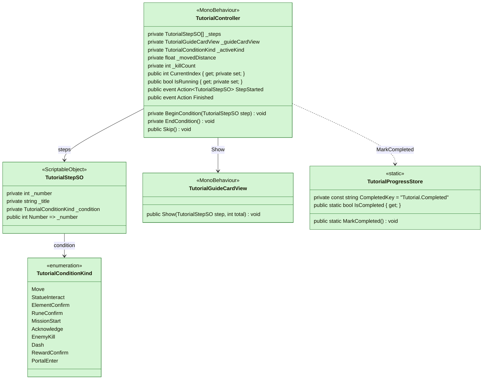

### 4.2 규칙 적용 구조

1층 규칙(임무 고정, 실패 없음, 체력 하한, 룬석 지급)을 `TutorialRules`가 기존 클래스에 주입하는 관계이다.

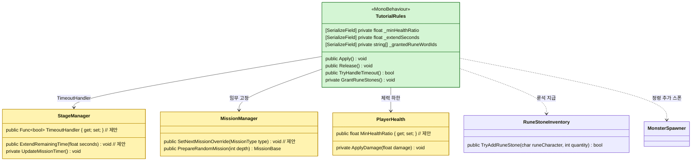

### 4.3 새 기록 카드와 지침서 구조

새 기록 카드 데이터, 본 기록 저장, 카드 표시, 협회 지침서가 같은 데이터(`RecordCardSO`)를 공유하는 구조이다.

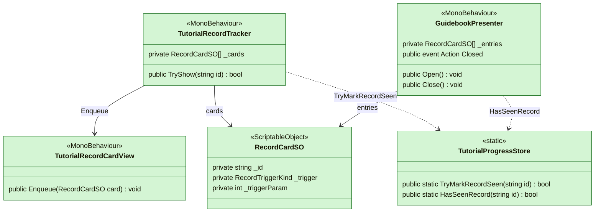

### 4.4 이벤트 관계 — 준비 구간 (단계 2~4)

시작 석상에서 일어나는 단계의 완료를 `TutorialController`가 구독하는 이벤트이다.

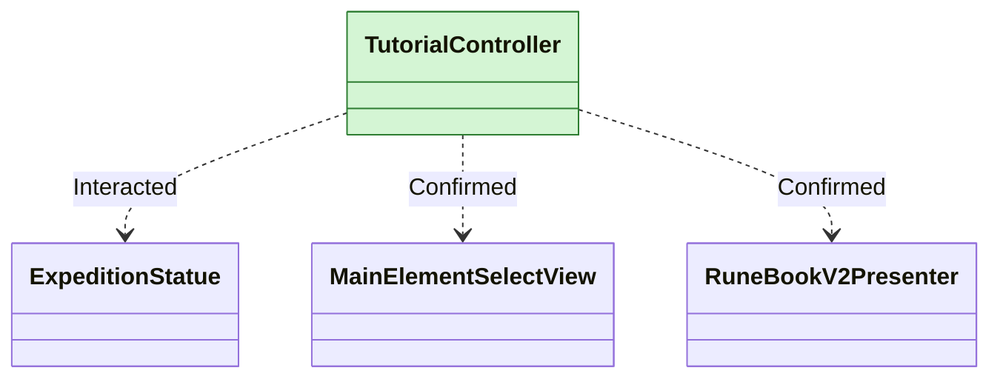

### 4.5 이벤트 관계 — 1층 구간 (단계 5~10)

1층에서 일어나는 단계의 완료를 `TutorialController`가 구독하는 이벤트이다. `StageStarted`는 단계 10 이후 완료 배너를 띄우는 데 쓴다.

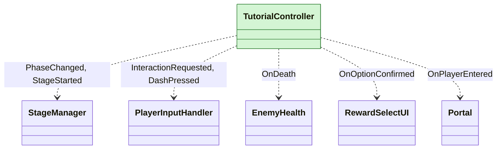

### 4.6 이벤트 관계 — 새 기록 카드 트리거

새 기록 카드 1차 트리거 5종을 `TutorialRecordTracker`가 구독하는 이벤트이다.

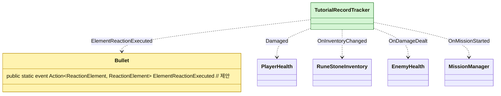

### 4.7 오버레이 뷰 구조

단계에 붙는 오버레이(키 안내, 월드 마커, 스포트라이트)와 완료 배너를 `TutorialController`가 부르는 구조이다. 연결 규칙은 6.4.1을 따른다.

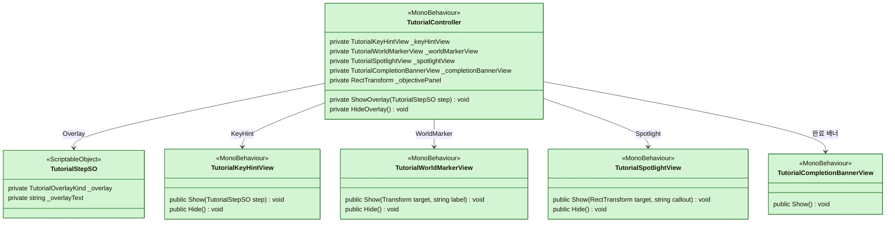

## 5. 시퀀스 다이어그램

### 5.1 필수 단계 진행 (단계 2~5)

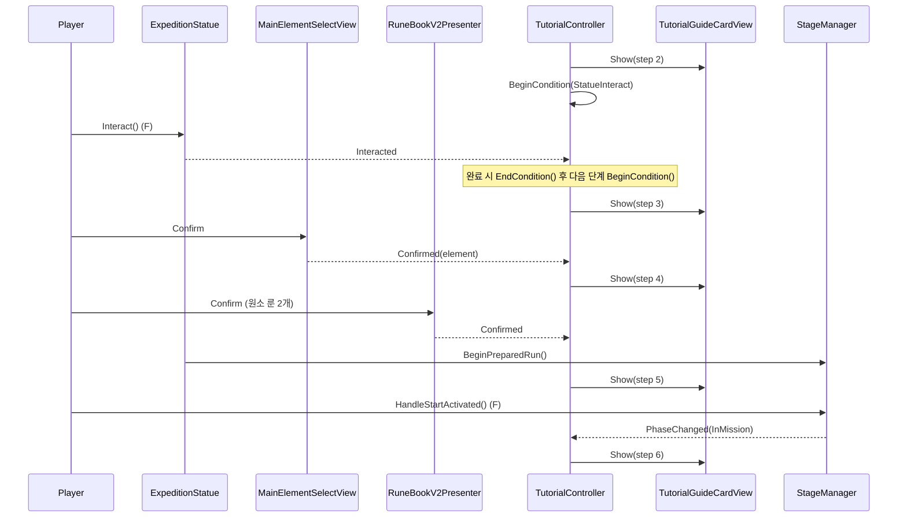

### 5.2 1층 제한 시간 만료 (임무 실패 없음)

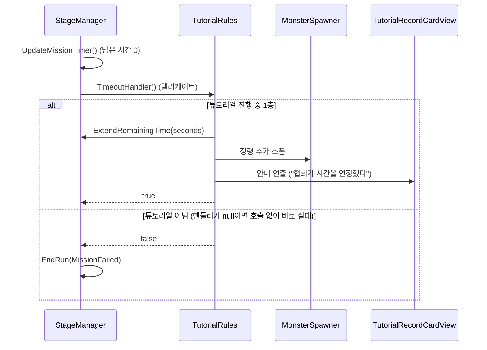

### 5.3 새 기록 카드 발동과 저장

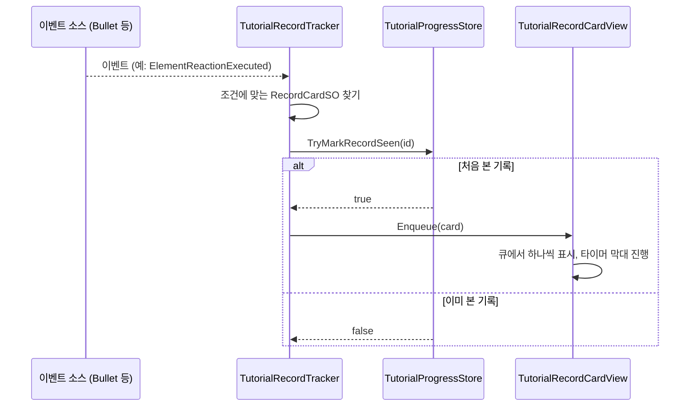

### 5.4 건너뛰기

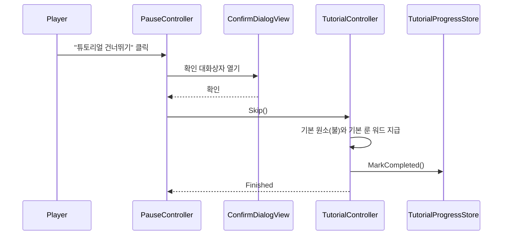

### 5.5 단계 오버레이와 완료 배너

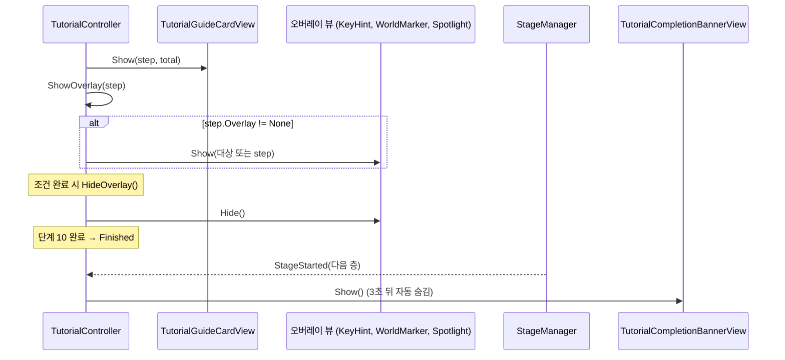

## 6. 상세 구현 절차 (Level 1.5, 실행 흐름 단계별)

구현 순서는 클래스별이 아니라 튜토리얼이 실제로 실행되는 순서(5절 시퀀스 다이어그램)를 따른다. 흐름은 시작·첫 단계([TutorialStartup.md](TutorialStartup.md)) → 준비 구간 단계 2~4(5.1) → 1층 전투 단계 5~8 → 임무 중 안전장치(5.2) → 보상·포탈·완료(5.5) → 새 기록 카드(5.3) → 지침서·건너뛰기(5.4)이다. 같은 클래스(특히 `TutorialController`, `TutorialRules`, `TutorialStepSO`)는 여러 단계에서 필요한 부분만 조금씩 채우며, 각 단계의 본문에는 그 단계에서 새로 필요해지는 선언을 둔다. 6.2~6.4는 클래스별 전체 선언과 세부 규칙을 모아 둔 참조 절이다.

### 6.1 구현 단계

#### 단계 1. 기반 데이터와 완료 저장 (최소)

이 단계에서는 아직 실행되는 것이 없다. 다만 이후 모든 단계가 단계 데이터(`TutorialStepSO`)를 읽고 완료 여부(`TutorialProgressStore.IsCompleted`)를 확인하므로, 구현 의존 때문에 실행 순서보다 먼저 최소 범위로 만든다. `TutorialStepSO`에는 번호·제목·본문·행 종류·키 문구·조건 문구·조건 종류·조건 값(`_number`, `_title`, `_body`, `_actionRow`, `_keyLabels`, `_conditionText`, `_condition`, `_conditionValue`)과 읽기 전용 프로퍼티를 두고, 행 종류와 조건 종류는 `TutorialActionRowKind`, `TutorialConditionKind` 열거형으로 별도 파일에 만든다(전체 선언은 6.2). `TutorialProgressStore`에는 완료 저장 부분만 먼저 구현한다.

```csharp
// TutorialProgressStore.cs — 제안 (이 단계의 범위)
public static bool IsCompleted { get; }
public static void MarkCompleted();
public static void ResetForDebug(); // 개발 편의 (I1 반복 테스트용)
```

저장은 `PlayerPrefs` 정수 `Tutorial.Completed`(0/1)에 하고, `MarkCompleted()`가 값을 쓴 뒤 `PlayerPrefs.Save()`를 부른다. `ResetForDebug()`는 키를 지우고 정적 캐시를 비우며, 도메인 리로드를 끈 에디터 플레이에서 정적 캐시가 남지 않도록 플레이 시작 때 캐시를 비우는 처리를 둔다(6.2.1). `_actionLabels`, `_subSteps`, `_overlay`, `_overlayText`와 `TutorialOverlayKind`는 쓰는 단계에서 추가하고, 본 기록 관련 멤버(`HasSeenRecord`, `TryMarkRecordSeen`, `SeenRecordCount`)는 단계 7에서 추가한다. 단계 SO 에셋은 1~2번만 임시 문구로 만들고 나머지는 각 단계에서 만든다.

이 단계가 끝나면 SO 에셋을 만들 수 있고, `MarkCompleted()` 뒤 `IsCompleted`가 `true`이며 에디터를 다시 실행해도 유지된다. `ResetForDebug()`로 지워진다.

#### 단계 2. 시작과 첫 단계 (단계 1 "균열 착지")

실행의 출발점은 전투 씬이 열릴 때 `TutorialController.Start()`가 `TutorialProgressStore.IsCompleted`를 확인하는 것이다. 완료했으면 아무것도 하지 않고, 아니면 `StartRoutine()`을 시작한다. 코루틴은 한 프레임을 기다린 뒤 `StageManager.IsWaitingForPreparation`, `GameBootstrap.State`, `PortalPlayerHider.IsAnyHiding`을 차례로 확인하고, 모두 통과하면 `TutorialRules.Apply()`를 부른 뒤 `BeginFirstStep()`으로 첫 카드를 띄운다. 이 시작 구간의 구현 순서, 선언, 조건과 검증 시나리오(T1~T9)는 [TutorialStartup.md](TutorialStartup.md) 6.1~6.4에서 상세히 정하며, 이 단계가 그 네 단계를 모두 포함한다. 그 문서의 순서대로 `TutorialController`의 시작 멤버를 만들고 `PortalPlayerHider.IsAnyHiding`(수정)을 추가한다.

시작 흐름이 첫 카드까지 이어지면, 이 단계에서는 이후 모든 단계의 틀이 되는 진행 부분을 `TutorialController`에 추가한다. `BeginFirstStep()`은 `_guideCardView.Show()` → `ShowOverlay(_steps[0])` → `BeginCondition(_steps[0])` 순서로 부른다. `BeginCondition`은 `_activeKind`를 정하고 `_movedDistance`와 `_killCount`를 0으로 둔 뒤 조건 종류에 맞는 이벤트 하나만 구독하는데, 이 단계에서는 `Move`만 처리하고 나머지 종류는 오류 로그를 남긴다. `Move`는 `Update()`가 직전 프레임 위치와의 거리를 `_movedDistance`에 더해 `ConditionValue` 이상이면 완료한다(일시정지 중에는 위치가 변하지 않으므로 별도 처리가 없다). 완료 콜백은 `_activeKind`를 무효로 만들고 `CompleteStep()`을 한 번만 실행하므로 같은 프레임에 이벤트가 겹쳐도 두 번째는 무시된다. `CompleteStep()`은 `EndCondition()` → `HideOverlay()` 뒤 마지막 단계가 아니면 `CurrentIndex`를 올리고 `StepStarted`를 낸 뒤 다음 카드를 `Show`한다.

```csharp
// TutorialController.cs — 제안 (이 단계에서 추가하는 멤버. 시작 멤버는 TutorialStartup.md 6.1~6.4)
[SerializeField] private TutorialKeyHintView _keyHintView;
private TutorialConditionKind _activeKind;
private float _movedDistance;

private void BeginCondition(TutorialStepSO step); // 이 단계에서는 Move만 구독
private void EndCondition();
private void ShowOverlay(TutorialStepSO step);    // 이 단계에서는 KeyHint만
private void HideOverlay();
private void CompleteStep();
```

`TutorialRules`는 `Apply()`와 `Release()`, `_isApplied`만 두고 규칙 본문은 비워 둔다. `TutorialGuideCardView`는 `Show`/`Hide`와 기본 `Key` 카드 프리팹만, `TutorialKeyHintView`는 `Show`/`Hide`와 기본·WASD 프리팹만 구현한다. 뷰는 표시만 담당하고, 단계 카드 문구는 SO(`_title`, `_body`, `_keyLabels`)에서 뷰로 전달되며 뷰는 프리팹 자식 경로로 바인딩한다(6.4.2). `TutorialController`는 씬 컴포넌트를 직렬화 참조로 받고(P14) 뷰의 `Show`/`Hide`를 직접 부른다. `TutorialStepSO`에는 `_overlay`, `_overlayText`와 `TutorialOverlayKind`를 추가한다. 이 시점에 이전 단계(`_Prev`) 카드, 룬석 지급·잠금·임무 고정은 아직 없으며 `Apply`는 플래그만 켠다.

이 단계가 끝나면 새 게임에서 연출이 끝난 직후 단계 1 카드(진행 바 1/10)와 WASD 안내가 뜨고, 이동하면 단계 2 카드가 뜬다. 완료 상태에서는 아무것도 뜨지 않는다. 시나리오 T1~T9([TutorialStartup.md](TutorialStartup.md) 7절)와 V11 중 기본형 카드를 확인한다.

#### 단계 3. 준비 구간 (단계 2~4: 시작 석상)

이어지는 흐름은 플레이어가 석상 앞에서 F로 상호작용하고, 원소를 확정하고, 룬북에서 장착을 확정하면 석상이 무너지며 1층이 시작되는 것이다(5.1). 가장 먼저 구현할 것은 `TutorialController.BeginCondition`/`EndCondition`에 석상 흐름의 세 조건을 추가하는 것이다. 단계 2의 조건 `StatueInteract`는 `ExpeditionStatue.Interacted`를 구독하고, 이벤트가 오면 `CompleteStep()`이 불려 단계 3 카드로 넘어간다. 단계 3의 `ElementConfirm`은 `MainElementSelectView.Confirmed`, 단계 4의 `RuneConfirm`은 `RuneBookV2Presenter.Confirmed`를 구독한다. 세 이벤트는 모두 기존 `public event`이므로 구독만 하며 `ExpeditionStatue`는 수정하지 않는다. 마지막 확정 뒤에는 기존 흐름(`ExpeditionStatue.BeginRun()` → `StageManager.BeginPreparedRun()`)이 이어진다.

```csharp
[SerializeField] private ExpeditionStatue _expeditionStatue;       // 제안(연결): StatueInteract
[SerializeField] private MainElementSelectView _elementSelectView; // 제안(연결): ElementConfirm
[SerializeField] private RuneBookV2Presenter _runeBookPresenter;   // 제안(연결): RuneConfirm
[SerializeField] private TutorialWorldMarkerView _worldMarkerView; // 제안: 단계 2의 석상 마커
```

단계 카드의 연출도 여기서 갖춘다. `ShowOverlay`에 `WorldMarker`를 추가해 단계 2는 `ExpeditionStatue.InteractionGuidePoint`에 월드 마커를 띄우고, `TutorialWorldMarkerView`는 대상이 화면 안이면 마커를, 밖이면 가장자리 화살표를 보여 준다. `TutorialGuideCardView`에는 `_Steps` 카드와 이전 단계 카드(`_Prev`)가 새 카드 아래로 접히며 사라지는 처리를 추가하고, `TutorialStepSO`에는 `_actionLabels`, `_subSteps`를 추가한다(6.4.2~6.4.5).

단계 4의 장착 제한은 `TutorialRules`의 룬석 지급으로 구현한다(S3). `Apply()`가 부르는 `GrantRuneStones()`는 허용 룬 워드 2개의 문자마다 필요 수량에서 현재 보유 수량(`RuneStoneInventory.GetQuantity`)을 뺀 부족분만 `TryAddRuneStone`으로 지급한다(X1). 그러면 단계 4에서 장착 가능한 룬 워드만 룬석 부족 검사를 통과하고 나머지는 `???`로 보인다. 지급은 `PlayerRuneManager.Instance.IsInitialized`이고 `_runeStonesGranted`가 `false`일 때 한 번만 하며, 데이터 로드가 끝나지 않았으면 지급하지 않고 조건을 다시 확인한다(**확인 필요**). 룬북 잠금(P5)도 같은 `Apply()`에 넣는다. `RuneBookV2Toggle.HandleOpenRuneBookPressed()`(176줄)가 `IsLocked`이면 `Open()`을 부르지 않고 반환하게 해 Tab 입력만 막고, 석상의 `Open()` 직접 호출은 `IsBlocked()`를 건드리지 않으므로 그대로 열린다. `Apply()`가 `IsLocked = true`로 두고 `_runeBookPresenter.Confirmed`를 구독해 확정 때 `false`로 되돌린다. `HudMenuHints`는 `Update()`(159줄)에서 `IsLocked`에 따라 Tab 힌트와 룬북 아이콘, 알림 `_glow`/`_dot`을 숨긴다.

```csharp
// RuneBookV2Toggle.cs — 제안
public bool IsLocked { get; set; }

// TutorialRules.cs — 제안 (이 단계의 추가분)
[SerializeField] private string[] _grantedRuneWordIds;
[SerializeField] private RuneBookV2Toggle _runeBookToggle;
[SerializeField] private RuneBookV2Presenter _runeBookPresenter;
private bool _runeStonesGranted;
private void GrantRuneStones();
```

이 단계가 끝나면 석상 흐름을 카드와 함께 끝까지 통과하고(카드 2→3→4→5), 단계 4에서 허용된 룬 워드만 장착된다. Tab은 룬북 확정 전까지 열리지 않지만 석상의 룬북은 열린다. 확인할 시나리오는 V11, V12, V13, V18이다. 룬 철자 겹침 확인(**확인 필요**)과 1층 단계(5~)의 조건, 임무 고정은 다음 단계로 미룬다.

#### 단계 4. 1층 시작과 전투 단계 (단계 5~8)

석상이 무너지면 1층이 시작되는데, 이 임무 종류는 첫 단계가 정한 `SoulCollect`여야 한다. 그래서 가장 먼저 구현할 것은 `MissionManager`의 임무 고정이다. 흐름은 `TutorialRules.Apply()`(시작 때) → `MissionManager.SetNextMissionOverride()`이고, 이어 `StageManager.BeginPreparedRun()` → `StartStage(1)` → `MissionManager.PrepareRandomMission()` → `PickMissionType()`이 맨 앞에서 고정값을 꺼내 비우고 바로 돌려준다. `Apply()`가 `BeginPreparedRun` 전에 불려야 하므로 단계 2의 시작 흐름에서 이미 호출된다. 고정값은 한 번 쓰면 비워지므로 2층부터는 기존 추첨(셔플 백)으로 돌아간다(P2). 기존 `_useForcedMissionType` 확인(152줄)은 그대로 둔다.

```csharp
// MissionManager.cs — 제안
private MissionType? _nextMissionOverride;
public void SetNextMissionOverride(MissionType type);
```

1층이 시작된 뒤의 단계 5~8은 모두 `BeginCondition`에 조건 종류를 더하는 일이다. 단계 5(`MissionStart`)는 `StageManager.PhaseChanged`가 `InMission`이 되면 완료하고, 단계 6(`Acknowledge`)은 `PlayerInputHandler.InteractionRequested`(F)를 구독해 임무 시작 확인을 받는다. 단계 7(`EnemyKill`)은 `EnemyHealth.OnDeath`를 구독해 `_killCount`를 누적하고 `ConditionValue` 이상일 때 완료하며, 단계 8(`Dash`)은 `PlayerInputHandler.DashPressed`를 구독한다. 정적 이벤트 구독이 남지 않도록 `OnDisable`에서도 `EndCondition()`을 부른다. 오버레이는 단계 6의 `Spotlight`(대상은 HUD 타이머·목표 패널인 `_objectivePanel`, 6.4.1, 6.4.4), 임무 오브젝트에 붙는 `WorldMarker`, 마우스·Space의 `KeyHint`를 추가하고, `TutorialGuideCardView`에는 `_Mouse` 카드를 추가한다.

```csharp
[SerializeField] private PlayerInputHandler _inputHandler;
[SerializeField] private RectTransform _objectivePanel;
[SerializeField] private TutorialSpotlightView _spotlightView;
private int _killCount;
```

이 단계가 끝나면 1층 임무가 `SoulCollect`이고 2층부터는 기존 추첨이며, 단계 5~8의 카드와 오버레이가 차례로 진행된다. 확인할 시나리오는 V14, V19이다. 아직 임무 실패 없음과 체력 하한이 없으므로 시간이 0이 되면 임무가 실패할 수 있어 이 단계의 테스트는 짧게 한다.

#### 단계 5. 임무 중 안전장치 (T2: 실패 없음, 체력 하한)

임무가 진행되는 동안 제한 시간이 0이 되어도 끝나지 않고 연장되며, 피격으로 체력이 하한 아래로 내려가지 않게 한다(5.2). 먼저 시간 만료 쪽을 구현한다. `StageManager.Update()`는 `InMission`에서 매 프레임 `UpdateMissionTimer()`(440줄)를 부르고, `_remainingTime <= 0f && _currentMission is not SurvivalMission` 분기(450줄)에서 `EndRun(RunEndReason.MissionFailed)`(453줄) 앞에 `TimeoutHandler?.Invoke() == true`면 `return`하는 줄을 넣는다. 핸들러가 없으면 기존 흐름(`EndRun`)을 그대로 탄다. 정화 단계의 타이머(`UpdatePurification`)는 건드리지 않는다.

```csharp
// StageManager.cs — 제안
public Func<bool> TimeoutHandler { get; set; }  // true를 돌려주면 임무를 실패시키지 않는다
public void ExtendRemainingTime(float seconds); // _remainingTime += seconds
```

핸들러는 `TutorialRules.TryHandleTimeout()`이다. `Apply()`가 `StageManager.Instance.TimeoutHandler = TryHandleTimeout`으로 등록한다. 이 메서드는 `_isApplied`이고 `CurrentDepth == 1`일 때만 처리하며, 처리하면 반드시 먼저 `StageManager.ExtendRemainingTime(_extendSeconds)`로 시간을 늘린 뒤 `true`를 돌려준다. 시간을 늘리지 않고 `true`만 돌려주면 `UpdateMissionTimer`가 매 프레임 다시 호출하기 때문이다. 정령 추가 스폰 방법은 구현 시 확인한다(**확인 필요**, `MonsterSpawner.RestartSpawner(depth)` 후보). 조건에 맞지 않으면 `false`를 돌려준다.

체력 하한은 `PlayerHealth.ApplyDamage(float damage)`(86줄)에서 사망 판정 앞에 적용한다. 일반 피격(`TakeDamageCoroutine`)과 지속 피해(`TakeDamageOverTime`)가 모두 `ApplyDamage`를 거치므로 한 곳에서 처리된다. `MinHealthRatio > 0f`이면 하한은 `_maxHealth * MinHealthRatio`이고, 피해 후 체력이 하한 아래로 내려가면 `_currentHealth`를 하한으로 두고 `Death()`를 부르지 않는다. `Damaged` 이벤트와 피격 연출은 그대로 낸다. 이미 하한 아래이면 체력을 올리지 않고 더 내리지도 않으며, `MinHealthRatio == 0f`이면 기존 동작과 같다. `Apply()`가 이 값을 `_minHealthRatio`로 설정하고 `Release()`가 0으로 되돌린다.

```csharp
// PlayerHealth.cs — 제안
public float MinHealthRatio { get; set; } // 기본 0
```

이 단계가 끝나면 1층에서 시간이 0이 되어도 런이 끝나지 않고 시간이 늘어나며, 체력이 하한 아래로 내려가지 않고 사망하지 않는다. 튜토리얼 종료 뒤에는 일반 규칙이다. 확인할 시나리오는 V4, V5, V20이다. 시간 연장 안내 카드는 단계 7에서 `TutorialRecordTracker`와 연결한다.

#### 단계 6. 보상·포탈과 완료 (단계 9~10, 종료)

임무를 클리어하면 `StageManager.HandleMissionCleared()` → `RewardController.Grant()`로 보상 선택이 열리고, 단계 9의 조건 `RewardConfirm`이 `RewardSelectUI.OnOptionConfirmed`를 구독해 `CompleteStep()`을 부른다. 이어 포탈이 열리면(`StageManager.PhaseChanged`가 `Purification`) `ShowOverlay`가 단계 10의 포탈 월드 마커를 켠다. 포탈 오브젝트는 `FindAnyObjectByType<Portal>()`로 찾는다(**확인 필요**). 단계 10의 조건 `PortalEnter`는 `Portal.OnPlayerEntered`를 구독하고, 정적 이벤트이므로 `EndCondition`/`OnDisable`에서 반드시 해제한다. `TutorialGuideCardView`에는 `_MultiKey` 카드를 추가한다.

```csharp
[SerializeField] private RewardSelectUI _rewardSelectUI;
[SerializeField] private TutorialCompletionBannerView _completionBannerView;
public event Action Finished;
private void Finish();
```

마지막 단계를 완료하면 `CompleteStep()`이 `Finish()`를 부른다. `Finish()`는 완료 처리를 한 곳에 모은 메서드로, `IsRunning = false` → `TutorialProgressStore.MarkCompleted()` → `_rules.Release()` → `Finished`를 낸다. 이후 `StageManager.StageStarted`를 구독해 다음 층(2층 이상)이 시작되면 `_completionBannerView.Show()`를 한 번 부르고 구독을 해제한다. 단계 8에서 만들 `Skip()`도 같은 `Finish()`를 쓰되, 건너뛰어서 끝났을 때는 배너를 띄우지 않는다. `TutorialCompletionBannerView`는 `Show`/`Hide`와 일정 시간 뒤 자동 숨김을 구현한다.

이 단계가 끝나면 1~10단계를 끊김 없이 완주하고 완료 플래그가 저장되며, 다음 층에서 배너가 3초 보였다 사라진다. 재진입하면 아무것도 뜨지 않는다. 확인할 시나리오는 V1, V2, V15이다. 건너뛰기와 새 기록 카드는 다음 단계에서 구현한다.

#### 단계 7. 새 기록 카드 (5.3)

전투 중 처음 겪는 상황이 생기면 번호 없는 새 기록 카드가 한 번만 뜨며, 튜토리얼 완료 여부와 무관하게 동작한다. 흐름의 출발점은 각 게임 이벤트이므로 먼저 `Bullet`에 반응 실행 이벤트를 만든다. `ExecuteReaction(...)`(249줄) 본문 시작, `switch` 앞에서 `ElementReactionExecuted?.Invoke(primary, secondary)`를 낸다. 이 메서드는 직접 호출되지 않고 `BulletHitEffects` 생성자에 델리게이트로 전달되므로(75줄) 반응이 실제로 실행될 때마다 이벤트가 난다. 구독자가 없으면 아무 일도 없고, 기존 `EnemyHealth.OnDeath`처럼 `?.Invoke` 형태로 낸다.

```csharp
// Bullet.cs — 제안
public static event Action<ReactionElement, ReactionElement> ElementReactionExecuted;
```

`TutorialRecordTracker`는 `OnEnable`에서 1차 트리거 5종을 구독하고 `OnDisable`에서 해제한다. `Bullet.ElementReactionExecuted`는 `FirstReaction`, `PlayerHealth.Damaged`는 `PlayerDamaged`, `RuneStoneInventory.OnInventoryChanged`는 `RuneStoneAcquired`(수량이 늘었을 때만), `EnemyHealth.OnDamageDealt`는 `FirstEnemyHit`, `MissionManager.OnMissionStarted`는 `MissionTypeStarted`(매개변수는 `(int)mission.Type`)로 이어진다. 룬석 인벤토리는 `ResetForNewGame`에서 교체될 수 있으므로 `PlayerRuneManager.LoadoutReplaced`에서 다시 구독한다. 이벤트는 모두 `Handle(kind, param)`으로 모이고, `Handle`이 `_cards`에서 `Trigger == kind`(`MissionTypeStarted`면 `TriggerParam == param`도)인 카드를 찾아 `TryShow(card.Id)`를 부른다.

```csharp
// TutorialRecordTracker.cs — 제안
public bool TryShow(string id); // 처음 본 기록이면 저장하고 카드 뷰에 넣는다
private void Handle(RecordTriggerKind kind, int param = 0);
```

`TryShow`는 `TutorialProgressStore.TryMarkRecordSeen(id)`가 `true`일 때만 `_recordCardView.Enqueue(card)`를 부르고 `true`를 돌려주며, 해당 카드가 없으면 `false`를 돌려준다. 그래서 같은 카드는 한 번만 뜬다. 이 단계에서 `TutorialProgressStore`에 본 기록 저장을 추가한다. `TryMarkRecordSeen`은 id가 비었거나 이미 본 기록이면 저장하지 않고 `false`를 돌려주며, 본 기록 id는 문자열 `Tutorial.SeenRecords`(`,`로 이은 값)로 저장해 첫 접근 때 `HashSet<string>` 캐시로 읽는다(6.2.1). `RecordCardSO`와 에셋, `TutorialRecordCardView`(큐, 타이머 막대, 분류별 변형, 6.4.3)도 이때 만든다. 마지막으로 단계 5의 `TryHandleTimeout()`이 `_recordTracker.TryShow(_extendNoticeRecordId)`로 시간 연장 안내 카드를 띄우도록 연결한다.

이 단계가 끝나면 첫 반응, 피격, 룬석 획득, 첫 적중 원소 각인, 임무 종류 첫 시작에서 카드가 한 번만 뜨고 한 장씩 차례로 나온다. 확인할 시나리오는 V8, V9, V16이다. "남은 시간 10초"와 "체력 위험" 트리거는 후속으로 미룬다(S6).

#### 단계 8. 협회 지침서와 건너뛰기 (5.4)

일시정지 메뉴에서 지침서를 열어 기록을 보거나 튜토리얼을 건너뛰는 흐름이다. 먼저 `GuidebookPresenter`를 구현한다. `Open()`이 `RecordCardSO` 목록을 분류별로 묶어 본 기록은 내용을, 미본 기록은 `???`로 보여 주고(`Refresh`, `Select`, 6.4.8), `Close()`가 `Closed` 이벤트를 낸다. 본 기록 여부는 `TutorialProgressStore.HasSeenRecord`와 `SeenRecordCount`로 읽는다.

연결은 `PauseController`(`UI/Pause/PauseController.cs`)에서 한다. `State`에 `Guidebook`을 추가하고, `Awake()`(88줄)에서 두 버튼의 `onClick`에 `AskSkipTutorial`, `OpenGuidebook`을 등록하며 `GuidebookPresenter.Closed`를 구독해 `ShowMenu`로 돌아오게 한다(`_settingsPanel.Closed`와 같은 패턴). `Update()`의 Esc `switch`에는 `case State.Guidebook: _guidebook.Close(); break;`를 추가하고, `HideAll()`(450줄)에서 지침서 화면도 숨긴다. `ShowMenu()`(290줄)에서 "튜토리얼 건너뛰기"는 `_isExpedition`이고 `TutorialController.IsRunning`일 때만 켠다(`_abandonButton`과 같은 방식). 프리팹은 `PauseUI` 메뉴 패널에 버튼 2개를 기존 설정 버튼과 같은 모양으로 추가하고 `TutorialGuidebookScreen` 인스턴스를 같은 캔버스에 둔다.

```csharp
// PauseController.cs — 제안
[SerializeField] private Button _skipTutorialButton;
[SerializeField] private Button _guidebookButton;
[SerializeField] private GuidebookPresenter _guidebook;
[SerializeField] private TutorialController _tutorialController; // 비워 두면 씬에서 찾는다

// TutorialController.cs — 제안
public void Skip();
```

`AskSkipTutorial()`은 `AskAbandonRun()`(326줄)과 같은 형태로 `_state == State.Menu`일 때만 `ShowConfirm("튜토리얼을 건너뛸까요?", "지침서에서 언제든 다시 볼 수 있습니다.", "건너뛰기", SkipTutorial)`을 부르고, `SkipTutorial()`이 `TutorialController.Skip()`을 부른 뒤 메뉴로 돌아간다. `Skip()`은 `IsRunning`일 때만 동작해 조건과 오버레이를 해제하고 기본 원소(불)를 `PlayerRuneManager.Instance.RuneEffectLoadout.EquipPrimaryElement("rune_fire")`로 장착한 뒤(주력 원소 슬롯에 값이 있으면 건너뜀) 단계 6의 `Finish()` 공통 처리를 한다. 기본 룬 워드 지급 대상과 준비 구간(단계 1~4)에서 건너뛰었을 때 석상 흐름은 **미결**(8절)이라, 이 단계에서는 `Finish()` 공통 처리까지만 구현하고 기본 지급은 결정 뒤 연결한다.

이 단계가 끝나면 메뉴에서 지침서가 열리고 닫히며 메뉴로 돌아오고, 지침서가 열려 있는 동안 일시정지 상태가 유지된다. 건너뛴 뒤 이후 런에서는 튜토리얼이 나오지 않는다. 확인할 시나리오는 V3, V10이다.

#### 단계 9. 검증

7절 시나리오 전체와 CLAUDE.md의 Codex 리뷰를 진행한다. 각 단계의 기대 동작은 해당 단계에서 이미 확인했으므로, 여기서는 단계 사이의 연결(예: 단계 3 → 4 → 5 전환, 건너뛰기 직후 이벤트)과 회귀(V17)를 확인한다.

### 6.2 신규 멤버 선언 (클래스별 전체 선언, 구현 단계에서 참조)

```csharp
// TutorialStepSO.cs — 제안
public enum TutorialActionRowKind { Key, Mouse, MultiKey, Steps, ConditionText }
public enum TutorialConditionKind
{
    Move, StatueInteract, ElementConfirm, RuneConfirm, MissionStart,
    Acknowledge, EnemyKill, Dash, RewardConfirm, PortalEnter
}

[CreateAssetMenu(menuName = "Tutorial/Step")]
public class TutorialStepSO : ScriptableObject
{
    [SerializeField] private int _number;
    [SerializeField] private string _title;
    [SerializeField, TextArea] private string _body;
    [SerializeField] private TutorialActionRowKind _actionRow;
    [SerializeField] private string[] _keyLabels;
    [SerializeField] private string _conditionText;
    [SerializeField] private TutorialConditionKind _condition;
    [SerializeField] private float _conditionValue;
    [SerializeField] private string[] _actionLabels;    // 제안(6.4): 키 옆 설명. Key는 1개, MultiKey는 2개
    [SerializeField] private string[] _subSteps;        // 제안(6.4): Steps 카드의 하위 단계 문구
    [SerializeField] private TutorialOverlayKind _overlay; // 제안(6.4): 단계에 붙는 오버레이
    [SerializeField] private string _overlayText;       // 제안(6.4): 마커·키 안내·스포트라이트 문구

    public int Number => _number;
    public string Title => _title;
    public string Body => _body;
    public TutorialActionRowKind ActionRow => _actionRow;
    public IReadOnlyList<string> KeyLabels => _keyLabels;
    public string ConditionText => _conditionText;
    public TutorialConditionKind Condition => _condition;
    public float ConditionValue => _conditionValue;
    public IReadOnlyList<string> ActionLabels => _actionLabels;
    public IReadOnlyList<string> SubSteps => _subSteps;
    public TutorialOverlayKind Overlay => _overlay;
    public string OverlayText => _overlayText;
}

public enum TutorialOverlayKind { None, KeyHint, WorldMarker, Spotlight } // 제안(6.4)
```

```csharp
// RecordCardSO.cs — 제안 (S6: 1차 트리거 5종. TimeLow, HealthLow는 후속)
public enum RecordCategory { Mission, Warning, Skill, Defense, Rune, Place, ElementReaction }
public enum RecordTriggerKind
{
    FirstReaction, PlayerDamaged, RuneStoneAcquired, FirstEnemyHit, MissionTypeStarted
}

[Serializable]
public class RecordKeyRow // 지침서 상세 키 안내 한 줄. 예: [Tab] 원정 중 룬북 열기, 닫기
{
    [SerializeField] private string[] _keys;   // 비어 있으면 Tag(예: 우클릭)를 대신 쓴다
    [SerializeField] private string _tag;
    [SerializeField] private string _label;
}

[CreateAssetMenu(menuName = "Tutorial/Record Card")]
public class RecordCardSO : ScriptableObject
{
    [SerializeField] private string _id;
    [SerializeField] private RecordCategory _category;
    [SerializeField] private string _title;
    [SerializeField, TextArea] private string _body;
    [SerializeField] private string _footer;
    [SerializeField] private RecordTriggerKind _trigger;
    [SerializeField] private int _triggerParam;           // 제안(Level 1.5): MissionTypeStarted일 때 MissionType 값. 그 외 트리거는 쓰지 않는다
    [SerializeField] private RecordKeyRow[] _keyRows;
    [SerializeField] private ReactionElement[] _elements; // 제안(6.4): ElementReaction 카드의 원소 점 색 (2개)

    public string Id => _id;
    public RecordCategory Category => _category;
    public string Title => _title;
    public string Body => _body;
    public string Footer => _footer;
    public RecordTriggerKind Trigger => _trigger;
    public int TriggerParam => _triggerParam;
    public IReadOnlyList<RecordKeyRow> KeyRows => _keyRows;
    public IReadOnlyList<ReactionElement> Elements => _elements;
}
```

```csharp
// TutorialProgressStore.cs — 제안
public static class TutorialProgressStore
{
    private const string CompletedKey = "Tutorial.Completed";
    private const string SeenRecordsKey = "Tutorial.SeenRecords";

    public static bool IsCompleted { get; }
    public static int SeenRecordCount { get; }
    public static void MarkCompleted();
    public static bool HasSeenRecord(string id);
    public static bool TryMarkRecordSeen(string id); // 처음이면 true
    public static void ResetForDebug();               // 개발 편의 (I1 반복 테스트용)
}
```

```csharp
// TutorialController.cs — 제안
public class TutorialController : MonoBehaviour
{
    [SerializeField] private TutorialStepSO[] _steps;
    [SerializeField] private TutorialGuideCardView _guideCardView;
    [SerializeField] private TutorialKeyHintView _keyHintView;                      // 제안(6.4)
    [SerializeField] private TutorialWorldMarkerView _worldMarkerView;              // 제안(6.4)
    [SerializeField] private TutorialSpotlightView _spotlightView;                  // 제안(6.4)
    [SerializeField] private TutorialCompletionBannerView _completionBannerView;    // 제안(6.4)
    [SerializeField] private RectTransform _objectivePanel;                         // 제안(6.4): 단계 6 스포트라이트 대상
    [SerializeField] private TutorialRules _rules;                                  // 제안(연결): Apply/Release
    [SerializeField] private ExpeditionStatue _expeditionStatue;                    // 제안(연결): StatueInteract
    [SerializeField] private MainElementSelectView _elementSelectView;              // 제안(연결): ElementConfirm
    [SerializeField] private RuneBookV2Presenter _runeBookPresenter;                // 제안(연결): RuneConfirm
    [SerializeField] private PlayerInputHandler _inputHandler;                      // 제안(연결): Acknowledge, Dash
    [SerializeField] private RewardSelectUI _rewardSelectUI;                        // 제안(연결): RewardConfirm

    private TutorialConditionKind _activeKind;
    private float _movedDistance; // Move 조건용 (Update에서 누적)
    private int _killCount;       // EnemyKill 조건용

    public int CurrentIndex { get; private set; }
    public bool IsRunning { get; private set; }

    public event Action<TutorialStepSO> StepStarted;
    public event Action Finished;

    private void BeginCondition(TutorialStepSO step); // 조건 종류별 이벤트 구독 (아래 목록)
    private void EndCondition();                      // 구독 해제
    private void ShowOverlay(TutorialStepSO step);    // 제안(6.4): step.Overlay에 맞는 오버레이 표시
    private void HideOverlay();                       // 제안(6.4)
    private void CompleteStep();                      // 제안(Level 1.5): EndCondition → HideOverlay → 다음 단계 또는 Finish
    private void Finish();                            // 제안(Level 1.5): 완료 처리 공통 (MarkCompleted, Release, Finished)
    public void Skip(); // 기본 원소(불)와 기본 룬 워드 지급 → MarkCompleted → Finished
}
```

```csharp
// TutorialRules.cs — 제안
public class TutorialRules : MonoBehaviour
{
    [SerializeField, Range(0f, 1f)] private float _minHealthRatio;   // 값 미정
    [SerializeField, Min(1f)] private float _extendSeconds;          // 값 미정
    [SerializeField] private string[] _grantedRuneWordIds;           // 룬석을 지급할 룬 워드 id (허용 2개)
    [SerializeField] private PlayerHealth _playerHealth;              // 제안(연결)
    [SerializeField] private RuneBookV2Toggle _runeBookToggle;        // 제안(연결): IsLocked
    [SerializeField] private RuneBookV2Presenter _runeBookPresenter;  // 제안(연결): Confirmed에서 잠금 해제
    [SerializeField] private TutorialRecordTracker _recordTracker;    // 제안(연결): 시간 연장 안내 카드
    [SerializeField] private string _extendNoticeRecordId;            // 제안(연결): 안내 카드 id

    private bool _isApplied;
    private bool _runeStonesGranted;

    private void GrantRuneStones(); // 각 id의 RuneWord 문자별 필요 수량 − RuneStoneInventory.GetQuantity(char)만큼만 TryAddRuneStone(char, 부족분) (X1)
    public void Apply();   // IsCompleted가 아니고 1층일 때만 규칙을 켠다. TimeoutHandler 등록, GrantRuneStones() 호출
    public void Release(); // 튜토리얼 종료·건너뛰기 시 원복. TimeoutHandler = null
    public bool TryHandleTimeout();
}
```

`TutorialController.BeginCondition`의 조건 종류별 구독 대상:

- `Move`: `Update`에서 플레이어 위치 이동 거리를 `_movedDistance`에 누적해 `ConditionValue` 이상이면 완료
- `StatueInteract`: `ExpeditionStatue.Interacted` · `ElementConfirm`: `MainElementSelectView.Confirmed` · `RuneConfirm`: `RuneBookV2Presenter.Confirmed`
- `MissionStart`: `StageManager.PhaseChanged`가 `InMission` · `Acknowledge`: `PlayerInputHandler.InteractionRequested`(F)
- `EnemyKill`: `EnemyHealth.OnDeath`를 `_killCount`에 누적해 `ConditionValue` 이상이면 완료 · `Dash`: `PlayerInputHandler.DashPressed`
- `RewardConfirm`: `RewardSelectUI.OnOptionConfirmed` · `PortalEnter`: `Portal.OnPlayerEntered`

```csharp
// TutorialRecordTracker.cs — 제안
public class TutorialRecordTracker : MonoBehaviour
{
    [SerializeField] private RecordCardSO[] _cards;
    [SerializeField] private TutorialRecordCardView _recordCardView;

    public bool TryShow(string id); // id가 같은 카드를 찾아 처음 본 기록이면 저장하고 카드 뷰에 넣는다
    private void Handle(RecordTriggerKind kind, int param = 0); // 제안(Level 1.5): 트리거 공통 처리
}
```

#### 6.2.1 신규 클래스의 역할, 조건, 연결 (구현 단계에서 참조)

**`TutorialProgressStore`**
- 저장 형식: `PlayerPrefs` 정수 `Tutorial.Completed`(0/1)와 문자열 `Tutorial.SeenRecords`(본 기록 id를 `,`로 이은 값). 첫 접근 때 문자열을 `HashSet<string>`으로 읽어 정적 캐시에 둔다.
- `MarkCompleted()`와 `TryMarkRecordSeen(id)`는 값을 쓰고 `PlayerPrefs.Save()`를 부른다. `TryMarkRecordSeen`은 id가 null·빈 문자열이거나 이미 본 기록이면 저장하지 않고 `false`를 돌려준다.
- `ResetForDebug()`는 두 키를 지우고 캐시를 비운다. 도메인 리로드를 끈 에디터 플레이에서 정적 캐시가 남지 않도록 `OwnedRuneWords`처럼 플레이 시작 때 캐시를 비우는 처리를 둔다.
- 연결: `TutorialController`(완료), `TutorialRecordTracker`(본 기록), `GuidebookPresenter`(`HasSeenRecord`, `SeenRecordCount`)가 호출한다. 호출 방향은 항상 이쪽으로 들어온다.

**`TutorialController`**
- 시작 조건과 대기 흐름은 [TutorialStartup.md](TutorialStartup.md)를 따른다. 요약: `TutorialProgressStore.IsCompleted`면 시작하지 않고, 아니면 한 프레임 뒤 `IsWaitingForPreparation`을 확인하고 `GameBootstrap` 준비(`Ready`)와 도착 연출 종료(`PortalPlayerHider.IsAnyHiding == false`)를 기다린 뒤 `_rules.Apply()`를 먼저 부르고 단계 0을 `BeginCondition`으로 연다. 플레이어 위치는 `GameObject.FindGameObjectWithTag("Player")`로 한 번 찾는다(`ExpeditionStatue`와 같은 방식).
- `BeginCondition(step)`: `_activeKind`를 정하고 `_movedDistance`, `_killCount`를 0으로 두며 종류에 맞는 이벤트 하나만 구독한다. `EndCondition()`은 같은 switch로 해제한다. `OnDisable`에서도 `EndCondition()`을 불러 static 이벤트(`EnemyHealth.OnDeath`, `Portal.OnPlayerEntered`) 구독이 남지 않게 한다.
- 중복 완료 방지: 완료 콜백이 들어오면 `_activeKind`를 무효로 만들고 `CompleteStep()`을 한 번만 실행한다. 같은 프레임에 두 이벤트가 와도 두 번째는 무시한다.
- `Update()`: `Move` 조건일 때만 직전 프레임 위치와의 거리를 `_movedDistance`에 더한다. 일시정지 중에는 위치가 변하지 않으므로 별도 처리가 없다.
- `CompleteStep()`: `EndCondition()` → `HideOverlay()` → 마지막 단계면 `Finish()`, 아니면 `CurrentIndex`를 올리고 `StepStarted`를 낸 뒤 `_guideCardView.Show(...)`, `ShowOverlay(...)`, `BeginCondition(...)`.
- `Finish()`: `IsRunning = false`, `TutorialProgressStore.MarkCompleted()`, `_rules.Release()`, `Finished`를 낸다. 완료 배너를 위해 `StageManager.StageStarted`를 구독해 다음 층(2층 이상)에서 `_completionBannerView.Show()`를 한 번 부르고 구독을 해제한다. `Skip()`에서 끝났을 때는 배너를 띄우지 않는다.
- 단계 10의 오버레이는 포탈이 열린 뒤(`StageManager.PhaseChanged`가 `Purification`)에 켠다. 대상 포탈은 `FindAnyObjectByType<Portal>()`로 찾는다(**확인 필요**).
- `Skip()`: `IsRunning`일 때만 동작한다. 조건 해제와 오버레이 숨김 뒤 기본 원소(불)를 `PlayerRuneManager.Instance.RuneEffectLoadout.EquipPrimaryElement("rune_fire")`로 장착한다. 이미 주력 원소 슬롯(`PrimaryElementSlotIndex`)에 값이 있으면 건너뛴다. 기본 룬 워드 지급 대상과, 준비 구간(단계 1~4)에서 건너뛰었을 때 석상 흐름을 어떻게 둘지는 **미결**이다(8절). 이후 `Finish()` 공통 처리를 하되 배너는 띄우지 않는다.
- 연결 방식: 씬 컴포넌트(`ExpeditionStatue`, `MainElementSelectView`, `RuneBookV2Presenter`, `PlayerInputHandler`, `RewardSelectUI`, 뷰 4개, `TutorialRules`)는 직렬화 참조로 받고, `StageManager`와 `MissionManager`는 `Instance`로, `EnemyHealth`와 `Portal`은 static 이벤트로 접근한다.

**`TutorialRules`**
- `Apply()` 조건: `TutorialProgressStore.IsCompleted`가 `false`이고 `StageManager.Instance.IsWaitingForPreparation`이 `true`일 때만 켠다. 이미 켜져 있으면(`_isApplied`) 다시 하지 않는다. 켜면서 다음을 한다.
  - `MissionManager.Instance.SetNextMissionOverride(MissionType.SoulCollect)`
  - `_playerHealth.MinHealthRatio = _minHealthRatio`
  - `StageManager.Instance.TimeoutHandler = TryHandleTimeout`
  - `_runeBookToggle.IsLocked = true`, 그리고 `_runeBookPresenter.Confirmed`를 구독해 룬북 확정 때 `IsLocked = false`로 되돌린다(석상의 룬북 확정 이후 Tab 해제).
  - `GrantRuneStones()`
- `GrantRuneStones()` 조건: `PlayerRuneManager.Instance.IsInitialized`이고 `_runeStonesGranted`가 `false`일 때 한 번만. 각 룬 워드 id를 `RuneEffectDatabase.Instance.TryGetById`로 찾아 `RuneWord`의 문자별 필요 수량(같은 문자가 여러 번이면 그 횟수)을 센 뒤, `PlayerRuneManager.Instance.RuneStoneInventory.GetQuantity(char)`와 비교해 부족분이 있을 때만 `TryAddRuneStone(char, 부족분)`을 부른다. 재시작·포기로 씬이 다시 열려도 룬석이 필요량 이상 쌓이지 않는다([TutorialStartup.md](TutorialStartup.md) X1). 데이터 로드가 끝나지 않았으면 지급하지 않고 조건을 다시 확인한다(**확인 필요**: 로드 완료 시점).
- `TryHandleTimeout()` 조건: `_isApplied`이고 `StageManager.Instance.CurrentDepth == 1`일 때만 처리한다. 처리하면 `StageManager.ExtendRemainingTime(_extendSeconds)`로 남은 시간을 늘리고, 정령을 추가 스폰하고(방법은 **확인 필요**: `MonsterSpawner.RestartSpawner(depth)` 후보), 안내 카드를 `_recordTracker.TryShow(_extendNoticeRecordId)`로 띄운 뒤 `true`를 돌려준다. 시간을 늘리지 않고 `true`만 돌려주면 `UpdateMissionTimer`가 매 프레임 다시 호출하므로 반드시 시간을 늘린다. 조건에 맞지 않으면 `false`를 돌려준다. 안내 카드는 본 기록 규칙에 따라 처음 한 번만 뜬다.
- `Release()`: `_isApplied`일 때만. `MinHealthRatio = 0`, `TimeoutHandler = null`, `IsLocked = false`, `Confirmed` 구독 해제. `TutorialController`의 `Finish()`와 `Skip()`이 부른다.

**`TutorialRecordTracker`**
- 튜토리얼 완료와 무관하게 항상 동작한다. 본 기록 여부는 `TutorialProgressStore`가 정하므로 같은 카드는 한 번만 뜬다.
- `OnEnable`에서 1차 트리거 5종을 구독하고 `OnDisable`에서 해제한다(static 이벤트는 반드시 해제).
  - `Bullet.ElementReactionExecuted` → `FirstReaction`
  - `PlayerHealth.Damaged` → `PlayerDamaged`
  - `RuneStoneInventory.OnInventoryChanged` → `RuneStoneAcquired` (수량이 늘었을 때만. 룬석 인벤토리는 `ResetForNewGame`에서 교체될 수 있으므로 `PlayerRuneManager.LoadoutReplaced`에서 다시 구독한다)
  - `EnemyHealth.OnDamageDealt` → `FirstEnemyHit` (원소 각인 안내)
  - `MissionManager.OnMissionStarted(MissionBase)` → `MissionTypeStarted`, 매개변수는 `(int)mission.Type`
- `Handle(kind, param)`: `_cards`에서 `Trigger == kind`이고, `MissionTypeStarted`면 `TriggerParam == param`인 카드를 찾아 `TryShow(card.Id)`를 부른다. `TryShow`는 `TryMarkRecordSeen`이 `true`일 때만 `_recordCardView.Enqueue(card)`를 부르고 `true`를 돌려준다. 해당 카드가 없으면 `false`.
- 연결: 호출 방향은 `Tracker → TutorialProgressStore`, `Tracker → TutorialRecordCardView`이다. `TutorialRules`가 시간 연장 안내를 위해 `TryShow(id)`를 직접 부른다.

### 6.3 기존 클래스 수정 (구현 단계에서 참조)

각 수정은 파일, 메서드, 호출 지점, 조건을 함께 적는다. 줄 번호는 작성 시점 기준이다.

**`StageManager`** (`Stage/StageManager.cs`)
- 수정 위치: `UpdateMissionTimer()`(440줄). `_remainingTime <= 0f && _currentMission is not SurvivalMission` 분기(450줄) 안, `EndRun(RunEndReason.MissionFailed)`(453줄) 앞.
- 호출 지점과 조건: `Update()`가 `InMission`에서 매 프레임 부른다. 만료 분기에 들어오면 `TimeoutHandler?.Invoke() == true`일 때 `return`한다. 핸들러는 true를 돌려주기 전에 `ExtendRemainingTime`으로 시간을 늘려야 한다. 그렇지 않으면 다음 프레임에 다시 호출된다. `TimeoutHandler`가 `null`이면 기존 흐름(`EndRun`)을 그대로 탄다. 정화 단계의 타이머(`UpdatePurification`, 599줄)는 건드리지 않는다.

```csharp
public Func<bool> TimeoutHandler { get; set; }          // 제안: true를 돌려주면 임무를 실패시키지 않는다
public void ExtendRemainingTime(float seconds)          // 제안: _remainingTime += seconds
```

**`MissionManager`** (`Stage/MissionManager.cs`)
- 수정 위치: `PickMissionType()`(150줄) 맨 앞. 고정값이 있으면 꺼내 비우고 바로 돌려준다. 기존 `_useForcedMissionType` 확인(152줄)은 그대로 둔다.
- 호출 지점과 조건: `PrepareRandomMission(int depth)`(97줄)가 `PickMissionType()`을 부른다. `TutorialRules.Apply()`가 1층 준비(`StageManager.BeginPreparedRun`) 전에 `SetNextMissionOverride`를 불러야 1층 임무가 고정된다. 한 번 쓰면 비워지므로 2층부터는 기존 추첨(셔플 백)으로 돌아간다.

```csharp
public void SetNextMissionOverride(MissionType type)    // 제안: private MissionType? _nextMissionOverride에 저장
```

**`PlayerHealth`** (`Player/PlayerHealth.cs`)
- 수정 위치: `ApplyDamage(float damage)`(86줄). 사망 판정(`_currentHealth - finalDamage <= 0f`) 앞에서 하한을 적용한다.
- 호출 지점과 조건: `TakeDamageCoroutine`(일반 피격)과 `TakeDamageOverTime`(지속 피해)이 모두 `ApplyDamage`를 거치므로 한 곳에서 처리된다. `MinHealthRatio > 0f`이면 `하한 = _maxHealth * MinHealthRatio`이고, 피해 후 체력이 하한 아래로 내려가면 `_currentHealth`를 하한으로 두고 `Death()`를 부르지 않는다. `Damaged` 이벤트와 피격 연출은 그대로 낸다. 이미 하한 아래인 상태에서는 체력을 올리지 않고 더 내리지 않는다. `MinHealthRatio == 0f`이면 기존 동작과 같다.

```csharp
public float MinHealthRatio { get; set; }               // 제안, 기본 0
```

**`Bullet`** (`Bullet/Bullet.cs`)
- 수정 위치: `ExecuteReaction(ReactionElement primary, ReactionElement secondary, ReactionContext context)`(249줄) 본문 시작.
- 호출 지점과 조건: 이 메서드는 직접 호출되지 않고 `BulletHitEffects` 생성자에 델리게이트로 전달된다(75줄). 반응이 실제로 실행되는 시점마다 이벤트가 나야 하므로 `switch` 앞에서 낸다. 구독자(`TutorialRecordTracker`)가 없으면 아무 일도 없다. 기존 static 이벤트(`EnemyHealth.OnDeath`)처럼 `?.Invoke` 형태로 낸다.

```csharp
public static event Action<ReactionElement, ReactionElement> ElementReactionExecuted; // 제안
```

**`RuneBookV2Toggle`** (`UI/RuneBookV2/RuneBookV2Toggle.cs`)
- 수정 위치: `HandleOpenRuneBookPressed()`(176줄). `IsLocked`이면 `Open()`을 부르지 않고 반환한다.
- 호출 지점과 조건: Tab 입력만 막는다. `IsBlocked()`(149줄)에는 넣지 않는다. 시작 석상이 `HandleElementConfirmed`에서 `Open()`을 직접 부르므로 `IsBlocked()`를 막으면 단계 4의 룬북이 열리지 않는다. 룬북이 열려 있을 때 닫는 키(`_closeKeys`)는 영향받지 않는다.

```csharp
public bool IsLocked { get; set; }                       // 제안
```

**`HudMenuHints`** (`UI/HUD/HudMenuHints.cs`)
- 수정 위치: `Build()`에서 `HudHint_KeyTab` 이미지와 `_bookIcon`(`HudHint_RuneBook`)을 필드에 보관하고, `Update()`(159줄)에서 `_toggle.IsLocked`에 따라 두 이미지와 알림용 `_glow`, `_dot`을 켜고 끈다.
- 호출 지점과 조건: Esc 힌트(`HudHint_KeyEsc`, `HudHint_Pause`)는 항상 보인다. `IsLocked`가 풀리면 다음 `Update`에서 다시 보인다. 룬북 알림 점은 잠긴 동안 켜지지 않아야 하므로 잠금 중에는 `SetNotification(false)` 상태를 유지한다.

**`PauseController`** (`UI/Pause/PauseController.cs`) 와 `PauseUI` 프리팹 (`Prefabs/Screens/PauseUI`)
- 프리팹 수정: 메뉴 패널에 버튼 2개("튜토리얼 건너뛰기", "협회 지침서")를 기존 설정 버튼과 같은 모양으로 추가하고, `TutorialGuidebookScreen` 인스턴스를 같은 캔버스에 둔다.
- 코드 수정 위치:
  - `State`에 `Guidebook`을 추가한다.
  - `Awake()`(88줄)에서 두 버튼의 `onClick`에 `AskSkipTutorial`, `OpenGuidebook`을 등록하고 `GuidebookPresenter.Closed`를 구독해 `ShowMenu`로 돌아오게 한다(`_settingsPanel.Closed`와 같은 패턴).
  - `Update()`의 Esc `switch`에 `case State.Guidebook: _guidebook.Close(); break;`를 추가한다.
  - `HideAll()`(450줄)에서 지침서 화면도 숨긴다.
  - `ShowMenu()`(290줄)에서 "튜토리얼 건너뛰기"는 `_isExpedition`이고 `TutorialController.IsRunning`일 때만 켠다(`_abandonButton`과 같은 방식).
- 호출 지점과 조건: `AskSkipTutorial()`은 `AskAbandonRun()`(326줄)과 같은 형태로 `_state == State.Menu`일 때만 `ShowConfirm("튜토리얼을 건너뛸까요?", "지침서에서 언제든 다시 볼 수 있습니다.", "건너뛰기", SkipTutorial)`를 부른다. `SkipTutorial()`은 `TutorialController.Skip()`을 부른 뒤 메뉴로 돌아간다. 지침서가 열려 있는 동안은 일시정지 상태(`IsGamePaused`)가 유지된다.

```csharp
[SerializeField] private Button _skipTutorialButton;               // 제안
[SerializeField] private Button _guidebookButton;                  // 제안
[SerializeField] private GuidebookPresenter _guidebook;            // 제안
[SerializeField] private TutorialController _tutorialController;   // 제안: 비워 두면 씬에서 찾는다
```

### 6.4 UI 뷰 (프리팹 구동, 구현 단계에서 참조)

모두 신규(제안) `MonoBehaviour`이며 `Assets/01_Scripts/Tutorial/UI/`에 둔다. 공통 규칙은 다음과 같다.

- 프리팹은 스크립트를 갖지 않으므로 뷰가 자식 이름 경로(`transform.Find`)로 바인딩한다. 경로는 구현된 프리팹(`Assets/10_UI/Prefabs/Tutorial/`) 기준이다.
- 변형 프리팹은 `[SerializeField] private GameObject` 참조로 두고 런타임에 `Instantiate`한다.
- 문구의 출처: 단계·기록 카드 문구는 SO(I2), 오버레이·배너의 고정 문구는 프리팹이 가진다.
- `TutorialSkipHintView`(길게 누르기 게이지)는 S4에 따라 제외한다.
- 뷰는 표시만 담당한다. 언제 보여 줄지는 `TutorialController`와 `TutorialRecordTracker`가 정한다.

#### 6.4.1 단계별 오버레이 연결 (P10~P13, 승인 완료)

기존 설계에는 필수 단계 카드(`TutorialGuideCardView`)를 제외한 오버레이(키 안내, 월드 마커, 스포트라이트)를 어느 단계에 어떻게 붙일지가 없었다. 6.4를 쓰면서 확인한 빈 부분이며, 아래 내용은 P10~P13으로 승인되었다.

- `TutorialStepSO`에 `TutorialOverlayKind _overlay`(None, KeyHint, WorldMarker, Spotlight)와 `string _overlayText`를 추가한다 (6.2 선언 참고). 문구는 I2에 맞게 SO에 둔다.
- 오버레이 대상(월드 마커, 스포트라이트)은 SO가 씬 오브젝트를 참조할 수 없으므로 `TutorialController`가 조건 종류로 정한다. 새 클래스는 필요 없다.
- 단계별 연결:
  - 1 `Move`: `KeyHint` (WASD, "이동")
  - 2 `StatueInteract`: `WorldMarker`, 대상 `ExpeditionStatue.InteractionGuidePoint`
  - 3 `ElementConfirm`, 4 `RuneConfirm`, 9 `RewardConfirm`: 오버레이 없음 (해당 선택 화면이 이미 보인다)
  - 5 `MissionStart`: `WorldMarker`, 대상 `MissionManager.CurrentMissionObject`
  - 6 `Acknowledge`: `Spotlight`, 대상 HUD 타이머·목표 패널 (`TutorialController._objectivePanel`)
  - 7 `EnemyKill`: `KeyHint` (마우스, "길게 눌러 사격, 마우스로 조준")
  - 8 `Dash`: `KeyHint` (Space, "대시")
  - 10 `PortalEnter`: `WorldMarker`, 대상 포탈 (포탈이 열린 뒤에 표시한다. 포탈 오브젝트를 찾는 방법은 **확인 필요**)
- 완료 배너는 `TutorialController`가 단계 10 완료(`Finished`) 뒤 다음 층의 `StageManager.StageStarted`를 받을 때 한 번 띄운다.
- 단계가 끝나면 `HideOverlay()`가 해당 오버레이의 `Hide()`를 부른다.

#### 6.4.2 TutorialGuideCardView

필수 단계 카드를 만들고, 단계가 바뀌면 이전 카드를 "지난 단계" 카드로 바꿔 몇 초 뒤 사라지게 한다. 호출: `TutorialController`가 `StepStarted` 시 `Show(step, total)`, 종료 시 `Hide()`.

- 프리팹 (`Prefabs/Tutorial/Cards/`): `TutorialGuideCard`(Key, ConditionText), `_Mouse`, `_MultiKey`, `_Steps`, `_Prev`
- 행동 행 종류별 프리팹: `Key`는 기본, `Mouse`는 `_Mouse`, `MultiKey`는 `_MultiKey`, `Steps`는 `_Steps`, `ConditionText`는 기본 프리팹에서 `ActionRow/KeyIcon`과 `ActionRow/ActionLabel`을 끄고 `ActionRow/ConditionText`를 켠다.
- 공통 채우기: `Header/HeaderLabel`에 "협회 지침  NN / total", `Header/ProgressBar/Fill`의 `anchorMax.x`를 `Number / total`로, `TitleText`, `BodyText`.
- 종류별 채우기:
  - `Key`: `ActionRow/KeyIcon/KeyText`에 `KeyLabels[0]`, `ActionRow/ActionLabel`에 `ActionLabels[0]`
  - `MultiKey`: `KeyIcon`~`KeyIcon4`의 `KeyText`에 `KeyLabels[0..3]`, `ActionLabel`/`ActionLabel2`에 `ActionLabels[0..1]`
  - `Mouse`, `ConditionText`: `ActionRow/ConditionText`에 `ConditionText`
  - `Steps`: `StepList/StepRow1..3`의 `StepText`에 `SubSteps`. 현재 하위 단계는 `Marker/Fill`을 켜고 `Marker/Number`와 `StepText` 색을 강조색으로 바꾼다. 1차는 첫 항목을 고정 강조하며, 하위 단계 진행 연동은 후속이다 (P13). `ActionRow/ConditionText`에 `ConditionText`.
- 이전 카드: 단계가 바뀌면 직전 단계 데이터로 `_Prev`를 만들어 현재 카드 아래에 놓고(시안 02/12), `_prevHoldSeconds` 뒤 `CanvasGroup`(루트에 있음)의 알파를 `_prevFadeSeconds` 동안 낮춘 뒤 `Destroy`한다. `_Prev`는 진행 바가 꺼져 있다.

```csharp
// TutorialGuideCardView.cs — 제안
public class TutorialGuideCardView : MonoBehaviour
{
    [SerializeField] private RectTransform _cardRoot;           // 카드를 만들 부모 (좌상단 기본 앵커)
    [SerializeField] private GameObject _keyCardPrefab;         // TutorialGuideCard
    [SerializeField] private GameObject _mouseCardPrefab;       // TutorialGuideCard_Mouse
    [SerializeField] private GameObject _multiKeyCardPrefab;    // TutorialGuideCard_MultiKey
    [SerializeField] private GameObject _stepsCardPrefab;       // TutorialGuideCard_Steps
    [SerializeField] private GameObject _prevCardPrefab;        // TutorialGuideCard_Prev
    [SerializeField, Min(0f)] private float _prevHoldSeconds;   // 값 미정
    [SerializeField, Min(0.01f)] private float _prevFadeSeconds; // 값 미정

    private GameObject _currentCard;
    private TutorialStepSO _currentStep;
    private int _currentTotal;

    public void Show(TutorialStepSO step, int total); // 이전 카드를 _Prev로 바꾸고 새 카드를 만든다
    public void Hide();                               // 현재 카드를 제거한다 (튜토리얼 종료)
}
```

#### 6.4.3 TutorialRecordCardView

새 기록 카드를 큐로 하나씩 표시한다. 호출: `TutorialRecordTracker.TryShow`가 `Enqueue(card)`.

- 프리팹 (`Prefabs/Tutorial/Cards/`): `TutorialRecordCard`(기본), `_Warning`, `_Reaction`. 분류가 `Warning`이면 `_Warning`, `ElementReaction`이면 `_Reaction`, 그 외는 기본이다.
- 채우기: `Header/HeaderLabel`에 "새 기록 / 분류", `TitleRow/Title`, `Body`, `Footer`. `_Reaction`은 `TitleRow/ElementDots`(`Dot1`, `Dot2`의 색)을 `Elements`의 원소 색으로 바꾼다.
- 타이머 막대: `TimerBar/Fill`의 `anchorMax.x`를 1에서 0으로 `_displaySeconds` 동안 줄이고, 끝나면 카드를 제거하고 다음 카드를 만든다. 게임은 멈추지 않는다.
- 위치: 가이드 카드 아래(시안 스펙 시트 B)에 둔다. 정확한 앵커는 구현 시 시안을 따른다.

```csharp
// TutorialRecordCardView.cs — 제안
public class TutorialRecordCardView : MonoBehaviour
{
    [SerializeField] private RectTransform _cardRoot;
    [SerializeField] private GameObject _defaultCardPrefab;     // TutorialRecordCard
    [SerializeField] private GameObject _warningCardPrefab;     // TutorialRecordCard_Warning
    [SerializeField] private GameObject _reactionCardPrefab;    // TutorialRecordCard_Reaction
    [SerializeField, Min(0.1f)] private float _displaySeconds;  // 값 미정

    private readonly Queue<RecordCardSO> _queue = new();
    private GameObject _currentCard;

    public void Enqueue(RecordCardSO card); // 표시 중인 카드가 없으면 바로 보여 준다
}
```

#### 6.4.4 TutorialSpotlightView

대상 UI만 밝게 남기고 나머지를 어둡게 덮는다. 단계 6에만 쓴다 (S5). 호출: `TutorialController.ShowOverlay`가 `Show(_objectivePanel, step.OverlayText)`.

- 프리팹 (`Prefabs/Tutorial/Overlays/TutorialSpotlight`): 루트는 전체 화면. `Hole`(기본 300x90) 자식에 `DimTop`/`DimBottom`/`DimLeft`/`DimRight`(구멍 주변을 8000/4000 크기로 덮는 `Image`), `Glow`, `Callout`(`Label` + `Arrow`)이 있다.
- 동작: 대상 `RectTransform`의 월드 모서리를 루트 로컬 좌표로 바꿔 `Hole`의 `anchoredPosition`과 `sizeDelta`를 맞춘다. 덮개는 `Hole`의 자식이라 따라간다. 구멍 안은 `Image`가 없어 클릭이 통과한다. `Callout/Label`에 문구를 넣는다.

```csharp
// TutorialSpotlightView.cs — 제안
public class TutorialSpotlightView : MonoBehaviour
{
    [SerializeField] private RectTransform _hole;       // Hole
    [SerializeField] private TMP_Text _calloutLabel;    // Hole/Callout/Label

    public void Show(RectTransform target, string callout);
    public void Hide();
}
```

#### 6.4.5 TutorialWorldMarkerView

월드 대상 위에 "시작 석상" 같은 마커를 띄운다. 화면 밖이면 가장자리 화살표로 바뀐다. 호출: `ShowOverlay`가 `Show(target, step.OverlayText)`.

- 프리팹 (`Prefabs/Tutorial/Hints/TutorialWorldMarker`): 피벗이 아래 가운데인 루트에 `Pill/Label`, `Chevron`, `EdgeArrow`(비활성, `ignoreLayout`)가 있다.
- 동작: `LateUpdate`에서 `_camera.WorldToScreenPoint(target.position + 위쪽 오프셋)`를 캔버스 좌표로 바꿔 루트 위치를 정한다. 화면 안이면 알약과 `Chevron`을 보이고 `Chevron`을 위아래로 흔든다. 화면 밖(또는 카메라 뒤)이면 위치를 `_edgeMargin` 여백 안으로 제한하고 `EdgeArrow`를 켜서 대상 방향으로 회전시키며 알약과 `Chevron`은 숨긴다.
- 월드 프롬프트(`InteractionGuideView`)와는 별개이다. 중복 정리는 TutorialFlow.md 4절(레이아웃) 과제이다.

```csharp
// TutorialWorldMarkerView.cs — 제안
public class TutorialWorldMarkerView : MonoBehaviour
{
    [SerializeField] private RectTransform _markerRoot;
    [SerializeField] private TMP_Text _label;                // Pill/Label
    [SerializeField] private RectTransform _edgeArrow;       // EdgeArrow
    [SerializeField] private Camera _camera;                 // 비워 두면 Camera.main
    [SerializeField] private float _worldYOffset;            // 값 미정
    [SerializeField, Min(0f)] private float _edgeMargin;     // 값 미정

    private Transform _target;

    public void Show(Transform target, string label);
    public void Hide();
}
```

#### 6.4.6 TutorialKeyHintView

플레이어 근처에 키 안내 알약을 띄운다. 호출: `ShowOverlay`가 `Show(step)`, 단계가 끝나면 `Hide()`.

- 프리팹 (`Prefabs/Tutorial/Hints/`): `TutorialKeyHintPill`(키 1개 + 문구), `_WASD`, `_Space`, `_Mouse`
- 프리팹 선택: `ActionRow`가 `Mouse`면 `_Mouse`, 키 라벨이 4개(WASD)면 `_WASD`, `Space` 라벨이면 `_Space`, 그 외는 기본(`KeyIcon/KeyText`에 `KeyLabels[0]`).
- 채우기: `Label`에 `OverlayText`. 위치는 플레이어(`_player`) 위를 월드→화면으로 따라간다 (`TutorialWorldMarkerView`와 같은 방식).

```csharp
// TutorialKeyHintView.cs — 제안
public class TutorialKeyHintView : MonoBehaviour
{
    [SerializeField] private RectTransform _hintRoot;
    [SerializeField] private GameObject _defaultPillPrefab;  // TutorialKeyHintPill
    [SerializeField] private GameObject _wasdPillPrefab;     // TutorialKeyHintPill_WASD
    [SerializeField] private GameObject _spacePillPrefab;    // TutorialKeyHintPill_Space
    [SerializeField] private GameObject _mousePillPrefab;    // TutorialKeyHintPill_Mouse
    [SerializeField] private Transform _player;              // 비워 두면 Player 태그
    [SerializeField] private float _worldYOffset;            // 값 미정

    private GameObject _currentPill;

    public void Show(TutorialStepSO step);
    public void Hide();
}
```

#### 6.4.7 TutorialCompletionBannerView

하단 "협회 지침 완료" 배너를 잠깐 보여 준다. 호출: `TutorialController`가 단계 10 완료 뒤 다음 층 `StageStarted`에서 `Show()`.

- 프리팹 (`Prefabs/Tutorial/Overlays/TutorialCompletionBanner`): `TopLine`/`BottomLine`, `Label`("다음 층 도착 시, 3초 표시"), `Title`, `Body`. 문구는 프리팹이 가진다.
- 동작: 루트를 켜고 `_displaySeconds`(시안 3초) 뒤 알파를 낮춰 끈다. 프리팹에 `CanvasGroup`이 없어 뷰가 `GetComponent` 후 없으면 추가한다.

```csharp
// TutorialCompletionBannerView.cs — 제안
public class TutorialCompletionBannerView : MonoBehaviour
{
    [SerializeField] private GameObject _bannerRoot;
    [SerializeField, Min(0.1f)] private float _displaySeconds = 3f;

    public void Show();
    public void Hide();
}
```

#### 6.4.8 GuidebookPresenter

협회 지침서 화면의 목록과 상세를 채운다. 호출: `PauseController`의 `_guidebookButton`이 `Open()`을 부른다.

- 프리팹 (`Prefabs/Tutorial/Guidebook/`): `TutorialGuidebookScreen`(`Panel/LeftColumn`: `Title`, `Count`, `ScrollView/Viewport/Content` · `Panel/RightColumn`: `CategoryLabel`, `Title`, `Body`, `KeyBox`, `Footnote` · `HintBar`), 목록 부품 `TutorialGuidebookListItem`, `_Locked`, `TutorialGuidebookCategory`, 키 행 `TutorialGuidebookKeyRow`.
- 목록: `_entries`를 분류별로 묶어 `Content`에 분류 제목(`TutorialGuidebookCategory`)과 항목을 만든다. 본 기록(`TutorialProgressStore.HasSeenRecord`)은 `TutorialGuidebookListItem`(`Label`에 제목), 미본 기록은 분류마다 `_Locked` 한 줄("???" + "N개 미발견")로 묶는다. 상단 `Count`는 "기록 {본 수} / {전체}"이다 (카운트 기준은 **미결**).
- 선택: 항목의 `Button`이 `Select(card)`를 부르면 이전 항목의 `SelectedBg`/`SelectedBorder`를 끄고 새 항목을 켠다. 상세는 `CategoryLabel`, `Title`, `Body`, `Footnote`(`Footer`)를 채우고, `KeyBox`에 `KeyRows`마다 `TutorialGuidebookKeyRow`를 만든다. 키가 있으면 `KeyIcon`(필요하면 `TutorialKeyIcon` 추가)을, 없으면 `Tag`를 켠다.
- 입력: ↑/↓로 선택을 옮긴다. Esc는 `PauseController`가 `State.Guidebook`에서 `Close()`를 불러 처리하므로 이 클래스가 Esc를 직접 읽지 않는다. 열려 있는 동안 일시정지 메뉴는 그대로 멈춘 상태이다.

```csharp
// GuidebookPresenter.cs — 제안
public class GuidebookPresenter : MonoBehaviour
{
    [SerializeField] private RecordCardSO[] _entries;
    [SerializeField] private GameObject _screenRoot;          // TutorialGuidebookScreen
    [SerializeField] private RectTransform _listContent;      // ScrollView/Viewport/Content
    [SerializeField] private GameObject _categoryPrefab;      // TutorialGuidebookCategory
    [SerializeField] private GameObject _itemPrefab;          // TutorialGuidebookListItem
    [SerializeField] private GameObject _lockedItemPrefab;    // TutorialGuidebookListItem_Locked
    [SerializeField] private GameObject _keyRowPrefab;        // TutorialGuidebookKeyRow
    [SerializeField] private TMP_Text _countText;
    [SerializeField] private TMP_Text _categoryLabel;
    [SerializeField] private TMP_Text _titleText;
    [SerializeField] private TMP_Text _bodyText;
    [SerializeField] private TMP_Text _footnoteText;
    [SerializeField] private RectTransform _keyBox;           // RightColumn/KeyBox

    public event Action Closed;                // 제안: PauseController가 구독해 메뉴로 돌아온다

    public void Open();
    public void Close();                       // Closed를 낸다
    private void Refresh();                    // 목록 다시 만들기
    private void Select(RecordCardSO card);    // 상세 채우기, 선택 표시 토글
}
```

## 7. 검증 시나리오

각 시나리오는 새 게임(`TutorialProgressStore.ResetForDebug()` 후)에서 시작한다.

| # | 조건 | 절차 | 기대 결과 |
|---|---|---|---|
| V1 | 정상 완주 | 단계 1~10을 안내대로 수행 | 각 행동 직후 다음 카드로 넘어가고, 단계 10 후 완료 플래그가 저장된다 |
| V2 | 최초 1회 | V1 완료 후 새 런 시작 | 튜토리얼 카드가 나오지 않고 `TimeoutHandler`가 null이라 임무 실패가 기존대로 동작한다 |
| V3 | 건너뛰기 | 단계 중간에 메뉴 → 건너뛰기 → 확인 | 기본 원소(불)와 기본 룬 워드가 지급되고 규칙이 해제되며 이후 런에서 나오지 않는다 |
| V4 | 시간 0 | 1층 임무에서 남은 시간을 0까지 방치 | 임무 실패 대신 시간이 연장되고 정령이 추가된다. 런이 끝나지 않는다 |
| V5 | 체력 하한 | 1층에서 계속 피격 | 체력이 하한 아래로 내려가지 않고 사망하지 않는다. 튜토리얼 종료 후에는 일반 사망 규칙 |
| V6 | Tab 잠금 | 단계 4 이전에 Tab | 룬북이 열리지 않고 HUD 힌트가 없다. 단계 4에서 해제 |
| V7 | 룬 제한 | 단계 4 룬북 열기 (지급 룬석만 보유) | 허용 2개만 장착 가능, 나머지는 룬석 부족으로 넣을 수 없고 `???`로 표시된다. 해제 후에도 룬석이 돌아오지 않는다 |
| V8 | 첫 반응 | 단계 7 전투에서 원소 2개 룬으로 적중 | `ElementReactionExecuted`가 발생하고 반응 기록 카드가 한 번만 뜬다 |
| V9 | 중복 방지 | 같은 상황 반복 | 새 기록 카드가 다시 뜨지 않는다 |
| V10 | 지침서 | 메뉴 → 협회 지침서 | 본 기록은 내용이 보이고 미본 기록은 `???`, 카운트가 본 기록 수와 일치한다 |
| V11 | 카드 변형 | 단계 1·2(Key), 7(Mouse), 9(MultiKey), 4(Steps)에 진입 | 행동 행 종류에 맞는 카드 프리팹이 뜨고 키·문구·하위 단계가 SO대로 채워진다. 진행 바가 `Number / 10`을 가리킨다 |
| V12 | 지난 단계 카드 | 단계가 바뀔 때 | 직전 단계가 `_Prev`로 현재 카드 아래에 남았다가 설정 시간 뒤 사라진다 |
| V13 | 월드 마커 | 단계 2·5·10에서 대상이 화면 안/밖일 때 | 안이면 알약이 대상 위를 따라가고, 밖이면 가장자리 화살표가 대상 방향을 가리킨다 |
| V14 | 스포트라이트 | 단계 6 | 타이머·목표 패널만 밝고 나머지는 어둡다. 패널 위 클릭이 통과한다 |
| V15 | 완료 배너 | 단계 10 완료 후 다음 층 시작 | 배너가 3초 보였다 사라진다. 이후 층에서는 다시 뜨지 않는다 |
| V16 | 새 기록 카드 큐 | 카드 두 개를 연달아 발동 | 한 장씩 차례로 뜨고 타이머 막대가 줄어든 뒤 사라진다. 분류별 변형이 맞다 |
| V18 | 룬북 잠금 | 튜토리얼 중 Tab을 누르고, 시작 석상에서 원소를 확정한다 | Tab으로는 룬북이 열리지 않지만 석상 흐름에서는 룬북이 자동으로 열린다. 룬북을 확정한 뒤에는 Tab이 열린다 |
| V19 | 임무 고정 | 새 튜토리얼에서 1층 임무 확인 | 1층은 `SoulCollect`이고 2층부터는 기존 추첨이다 |
| V20 | 시간 연장 반복 | 1층 임무 시간이 0이 되는 일을 두 번 겪을 때 | 매번 `_extendSeconds`만큼 늘고 매 프레임 재호출되지 않는다. 안내 카드는 처음 한 번만 뜬다 |
| V17 | 회귀 | 튜토리얼과 무관한 일반 런 | `StageManager`, `MissionManager`, `PlayerHealth`, `RuneBookV2Toggle`의 기존 동작이 같다 (특히 임무 실패, 사망, Tab) |

경계·예외: 단계 도중 일시정지, 석상 상호작용 도중 취소(원소 선택 `Cancelled`), 룬북을 확정 없이 닫고 다시 연 경우, 건너뛰기 직후 같은 프레임의 이벤트.

## 8. 설계 결정, 제약 및 미결 사항

**주요 결정과 이유**
- 단계 완료 조건은 별도 클래스로 나누지 않고 `TutorialController`가 `TutorialConditionKind` switch로 이벤트 하나를 구독한다. 상태가 필요한 조건이 이동 거리와 처치 수 둘뿐이라 클래스 분리 이득이 작다 (P1, S1).
- 임무 실패 방지는 `StageManager`에 `Func<bool> TimeoutHandler`를 주입한다. 구현체가 `TutorialRules` 하나뿐이고, 핸들러가 null이면 튜토리얼 없는 경로의 동작이 같다 (P3, S2).
- 룬 제한은 룬북 코드를 고치지 않고 룬석 지급으로 푼다. 기존 장착 규칙(룬석 필요)과 공개 수준(`Listed` → `???`)을 그대로 쓴다 (P9, S3).
- 지침서 항목을 `RecordCardSO`로 통일해 문구가 한 곳에만 있다 (P7).
- `ExpeditionStatue`는 수정하지 않는다. 필요한 이벤트가 이미 공개돼 있다.

**고려한 대안**
- `Time.timeScale`로 단계 6을 멈추는 방식: 일시정지 시스템(`PauseController.IsGamePaused`)과 충돌할 수 있어 제안에서 제외했다. 방식은 미결이다.
- 건너뛰기 전용 대화상자(`TutorialSkipDialog`) 신규 사용: 기존 `ConfirmDialogView`가 같은 일을 하므로 재사용으로 결정했다 (P8).
- 조건을 `ITutorialCondition` 구현체 10종으로 분리하는 방식과 `IMissionTimeoutPolicy` 인터페이스: 과설계로 판단해 폐기했다 (S1, S2). 조건 단위 테스트가 필요해지면 그때 분리한다.

**단순화 반영 결과**

S1·S2·S4·S5·S6을 반영해 신규 클래스는 약 28개에서 약 13개(SO 2, 저장 1, 진행 1, 추적 1, 규칙 1, 뷰 7)로 줄었다. 반영 내용은 2절 "단순화 결정" 표를 따른다. 과설계가 아니라고 판단해 유지한 부분: `TutorialRecordTracker`와 `TutorialController`의 분리(단계 진행과 상황 안내는 수명·저장 방식이 다르다), `TutorialRules`에 규칙을 모은 것(해제 시 한 번에 원복), 수정 대상 6곳(각각 훅이 실제로 없다는 것을 코드로 확인했다), `RecordCardSO`가 지침서 항목을 겸하는 것(문구 중복 방지).

**S3 룬 제한 방식 — 지급 자원 방식으로 결정 (사용자 승인 완료)**

`GameRuneBookV2DataSource.GetEntries()`와 장착 차단 경로를 고치는 안 대신, 튜토리얼이 허용 룬 워드 2개에 필요한 룬석만 지급한다. 근거가 되는 코드 확인 사실은 2절 "기존 구조에서 확인한 사실"에 정리했다. 남은 확인 사항은 2절 "아직 정해지지 않은 사항"의 룬 철자 겹침, 부족 문구, "원소 룬 2개" 정의이다. 구현 전에 룬 철자 데이터를 확인하고, 겹침으로 허용하지 않은 워드가 만들어지면 지급 구성을 조정한다.

**제약·리스크**
- 완료 플래그는 PlayerPrefs라 사용자가 지울 수 있다. 개발용 초기화 수단(`ResetForDebug`)이 필요하다.
- 단계 6과 7의 실제 동작은 스폰·미션 연출에 의존한다 (첫 반응 보장, 대시 안전 구간). 구현 시 `MonsterSpawner`와 `SoulCollectMission`을 다시 확인한다 (**확인 필요**).
- 테스트 프로젝트 구성이 없다 (asmdef, 테스트 폴더). EditMode 테스트가 필요하면 구성부터 정해야 한다. 7절 시나리오는 수동 플레이 기준이다.
- `ExpeditionStatue`와 `StageManager`가 같은 씬(`CombatScene`)에 있다고 가정한다 (**확인 필요**).

**미결 사항** — 2절 "아직 정해지지 않은 사항"을 따른다. 승인 후에만 확정한다.

**제외 범위**
- TutorialFlow.md 4절의 시안·문구 수정 작업(용어 통일, 레이아웃 겹침 등)은 기획·시안 쪽 과제이며 이 설계의 구현 범위가 아니다.
- 이번 작업과 무관한 기존 문제는 다루지 않는다.

