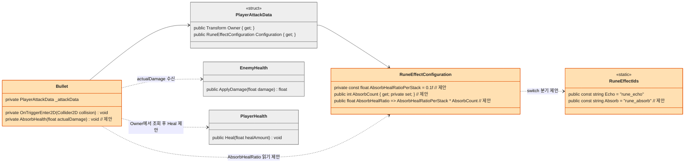
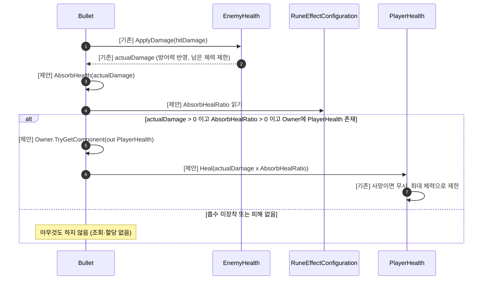

# 흡수(Absorb) 룬 — 기술 설계

> 상태: **설계 (미구현)** · 상세도 **Level 2** · 기준 브랜치 `feature/growth` · 작성일 2026-10-12
> 이 문서는 설계만 다룬다. 코드는 아직 구현하지 않았다. 표기 `제안`은 아직 코드에 없는 신규 요소이다.
> 룬 ID는 `rune_absorb`(Absorb, 흡수)이다.

## 1. 기능 개요

흡수(`rune_absorb`)는 `Control` 분류 룬이다. 탄환이 적에게 직접 적중해 피해를 줄 때마다, 실제로 가한 피해의 10%만큼 플레이어 체력을 회복한다. 중복 장착하면 회복 비율이 합산된다. 회복은 최대 체력을 넘지 않는다.

## 2. 구현 요구사항

### 기획서에서 확정된 규칙 (상세 기획 4-4, 4-6, 5-7)

| 항목 | 규칙 |
|---|---|
| 효과 | 적에게 명중 시 가한 피해의 10% 회복 |
| 분류 / 중복 | `Control` / 중복 가능 |
| 기준 / 시점 | 실제 Bullet Damage 기준 / 적중 시마다 적용 |
| 상한 | 회복은 최대 HP를 넘지 않음 (5-7) |
| 미정 | 소비량 (설계에 영향 없음) |

### 이번 설계에서 정한 사항 (사용자 승인 완료)

| # | 쟁점 | 결정 | 근거 |
|---|---|---|---|
| D1 | 회복량 기준 | **`EnemyHealth.ApplyDamage`가 반환하는 `actualDamage`** (방어력 반영, 남은 체력으로 제한) | "가한 피해"라는 문구와 일치. 이미 반환되는 값을 재사용 |
| D2 | 적용 범위 | **탄환 직접 적중만**. 화상·반응 장판 같은 지속 피해, Chain 대상의 반응 효과, 반복 발동은 제외 | 기획서 6-3이 흡수 발동 범위를 상세 설계 때 정하도록 남겨 둠. 지속 피해의 과도한 회복을 막음 |
| D3 | 중복 장착 | **회복 비율 합산**: `0.1 × 개수` (2개 = 20%) | 위력·가속·연장·반복의 개수 비례 방식과 일관 |
| D4 | 수치 위치 | 코드 상수 (`RuneEffectConfiguration`) | 룬 효과 CSV에 수치 컬럼이 없고 다른 룬도 코드 상수 |
| D5 | 적용 위치 | **`Bullet.OnTriggerEnter2D`에서 `ApplyDamage` 직후** 회복 | 실제 피해량과 `Owner`를 모두 가진 한 지점. 기존 `PlayHitFeedback` 호출과 같은 패턴 |

### 기존 구조에서 확인한 사실

- `Bullet.OnTriggerEnter2D`는 `float actualDamage = enemyHealth.ApplyDamage(hitDamage)`로 실제 피해량을 받고, `actualDamage > 0f && _attackData.Owner != null`일 때 `Owner.TryGetComponent(out PlayerAttack)`으로 `PlayHitFeedback`을 호출한다 ([Bullet.cs:162](../../../Assets/01_Scripts/Bullet/Bullet.cs)).
- `EnemyHealth.ApplyDamage`는 방어력을 반영한 피해를 `Mathf.Min(mitigatedDamage, 남은 체력)`으로 제한해 반환한다. 피해가 없거나 이미 사망했으면 0을 반환한다 ([EnemyHealth.cs:47](../../../Assets/01_Scripts/Enemy/EnemyHealth.cs)).
- `PlayerHealth.Heal(float)`가 이미 있다. 사망 상태나 0 이하의 값은 무시하고, 최대 체력을 넘지 않도록 제한한다 ([PlayerHealth.cs:122](../../../Assets/01_Scripts/Player/PlayerHealth.cs)). 기획의 상한 규칙이 이미 구현돼 있다.
- `EnemyHealth.OnDamageDealt`는 정적 이벤트라 피해 출처(탄환인지 화상인지)를 알 수 없어 흡수의 훅으로 쓸 수 없다. 이 때문에 D2와 D5를 정했다.
- 화상·반응 피해는 `EnemyHealth.TakeDamage`를 통하므로 `Bullet.OnTriggerEnter2D`의 `ApplyDamage` 반환값과 섞이지 않는다. `Bullet` 한 곳에서 처리하면 D2가 자연스럽게 지켜진다.
- 반복(Echo) 발동은 `ApplyElementEffectCore`만 호출하고 탄환 피해를 다시 주지 않으므로 흡수와 겹치지 않는다.
- `PlayerAttackData.Owner`는 `PlayerAttack`이 있는 `Transform`이다. `Player.prefab`에서 `PlayerHealth`와 `PlayerAttack`이 **같은 GameObject**에 붙어 있음을 확인했다. 따라서 `Owner.TryGetComponent(out PlayerHealth)`로 조회할 수 있다.
- `PlayerHealth`에는 회복 이벤트가 없지만 `PlayerHealthHudBinder`가 `LateUpdate`에서 `CurrentHealth`를 매 프레임 비교해 체력바를 갱신한다. 따라서 회복 후 HUD를 별도로 갱신할 필요가 없다.
- `OnTriggerEnter2D`는 대상 등록(`TryRegisterTarget`) 뒤에 실행되므로 한 탄환은 같은 적에게 한 번만 적중 처리된다. 흡수도 적 1마리당 탄환 1개당 최대 1회 적용된다.
- `rune_absorb`는 `RuneEffectText`, 아이콘 카탈로그, 상점 카탈로그에 이미 등록돼 있다. `RuneEffectIds`에만 없다.
- `RuneEffectPipeline` 계열 스탯 파이프라인은 폐기되었으므로 사용하지 않는다.

## 3. 구현 대상

| 파일 | 구분 | 책임 | 주요 멤버 / 수정 위치 | 변경 이유 |
|---|---|---|---|---|
| `Rune/RuneEffect/RuneEffectIds.cs` | 수정 | 룬 효과 ID 상수 | `Absorb = "rune_absorb"` 추가 | 장착 ID 식별 |
| `Rune/RuneEffect/RuneEffectConfiguration.cs` | 수정 | 장착 효과 집계 | `AbsorbHealRatioPerStack`(상수, 제안), `AbsorbCount`(제안), `AbsorbHealRatio`(제안), 생성자 `switch`에 `Absorb` 분기 | 회복 비율의 단일 원천 |
| `Bullet/Bullet.cs` | 수정 | 탄환 적중 처리 | `OnTriggerEnter2D`에서 `ApplyDamage` 직후 `AbsorbHealth(actualDamage)` 호출, `AbsorbHealth`(제안) | D5 |
| `PlayerHealth`, `EnemyHealth`, `PlayerAttackData`, `BulletHitEffects`, 반응 실행기 | 변경 없음 | — | — | 기존 `Heal`, `ApplyDamage`, `Owner`를 그대로 사용 |

## 4. 클래스 다이어그램

색: 회색 = 변경 없음, 주황 = 흡수 추가로 수정. 필드·프로퍼티는 실제 C# 선언 형태로 쓰고, 신규 멤버는 줄 끝 `// 제안` 주석으로 구분한다. 메서드는 Mermaid 표기(`이름(인자) : 반환형`)로 표시된다. `{ }`는 Mermaid 제약으로 `#123;`, `#125;` 코드로 입력한다.



## 5. 시퀀스 다이어그램

탄환 직접 적중 시 피해와 회복 흐름이다. 반응·Chain·반복 처리는 생략한다.



## 6. 상세 구현 절차 (Level 2)

Level 2이므로 멤버 선언에 더해 핵심 처리 로직, 데이터 흐름, 조건 분기, 클래스 간 연결 방법을 설명한다. `// 제안`은 아직 코드에 없는 신규 선언이고, `// 기존`은 현재 코드에 있는 선언이다.

### 구현 순서

| 순서 | 대상 | 작업 | 완료 조건 |
|---|---|---|---|
| 1 | `RuneEffectIds` | `Absorb` 상수 추가 | 상수가 컴파일되고 DB의 `rune_absorb` ID와 일치 |
| 2 | `RuneEffectConfiguration` | `AbsorbHealRatioPerStack`, `AbsorbCount`, `AbsorbHealRatio` 추가, 생성자 `switch`에 `Absorb` 분기 추가 | `rune_absorb` N개 장착 시 `AbsorbHealRatio == 0.1 × N`, 미장착 시 0 |
| 3 | `Bullet` | `AbsorbHealth` 추가, `OnTriggerEnter2D`의 `ApplyDamage` 직후 호출 | 적중 시 `actualDamage × 비율`만큼 회복, 미장착 시 동작·할당 변화 없음 |
| 4 | — | 7절 시나리오로 인게임 검증 | 모든 시나리오 통과 |

- 1→2→3 순서로 구현한다. 3은 2의 `AbsorbHealRatio`가 먼저 있어야 한다.

### 데이터 흐름

```text
장착 변경 → PlayerAttack.OnLoadoutChanged → new RuneEffectConfiguration(effects)
          → AbsorbCount = rune_absorb 개수, AbsorbHealRatio = 0.1 × AbsorbCount
발사     → PlayerAttackData.Configuration에 확정 (이후 장착을 바꿔도 날아간 탄환은 그대로)
적중     → actualDamage = EnemyHealth.ApplyDamage(hitDamage)      // 방어력·남은 체력 반영
          → healAmount = actualDamage × Configuration.AbsorbHealRatio
          → PlayerHealth.Heal(healAmount)                          // 사망 무시, 최대 체력 제한
표시     → PlayerHealthHudBinder.LateUpdate가 CurrentHealth 변화를 감지해 체력바 갱신
```

### 멤버 선언

**1. `Rune/RuneEffect/RuneEffectIds.cs` — 상수 추가**

```csharp
public const string Absorb = "rune_absorb"; // 제안
```

**2. `Rune/RuneEffect/RuneEffectConfiguration.cs` — 상수·프로퍼티 추가, 생성자 수정**

```csharp
private const float AbsorbHealRatioPerStack = 0.1f;                       // 제안
public int AbsorbCount { get; private set; }                              // 제안
public float AbsorbHealRatio => AbsorbHealRatioPerStack * AbsorbCount;    // 제안

public RuneEffectConfiguration(IReadOnlyList<RuneEffectDefinition> effects) // 기존: switch에 Absorb 분기 추가
```

**3. `Bullet/Bullet.cs` — 회복 호출 추가**

```csharp
private void OnTriggerEnter2D(Collider2D collision) // 기존: ApplyDamage 직후 AbsorbHealth(actualDamage) 호출 추가
private void AbsorbHealth(float actualDamage)       // 제안
```

변경 없음: `PlayerHealth`(이미 `Heal`이 최대 체력 제한과 사망 시 무시를 처리), `EnemyHealth`, `PlayerAttackData`, `BulletHitEffects`, 반응 실행기 10종.

### 핵심 처리 로직

**`RuneEffectConfiguration` (단계 2)**
- 기존 `PowerCount`, `SpeedCount`, `RangeCount`, `EchoCount`와 같은 방식이다. 생성자 `switch`의 `case RuneEffectIds.Absorb:`에서 `AbsorbCount += 1`을 한다.
- `AbsorbHealRatio`는 프로퍼티 계산식이다. 미장착이면 `0.1 × 0 = 0`이라 별도 분기 없이 "회복 없음"을 나타낸다. 호출 쪽이 이 값의 `0` 여부만 검사하면 된다.
- `RuneEffectConfiguration` 생성자는 Return·Orbit·Fix 상호 배타 검사를 이미 한다. 흡수는 어떤 룬과도 배타 관계가 없으므로 검사를 추가하지 않는다.

**`Bullet.OnTriggerEnter2D` 호출 지점 (단계 3)**
- 기존 코드에서 `float actualDamage = enemyHealth.ApplyDamage(hitDamage);` 다음 줄이 `PlayHitFeedback` 블록이다. 흡수 호출은 이 두 지점 사이 또는 `PlayHitFeedback` 블록 바로 뒤에 둔다. 둘은 독립적이라 순서는 중요하지 않지만, 둘 다 `try` 블록 안에 있어 `_processingHit` 보호를 받는다.
- 호출은 `ApplyElementEffect`·`ApplyChain` **앞**에서 한다. 이 두 호출이 반응 장판 생성이나 예외를 일으켜도 이미 확정된 탄환 피해에 대한 회복이 누락되지 않게 하기 위함이다.

**`Bullet.AbsorbHealth` 조건 분기 (단계 3)**
1. `actualDamage <= 0f`이면 반환한다. 이미 사망했거나 피해가 0인 경우다 (`ApplyDamage`가 0을 반환).
2. `_attackData.Configuration.AbsorbHealRatio <= 0f`이면 반환한다. 흡수 미장착 탄환은 여기서 끝나므로 컴포넌트 조회와 곱셈을 하지 않는다.
3. `_attackData.Owner`가 `null`이면 반환한다 (플레이어 오브젝트가 파괴된 경우).
4. `_attackData.Owner.TryGetComponent(out PlayerHealth playerHealth)`가 실패하면 반환한다.
5. `playerHealth.Heal(actualDamage * AbsorbHealRatio)`를 호출한다. 사망 상태 무시와 최대 체력 제한은 `Heal`이 처리하므로 `Bullet`에서 다시 검사하지 않는다.

`AbsorbHealth` 예시이다. 위 분기를 옮긴 메서드 전체 본문이며, 기존 `Bullet`의 필드(`_attackData`)를 가정한 참고용이라 컴파일 여부는 구현 시 확인한다:

```csharp
private void AbsorbHealth(float actualDamage)
{
    if (actualDamage <= 0f)
        return;

    float healRatio = _attackData.Configuration.AbsorbHealRatio;
    if (healRatio <= 0f)
        return;

    if (_attackData.Owner == null || !_attackData.Owner.TryGetComponent(out PlayerHealth playerHealth))
        return;

    playerHealth.Heal(actualDamage * healRatio);
}
```

### 클래스 간 연결

- `Bullet`은 이미 `_attackData`(발사 시 확정된 `Configuration`과 `Owner`)를 가지고 있다. 새 필드, 새 참조, 이벤트 구독이 필요 없다.
- `PlayerHealth`와의 연결은 호출 시점의 `TryGetComponent`뿐이다. `Bullet`이 `PlayerHealth`를 캐시하지 않는 이유는 한 탄환이 적중하는 횟수가 적고, 흡수 장착 탄환의 적중 시에만 조회하기 때문이다.
- `FireExtraShot`(보상 특성의 추가 탄환)도 같은 `Configuration`과 `Owner`를 복사하므로 별도 처리 없이 흡수가 적용된다. 이때 추가 탄환의 피해 배율(`damageScale`)이 반영된 `actualDamage`를 기준으로 회복한다.
- 반복(Echo)은 `ApplyElementEffectCore`만 호출하고 `ApplyDamage`를 호출하지 않으므로 흡수와 상호작용이 없다. Chain의 반응 효과도 `ApplyDamage`를 거치지 않는다.

### 구현 시 주의

- 회복량은 `float` 곱셈이라 부동소수 오차가 있을 수 있다. `PlayerHealth`가 `float`이므로 반올림하지 않는다.
- 매우 작은 회복(예: 0.1)도 그대로 더한다. 최소 회복량 보정은 기획에 없으므로 추가하지 않는다.
- 실제 피해가 `ApplyDamage` 안에서 사망 처리(`Destroy(gameObject)`)로 이어져도 반환값은 정상이므로 회복은 문제없이 계산된다.

## 7. 검증 시나리오

기본값: 탄환 피해 10, 방어력 0, 플레이어 최대 체력 100.

| 상황 | 절차 | 기대 결과 |
|---|---|---|
| 흡수 0개 | 흡수 없이 적중 | 체력 변화 없음 (현재와 동일) |
| 흡수 1개 | 체력 50에서 흡수 1개로 적중 | 피해 10 → 회복 1.0, 체력 51 |
| 흡수 2개 | 흡수 2개로 적중 | 비율 20% → 회복 2.0 (합산) |
| 방어력 반영 | 방어력 100인 적에게 적중 | 실제 피해 5 → 회복 0.5 |
| 초과 피해 | 체력 3인 적에게 피해 10 적중 | 실제 피해 3 → 회복 0.3 (마지막 일격의 초과분은 회복 안 됨) |
| 최대 체력 | 체력 99.5에서 회복 1.0 | 체력 100 (최대 체력 초과 안 함) |
| 만체력 | 체력 100에서 적중 | 체력 100 유지, 오류 없음 |
| 플레이어 사망 | 사망 상태에서 적중 | 회복 안 됨 (`Heal`이 무시) |
| 관통 | 흡수 + 관통, 적 3마리 관통 | 적중마다 회복, 회복량은 관통 감쇠가 반영된 실제 피해 기준 |
| 연사·확산 | 흡수 + 연사 또는 확산 | 각 탄환의 적중마다 개별 회복 |
| 지속 피해 제외 | 흡수 + 불(화상) 적중 후 화상 틱 | 최초 탄환 피해에서만 회복, 화상 틱으로는 회복 없음 |
| Chain 제외 | 흡수 + 연쇄 | 직접 적중 대상의 피해로만 회복, 연쇄 대상의 반응 효과로는 회복 없음 |
| 반복 제외 | 흡수 + 반복 | 반복 발동으로는 회복 없음 |
| 피해 없음 | 이미 사망한 적과 겹침 | `OnTriggerEnter2D` 초입에서 걸러져 회복 없음 |
| 합산 + 방어력 | 흡수 2개, 방어력 100인 적에게 피해 10 적중 | 실제 피해 5, 비율 20% → 회복 1.0 |
| 관통 계산 예 | 흡수 1개 + 관통, 적 3마리 연속 관통 (탄환 피해 10, 방어력 0) | 1마리 10 → 1.0, 2마리 9.5 → 0.95, 3마리 9.0 → 0.9 (관통 감쇠 5%씩 반영) |
| 같은 적 재적중 | 한 탄환이 같은 적과 다시 겹침 | `TryRegisterTarget`으로 걸러져 회복 한 번만 적용 |
| 추가 탄환 | 보상 특성 `FireExtraShot`(피해 배율 0.5) + 흡수 | 추가 탄환의 실제 피해 5 → 회복 0.5 |
| 장착 변경 | 비행 중 흡수 해제 | 이미 날아간 탄환은 발사 시 확정된 비율로 회복 |
| HUD 갱신 | 체력 50에서 회복 후 체력바 확인 | 다음 `LateUpdate`에 체력바 갱신 (별도 갱신 코드 불필요) |
| 미장착 회귀 | 흡수 없이 연사·확산·관통 전투 | 체력과 성능이 기존과 동일 (`TryGetComponent` 호출 없음) |

## 8. 설계 결정, 제약 및 미결 사항

- **적용 위치 (D5)와 대안**

| 안 | 내용 | 판단 |
|---|---|---|
| **A (채택)** | `Bullet.OnTriggerEnter2D`의 `ApplyDamage` 직후에 회복 | 실제 피해량과 `Owner`를 모두 가진 한 지점. 피해 출처가 탄환 직접 적중으로 한정됨 |
| B | `EnemyHealth.OnDamageDealt` 정적 이벤트 구독 | 피해 출처를 알 수 없어 화상·반응 피해로도 회복됨. D2 위반 |
| C | `PlayerAttack`이 회복을 맡고 `Bullet`은 위임 | `PlayHitFeedback`처럼 위임 가능하나 `PlayerAttack`에 룬 효과 처리가 늘어남. 이번에는 불필요 |

- **회복 계산을 `Configuration`에 두는 이유**: 위력·가속·연장·반복과 같은 방식으로 개수 집계와 배율을 `RuneEffectConfiguration` 한 곳에 모은다. 곱하는 지점만 `Bullet` 한 곳이다.
- **초과 피해는 회복되지 않는다 (D1의 결과)**: 마지막 일격이 남은 체력보다 클 때 초과분은 회복에 포함되지 않는다. 기획의 "가한 피해" 해석에 따른 것이며, 방어 전 탄환 피해로 바꾸려면 D1을 다시 정해야 한다.
- 회복은 탄환이 적중한 프레임에 즉시 적용되며 장착 변경 후 다음 발사부터 반영된다 (`PlayerAttackData`가 발사 시 확정).
- **미결 (확인 필요)**
  - `PlayerAttackData.Owner`와 같은 오브젝트에 `PlayerHealth`가 있다는 가정은 `Player.prefab`에서 확인했다 (해결). 씬에 따라 다른 구성이 있다면 `TryGetComponent` 실패 시 조용히 건너뛰므로 오류는 나지 않는다.
  - 소비량은 기획서에서 `[미정]`이다. 설계에는 영향이 없다.
  - 6-3의 "화상 지속 피해를 적중으로 취급할지" 미정 항목은 이번 설계에서 "취급하지 않음(D2)"으로 정했다. 기획서에도 반영할지 결정이 필요하다.
- **제외 범위**: 지속 피해·Chain·반복에서의 회복, 회복 연출(수치 표시, 이펙트), 회복량 상한 조정.
- 관련 없는 참고: `BulletBackup`에도 `ApplyDamage`가 있으나 사용되지 않는 백업 경로이므로 건드리지 않는다.
