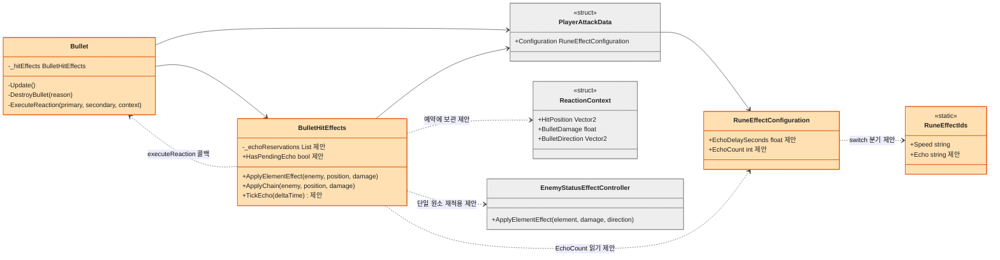
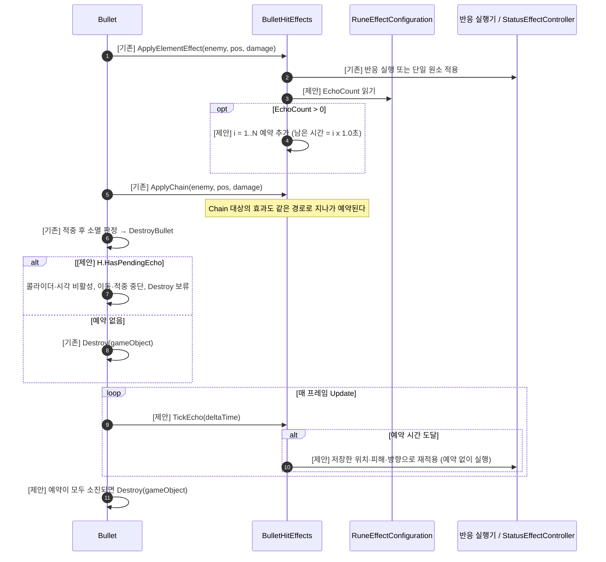
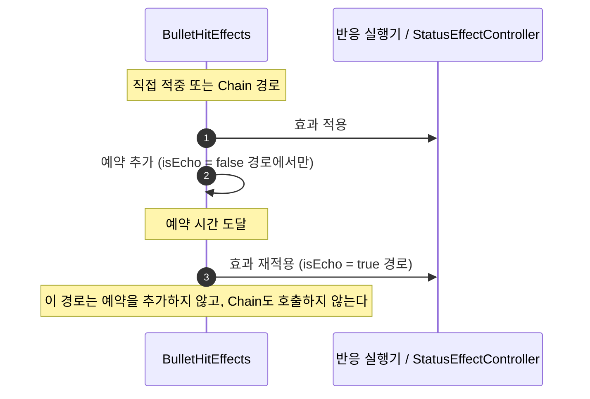

# 반복(Echo) 룬 — 기술 설계

> 상태: **설계 (미구현)** · 상세도 **Level 1** · 기준 브랜치 `feature/growth` · 작성일 2026-10-12
> 이 문서는 설계만 다룬다. 코드는 아직 구현하지 않았다. 표기 `제안`은 아직 코드에 없는 신규 요소이다.
> 룬 ID는 `rune_echo`(Echo)이다. 기획서 4-4의 표시명은 "반복", 4-6의 표시명은 "반향"으로 달라 표기 통일이 필요하다 (8절 참고).

## 1. 기능 개요

반복(`rune_echo`)은 `Special` 분류 룬이다. 탄환이 적중해 원소 효과나 원소 반응이 발생하면, 일정 시간 뒤 **같은 효과를 같은 위치에 1회 추가로 발동**한다. 탄환이 이미 사라졌어도 예약된 발동은 유지된다. 중복 장착하면 장착 개수만큼 추가 발동한다.

## 2. 구현 요구사항

### 기획서에서 확정된 규칙 (상세 기획 4-3-4, 4-4, 4-6)

| 항목 | 규칙 |
|---|---|
| 효과 | 원소 반응 발생 후 일정 시간 뒤 동일한 원소 반응을 1회 추가 발동 |
| 분류 / 중복 | `Special` / 중복 가능 |
| Chain 연동 | Chain으로 발생한 원소 반응도 반복 가능 |
| 재귀 금지 | 반복으로 발생한 반응은 반복·Chain을 다시 발동하지 않음 |
| 수명 | 원본 Bullet의 생존 여부와 무관하게 예약 시점에 발동 |
| 미정 | 추가 발동까지의 시간, 소비량 (4-4 "확인 필요") |

### 이번 설계에서 정한 사항 (사용자 승인 완료)

| # | 쟁점 | 결정 | 근거 |
|---|---|---|---|
| D1 | 지연 시간 | **1.0초** (코드 상수) | 기획서 미정. 반응 장판 지속(약 3초) 안에서 재발동이 보이는 길이 |
| D2 | 적용 범위 | **단일 원소 효과 + 2원소 반응** | 원소 1개만 장착해도 룬이 무효가 되지 않음. Chain과 같은 범위 |
| D3 | 중복 장착 | **개수 N → 추가 발동 N회, i번째는 i × 1.0초 뒤** | 위력·가속·연장의 개수 비례 방식과 일관 |
| D4 | 예약 수명 | **탄환 파괴 지연**: 예약이 남은 탄환은 숨긴 채 유지했다가 발동 후 파괴 | 반응 실행기가 탄환 프리팹의 컴포넌트라 탄환과 함께 파괴됨. 기존 컴포넌트를 그대로 쓰는 최소 변경 |
| D5 | 반복의 입력값 | 적중 당시의 **위치·피해·방향을 그대로 재사용** | "동일한 원소 반응" 규칙 |
| D6 | 수치 위치 | 코드 상수 (`RuneEffectConfiguration`) | 룬 효과 CSV에 수치 컬럼이 없음 |

### 기존 구조에서 확인한 사실

- 원소 효과는 `Bullet.OnTriggerEnter2D`에서 `BulletHitEffects.ApplyElementEffect`로 발생한다. 두 원소면 `ExecuteReaction`, 한 원소면 `EnemyStatusEffectController.ApplyElementEffect`를 호출한다 ([Bullet.cs:154](../../../Assets/01_Scripts/Bullet/Bullet.cs), [BulletHitEffects.cs:32](../../../Assets/01_Scripts/Bullet/BulletHitEffects.cs)).
- Chain(`ApplyChain`)도 같은 private `ApplyElementEffect`를 호출한다 ([BulletHitEffects.cs:78](../../../Assets/01_Scripts/Bullet/BulletHitEffects.cs)). 이 지점에 예약을 넣으면 Chain 반응도 자동으로 반복 대상이 된다.
- 반응 실행기 10종(`SteamReaction` 등)은 `Bullet` 프리팹에 붙은 `MonoBehaviour`이고, 장판은 각자 독립 프리팹으로 생성된다 ([Bullet.cs:11-20](../../../Assets/01_Scripts/Bullet/Bullet.cs)). 탄환이 `Destroy`되면 실행기도 함께 사라진다.
- `Bullet.Ended` 이벤트의 외부 구독자는 없다. 따라서 `Ended` 발행 시점은 그대로 두어도 영향이 없다.
- `PlayerAttackData.Configuration`은 발사 시점에 확정된다. 따라서 `EchoCount`도 발사 후 장착을 바꿔도 날아가는 탄환에는 반영되지 않는다.
- `rune_echo`는 아이콘 카탈로그, 상점 카탈로그, `RuneEffectText`에 이미 등록돼 있다. `RuneEffectIds`에만 없다.
- `RuneEffectPipeline` 계열 스탯 파이프라인은 폐기되었으므로 사용하지 않는다.

## 3. 구현 대상

| 파일 | 구분 | 책임 | 주요 멤버 / 수정 위치 | 변경 이유 |
|---|---|---|---|---|
| `Rune/RuneEffect/RuneEffectIds.cs` | 수정 | 룬 효과 ID 상수 | `Echo = "rune_echo"` 추가 | 장착 ID 식별 |
| `Rune/RuneEffect/RuneEffectConfiguration.cs` | 수정 | 장착 효과 집계 | `EchoDelaySeconds`(상수 1f, 제안), `EchoCount`(제안), 생성자 `switch`에 `Echo` 분기 | 반복 개수·지연의 단일 원천 |
| `Bullet/BulletHitEffects.cs` | 수정 | 원소 효과 적용, 반복 예약·진행 | 예약 목록(제안), `HasPendingEcho`(제안), `TickEcho(deltaTime)`(제안), 효과 적용부를 "적용"과 "예약"으로 분리 | 모든 원소 효과(직접 적중·Chain)가 지나가는 한 지점 |
| `Bullet/Bullet.cs` | 수정 | 탄환 수명 | `Update`에서 `TickEcho` 호출, `DestroyBullet`에서 예약이 남았으면 지연 파괴(제안) | D4 |
| `ReactionContext`, 반응 실행기 10종, `EnemyStatusEffectController`, `BulletMovement`, `PlayerAttack`, `PlayerAttackData` | 변경 없음 | — | — | 기존 호출 경로를 그대로 재사용 |

## 4. 클래스 다이어그램

색: 회색 = 변경 없음, 주황 = 반복 추가로 수정. 신규 멤버는 `제안`으로 표기한다.

## 5. 시퀀스 다이어그램

### 5-1. 적중 시 예약 → 탄환 파괴 지연 → 반복 발동

핵심 호출만 표시한다. 반응 내부 계산과 장판 생성은 생략한다.

### 5-2. 재귀 방지

## 6. 상세 구현 절차 (Level 1)

| 순서 | 작업 | 완료 조건 |
|---|---|---|
| 1 | `RuneEffectIds`에 `Echo = "rune_echo"` 추가 | 상수가 컴파일되고 DB의 `rune_echo` ID와 일치 |
| 2 | `RuneEffectConfiguration`에 `EchoDelaySeconds`(1f), `EchoCount`, `switch` 분기 추가 | `rune_echo` N개 장착 시 `EchoCount == N` |
| 3 | `BulletHitEffects`: 효과 적용 로직을 "예약 없이 적용"하는 내부 메서드와 "적용 후 예약"하는 기존 진입점으로 분리하고, 예약 목록·`HasPendingEcho`·`TickEcho`를 추가 | 직접 적중·Chain은 예약하고, 반복 발동은 예약·Chain을 호출하지 않음 |
| 4 | `Bullet.Update`에서 `TickEcho(Time.deltaTime)` 호출. 초기화 전·지연 파괴 상태에서도 틱이 돌도록 순서를 조정 | 비행 중과 지연 파괴 중 모두 예약이 진행됨 |
| 5 | `Bullet.DestroyBullet`: 예약이 남았으면 콜라이더·스프라이트·`_projectileVisual`을 끄고 `Destroy`를 보류. 소진되면 `Destroy` | 예약이 있는 탄환이 숨은 채 유지되다가 발동 후 제거됨. 예약이 없으면 기존과 동일 |
| 6 | 7절 시나리오로 인게임 검증 | 모든 시나리오 통과 |

- 1→2→3→4→5 순서로 구현한다. 3·4·5는 서로 맞물리므로 한 묶음으로 완성한 뒤 검증한다.
- 예약 목록은 `EchoCount > 0`일 때만 할당한다. 평소(반복 미장착) 추가 할당은 없다.
- 예약 항목은 남은 시간, 대상 `EnemyHealth`(단일 원소용), 위치, 피해, 방향을 가진다. 두 원소 반응은 `ReactionContext`로 저장한다.

## 7. 검증 시나리오

기본값: 탄환 피해 10, 지연 1.0초. 불 + 물(증기, 틱 피해 = 탄환 피해 × 0.2 = 2).

| 상황 | 절차 | 기대 결과 |
|---|---|---|
| 반복 0개 | 반복 없이 불+물 적중 | 증기 장판 1개 (현재와 동일), 탄환 즉시 파괴 |
| 2원소 반응 1개 | 반복 1개 + 불+물 적중 | 적중 즉시 증기, 1.0초 뒤 같은 위치에 증기 1개 추가 (틱 피해 2) |
| 단일 원소 | 반복 1개 + 불만 장착, 적중 | 즉시 화상, 1.0초 뒤 화상 재적용 (지속 시간 갱신) |
| 중복 2개 | 반복 2개 + 불+물 적중 | 증기 즉시, 1.0초 뒤, 2.0초 뒤 총 3회 |
| 탄환 소멸 후 발동 | 반복 1개, 적중 직후 탄환이 소멸하는 단발 | 탄환은 보이지 않지만 1.0초 뒤 반응이 발동하고 오브젝트 제거 |
| Chain 연동 | 반복 + 연쇄, 적 2마리 근접 | 직접 적중 대상과 Chain 대상의 반응이 각각 1회씩 반복 |
| 재귀 금지 | 반복 + 연쇄 | 반복 발동은 새 반복·Chain을 만들지 않음 (총 발동 횟수가 늘어나지 않음) |
| 관통 | 반복 + 관통, 적 3마리 관통 | 적중마다 반응과 반복 예약이 각각 생성, 탄환은 비행을 계속 |
| 대상 사망 | 반복 + 불만 장착, 1.0초 안에 적 처치 | 단일 원소 반복은 건너뜀 (오류 없음). 2원소 반응은 위치 기준이라 정상 발동 |
| 장착 변경 | 비행 중 반복 해제 | 이미 날아간 탄환은 발사 시점 구성 그대로 반복 |
| 회귀·궤도 | 반복 + 회귀/궤도 | 이동 방식과 무관하게 적중마다 예약, 정상 발동 |
| 씬 전환 | 예약이 남은 상태로 씬 이동 | 오브젝트 정리 시 예외 없음 (예약은 소실되어도 됨) |

## 8. 설계 결정, 제약 및 미결 사항

- **예약 수명 (D4)과 검토한 대안**

| 안 | 내용 | 판단 |
|---|---|---|
| **A (채택)** | 예약이 남은 탄환의 파괴를 지연 | 반응 실행기를 그대로 쓰고 수정 파일이 `Bullet`, `BulletHitEffects` 2개로 한정됨 |
| B | 씬 상주 `EchoScheduler` 신설 | 실행기가 탄환 프리팹에 붙어 있어 컴포넌트를 탄환 밖으로 분리해야 함. 변경이 큼 |

- **A안의 단점**: 숨은 탄환 오브젝트가 최대 `N × 1.0초` 동안 남는다. 관통 탄환이 적중마다 예약해도 탄환은 하나이므로 오브젝트 수는 늘지 않는다.
- **`Ended` 이벤트**: 지연 파괴 상태로 들어갈 때 기존처럼 `DestroyBullet` 시점에 발행한다. 현재 외부 구독자가 없어 영향이 없다.
- **미결 (기획 확인 필요)**
  - 지연 시간 1.0초와 중복 시 배수 방식은 이번 설계에서 정한 값이며 기획서에는 없다. 밸런스 조정 시 `EchoDelaySeconds` 한 곳만 바꾸면 된다.
  - 단일 원소 반복을 포함한 범위(D2)는 기획서의 "원소 반응" 표현을 넓게 해석한 것이다. 기획 확정 시 조정이 필요할 수 있다.
  - 룬 표시명이 기획서 4-4 "반복", 4-6 "반향"으로 다르다. UI 문구(`RuneEffectText`)와 맞춰 통일해야 한다.
  - 소비량은 기획서에서 `[미정]`이다. 설계에는 영향이 없다.
- **제외 범위**: 반복 발동 전용 연출(색 변화 등), 반복 발동 시 적중 이펙트 재생, 반응별 지연 시간 개별 설정.
- 관련 없는 참고: `BulletBackup`에도 `ApplyChain`이 있으나 사용되지 않는 백업 경로이므로 건드리지 않는다.
