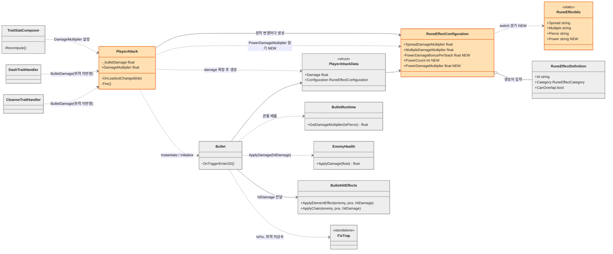
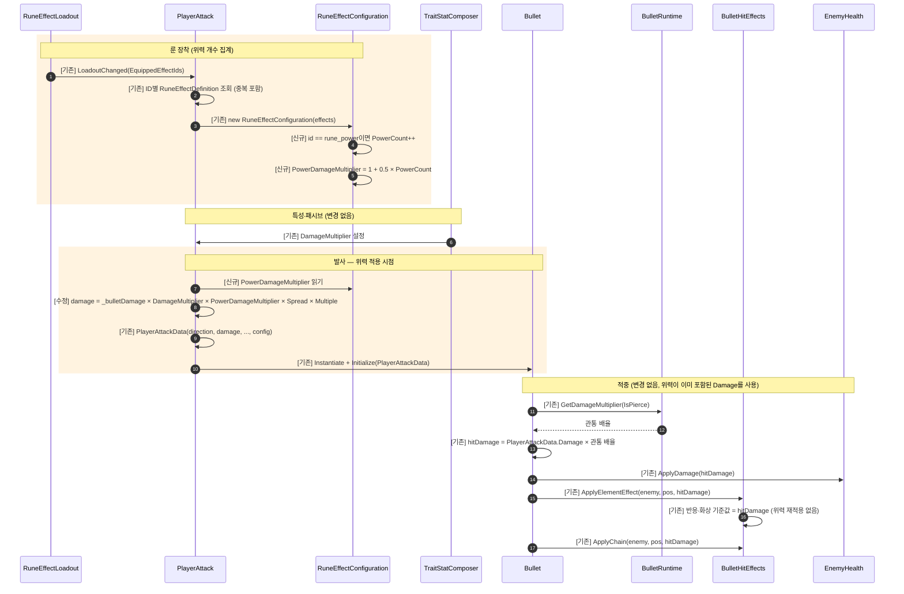

# 위력(Power) 룬 — 설계 및 구현

> 상태: **구현됨 (Unity 인게임 검증 전)** · 기준 브랜치 `feature/growth` · 작성일 2026-10-12
> 구현 위치: `RuneEffectIds.Power`, `RuneEffectConfiguration.PowerCount` / `PowerDamageMultiplier`, `PlayerAttack.Fire()`. 아래 다이어그램의 `NEW`·`[신규]`·`[수정]`은 위력 추가로 생긴 변경을 뜻한다.

## 0. 범위와 근거

### 기획서 규칙 (상세 기획 4-4, 4-6, 6-2, 6-3-2)

| 항목 | 규칙 |
|---|---|
| 효과 | 탄환의 최종 피해량이 +50% 증가 |
| 분류 / 중복 | `Enhancement` / 중복 가능 |
| 제외 | Fix의 Trap에는 효과를 상속하지 않음 |
| 파생 피해 | 위력이 적용된 최종 피해량을 파생 피해(화상 등)의 기준으로 사용하고, 위력을 파생 피해에 다시 곱하지 않음 |

### 구현 전 기존 구조에서 확인한 사실

- 장착 변경 시 `PlayerAttack.OnLoadoutChanged`가 `RuneEffectConfiguration`을 새로 생성한다. 장착 ID 중복을 포함해 `RuneEffectDefinition` 목록을 그대로 넘긴다 ([PlayerAttack.cs:200](../../../Assets/01_Scripts/Player/PlayerAttack.cs)).
- 확산·연사 피해 배율은 `RuneEffectConfiguration`에 상수로 있고, `PlayerAttack.Fire`가 곱한다 ([PlayerAttack.cs:232](../../../Assets/01_Scripts/Player/PlayerAttack.cs)).
- 룬 효과 CSV에는 수치 컬럼이 없다 (`RuneEffectCsvHeader`). 수치는 코드 상수이다.
- 발사 시 확정된 `PlayerAttackData.Damage`가 `Bullet`의 적중 피해, 원소 효과·반응(`ReactionContext`), Chain으로 그대로 전달된다.
- `FixTrap`은 `PlayerAttackData`를 받지 않는 독립 객체이다.
- `rune_power`는 아이콘 카탈로그, 상점 카탈로그, 룬 효과 설명 텍스트에 이미 등록돼 있다. 피해 처리 코드는 구현 전에는 없었다.
- `RuneEffectPipeline`, `ProgressSceneBinder`, `PlayerCombatStats` 계열 스탯 파이프라인은 폐기되었으므로 사용하지 않는다.

## 1. 결정 사항

| # | 쟁점 | 결정 | 근거 |
|---|---|---|---|
| D1 | 위력 2개 이상 장착 시 계산 | **합산**: `1 + 0.5 × 개수` (2개 = 2.0배) | 6-2의 Percent 합산 규칙과 일치 |
| D2 | 대시·정화 특성 피해 반영 | **반영 안 함** | 기획서가 탄환 피해로 한정, 변경 범위 최소화 |
| D3 | +50% 수치 위치 | **코드 상수** (`RuneEffectConfiguration`) | 확산·연사와 동일 방식, CSV 구조 변경 불필요 |
| D4 | 특성·패시브 `DamageMultiplier`와의 결합 | **별도 배율로 곱** | 기존 계산 경로 유지, `TraitStatComposer` 변경 없음 |

### 미결 (이번 설계에 영향 없음, 후속 확인)

| 쟁점 | 선택지 | 추천 |
|---|---|---|
| 위력 최대 장착 수 | 슬롯 수가 상한 / 별도 상한 | 슬롯 수가 상한 (별도 규정 없음) |

## 2. 클래스 다이어그램

범례: 회색 = 변경 없음, 주황 = 위력 추가로 수정된 클래스, `NEW` = 위력 추가로 생긴 멤버. **새 클래스는 만들지 않았다.**



### 클래스별 책임과 변경 구분

| 클래스 | 구분 | 책임 / 변경 |
|---|---|---|
| `RuneEffectIds` | 수정 | `Power = "rune_power"` 상수 1개 추가 |
| `RuneEffectConfiguration` | 수정 | 위력 개수 집계 (`PowerCount`), 배율 노출 (`PowerDamageMultiplier = 1 + 0.5 × PowerCount`), 보너스 상수 보관 |
| `PlayerAttack` | 수정 | `Fire()`의 피해 계산식에 `PowerDamageMultiplier` 곱셈 1항 추가 |
| `RuneEffectDefinition`, `RuneEffectLoadout` | 재사용 | 변경 없음. `CanOverlap`·중복 장착은 기존 처리 그대로 |
| `PlayerAttackData`, `Bullet`, `BulletRuntime`, `BulletHitEffects`, `ReactionContext`, `EnemyHealth` | 재사용 | 변경 없음. 확정된 `Damage`가 이미 모든 하류에 전달됨 |
| `FixTrap` | 재사용 | 변경 없음. 탄환 데이터를 받지 않아 위력이 상속되지 않음 |
| `TraitStatComposer`, `DashTraitHandler`, `CleanseTraitHandler` | 재사용 | 변경 없음 (D2, D4) |

### 데이터 흐름

```
RuneEffectDefinition[] ─▶ RuneEffectConfiguration (PowerCount 집계)
                                   │ PowerDamageMultiplier
                                   ▼
_bulletDamage × DamageMultiplier × PowerDamageMultiplier × Spread × Multiple
                                   │
                                   ▼
                      PlayerAttackData.Damage (발사 시 확정)
                                   │
              Bullet: × 관통 배율 = hitDamage
                                   │
        ┌──────────────┬───────────┴────────────┐
   ApplyDamage    ApplyElementEffect          ApplyChain
                  (반응·화상 기준값)
```

## 3. 시퀀스 다이어그램

범례: `[기존]` = 변경 없는 호출, `[수정]` = 위력 추가로 내용이 바뀐 호출, `[신규]` = 위력 추가로 생긴 호출·판정.



### 책임 정리

| 질문 | 담당 |
|---|---|
| 위력 개수를 세는 곳 | `RuneEffectConfiguration` (생성 시점, 장착 변경마다 재생성) |
| 위력 배율을 아는 곳 | `RuneEffectConfiguration.PowerDamageMultiplier` |
| 피해량에 곱하는 곳 | `PlayerAttack.Fire()` (발사 시 1회) |
| 적중 이후 | 변경 없음. 확정된 `Damage`가 전파됨 |

## 4. 설계 효과와 범위 점검

| 요구 | 충족 방식 |
|---|---|
| 최종 피해량 +50% | 발사 피해에 `1.5`배 (D1: 개수에 따라 합산) |
| 중복 가능 | 장착 목록의 `rune_power` 개수만큼 `PowerCount` 증가 |
| 파생 피해에 재적용 금지 | 발사 시 1회만 곱하고 하류는 `hitDamage`를 그대로 사용 |
| Fix Trap 미상속 | `FixTrap`이 탄환 데이터를 받지 않는 현재 구조가 이미 충족 |
| 불필요한 추상화 지양 | 신규 클래스 0개, 수정 3개 파일 (`RuneEffectIds`, `RuneEffectConfiguration`, `PlayerAttack`) |

### 알려진 제약

- 위력은 `DamageMultiplier`(특성·패시브)와 **곱**이다 (D4). 기획서 6-2의 "Percent는 하나의 합으로 합산" 규칙과는 구조상 다르다. 추후 비율 합산 구조로 통합하게 되면 위력 항도 함께 이전해야 한다.
- 위력이 장착된 상태에서 대시·정화 특성 피해는 오르지 않는다 (D2).
- `ApplyChain`이 연쇄 대상에게 `hitDamage`를 그대로 전달하는 현재 동작(기획서의 50% 배율과 다름)은 이 설계 범위가 아니다.

## 5. 검증 기준 (인게임 확인 필요)

기본 피해 `_bulletDamage = 10`, `DamageMultiplier = 1` 기준.

| 상황 | 기대 `PlayerAttackData.Damage` / 적중 피해 |
|---|---|
| 위력 0개 | 10 |
| 위력 1개 | 15 |
| 위력 2개 | 20 |
| 위력 1개 + 확산 | 발당 7.5 (3발) |
| 위력 1개 + 연사 | 발당 9 (2회) |
| 위력 1개 + 관통 | 적중 15, 이후 15×0.95, 15×0.90 … |
| 위력 1개 + 불 | 적중 15, 화상 틱 15×20% = 3 (위력 재적용 없음) |
| 위력 1개 + 고정 | Trap에 위력 미반영 |
| 위력 1개 + `DamageMultiplier` 1.2 | 10×1.2×1.5 = 18 |
| 위력 장착 해제 | 다음 발사부터 10으로 복귀 |
