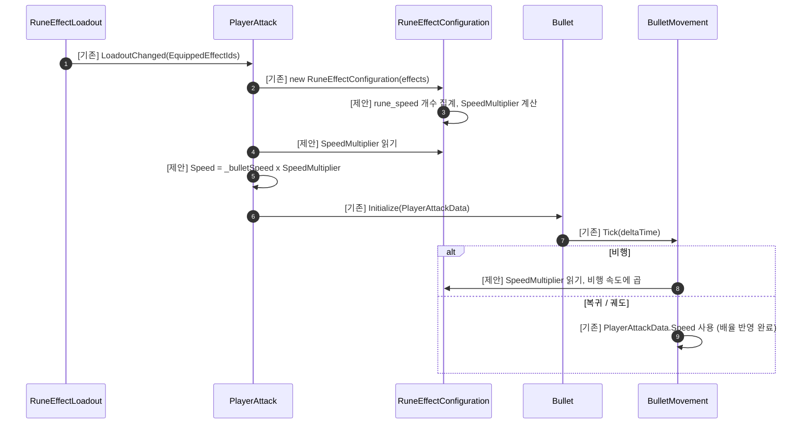

# 가속(Speed) 룬 — 기술 설계

> 상태: **설계 (미구현)** · 상세도 **Level 1** · 기준 브랜치 `feature/growth` · 작성일 2026-10-12
> 이 문서는 설계만 다룬다. 코드는 아직 구현하지 않았다. 표기 `제안`은 아직 코드에 없는 신규 요소이다.

## 1. 기능 개요

가속(`rune_speed`)은 탄환 속도를 +50% 올리는 Enhancement 룬이다. 중복 장착이 가능하며, Orbit 상태의 회전 속도도 함께 증가한다. 장착 후 다음 발사부터 탄환이 비행·복귀·궤도 모든 구간에서 더 빠르게 움직인다.

## 2. 구현 요구사항

### 기획서에서 확정된 규칙 (상세 기획 4-4, 4-6, 6-2)

| 항목 | 규칙 |
|---|---|
| 효과 | 탄환 속도 +50% |
| 분류 / 중복 | `Enhancement` / 중복 가능 |
| Orbit | 회전 속도도 증가 |
| 수치 분류 | `Speed +50%`는 별도 최종 배율 지정이 없으므로 `Percent`로 분류 (6-2) |

### 이번 설계에서 정한 사항

| # | 쟁점 | 결정 | 근거 |
|---|---|---|---|
| D1 | 중복 계산 | **합산**: `1 + 0.5 × 개수` (2개 = 2.0배) | 6-2의 Percent 합산 규칙, 위력 룬과 동일 |
| D2 | 비행 속도 적용 | **`BulletMovement`가 `Configuration.SpeedMultiplier`를 비행 속도에 곱함**. 복귀·궤도는 `PlayerAttackData.Speed`에 배율을 곱해 반영 | 속도가 두 갈래(아래 참고)라 한 곳만 바꾸면 누락됨 |
| D3 | +50% 수치 위치 | **코드 상수** (`RuneEffectConfiguration`) | 룬 효과 CSV에 수치 컬럼이 없고 위력·확산도 코드 상수 |

### 기존 구조에서 확인한 사실

- **탄환 속도가 두 갈래이다.**
  - 비행(Flying): `Bullet`의 프리팹 필드 `_startSpeed`(20) → `_endSpeed`(10)를 `BulletMovement.MoveFlyingInDirection`이 거리 진행도로 보간한다 ([BulletMovement.cs:89](../../../Assets/01_Scripts/Bullet/BulletMovement.cs)).
  - 복귀·궤도·반전 직후 복귀 보정: `PlayerAttackData.Speed`(`PlayerAttack._bulletSpeed`=5)를 쓴다 ([BulletMovement.cs:155, 165, 197](../../../Assets/01_Scripts/Bullet/BulletMovement.cs)).
- 따라서 `_bulletSpeed`에만 배율을 곱하면 비행 속도는 오르지 않는다.
- `BulletMovement`는 이미 `PlayerAttackData`를 보유하며 `PlayerAttackData.Configuration`으로 `RuneEffectConfiguration`에 접근한다.
- `PlayerAttack.FireExtraShot`는 `_attackData.Speed`를 복사하므로 `PlayerAttackData.Speed`에 배율이 반영되면 추가 탄환도 자동으로 일관된다.
- 궤도 접선 속도는 `Speed × deltaTime / OrbitRadius`로 각도를 갱신하므로 `Speed`가 오르면 회전 속도가 오른다 ([BulletMovement.cs:197-199](../../../Assets/01_Scripts/Bullet/BulletMovement.cs)).
- `FixTrap`은 탄환 데이터를 받지 않는 독립 객체이다. 가속은 Fix 탄환의 최대 사거리까지의 비행에만 영향을 준다.
- `rune_speed`는 아이콘·상점 카탈로그에 이미 등록돼 있다.
- `RuneEffectPipeline` 계열 스탯 파이프라인은 폐기되었으므로 사용하지 않는다.

## 3. 구현 대상

| 파일 | 구분 | 책임 | 주요 멤버 / 수정 위치 | 변경 이유 |
|---|---|---|---|---|
| `Rune/RuneEffect/RuneEffectIds.cs` | 수정 | 룬 효과 ID 상수 | `Speed = "rune_speed"` 추가 | 장착 ID 식별 |
| `Rune/RuneEffect/RuneEffectConfiguration.cs` | 수정 | 장착 효과 집계 | `SpeedBonusPerStack`(상수, 제안), `SpeedCount`(제안), `SpeedMultiplier = 1 + 0.5 × SpeedCount`(제안), 생성자 `switch`에 `Speed` 분기 | 배율의 단일 원천 |
| `Player/PlayerAttack.cs` | 수정 | 발사 데이터 확정 | `Fire()`에서 `PlayerAttackData`에 넘기는 속도를 `_bulletSpeed × SpeedMultiplier`로 변경 | 복귀·궤도·반전 속도 반영 |
| `Bullet/BulletMovement.cs` | 수정 | 탄환 이동 | `MoveFlyingInDirection`의 `speed`에 `_attackData.Configuration.SpeedMultiplier` 곱셈 | 비행 속도 반영 |
| `PlayerAttackData`, `Bullet`, `BulletRuntime`, `FireExtraShot` | 변경 없음 | — | — | 이미 확정된 `Speed`를 그대로 사용 |

## 4. 클래스 다이어그램

색: 회색 = 변경 없음, 주황 = 가속 추가로 수정. 신규 멤버는 `제안`으로 표기한다.

```mermaid
classDiagram
    direction LR

    class RuneEffectIds {
        <<static>>
        +Power string
        +Speed string 제안
    }
    class RuneEffectConfiguration {
        +PowerDamageMultiplier float
        -SpeedBonusPerStack float 제안
        +SpeedCount int 제안
        +SpeedMultiplier float 제안
    }
    class PlayerAttack {
        -_bulletSpeed float
        -Fire()
    }
    class PlayerAttackData {
        <<struct>>
        +Speed float
        +Configuration RuneEffectConfiguration
    }
    class Bullet {
        -_startSpeed float
        -_endSpeed float
    }
    class BulletMovement {
        -MoveFlyingInDirection(deltaTime)
        -MoveReturning()
        -MoveOrbiting()
    }

    RuneEffectConfiguration ..> RuneEffectIds : switch 분기 제안
    PlayerAttack --> RuneEffectConfiguration : 장착 변경마다 생성
    PlayerAttack ..> PlayerAttackData : Speed = _bulletSpeed x SpeedMultiplier 제안
    PlayerAttackData --> RuneEffectConfiguration
    PlayerAttack ..> Bullet : Instantiate / Initialize
    Bullet ..> BulletMovement : 생성, _startSpeed/_endSpeed 전달
    BulletMovement --> PlayerAttackData
    BulletMovement ..> RuneEffectConfiguration : 비행 속도에 SpeedMultiplier 곱 제안

    style PlayerAttackData fill:#eeeeee,stroke:#888,color:#222
    style Bullet fill:#eeeeee,stroke:#888,color:#222
    style RuneEffectIds fill:#ffe0b2,stroke:#e65100,color:#222
    style RuneEffectConfiguration fill:#ffe0b2,stroke:#e65100,color:#222
    style PlayerAttack fill:#ffe0b2,stroke:#e65100,color:#222
    style BulletMovement fill:#ffe0b2,stroke:#e65100,color:#222
```

## 5. 시퀀스 다이어그램

핵심 호출만 표시한다. 비행 보간, 이동량 제한, 궤도 각도 계산 같은 내부 계산은 생략한다.

## 6. 상세 구현 절차 (Level 1)

| 순서 | 작업 | 완료 조건 |
|---|---|---|
| 1 | `RuneEffectIds`에 `Speed = "rune_speed"` 추가 | 상수가 컴파일되고 `rune_speed`가 DB ID와 일치 |
| 2 | `RuneEffectConfiguration`에 `SpeedBonusPerStack`(0.5f), `SpeedCount`, `SpeedMultiplier`와 `switch` 분기 추가 | `rune_speed` N개 장착 시 `SpeedMultiplier == 1 + 0.5 × N` |
| 3 | `PlayerAttack.Fire()`에서 `PlayerAttackData`의 속도 인자를 `_bulletSpeed × SpeedMultiplier`로 변경 | `PlayerAttackData.Speed`가 배율을 반영하고 `FireExtraShot`도 같은 값을 복사 |
| 4 | `BulletMovement.MoveFlyingInDirection`의 보간 속도에 `_attackData.Configuration.SpeedMultiplier` 곱셈 | 비행 속도가 배율만큼 증가, 사거리 초과 이동 없음 |
| 5 | 아래 7절 시나리오로 인게임 검증 | 모든 시나리오 통과 |

- 1~4는 순서대로 구현한다. 4는 `Configuration`이 3과 무관하게 먼저 완성돼야 한다 (2 이후).

## 7. 검증 시나리오

기본값: `_bulletSpeed = 5`, `_startSpeed = 20`, `_endSpeed = 10`.

| 상황 | 절차 | 기대 결과 |
|---|---|---|
| 가속 0개 | 장착 없이 발사 | 비행 20→10, 복귀·궤도 5 (현재와 동일) |
| 가속 1개 | 장착 후 발사 | 비행 30→15, 복귀·궤도 7.5 |
| 가속 2개 | 2개 장착 후 발사 | 비행 40→20, 복귀·궤도 10 (합산 2.0배) |
| 가속 + 궤도 | 궤도 룬과 함께 발사 | 접선 속도 7.5로 회전, 지속 시간 5초는 불변 |
| 가속 + 회귀 | 회귀 룬과 함께 발사 | 복귀 이동 속도 7.5 |
| 사거리 경계 | 가속 2개, 사거리 끝 근처 | 이동량이 남은 사거리로 제한되어 초과 이동 없음 |
| 추가 탄환 | 보상 특성의 `FireExtraShot` 발사 | 원본 탄환과 같은 속도 |
| 장착 해제 | 가속 해제 후 다음 발사 | 속도가 기본값으로 복귀 |

## 8. 설계 결정, 제약 및 미결 사항

- **적용 지점이 두 곳인 이유와 대안 (D2)**: 속도의 원천이 `PlayerAttackData.Speed`와 `Bullet`의 프리팹 필드(`_startSpeed`, `_endSpeed`) 둘이기 때문이다. 배율 계산은 `RuneEffectConfiguration.SpeedMultiplier` 한 곳이고 곱셈 지점만 둘이다 (`PlayerAttack.Fire`, `BulletMovement.MoveFlyingInDirection`). 검토한 대안은 다음과 같다.

| 안 | 곱셈 지점 | 판단 |
|---|---|---|
| **A (채택)** | `PlayerAttack` + `BulletMovement` | 변경이 직관적이고 파일 수정이 4개 |
| F | `Bullet.Initialize` 한 곳 (`PlayerAttackData`에 `WithSpeed` 추가) | 곱셈 지점이 한 곳이지만 `Bullet`이 룬 배율을 알게 되고 구조체에 메서드가 추가됨. 수정 파일 수는 A와 같음 |
| B | `BulletMovement` 3곳 | 곱셈 지점이 가장 많음 |
- 가속은 장착 변경 후 **다음 발사부터** 적용된다. 이미 날아가는 탄환은 영향을 받지 않는다 (`PlayerAttackData`가 발사 시 확정).
- 프레임 이동량이 커져도 `moveDistance`는 남은 사거리로 제한된다. 다만 낮은 프레임에서 빠른 탄환이 얇은 적을 지나칠 가능성(터널링)은 `OnTriggerEnter2D` 방식 특성상 존재한다. 이번 설계 범위가 아니며 인게임 검증 시 관찰한다.
- 미결: **가속 최대 장착 수**는 기획서에 규정이 없다. 슬롯 수가 상한이라고 보는 안을 추천한다 (설계에는 영향 없음).
- 이번 작업과 무관하게 `BulletStats.Speed`(`BulletBackup`)는 현재 사용되지 않는 백업 경로이다. 건드리지 않는다.
