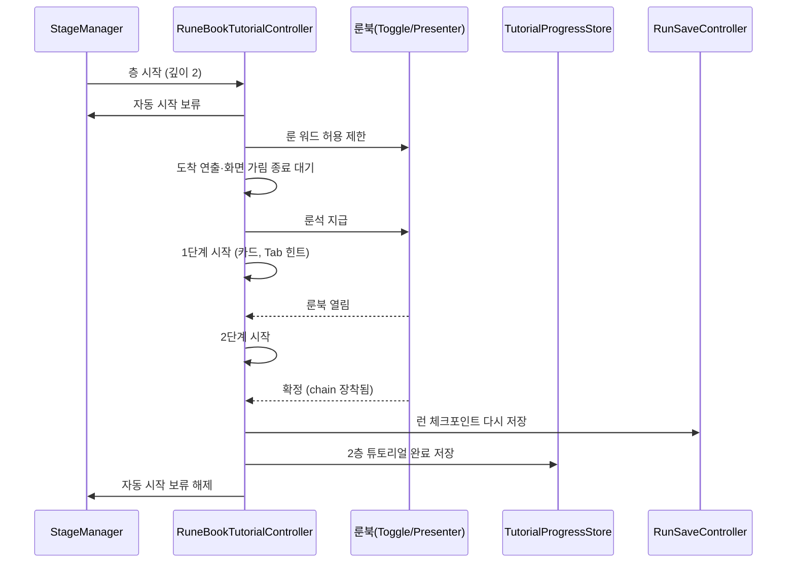

# 2층 룬북 튜토리얼 및 1층 바람 전용 설계

> 상태: **설계 (미구현)** · 상세도 **Level 1** · 기준 브랜치 `feature/growth` · 작성일 2026-10-14
> 선행 문서: [TutorialNewGameReset](../TutorialNewGameReset/TutorialNewGameResetDesign.md). 2층 튜토리얼 완료 필드와 저장소 복구를 전제로 한다.
> 1층 튜토리얼 기반: [TutorialConditionFlow](../TutorialConditionFlow/TutorialConditionFlowDesign.md), `Docs/Designs/Tutorial/TutorialFlow.md`.

## 1. 기능 개요 및 요구사항

### A. 2층 룬북 튜토리얼

2층에 진입한 뒤 임무를 시작하기 전에, 룬북을 열고 추가 룬 효과(`rune_chain`)를 3번째 슬롯에 장착하도록 안내한다.

- **시작 조건:** 2층이 시작되어 임무 시작 전(준비) 단계이고, 2층 튜토리얼 완료 기록이 없을 때. 1층 튜토리얼을 건너뛴 경우에도 시작한다.
- **단계(총 2단계):** (1) 룬북 열기, (2) `rune_chain`을 장착하고 확정.
- **룬석:** 튜토리얼 시작 시 `rune_chain`의 룬 문자를 룬석으로 지급하고, 룬북에서 장착 가능한 룬 워드를 `rune_chain` 하나로 제한한다(나머지는 `???`).
- **완료 판정:** 2단계는 확정 후 `rune_chain`이 장착 목록에 있으면 완료된다(슬롯 위치는 묻지 않는다). 안내는 "원소 룬 워드 2개 뒤 3번째 슬롯"을 기본 흐름으로 하되, 튜토리얼 중에는 허용 목록이 `rune_chain` 하나뿐이라 한 번 확정해 뺀 원소를 다시 장착할 수 없고(해제 시 룬석 미환급), 위치를 강제하면 진행이 막히는 상태가 생기므로 위치 검사는 하지 않는다.
- **종료:** 2단계 완료 시 런 체크포인트를 다시 저장한 뒤 완료 기록을 저장하고 끝낸다(순서 중요, 5단계 참조). 이후 임무 시작은 평소대로다.
- **건너뛰기:** 없다.
- **자동 시작 보류:** 준비 단계의 10초 자동 시작 카운트다운은 층 시작 알림을 받는 즉시 멈추고(도착 연출 대기 중에도), 튜토리얼이 끝나거나 중단되면 다시 센다.
- **중단:** 튜토리얼 중 플레이어가 F로 임무를 직접 시작하면 튜토리얼을 완료 기록 없이 종료한다(다시 뜨지 않는다. 1층 튜토리얼이 임무 클리어로 끊길 때와 같은 방식).
- **이어하기:** 2층 준비 단계에서 이어한 경우에도 완료 기록이 없으면 시작한다.

### B. 1층 튜토리얼의 원소 룬 워드를 바람 하나로

- 1층 튜토리얼 4단계에서 룬북에 열리는 원소 룬 워드를 바위·바람에서 **바람 하나**로 줄인다.
- 3단계에서 주력 원소로 바람을 고를 수 없게 한다(튜토리얼 중에만). 그래야 4단계의 추가 원소 룬 워드가 항상 바람으로 정해지고 충돌이 없다.

### 제외 범위

- 2층 튜토리얼 건너뛰기, 상황 안내 카드 추가, 스포트라이트 오버레이.
- 슬롯 개방 규칙(시작 3칸, 5층마다 개방)은 그대로다. 2층에서는 3번째 슬롯이 이미 열려 있다.

## 2. 기존 코드 분석 및 변경 범위

### 확인된 사실

- 층 전환은 씬을 바꾸지 않는다. 같은 전투 씬에서 스테이지 관리자(`StageManager`)가 다음 층을 준비하고 `StageStarted(깊이)`를 발생시킨다. 층이 준비되면 단계는 준비(Ready)가 된다.
- 준비 단계에는 자동 시작 타이머(씬 값 10초)가 있어, 잠시 후 임무가 자동으로 시작된다. 1층은 시작 석상 대기 때문에 이 문제가 없었다.
- 기존 튜토리얼 컨트롤러(`TutorialController`)는 1층 전제다: 준비 대기 상태에서만 시작, 임무 고정, 체력 하한, 룬북 잠금, 건너뛰기, 임무 클리어 시 종료. 완료하면 스스로 비활성화되고 정리 시 규칙 해제가 실행된다.
- 단계 데이터는 `TutorialStepSO`, 조건은 `ITutorialCondition` 구현체를 `TutorialConditionFactory`가 종류별로 생성한다. 가이드 카드, 키 힌트 뷰는 컨트롤러가 직접 부른다.
- 룬북 열기(`RuneBookV2Toggle.Open`)에는 열림 알림이 없다. 확정(`RuneBookV2Presenter.Confirmed`)은 로드아웃 확정 후에 발생해, 이 시점에 장착 목록에서 장착 여부를 읽을 수 있다.
- 기존 룬 확정 조건은 무엇을 장착했든 확정만 하면 완료된다. 2층에서는 `rune_chain` 장착이 필수라 그대로 쓸 수 없다.
- 런 체크포인트(`RunSaveController`)는 층 시작 알림, 상점 진입, 상점 구매·리롤 때만 저장하며 장착·룬석 변경에는 저장하지 않는다. 저장 내용에는 장착 룬 효과, 룬석, 현재 미션 종류가 포함된다. 판 저장 컨트롤러는 전투 씬이 열릴 때 스스로 만들어지고, 이어하기 복원은 시작 후 최소 한 프레임을 기다린 뒤 층 시작 알림을 발생시킨다.
- 룬북 확정은 3번째 이후의 비원소 효과를 "현재 점유된 칸 수" 위치에 넣고, 칸을 비우면 뒤 칸을 앞으로 당긴다. 따라서 `rune_chain`이 3번째 칸에 있는지는 별도로 확인해야 한다. 로드아웃은 칸 번호로 장착 효과를 읽는 접근자를 제공한다.
- 룬 워드 허용 제한은 룬북 발표자(`RuneBookV2Presenter`)의 허용 id 설정으로 이미 제공된다. 룬석 지급 로직은 1층 규칙 클래스(`TutorialRules`)에 있다. 룬 워드의 룬 문자는 룬 효과 데이터 정의에서 읽는다.
- 주력 원소 선택 화면(`MainElementSelectView`)은 구슬 4개(불·바람·흙·물)를 방향키/클릭으로 고르며, 확정하면 해당 원소를 주력으로 장착한다. 시작 선택은 첫 구슬이다. 잠금 개념이 없다.
- 현재 1층 허용 목록은 `CombatScene`의 컨트롤러 값 `rune_earth`, `rune_wind`이다. 건너뛰기는 부족한 원소를 불, 바람 순으로 채운다.

### 제안

- 2층 전용 컨트롤러를 새로 만든다. 1층 컨트롤러에 2층을 끼우면 임무 고정, 건너뛰기, 임무 클리어 종료 등 1층 전제 분기가 늘어난다. 단계 SO, 조건 팩토리, 가이드 카드, 키 힌트는 재사용한다.
- 오버레이는 스포트라이트 대신 키 힌트(Tab)로 한다. 룬북 HUD 안내는 런타임 생성이라 스포트라이트 대상 등록 여부가 확인되지 않았다.

### 변경 범위

| 구분 | 파일 | 내용 |
|---|---|---|
| 신규 | [RuneBookTutorialController.cs](../../../Assets/01_Scripts/Tutorial/Core/RuneBookTutorialController.cs) | 2층 튜토리얼 진행 |
| 신규 | [RuneBookOpenCondition.cs](../../../Assets/01_Scripts/Tutorial/Conditions/RuneBookOpenCondition.cs) | 룬북이 열리면 완료 |
| 신규 | [RuneEffectEquipCondition.cs](../../../Assets/01_Scripts/Tutorial/Conditions/RuneEffectEquipCondition.cs) | 확정 후 지정한 룬 효과가 장착돼 있으면 완료 |
| 수정 | [TutorialConditionKind.cs](../../../Assets/01_Scripts/Tutorial/Core/TutorialConditionKind.cs) | 종류 2개 추가 |
| 수정 | [TutorialConditionFactory.cs](../../../Assets/01_Scripts/Tutorial/Conditions/TutorialConditionFactory.cs) | 새 조건 생성 분기 |
| 수정 | [TutorialStepSO.cs](../../../Assets/01_Scripts/Tutorial/Core/TutorialStepSO.cs) | 조건 대상 id 필드 |
| 수정 | [RuneBookV2Toggle.cs](../../../Assets/01_Scripts/UI/RuneBookV2/RuneBookV2Toggle.cs) | 열림 알림 이벤트 |
| 수정 | [StageManager.cs](../../../Assets/01_Scripts/Stage/StageManager.cs) | 자동 시작 보류 프로퍼티 |
| 수정 | [MainElementSelectView.cs](../../../Assets/01_Scripts/UI/MainElement/MainElementSelectView.cs) | 원소 잠금 |
| 수정 | [MainElementOrbView.cs](../../../Assets/01_Scripts/UI/MainElement/MainElementOrbView.cs) | 잠금 표시 |
| 수정 | [TutorialController.cs](../../../Assets/01_Scripts/Tutorial/Core/TutorialController.cs) | 잠글 주력 원소 목록 필드, 규칙에 전달 |
| 수정 | [TutorialRules.cs](../../../Assets/01_Scripts/Tutorial/Core/TutorialRules.cs) | 주력 원소 잠금 적용·해제 |
| 수정 | [RunSaveController.cs](../../../Assets/01_Scripts/Save/RunSaveController.cs) | 튜토리얼 완료 시 체크포인트를 즉시 다시 저장하는 공개 메서드 |

## 3. 전체 실행 흐름 및 설계 구조

2층 컨트롤러는 씬에 계속 켜져 있다가 스테이지 시작 알림에서 깊이가 2일 때만 동작한다. 알림을 받으면 **즉시** 자동 시작 보류와 룬 워드 제한을 걸고(도착 연출과 페이드 동안에도 카운트다운이 흐르지 않게), 룬석 지급과 안내 카드 표시는 연출이 끝난 뒤로 미룬다. 룬석 지급을 알림 처리 중에 하지 않는 이유는, 판 저장 컨트롤러가 같은 알림에서 층 시작 체크포인트를 저장하므로 지급분이 체크포인트에 섞여 이어하기마다 룬석이 쌓이는 것을 막기 위해서다(코루틴은 알림보다 최소 한 프레임 뒤에 재개된다). 시작 시점에 이미 2층 준비 단계라면 알림을 기다리지 않고 같은 절차를 바로 진행한다. 이어하기 복원은 한 프레임 이상 기다린 뒤 알림을 내므로 컨트롤러의 시작 처리가 먼저 끝나 구독이 보장된다. 종료(완료·중단 모두)할 때 제한과 보류를 해제한다.



1층 쪽 변경(B)은 규칙 클래스가 튜토리얼 시작 때 주력 원소 선택 화면에 잠글 원소를 알리고, 규칙 해제 시 풀어 주는 구조다. 잠글 원소 목록은 컨트롤러의 인스펙터 값(바람)으로 두어 코드에 원소를 박지 않는다.

## 4. 단계별 구현 가이드

### 단계 1. 1층 바람 전용 (요구사항 B)

**씬 값:** `CombatScene`의 튜토리얼 컨트롤러 룬석 지급 목록을 `rune_wind` 하나로 줄인다. 룬석 지급과 룬북 허용 제한이 모두 이 목록을 쓰므로 바위 룬석 지급과 바위 표시가 함께 사라진다.

**주력 원소 잠금:**

파일: [MainElementOrbView.cs](../../../Assets/01_Scripts/UI/MainElement/MainElementOrbView.cs) (수정)

```csharp
/// <summary>true면 구슬이 어둡게 보이고 선택할 수 없다.</summary>
public void SetLocked(bool isLocked);
public bool IsLocked { get; private set; }
```

잠기면 채움과 글로우 색을 어둡게 하고 호버 링을 켜지 않는다.

파일: [MainElementSelectView.cs](../../../Assets/01_Scripts/UI/MainElement/MainElementSelectView.cs) (수정)

```csharp
/// <summary>선택할 수 없게 막을 원소. null 또는 빈 목록이면 모두 연다. (튜토리얼)</summary>
public void SetLockedElements(IReadOnlyCollection<ReactionElement> lockedElements);
```

1. 전달받은 원소와 같은 구슬의 잠금을 켜고 나머지는 끈다.
2. 선택 인덱스가 잠긴 구슬을 가리키면 잠기지 않은 첫 구슬로 옮기고 화면을 갱신한다.

기존 선택 경로 세 곳(클릭, 방향 입력, 번호로 고르기)에서 대상 구슬이 잠겨 있으면 선택하지 않고 돌아온다. 호버 처리도 잠긴 구슬은 표시만 바꾸지 않는다. 확정은 현재 선택 구슬로만 하므로 별도 차단이 필요 없다.

파일: [TutorialController.cs](../../../Assets/01_Scripts/Tutorial/Core/TutorialController.cs), [TutorialRules.cs](../../../Assets/01_Scripts/Tutorial/Core/TutorialRules.cs) (수정)

```csharp
// TutorialController
[Tooltip("튜토리얼 중 주력 원소 선택에서 막을 원소")]
[SerializeField] private ReactionElement[] _lockedPrimaryElements;

// TutorialRules: 생성자에 _lockedPrimaryElements를 추가로 받는다.
private MainElementSelectView _primaryElementSelectView;
```

규칙 적용 시 주력 원소 선택 화면(비활성 포함)을 찾아 잠글 원소를 건다. 규칙 해제 시 잠금을 비우고 참조를 정리한다. 건너뛰기 기본 지급(불, 바람)은 바람을 두 번째로 채우므로 그대로 둔다. 씬의 컨트롤러 값에 바람을 넣는다.

### 단계 2. 조건 종류와 단계 데이터 확장

파일: [TutorialConditionKind.cs](../../../Assets/01_Scripts/Tutorial/Core/TutorialConditionKind.cs) (수정)

```csharp
RuneBookOpen,        // 기존 마지막 PortalEnter 뒤에 추가
RuneEffectEquip
```

기존 단계 에셋이 정수로 저장돼 있으므로 반드시 끝에 추가한다.

파일: [TutorialStepSO.cs](../../../Assets/01_Scripts/Tutorial/Core/TutorialStepSO.cs) (수정)

```csharp
[Tooltip("조건이 가리키는 대상 id. 룬 효과 장착 조건이 장착을 확인할 룬 효과 id")]
[SerializeField] private string _conditionTargetId;
public string ConditionTargetId => _conditionTargetId;
```

파일: [TutorialConditionFactory.cs](../../../Assets/01_Scripts/Tutorial/Conditions/TutorialConditionFactory.cs) (수정): 새 두 종류에 대응하는 분기를 추가한다.

### 단계 3. 룬북 열림 알림과 조건

파일: [RuneBookV2Toggle.cs](../../../Assets/01_Scripts/UI/RuneBookV2/RuneBookV2Toggle.cs) (수정)

```csharp
/// <summary>룬북이 열렸을 때 (보기 전용으로 열린 경우도 포함)</summary>
public event Action Opened;
```

열기 처리에서 룬북 오브젝트를 켜고 일시정지를 건 뒤 마지막에 이 이벤트를 발생시킨다. 열지 못하고 조기 종료한 경우에는 발생하지 않는다.

파일: [RuneBookOpenCondition.cs](../../../Assets/01_Scripts/Tutorial/Conditions/RuneBookOpenCondition.cs) (신규)

```csharp
public class RuneBookOpenCondition : ITutorialCondition
{
    public event Action Completed;
    public void Begin(TutorialStepSO step);
    public void Tick();
    public void End();
}
```

시작 시 룬북 토글(비활성 포함)을 찾아 열림 알림을 구독한다. 이미 열려 있다면 바로 완료한다. 열림 알림이 오면 완료를 알린다. 종료 시 구독을 해제한다. 매 프레임 처리는 없다.

파일: [RuneEffectEquipCondition.cs](../../../Assets/01_Scripts/Tutorial/Conditions/RuneEffectEquipCondition.cs) (신규)

```csharp
public class RuneEffectEquipCondition : ITutorialCondition
{
    private RuneBookV2Presenter _presenter;
    private string _targetEffectId;
    public event Action Completed;
    public void Begin(TutorialStepSO step);
    public void Tick();
    public void End();
    private void HandleConfirmed();
}
```

시작 시 단계의 대상 룬 효과 id를 보관하고 룬북 발표자(비활성 포함)의 확정 알림을 구독한다. 확정 알림을 받으면(이 시점에 로드아웃은 이미 확정되어 있다) 플레이어의 로드아웃 장착 목록에 대상 룬 효과가 있을 때만 완료를 알린다. 없으면 아무것도 하지 않고 플레이어가 다시 시도하게 둔다. 종료 시 구독을 해제한다.

### 단계 4. 준비 단계 자동 시작 보류

파일: [StageManager.cs](../../../Assets/01_Scripts/Stage/StageManager.cs) (수정)

```csharp
/// <summary>true면 준비 단계의 자동 시작 카운트다운이 흐르지 않는다. (튜토리얼) 직접 시작(F)은 막지 않는다.</summary>
public bool IsAutoStartSuspended { get; set; }
```

자동 시작 갱신은 이 값이 참이면 남은 시간을 줄이지 않고 돌아온다. HUD가 쓰는 카운트 중 여부 프로퍼티도 이 값이 참이면 거짓을 돌려줘 카운트다운 표시가 숨는다. 보류를 풀면 남은 시간이 보류 직전 값에서 이어진다.

### 단계 5. 2층 컨트롤러

파일: [RuneBookTutorialController.cs](../../../Assets/01_Scripts/Tutorial/Core/RuneBookTutorialController.cs) (신규)

```csharp
public class RuneBookTutorialController : MonoBehaviour
{
    [Header("참조")]
    [SerializeField] private TutorialStepSO[] _steps;
    [SerializeField] private TutorialGuideCardView _guideCardView;
    [SerializeField] private TutorialKeyHintView _keyHintView;

    [Header("설정")]
    [SerializeField, Min(1)] private int _targetDepth = 2;
    [SerializeField] private string _grantedRuneWordId = "rune_chain";

    private StageManager _stageManager;
    private RuneBookV2Presenter _runeBookPresenter;
    private ITutorialCondition _activeCondition;
    private Coroutine _showRoutine;
    private int _currentStepIndex;
    private bool _isRunning;

    private void Start();
    private void Update();
    private void OnDisable();
    private void HandleStageStarted(int depth);
    private void HandlePhaseChanged(StagePhase phase);
    private void BeginTutorial();
    private IEnumerator ShowAfterArrivalRoutine();
    private void GrantRuneStones();
    private void BeginStep(int stepIndex);
    private void HandleConditionCompleted();
    private void Finish();
    private void Release();
}
```

**`Start`:**

1. 2층 튜토리얼 완료 기록이 있으면 컨트롤러를 끄고 끝낸다.
2. 스테이지 관리자를 가져와 층 시작 알림을 구독한다.
3. 이미 목표 깊이의 준비 단계라면 튜토리얼을 바로 시작한다. (알림이 이미 지나간 경우의 안전장치. 이어하기 복원은 한 프레임 이상 뒤에 알림을 내므로 보통은 알림 경로로 시작된다.)

**`Update`:** 진행 중이고 활성 조건이 있으면 매 프레임 그 조건의 갱신을 호출한다. (1층과 같다. 이 튜토리얼의 두 조건은 이벤트 기반이라 실제 처리는 없다.)

**`HandleStageStarted`:** 깊이가 목표 깊이가 아니거나 이미 진행 중이면 종료한다. 아니면 튜토리얼을 시작한다.

**`BeginTutorial`:**

1. 진행 상태로 전환한다.
2. 스테이지 관리자의 자동 시작을 보류하고 단계 변경 알림을 구독한다. 연출 대기보다 **먼저** 해서 대기 중 카운트다운이 흐르지 않게 한다.
3. 룬북 발표자(비활성 포함)를 찾아 지급 대상 룬 워드 하나만 허용하도록 제한한다.
4. 카드 표시 코루틴을 시작한다.

**`ShowAfterArrivalRoutine`:**

1. 플레이어의 포탈 도착 연출과 화면 가림(층 전환 페이드)이 끝날 때까지 기다린다.
2. 기다리는 사이 튜토리얼이 중단되었다면(단계 변경 알림으로 해제됨) 아무것도 하지 않고 끝낸다.
3. 지급 대상 룬 워드를 이루는 룬 문자를 룬석으로 한 개씩 지급한다. (층 시작 체크포인트가 이미 저장된 뒤라 지급분이 체크포인트에 들어가지 않는다)
4. 첫 단계를 시작한다.

**`BeginStep`:** 단계의 조건을 팩토리로 만들어 활성 조건으로 두고, 카드에 단계 번호와 전체 단계 수를 넣어 보여 준 뒤 단계에 지정된 오버레이(키 힌트)를 띄운다. 조건의 완료 알림을 구독하고 조건을 시작한다.

**`HandleConditionCompleted`:** 활성 조건을 정리하고(구독 해제, 종료, 오버레이 숨김) 다음 단계가 있으면 시작하고, 없으면 마무리한다.

**`HandlePhaseChanged`:** 단계가 준비 이외로 바뀌었으면(플레이어가 임무를 직접 시작) 완료 기록 없이 중단한다. 컨트롤러를 끄고 해제 처리가 정리를 맡는다.

**`Finish`:**

1. 카드를 숨긴다.
2. 판 저장 컨트롤러에 체크포인트를 다시 저장하게 한다. 룬 장착과 소모된 룬석이 반영된 상태가 저장된다.
3. 2층 튜토리얼 완료를 저장한다. 체크포인트를 먼저 저장하는 이유는, 두 저장 사이에 종료돼도 "완료 기록 없음 + 장착 반영" 상태가 되어 튜토리얼이 한 번 더 뜰 뿐 장착 상태와 완료 기록이 어긋나지 않기 때문이다.
4. 컨트롤러를 끈다.

**`Release`(비활성화 시 실행):** 진행 중인 카드 표시 코루틴을 멈추고, 활성 조건을 정리하며, 룬 워드 허용 제한을 풀고, 자동 시작 보류를 해제하고, 단계 변경과 층 시작 알림 구독을 해제한다. 진행 중이었다면 카드를 숨긴다. 룬북 토글의 입력 잠금은 1층 튜토리얼이 끝날 때 이미 풀려 있어 건드리지 않는다.

파일: [RunSaveController.cs](../../../Assets/01_Scripts/Save/RunSaveController.cs) (수정)

```csharp
/// <summary>지금 상태를 체크포인트로 저장한다. 튜토리얼이 장착을 바꾼 뒤 부른다. (저장 조건은 층 시작 저장과 같다)</summary>
public void SaveCheckpointNow();
```

기존 저장 판단 메서드를 그대로 불러, 복원 중이거나 런이 끝났거나 1층 튜토리얼 미완료이거나 플레이어가 사망한 상태면 저장하지 않는다. 튜토리얼 컨트롤러는 판 저장 컨트롤러를 씬에서 찾아 이 메서드를 부른다(판 저장 컨트롤러는 전투 씬이 열릴 때 스스로 만들어지므로 컨트롤러 Start 이후에도 이미 존재한다).

### 단계 6. 데이터와 씬 작업 (Unity 에디터)

1. `Assets/11_Data/Tutorial/` 아래 단계 에셋 2개를 만든다.
   - 룬북 열기: 조건 `RuneBookOpen`, 제목·본문(룬북을 열어 새 룬 효과를 확인하게 하는 안내), 행동 행에 키 `Tab`, 오버레이 키 힌트(1층 임무 개시 단계와 같은 프리팹, 문구 "룬북").
   - 룬 효과 장착: 조건 `RuneEffectEquip`, 대상 id `rune_chain`, 본문(원소 룬 워드 2개 뒤 3번째 슬롯에 장착 후 확정하도록 안내. 이미 확정한 원소는 빼면 다시 장착할 수 없음을 알린다).
2. `CombatScene`에 빈 오브젝트를 만들고 2층 컨트롤러를 붙인 뒤 위 두 단계를 순서대로 넣고, 가이드 카드 뷰와 키 힌트 뷰를 1층 컨트롤러와 같은 오브젝트로 연결한다. 깊이 2, 지급 룬 워드 `rune_chain`은 기본값을 쓴다.
3. 1층 컨트롤러의 룬석 지급 목록을 `rune_wind` 하나로 바꾸고, 잠글 주력 원소 목록에 `Wind`를 넣는다.
4. 3번째 슬롯이 2층에서 이미 열려 있는지는 슬롯 개방 설계(시작 3칸) 기준으로 확인한다.

## 5. 검증 기준 및 테스트 시나리오

| # | 실행 조건 | 수행 행동 | 예상 결과 |
|---|---|---|---|
| 1 | 새 게임, 1층 튜토리얼 정상 완료 | 2층 진입 | 도착 연출·페이드 종료 후 룬북 열기 카드와 Tab 힌트, 자동 시작 카운트다운 정지 |
| 2 | 1번 상태 | Tab으로 룬북 열기 | 2단계 카드로 전환, 룬북에서 `rune_chain`만 보이고 나머지는 `???` |
| 3 | 2단계 | `rune_chain` 없이 다른 상태로 확정(또는 빈 슬롯) | 완료되지 않고 계속 대기 |
| 4 | 2단계 | 3번째 슬롯에 `rune_chain` 장착 후 확정 | 체크포인트 재저장 → 완료 저장, 카드 사라짐, 자동 시작 카운트 재개, 룬북 허용 제한 해제 |
| 4a | 2단계, 원소 룬 워드 2개 장착 상태 | 원소 하나를 빼고 `rune_chain`을 2번째 슬롯에 확정 | 장착 목록에 있으므로 완료되고 진행이 막히지 않음 |
| 4d | 2단계 | `rune_chain` 없이 확정 | 완료되지 않고 계속 대기 |
| 4b | 4번 직후 | 바로 게임 종료 후 이어하기 | 2층부터 이어하고 `rune_chain`이 장착돼 있으며 튜토리얼 미실행 |
| 4c | 4번 직전(2단계 중) | 게임 종료 후 이어하기 | 장착 전 상태로 2층 복원, 완료 기록이 없어 튜토리얼이 다시 시작. 룬석은 체크포인트에 지급분이 없으므로 한 번만 지급되고, 종료·이어하기를 반복해도 쌓이지 않음 |
| 5 | 2층 튜토리얼 완료 기록 있음 | 2층 진입 | 튜토리얼 미실행 |
| 6 | 1층 튜토리얼을 건너뜀 | 2층 진입 | 2층 튜토리얼 시작 |
| 7 | 튜토리얼 1단계 중 | F로 임무 시작 | 튜토리얼 종료(완료 기록 없음), 룬북 제한·카운트 보류 해제, 2층 튜토리얼이 다시 뜨지 않음 |
| 8 | 튜토리얼 1단계(룬북을 아직 열지 않음) | 10초 이상 아무것도 하지 않고 대기 | 임무가 자동으로 시작되지 않음 |
| 8a | 2층 진입 직후(페이드·도착 연출 중) | 연출이 10초 이상 걸리게 지연시키거나 디버그로 지연 | 연출 동안에도 카운트다운이 줄지 않고, 연출 후 튜토리얼이 정상 시작 |
| 9 | 2층 준비 단계 저장 후 이어하기, 완료 기록 없음 | 이어하기 | 도착 연출 후 튜토리얼 시작 |
| 10 | 3층 이상으로 이어하기 | 이어하기 | 2층 튜토리얼 미실행 |
| 11 | 1층 튜토리얼 3단계 | 주력 원소 선택 화면에서 바람 선택 시도(방향키 오른쪽, 클릭) | 바람 구슬이 어둡고 선택되지 않음 |
| 12 | 1층 튜토리얼 4단계 | 룬북 열기 | 원소 룬 워드는 바람만 보이고 흙·불·물은 `???`, 바람 룬석만 지급 |
| 13 | 1층 튜토리얼 건너뛰기 | 건너뛰기 선택 | 주력 포함 원소 룬 효과가 2개가 되고 이후 주력 원소 선택 화면에서 잠금 해제 |
| 14 | 튜토리얼 종료 후(또는 이미 완료한 플레이어) | 주력 원소 선택 화면 | 바람 포함 4개 모두 선택 가능 |

## 6. 미해결·확인 필요

- 이어하기 복원의 알림 시점은 코드로 확인했다(시작 후 최소 한 프레임 뒤). 컨트롤러 시작 시점 재확인은 안전장치로만 두며 시나리오 9에서 검증한다.
- `rune_chain`의 룬 문자 구성은 외부 룬 효과 정의 데이터에서 읽으므로 이 문서에서 값을 확정하지 않았다. 지급은 정의의 룬 워드를 그대로 쓴다.
- 시나리오 8의 자동 시작 보류 중에도 F로 직접 시작은 막지 않는다(시나리오 7). 막고 싶다면 추후 협의한다.
