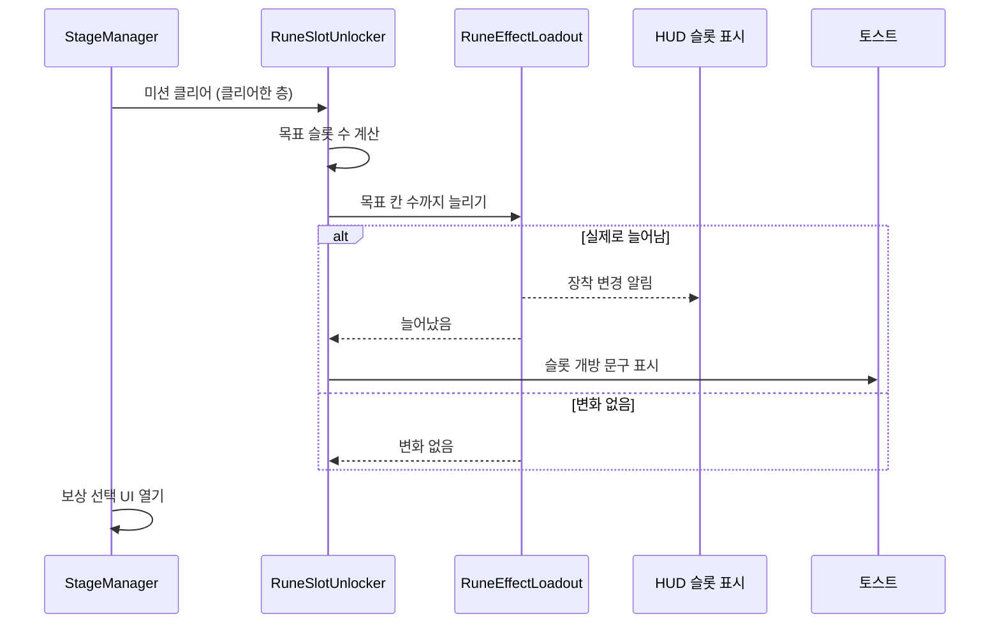

# 룬 슬롯 층 기반 개방 설계

## 1. 기능 개요 및 요구사항

룬 장착 슬롯을 "3칸으로 시작해 5층을 클리어할 때마다 1칸씩 개방"하는 방식으로 바꾼다. 지금은 2칸으로 시작하고 보상 목록에서 슬롯 확장을 골라야 늘어나는데, 이 선택지를 없애고 층 진행으로 자동 개방한다. 짧은 플레이 타임 안에 룬 조합을 더 많이 시도하게 하려는 목적이다.

- **시작:** 새 런은 슬롯 3칸으로 시작한다. 장착 규칙상 원소 룬은 최대 2칸이므로 원소 2칸, 비원소 1칸이 된다.
- **개방:** 5층 미션을 클리어하면 4칸, 10층 미션을 클리어하면 5칸이 된다. 최대는 5칸이며, 보스 층에서도 5칸이다.
- **알림:** 슬롯이 실제로 열릴 때 "룬 슬롯이 열렸습니다 (4/5)" 같은 토스트 문구를 띄운다.
- **보상 목록:** 슬롯 확장 선택지를 제거한다.
- **이어하기:** 저장된 층에서 이어해도 슬롯 수가 층 진행과 어긋나지 않는다.
- **제외 범위:** 연구 노드 기반의 레거시 슬롯 로직(`RuneLoadout`), 디버그용 가짜 룬 북 데이터 소스의 최소 슬롯 값, 기존 세이브 마이그레이션, 슬롯 개방 연출(토스트 외)은 다루지 않는다.

확정된 값: 시작 3칸, 개방 간격 5층, 최대 5칸.

## 2. 기존 코드 분석 및 변경 범위

### 확인된 사실

- 실제로 쓰이는 슬롯 시스템은 `PlayerRuneManager`가 가진 `RuneEffectLoadout`이다. `PlayerAttack`, 룬 북 V2, HUD, 엔딩 화면, 저장이 모두 이 클래스를 참조한다. 연구 노드 기반 `RuneLoadout`은 `GameSession`에 "룬 매니저 완성 시 제거" TODO가 붙은 레거시이며 슬롯 확장과 무관하다.
- 시작 칸 수 2는 `RuneEffectLoadout`의 생성자와 `ResetSlots`에 숫자로 직접 적혀 있다. 최대 칸 수는 상수 5이다.
- 슬롯 확장은 `ExpandSlots`가 한 칸씩 처리하며 변경될 때마다 장착 변경 알림을 발생시키고, HUD의 슬롯 표시는 이 알림으로 갱신된다.
- 현재 슬롯 확장의 유일한 호출 경로는 보상 선택이다. `RewardGenerator`가 5칸 미만일 때 후보에 슬롯 확장을 넣고, `RewardController`가 선택 확정 시 `ExpandSlots`를 호출한다. 슬롯 초기화는 두 곳에서 일어난다. 런이 끝날 때(종료 처리 중) `RewardController`가 `ResetSlots`로 초기값으로 되돌리고, 새 게임에서는 `PlayerRuneManager`가 로드아웃을 새로 만들어 생성자의 시작 칸 수가 적용된다. 엔딩 화면은 로드아웃 변경 알림을 구독하지 않고 창을 열 때 현재 슬롯 수를 읽는다.
- 층은 `StageManager`가 관리하며 미션 층은 1~10, 보스 층은 11이다. 미션을 클리어하면 `MissionCleared(클리어한 층)`이 발생하고, 이 이벤트는 보상 선택 UI가 열리기 직전에 나간다.
- 저장은 층이 시작될 때와 상점에 들어갈 때, 상점에서 구매·리롤할 때 이루어진다. 층을 내려갈 때는 층 번호를 먼저 올린 뒤 상점을 열기 때문에, 상점 저장에는 직전 층의 클리어 결과(예: 10층 클리어 후 보스 진입 전 상점이면 5칸)가 이미 반영되어 있다. 복원은 슬롯을 초기값으로 되돌린 뒤 저장된 칸 수까지 `ExpandSlots`를 반복하며, 상점에서 이어하는 경로는 클리어 알림을 다시 발생시키지 않는다. 따라서 5층을 클리어하고 6층이 시작된 뒤의 저장에는 4칸이 기록되고, 5층 도중에 종료한 저장에는 3칸이 기록되어 이어하면 5층을 다시 클리어할 때 4칸이 열린다.
- 기존 `RuneBookToastView`는 룬 북 UI 안에 있어 전투 중에는 보이지 않는다. 다만 컴포넌트 자체는 문구를 받아 잠깐 보여주고 서서히 사라지는 범용 형태이고 실시간 시간 기준으로 동작한다.
- 튜토리얼에는 슬롯 수에 의존하는 조건이 없다.

### 변경 범위

| 구분 | 파일 | 내용 |
|---|---|---|
| 신규 | [RuneSlotUnlocker.cs](../../../Assets/01_Scripts/Stage/RuneSlotUnlocker.cs) | 클리어한 층에 맞춰 슬롯 개방, 토스트 표시 |
| 수정 | [RuneEffectLoadout.cs](../../../Assets/01_Scripts/Rune/RuneEffect/RuneEffectLoadout.cs) | 시작 칸 수 상수 3, 목표 칸 수까지 늘리는 메서드 추가 |
| 수정 | [RewardType.cs](../../../Assets/01_Scripts/Stage/RewardType.cs) | 슬롯 확장 종류 제거 |
| 수정 | [RewardOption.cs](../../../Assets/01_Scripts/Stage/RewardOption.cs) | 슬롯 확장 선택지 생성 메서드 제거 |
| 수정 | [RewardGenerator.cs](../../../Assets/01_Scripts/Stage/RewardGenerator.cs) | 슬롯 확장 후보 추가 코드와 아이콘 필드 제거 |
| 수정 | [RewardController.cs](../../../Assets/01_Scripts/Stage/RewardController.cs) | 슬롯 확장 적용 분기 제거 |

씬에는 `CombatScene`의 `Systems` 아래 오브젝트 하나와 `Canvas/HUD` 아래 토스트 오브젝트 하나를 추가한다(4장 단계 5).

## 3. 전체 실행 흐름 및 설계 구조

슬롯 수의 소유자는 `RuneEffectLoadout` 하나이고, 층에 따라 몇 칸이어야 하는지의 규칙은 `RuneSlotUnlocker`만 안다. 규칙은 "시작 칸 수 + 클리어한 층 ÷ 개방 간격(몫)"을 최대 칸 수로 제한한 값이며, 클리어할 때마다 같은 식으로 목표를 계산해 로드아웃을 그 값까지 늘린다. 목표가 층에 대해 항상 같은 값이고 로드아웃은 줄이지 않으므로, 개방 층이 아닌 층의 클리어는 아무 변화도 일으키지 않는다. 별도의 "이미 열었는지" 상태나 5의 배수 검사가 필요 없다.



확장성 검토: 개방 간격과 문구를 인스펙터 값으로 두면 이후 층 수나 간격이 바뀌어도 코드 수정이 필요 없다. 시작 칸 수와 최대 칸 수는 로드아웃의 상수로 두어, 로드아웃의 장착 규칙(원소 슬롯 수)과 함께 한 곳에서 관리한다. 개방 시점을 다른 이벤트(예: 상점 이탈)로 바꾸는 요구는 현재 없으므로 시점을 추상화하지 않는다.

## 4. 단계별 구현 가이드

### 단계 1. 로드아웃의 시작 칸 수와 목표 칸 수 확장

파일: [RuneEffectLoadout.cs](../../../Assets/01_Scripts/Rune/RuneEffect/RuneEffectLoadout.cs) (수정)

아래는 새로 추가하는 선언이다. 기존 `MaxSlotCount`는 그대로 쓰고 주석만 시작 칸 수 변경에 맞게 고친다.

```csharp
/// <summary>런 시작 시 열려 있는 슬롯 수.</summary>
public const int InitialSlotCount = 3;

/// <summary>활성 슬롯을 targetCount칸까지 늘린다. 이미 같거나 많으면 아무것도 하지 않는다. 실제로 늘었으면 true.</summary>
public bool EnsureSlotCount(int targetCount);
```

**기존 코드 수정:** 생성자의 시작 칸 수와 `ResetSlots`의 초기화 값에 적혀 있는 숫자 2를 모두 새 상수로 바꾼다. `MaxSlotCount`, `ResetSlots`, `ExpandSlots`의 "보상 특성용" 설명 주석은 층 진행으로 개방한다는 내용으로 고친다. `ExpandSlots`는 저장 복원이 계속 쓰므로 남긴다.

**`EnsureSlotCount` 처리:**

1. 요청받은 목표가 최대 칸 수를 넘으면 최대 칸 수로 제한한다.
2. 제한된 목표가 현재 활성 슬롯 수 이하라면 아무것도 바꾸지 않고 늘어나지 않았음을 알린다.
3. 활성 슬롯 수를 제한된 목표로 올린다.
4. 장착 변경 알림을 한 번 발생시켜 HUD와 룬 북이 갱신되게 한다.
5. 늘어났음을 알린다.

### 단계 2. 층 클리어에 따른 개방 컴포넌트

파일: [RuneSlotUnlocker.cs](../../../Assets/01_Scripts/Stage/RuneSlotUnlocker.cs) (신규, 이 클래스만 담는 별도 파일)

```csharp
using UnityEngine;

[DisallowMultipleComponent]
public class RuneSlotUnlocker : MonoBehaviour
{
    [SerializeField, Min(1)] private int _floorsPerUnlock = 5; // 이 층 수를 클리어할 때마다 슬롯 1칸 개방
    [SerializeField] private RuneBookToastView _toast;
    [SerializeField] private string _unlockedMessageFormat = "룬 슬롯이 열렸습니다 ({0}/{1})"; // {0} = 열린 칸 수, {1} = 최대 칸 수

    private StageManager _stageManager;

    private void Start();
    private void OnDestroy();
    private void HandleMissionCleared(int clearedDepth);
}
```

**`Start` 처리:** 이 컴포넌트가 사용하는 스테이지 관리자를 가져와 보관하고, 미션 클리어 알림을 구독한다. 저장 컨트롤러와 같은 방식이다.

**`OnDestroy` 처리:** 보관 중인 스테이지 관리자가 있다면 미션 클리어 알림 구독을 해제한다.

**`HandleMissionCleared` 처리:**

1. 클리어한 층 수를 층당 개방 간격으로 나눈 몫을 구해, 이 시점까지 추가로 열려 있어야 하는 슬롯 수로 삼는다.
2. 로드아웃의 시작 칸 수에 그 몫을 더하고 최대 칸 수를 넘지 않게 제한해 목표 슬롯 수로 정한다.
3. 룬 매니저에서 현재 룬 효과 로드아웃을 가져온다. 로드아웃 객체가 런마다 새로 만들어질 수 있으므로 미리 보관하지 않고 이 시점에 가져온다.
4. 로드아웃을 목표 슬롯 수까지 늘리도록 요청한다.
5. 실제로 슬롯이 늘어났다면, 열린 칸 수와 최대 칸 수를 문구 형식에 채워 토스트로 표시한다. 늘어나지 않았다면 아무것도 하지 않는다.

별도 예외 처리는 두지 않는다. 룬 매니저와 로드아웃은 런이 진행 중인 이 시점에 이미 준비되어 있고, 토스트 참조는 씬 구성 계약으로 연결한다.

### 단계 3. 보상 목록에서 슬롯 확장 제거

슬롯 확장을 만들고 적용하는 모든 코드를 삭제한다. 선택지가 후보에서 사라지므로 이 단계가 끝나면 어떤 경로로도 보상으로 슬롯이 늘어나지 않는다.

- [RewardType.cs](../../../Assets/01_Scripts/Stage/RewardType.cs): 마지막 항목인 슬롯 확장 종류를 삭제한다. 가장 뒤에 있는 항목이라 다른 종류의 정수 값이 바뀌지 않는다.
- [RewardOption.cs](../../../Assets/01_Scripts/Stage/RewardOption.cs): 슬롯 확장 선택지를 만드는 정적 메서드를 삭제한다.
- [RewardGenerator.cs](../../../Assets/01_Scripts/Stage/RewardGenerator.cs): 후보 목록에 슬롯 확장을 추가하는 블록(슬롯이 최대 미만일 때만 후보로 넣던 코드)과 슬롯 확장 아이콘 필드, 그 머리말을 삭제한다. 삭제 후 로드아웃 참조가 더 쓰이지 않는다면 함께 정리한다.
- [RewardController.cs](../../../Assets/01_Scripts/Stage/RewardController.cs): 보상 적용 분기에서 슬롯 확장 종류를 처리하던 분기를 삭제한다. 런 종료 처리에서 슬롯을 초기값으로 되돌리는 호출은 그대로 둔다. 이 호출은 시작 칸 수 상수를 쓰게 되어 3칸으로 되돌리며, 새 게임에서는 로드아웃이 새로 만들어져 같은 상수가 적용된다. 런이 끝난 뒤 엔딩 화면이 현재 슬롯 수를 읽을 때 개방했던 빈 슬롯이 초기화된 칸 수로 보일 수 있는데, 초기값이 2였던 기존에도 같은 동작이었으므로 이번 범위에서 바꾸지 않는다.

### 단계 4. 저장 복원과의 정합 확인 (코드 변경 없음)

저장 복원은 슬롯을 시작 칸 수로 되돌린 뒤 저장된 칸 수까지 하나씩 늘리는 기존 방식을 그대로 쓴다. 이 방식은 시작 칸 수가 3으로 바뀌어도 올바르게 동작한다. 층 시작과 상점 진입 시점에 저장되므로 4칸 이상이 기록되는 것은 5층 클리어 이후에 시작되거나 열린 층·상점부터이고(10층 클리어 후 상점은 5칸), 5층 도중에 끈 저장은 3칸이 기록되어 이어서 5층을 다시 클리어하면 슬롯이 열린다. 상점에서 이어하는 경로는 클리어 알림을 다시 발생시키지 않고 저장된 칸 수를 그대로 쓴다. 시작 칸 수보다 적게 저장된 기존 세이브(2칸)는 복원 시 3칸이 되고, 층 규칙보다 많이 확장된 기존 세이브는 그 값이 유지된다. 별도의 마이그레이션은 하지 않는다.

### 단계 5. Unity 에디터 작업

1. `CombatScene`의 `Systems` 아래에 빈 오브젝트 `RuneSlotUnlocker`를 만들고 `RuneSlotUnlocker` 컴포넌트를 붙인다. 개방 간격은 기본값 5를 그대로 둔다.
2. `Canvas/HUD` 아래에 룬 북 토스트 오브젝트(`RuneBookToastView`가 붙은 오브젝트)를 복제해 배치하고, 화면 위쪽 중앙으로 옮긴다. 상단 중앙에는 타이머와 깊이 패널이 있으므로, 앵커를 위쪽 중앙으로 두고 깊이 패널 바로 아래(기준 해상도 1920×1080에서 위쪽 가장자리 기준 약 -270)에 배치해 겹치지 않게 한다. 배경 이미지와 프레임은 튜토리얼 가이드 카드의 배경·프레임(스프라이트, 슬라이스 타입, 픽셀 배율)과 같게 맞추며, 프레임은 배경의 자식으로 두어 문구 길이에 따른 너비 변화를 따라가게 한다. 룬 북의 토스트와는 별개 인스턴스여야 한다.
3. `RuneSlotUnlocker`의 토스트 참조에 위에서 만든 HUD 토스트를 연결한다.
4. 보상 선택 UI(`RewardSelectUI_Root`)는 `Canvas` 안에 자체 `Canvas` 컴포넌트를 가진 별도 계층이므로, `HUD` 안에서 형제 순서만 높여서는 그 위에 올라온다고 보장할 수 없다. 먼저 보상 UI의 `Canvas` 정렬 설정(정렬 재정의 여부, 정렬 순서)을 확인한다. 그다음 토스트 오브젝트에 별도 `Canvas`를 붙이고 정렬 재정의를 켠 뒤 정렬 순서를 보상 UI보다 높게 설정한다. 미션 클리어 알림은 보상 UI가 열리기 전에 나가지만 보상 UI는 클리어 연출 등을 기다린 뒤 열릴 수 있어, 토스트가 보이는 동안 보상 UI가 열릴 수 있기 때문이다. 정렬을 올린 토스트에도 클릭을 막지 않도록 레이캐스트 대상 설정은 끈 상태를 유지한다.
5. `RewardSystem` 프리팹에 있던 슬롯 확장 아이콘 참조는 필드를 삭제해도 프리팹 파일에는 남아 있다가 프리팹이 다시 저장될 때 정리된다. 컴파일에는 영향이 없다.

## 5. 검증 기준 및 테스트 시나리오

**시작 슬롯 수**
- 실행 조건: 새 런 시작, 1층.
- 수행 행동: 룬 북을 열어 슬롯 칸을 확인하고, 원소 룬 2개와 비원소 룬 1개를 장착해 본다.
- 예상 결과: 슬롯이 3칸 열려 있고 원소 2칸, 비원소 1칸 규칙대로 장착된다. 4번째 칸은 잠겨 있다.

**5층 개방**
- 실행 조건: 5층 미션 진행 중, 슬롯 3칸.
- 수행 행동: 5층 미션을 클리어한다.
- 예상 결과: 클리어 즉시 슬롯이 4칸이 되고 "룬 슬롯이 열렸습니다 (4/5)" 토스트가 보상 UI에 가려지지 않고 표시된다. HUD 슬롯 표시와 룬 북이 4칸으로 갱신된다.

**10층 개방**
- 실행 조건: 10층 미션 진행 중, 슬롯 4칸.
- 수행 행동: 10층 미션을 클리어한다.
- 예상 결과: 슬롯이 5칸이 되고 "(5/5)" 토스트가 표시된다. 보스 층에서도 5칸이 유지된다.

**개방 층이 아닌 층**
- 실행 조건: 1~4층, 6~9층 클리어.
- 수행 행동: 각 층 미션을 클리어한다.
- 예상 결과: 슬롯 수와 토스트에 변화가 없다.

**보상 목록**
- 실행 조건: 여러 층에서 보상 선택 UI를 반복해서 연다.
- 수행 행동: 후보 카드를 확인한다.
- 예상 결과: 룬 슬롯 확장 카드가 한 번도 나오지 않는다.

**이어하기**
- 실행 조건: 6층 시작 시점에 저장된 런(슬롯 4칸), 5층 도중에 저장된 런(슬롯 3칸).
- 수행 행동: 각각 이어하기로 재개한다.
- 예상 결과: 6층 저장은 4칸으로 복원된다. 5층 저장은 3칸으로 복원되고 5층을 다시 클리어하면 4칸이 된다.

**상점에서 이어하기**
- 실행 조건: 10층 클리어 후 보스 진입 전 상점에서 종료한 런(슬롯 5칸), 5층 클리어 후 6층 앞 상점에서 종료한 런(슬롯 4칸).
- 수행 행동: 각각 이어하기로 재개한다.
- 예상 결과: 저장된 칸 수(5칸, 4칸)로 복원되고 토스트가 다시 뜨지 않는다.

**새 런 초기화**
- 실행 조건: 5칸까지 열린 런이 종료되고 새 게임을 시작한다.
- 수행 행동: 새 런의 슬롯 수를 확인한다.
- 예상 결과: 다시 3칸으로 시작한다.

## 6. 구현 순서 요약과 커밋 규칙

1. 단계 1의 [RuneEffectLoadout.cs](../../../Assets/01_Scripts/Rune/RuneEffect/RuneEffectLoadout.cs)를 수정한다.
2. 단계 2의 [RuneSlotUnlocker.cs](../../../Assets/01_Scripts/Stage/RuneSlotUnlocker.cs)를 작성한다.
3. 단계 3에 따라 [RewardType.cs](../../../Assets/01_Scripts/Stage/RewardType.cs), [RewardOption.cs](../../../Assets/01_Scripts/Stage/RewardOption.cs), [RewardGenerator.cs](../../../Assets/01_Scripts/Stage/RewardGenerator.cs), [RewardController.cs](../../../Assets/01_Scripts/Stage/RewardController.cs)에서 슬롯 확장을 제거한다.
4. 단계 5에 따라 씬 오브젝트와 토스트를 구성한다.
5. 5장의 시나리오를 플레이 모드에서 확인한다.
6. 구현 코드, 씬·프리팹 변경, 이 설계 문서를 하나의 커밋으로 묶는다.
