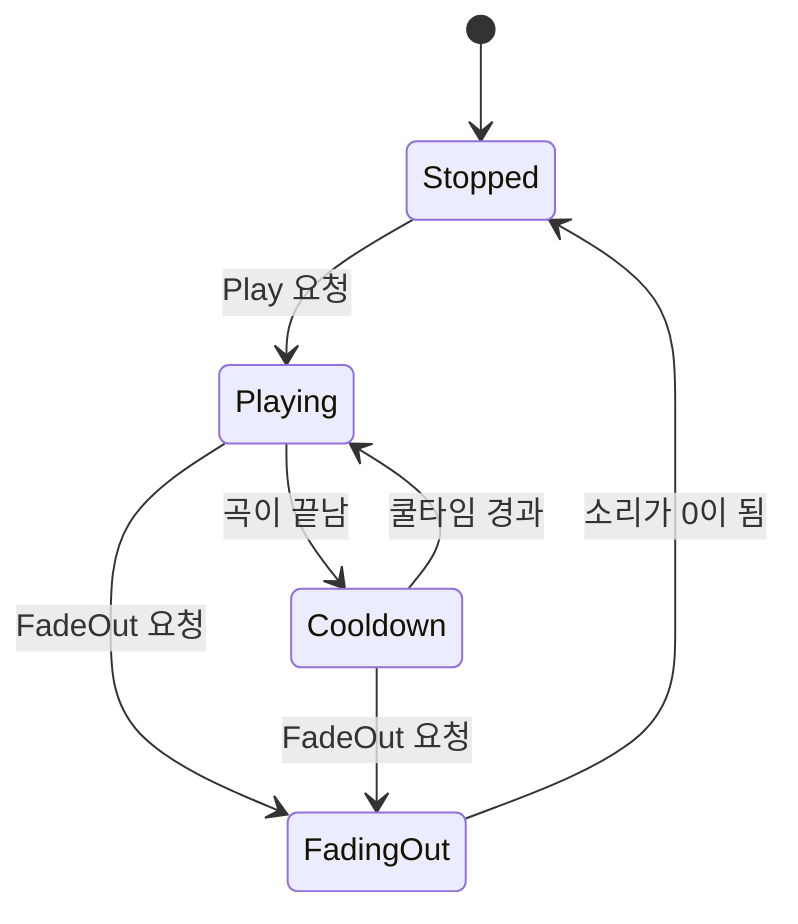

# 타이틀 BGM 쿨타임 반복 재생 — 구현 설계

> 상태: **설계 승인됨 (미구현)** · 기준 브랜치 `feature/growth` · 작성일 2026-10-14
> 범위는 StartScene의 BGM뿐이다. 메뉴 SFX, 다른 씬의 BGM은 이 문서에 포함하지 않는다.
> 갱신 2026-10-14: 예외 처리 최소화 기준을 적용해 방어 처리를 줄였다. 삭제한 것은 클립·참조 누락 검사, 재생 요청의 중복·곡 교체 분기, 페이드아웃의 상태별 분기, 씬 정리 시 안전용 페이드아웃, 오디오 전체 일시정지 판정이다.

## 1. 기능 개요 및 요구사항

### 목적

타이틀 화면에서 BGM을 재생하되, 클립을 루프로 이어 붙이지 않고 **한 번 재생 → 쿨타임(무음) → 다시 재생**을 반복한다. AI로 만든 곡은 끝에서 처음으로 이어지는 지점이 자연스럽지 않아서, 곡 사이에 쉬는 시간을 두어 이음새 문제를 없앤다.

### 범위와 제약

- BGM 클립, 쿨타임, 페이드인·페이드아웃 시간은 StartScene의 `TitleBgm` 컴포넌트 인스펙터에서 조정한다.
- 재생기는 씬에 묶이지 않는 static `Bgm`이다. 이후 다른 씬의 BGM도 같은 재생기를 쓸 수 있도록 일반 기능으로 만든다.
- 볼륨은 설정 창의 Master·BGM 슬라이더를 따르고, 슬라이더를 움직이면 재생 중에도 즉시 반영한다.
- 음원 파일은 `Assets/09_Audio/`로 옮긴다.

### 시작·종료 조건

- 시작: StartScene에 진입할 때 곧바로 재생한다. 첫 재생 전에는 쿨타임을 두지 않는다.
- 종료: 새 게임을 시작하면 시작 연출 동안 페이드아웃한다.
- 결과창에서 타이틀로 돌아오면 StartScene에 다시 진입하므로 처음부터 다시 시작한다.

### 제외 범위

- 메뉴 이동·확정·취소 SFX.
- CombatScene 등 다른 씬의 BGM. 이번 작업 후에는 StartScene을 떠난 뒤 BGM이 없는 상태가 된다.
- 서로 다른 BGM 사이의 크로스페이드.

## 2. 기존 코드 분석 및 변경 범위

### 확인된 기존 구조

- 오디오는 SFX용 static 재생기 `Sfx`(`Assets/01_Scripts/Audio/Sfx.cs`)만 있고 BGM 재생기는 없다. `Sfx`는 씬에 속하지 않는 루트 오브젝트를 `DontDestroyOnLoad`로 만들고, 거기에 `AudioSource`와 빈 구동 컴포넌트(`SfxRunner`)를 붙인다. 볼륨은 `GameSettings.Changed`를 구독해 갱신한다. `Bgm`은 이 방식을 따른다.
- `GameSettings`(`Assets/01_Scripts/UI/Settings/GameSettings.cs`)는 `MasterVolume`, `BgmVolume`, `Changed`를 이미 제공한다. 설정 창의 BGM 슬라이더도 `BgmVolume`을 저장하지만, 이 값을 읽어 쓰는 코드는 아직 없다.
- `TitleMenuController`(`Assets/01_Scripts/UI/Title/TitleMenuController.cs`)의 새 게임 처리는 중복 진입을 막은 뒤 시작 연출(`TitleSequence`, 기본 2.9초, 실제 시간 기준)을 재생하고, 연출이 끝나면 로딩 씬으로 넘어간다.
- 결과창에서 타이틀로 돌아가는 흐름(`RunFlow`)은 StartScene을 다시 불러온다.
- 빌드 씬 순서는 StartScene → LoadingScene → CombatScene이다.
- StartScene에는 `AudioListener`가 하나 있다. `AudioListener.pause`를 쓰는 코드는 스크립트에서 찾지 못했다.

### 생성·수정 대상

| 구분 | 대상 | 내용 |
|---|---|---|
| 신규 | [Bgm.cs](../../../Assets/01_Scripts/Audio/Bgm.cs) | static 재생기 `Bgm` |
| 신규 | [BgmRunner.cs](../../../Assets/01_Scripts/Audio/BgmRunner.cs) | 구동 컴포넌트 `BgmRunner` |
| 신규 | [TitleBgm.cs](../../../Assets/01_Scripts/UI/Title/TitleBgm.cs) | 인스펙터 값 보관, 재생 시작·페이드아웃 요청 |
| 수정 | [TitleMenuController.cs](../../../Assets/01_Scripts/UI/Title/TitleMenuController.cs) | `TitleBgm` 참조 추가, 새 게임 시작 시 페이드아웃 요청 |
| 수정 | `Assets/00_Scenes/StartScene.unity` | `TitleBgm` 오브젝트 추가, 참조 연결 |
| 이동 | 음원 파일 | Downloads의 `Runes_of_the_Old_Gate_2026-10-14T003749.wav` → `Assets/09_Audio/Title_RunesOfTheOldGate.wav` |

## 3. 전체 실행 흐름 및 설계 구조

### 데이터·상태 소유권

- 쿨타임·페이드 시간·클립은 `TitleBgm`이 인스펙터 값으로 소유하고, 재생을 요청할 때 `Bgm`에 넘긴다.
- 재생 상태(재생 중 / 쿨타임 / 페이드아웃 / 정지), 현재 페이드 비율, 쿨타임 경과 시간은 `Bgm`이 소유한다.
- `TitleMenuController`는 음악 설정을 가지지 않는다. 새 게임이 시작되었다는 사실만 `TitleBgm`에 알린다.

### 흐름

1. StartScene이 시작되면 `TitleBgm`이 클립과 시간 값으로 재생을 요청한다.
2. `Bgm`은 페이드인하며 곡을 재생한다.
3. 곡이 끝나면 쿨타임 동안 무음으로 기다린 뒤 다시 페이드인하며 재생한다. 이 반복은 정지 요청이 올 때까지 계속된다.
4. 새 게임을 선택하면 `TitleMenuController`가 `TitleBgm`에 페이드아웃을 요청하고, `Bgm`은 시작 연출 동안 소리를 줄여 정지한다.
5. 로딩 씬으로 넘어가도 재생기는 씬에 속하지 않으므로 남아 있다. 페이드아웃이 끝나면 스스로 정지한다. StartScene을 떠나는 경로는 새 게임 시작과 게임 종료뿐이어서, 씬 정리 시점의 별도 정지 처리는 두지 않는다.

### 재생기 상태



즉시 정지(`Stop`)는 어느 상태에서든 정지 상태로 보낸다. 쿨타임 중에 페이드아웃을 요청해도 별도 분기 없이 같은 경로를 타며, 페이드아웃 상태에서는 다시 재생하지 않고 소리가 0이 되면 정지한다.

## 4. 단계별 구현 가이드

### 단계 1. 음원 파일 준비

음원을 `Assets/09_Audio/Title_RunesOfTheOldGate.wav`로 옮긴다. Unity가 `.meta`를 생성하면 Project 창에서 파일을 선택하고 Inspector의 Import Settings를 다음과 같이 둔다. 변경 후 Apply를 누른다.

- Load Type: Streaming (60초, 약 11MB 파일이라 메모리에 올리지 않는다)
- Compression Format: Vorbis, Quality 70 내외
- Force To Mono: 끔

기존 SFX 파일들의 임포트 설정은 건드리지 않는다.

### 단계 2. 재생기 `Bgm` 선언

`Assets/01_Scripts/Audio/Bgm.cs`에 작성한다. `Sfx`와 같은 위치·방식이다. 구동 컴포넌트 `BgmRunner`는 MonoBehaviour이므로 클래스마다 별도 파일 원칙에 따라 `Assets/01_Scripts/Audio/BgmRunner.cs`에 따로 둔다.

```csharp
public static class Bgm
{
    private enum PlaybackState { Stopped, Playing, Cooldown, FadingOut }

    private static GameObject s_rootObject;               // 재생기 루트 오브젝트
    private static AudioSource s_audioSource;             // 실제로 소리를 내는 소스
    private static AudioClip s_currentClip;               // 재생 중이거나 재생할 곡
    private static PlaybackState s_playbackState;
    private static float s_cooldownSeconds;               // 곡이 끝난 뒤 다음 재생까지 쉬는 시간
    private static float s_cooldownElapsedSeconds;        // 쿨타임이 시작된 뒤 지난 시간
    private static float s_fadeInDurationSeconds;         // 재생을 시작할 때 소리가 0에서 1이 되기까지 걸리는 시간
    private static float s_fadeRatio;                     // 현재 페이드 비율 (0 무음 ~ 1 설정 볼륨)
    private static float s_fadeTargetRatio;               // 페이드 비율이 향하는 값 (1 페이드인, 0 페이드아웃)
    private static float s_fadeDurationSeconds;           // 지금 진행하는 페이드의 0↔1 이동 시간
    private static bool s_isSettingsSubscribed;           // 설정 변경 알림 구독 여부

    public static void Play(AudioClip clip, float cooldownSeconds, float fadeInDurationSeconds);
    public static void FadeOut(float fadeOutDurationSeconds);
    public static void Stop();

    internal static void Tick(float unscaledDeltaTime);

    private static void EnsureRoot();
    private static void StartClip();
    private static void ApplyVolume();
}
```

`BgmRunner.cs`의 선언은 다음과 같다.

```csharp
public sealed class BgmRunner : MonoBehaviour
{
    private void Update();
}
```

공개 기능은 재생 요청(`Play`), 페이드아웃 요청(`FadeOut`), 즉시 정지(`Stop`) 세 가지다. `Tick`은 구동 컴포넌트만 부르는 내부 갱신 함수이고, `BgmRunner.Update`는 실제 시간(일시정지 중에도 흐르는 시간)의 프레임 간격으로 `Tick`을 부른다.

**`EnsureRoot` 처리**

1. 재생기용 루트 오브젝트가 아직 살아 있으면 아무것도 하지 않는다.
2. 없다면 이전 실행(에디터에서 플레이를 껐다 켠 경우)의 상태가 남아 있을 수 있으므로 상태를 정지로 되돌리고 클립 참조를 비운다.
3. 새 루트 오브젝트를 만들어 씬 전환에도 남도록 하고, 오디오 소스(반복 재생 끔, 시작 시 자동 재생 끔)와 구동 컴포넌트를 붙인다.
4. 설정 변경 알림을 아직 구독하지 않았다면 구독하여 볼륨 갱신을 연결한다.

**`ApplyVolume` 처리**

오디오 소스의 볼륨을 전체 볼륨 × BGM 볼륨 × 현재 페이드 비율로 정한다. 소스가 없으면 아무것도 하지 않는다. 설정 변경 알림과 매 갱신에서 부른다.

**`Play` 처리**

호출은 타이틀 진입 시 한 번뿐이라는 계약을 전제로 하며, 클립과 시간 값은 인스펙터 설정을 그대로 신뢰한다. 이미 재생 중일 때의 중복 요청은 별도로 처리하지 않고, 호출되면 항상 처음부터 새로 재생한다.

1. 재생기용 루트 오브젝트가 준비되었는지 확인한다.
2. 클립, 쿨타임, 페이드인 시간을 저장한다.
3. 곡 재생을 시작한다.

**`StartClip` 처리**

1. 현재 곡을 소스에 지정하고 처음부터 재생을 시작한다.
2. 페이드 비율을 0에서 시작해 1을 목표로 두고, 페이드인 시간을 이동 시간으로 정한다.
3. 상태를 재생으로 바꾸고, 쿨타임 경과 시간을 0으로 되돌린다.
4. 현재 볼륨을 반영한다.

**`FadeOut` 처리**

호출은 새 게임 시작 시 한 번뿐이라는 계약을 전제로 한다. 페이드 목표를 0으로, 이동 시간을 요청받은 시간으로 정하고 상태를 페이드아웃으로 바꾼다. 재생 중이든 쿨타임 중이든 같은 처리이며, 이후 갱신에서 소리가 0이 되면 정지한다.

**`Stop` 처리**

소리를 즉시 멈추고 곡 참조와 상태를 정지로 되돌린다. 페이드아웃이 끝났을 때도 같은 처리를 쓴다.

**`Tick` 처리** (상태에 따라)

1. 정지 상태면 아무것도 하지 않는다.
2. 페이드 비율을 목표를 향해 이동시킨다. 이동 시간이 0 이하이면 즉시 목표에 도달한 것으로 본다. 그다음 볼륨을 반영한다.
3. 재생 상태이면 곡이 끝났는지 확인한다. 소스가 더 이상 재생 중이 아니면 곡이 끝난 것으로 보고, 쿨타임 경과 시간을 0으로 두고 쿨타임 상태로 바꾼다.
4. 쿨타임 상태이면 경과 시간에 프레임 간격을 더한다. 쿨타임에 도달하면 곡 재생을 다시 시작한다.
5. 페이드아웃 상태이면 페이드 비율이 0에 도달했는지 확인한다. 도달했다면 즉시 정지한다.

> 이 판정은 실제 시간 기준이므로 게임 시간 배율이 0이어도 쿨타임이 진행된다.

### 단계 3. `TitleBgm` 선언과 StartScene 시작 흐름

`Assets/01_Scripts/UI/Title/TitleBgm.cs`에 작성한다.

```csharp
[DisallowMultipleComponent]
public class TitleBgm : MonoBehaviour
{
    [SerializeField] private AudioClip _bgmClip;
    [Tooltip("곡이 끝난 뒤 다음 재생까지 쉬는 시간(초)")]
    [SerializeField, Min(0f)] private float _cooldownSeconds = 8f;
    [Tooltip("재생을 시작할 때 소리가 0에서 설정 볼륨까지 커지는 데 걸리는 시간(초)")]
    [SerializeField, Min(0f)] private float _fadeInDurationSeconds = 1.5f;
    [Tooltip("새 게임 시작 시 소리가 설정 볼륨에서 0까지 줄어드는 데 걸리는 시간(초)")]
    [SerializeField, Min(0f)] private float _fadeOutDurationSeconds = 2.5f;

    private void Start();
    public void FadeOut();
}
```

**`Start` 처리**

클립과 쿨타임, 페이드인 시간으로 재생을 요청한다. 이 요청은 StartScene이 시작될 때마다 일어나므로, 결과창에서 타이틀로 돌아왔을 때도 같은 경로로 처음부터 재생된다.

**`FadeOut` 처리**

설정된 페이드아웃 시간으로 재생기에 페이드아웃을 요청한다. 새 게임 시작 직후에 불린다.

**Unity 에디터 작업**

1. StartScene을 열고 루트에 빈 오브젝트 `TitleBgm`을 만든다.
2. `TitleBgm` 컴포넌트를 추가하고 단계 1의 파일을 `Clip`에 연결한다(Inspector에는 `Bgm Clip`으로 보인다). 클립은 필수 설정이다.
3. 쿨타임과 페이드 값을 필요에 맞게 조정한다. 기본값은 8초 / 1.5초 / 2.5초다.

### 단계 4. 새 게임 시작 시 페이드아웃 연결

`TitleMenuController`에 다음 선언을 추가한다.

```csharp
[Header("BGM")]
[SerializeField] private TitleBgm _bgm;
```

수정 대상은 새 게임 시작 처리(`StartNewGame`)다. 처리 순서는 다음과 같다.

1. 이미 시작 중이면 종료한다. (기존 동작 유지)
2. 시작 중 상태로 전환한다. (기존 동작 유지)
3. **BGM 페이드아웃을 요청한다.** 음악 참조는 필수 연결이므로 별도 검사를 두지 않고, 중복 시작이 막힌 뒤에 두어 한 번만 요청되게 한다.
4. 이후 세션 시작, 보유 룬 단어 초기화, 시작 연출 재생은 기존 순서를 그대로 따른다.

다른 메뉴 항목(설정, 게임 종료)에는 BGM 처리를 추가하지 않는다. 설정 창이 열려 있어도 음악은 계속 재생되고, 슬라이더 조작은 설정 변경 알림을 통해 즉시 반영된다.

**Unity 에디터 작업**: StartScene에서 `TitleMenuController`가 붙은 오브젝트를 선택하고 `Bgm` 필드에 단계 3의 `TitleBgm` 오브젝트를 연결한다. 이 연결이 빠지면 새 게임 시작 처리에서 오류가 나므로 반드시 연결한다.

## 5. 검증 기준 및 테스트 시나리오

| # | 실행 조건 | 수행 행동 | 예상 결과 |
|---|---|---|---|
| 1 | 정상 재생 | StartScene 플레이 | 약 1.5초 동안 소리가 커지며 곡이 재생된다. |
| 2 | 쿨타임 | 곡이 끝날 때까지 대기 | 곡 종료 후 설정한 쿨타임 동안 무음이고, 이후 처음부터 다시 페이드인하며 재생된다. |
| 3 | 쿨타임 조정 | 인스펙터에서 쿨타임을 바꾸고 재실행 | 바뀐 시간만큼 쉬고 재생된다. |
| 4 | 쿨타임 0 | 쿨타임을 0으로 설정 | 곡이 끝나자마자 다시 시작되어 쉬는 시간이 없다. 오류가 없어야 한다. |
| 5 | 새 게임 시작 | 재생 중 새 게임 선택 | 시작 연출 동안 소리가 줄어 정지하고, 로딩 씬 이후 BGM이 남지 않는다. |
| 6 | 쿨타임 중 시작 | 쿨타임 중 새 게임 선택 | 무음 상태가 유지되고 다음 재생이 시작되지 않는다. |
| 7 | 볼륨 반영 | 설정 창에서 BGM 슬라이더 조작 | 재생 중 소리 크기가 즉시 바뀐다. 0이면 들리지 않아도 쿨타임과 재생 주기는 유지된다. |
| 8 | 취소 | 설정 창에서 취소(Esc) | 슬라이더 값이 원래대로 돌아오고 소리 크기도 복귀한다. |
| 9 | 타이틀 복귀 | 전투 후 결과창에서 타이틀로 복귀 | 이전 BGM이 남아 있지 않고, StartScene 진입과 함께 처음부터 재생된다. |
| 10 | 에디터 재진입 | 플레이를 껐다 켜기 | 이전 실행의 상태가 남지 않고 정상적으로 재생된다. |
