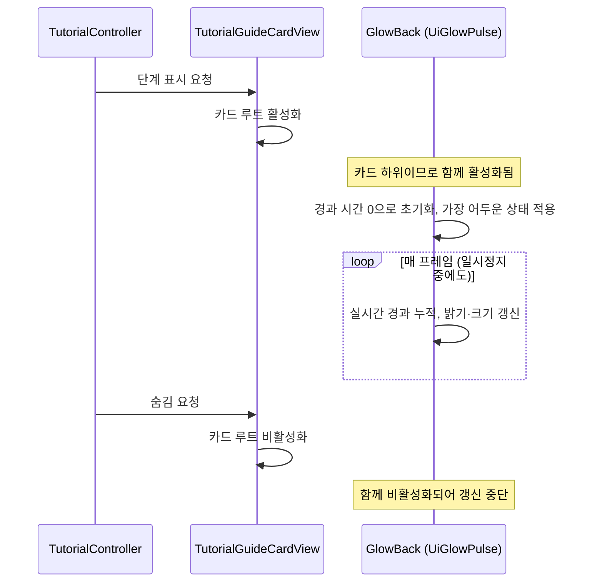

# 튜토리얼 가이드 카드 글로우 펄스 설계

## 1. 기능 개요 및 요구사항

튜토리얼 가이드 카드 뒤에 금빛 후광(글로우)이 천천히 숨 쉬듯 밝아졌다 어두워지게 하여, 룬 북처럼 화면이 복잡한 상황에서도 사용자가 카드를 놓치지 않게 한다.

- **시작 조건:** 튜토리얼 단계가 시작되어 가이드 카드가 화면에 나타날 때.
- **종료 조건:** 카드가 숨겨질 때. 카드와 같은 수명으로 움직인다.
- **정상 동작:** 카드 가장자리 바깥으로 번지는 금빛 후광의 밝기와 크기가 일정한 주기로 변한다. 카드가 나타나는 순간에는 가장 어두운 상태에서 시작한다.
- **일시정지 중에도 동작:** 룬 북을 열면 게임이 일시정지되는데, 4단계(룬 워드 장착)는 바로 그 상태에서 진행되므로 이때도 움직여야 한다.
- **제약:** 카드의 크기·레이아웃을 바꾸지 않고, 마우스 클릭을 막지 않는다.
- **제외 범위:** 카드 외의 다른 튜토리얼 UI(키 힌트, 완료 배너 등)에는 적용하지 않는다. 색상·모양 변경, 단계별 다른 연출은 다루지 않는다.

확정된 기본값: 한 주기 2.4초, 최소 밝기는 기준 밝기의 30%, 크기 배율 1.0 ~ 1.03.

## 2. 기존 코드 분석 및 변경 범위

### 확인된 사실

- 가이드 카드는 `Assets/10_UI/Prefabs/Tutorial/Cards/TutorialGuideCard.prefab`이고, `CombatScene`의 `Canvas/TutorialGuideCard`는 이 프리팹의 인스턴스다. `GlowBack`은 씬 인스턴스가 아니라 이 원본 프리팹에 추가하므로, 원본을 기반으로 하는 `TutorialGuideCard_Mouse`, `TutorialGuideCard_MultiKey`, `TutorialGuideCard_Prev`와 `TutorialGuideCard_Mouse`를 기반으로 하는 `TutorialGuideCard_Steps`에도 상속된다. 변형 프리팹이 `GlowBack`의 배치를 덮어쓰는지는 확인하지 않았다. 카드의 컴포넌트는 `Image`, `VerticalLayoutGroup`, `ContentSizeFitter`이고 자식은 `GlowBack`, `Bg1`, `Header`, `TitleText`, `BodyText`, `Divider`, `ActionRow`이다. `Bg1`은 레이아웃을 무시하고 카드 전체를 채우는 배경 이미지다.
- 카드의 표시와 숨김은 `TutorialGuideCardView`가 카드 루트의 활성화 상태로만 제어한다. 이 클래스는 이번 설계에서 수정하지 않는다.
- 룬 북을 열면 `RuneBookPauseController`가 시간 배율을 0으로 만든다. 시간 배율과 무관하게 호출되는 `Update`와 실시간 델타 시간으로 움직여야 한다. `HudMenuHints`의 금빛 펄스도 코루틴에서 같은 실시간 기준을 사용해 일시정지 중에도 재생된다.
- 글로우용 스프라이트 `TutorialCard_GlowFrame.png`는 가장자리 24px 9-slice로 설정되어 있어 카드 크기에 맞게 늘어난다.
- `GlowBack` 오브젝트는 이미 원본 프리팹에 추가되어 있다(루트 아래 첫 번째 자식, 위 스프라이트를 `Sliced`로 사용, 색 `(1, 0.82, 0.4)`와 알파 0.6, 레이아웃 무시, 카드 대비 사방 32px 확장, 클릭 차단 꺼짐). 형제 순서가 `Bg1`보다 앞서므로 카드 뒤에 그려진다.

### 변경 범위

| 구분 | 파일 | 내용 |
|---|---|---|
| 신규 | [UiGlowPulse.cs](../../../Assets/01_Scripts/UI/UiGlowPulse.cs) | 글로우 펄스 컴포넌트 |
| 수정 | `TutorialGuideCard.prefab` | `GlowBack`에 `UiGlowPulse` 추가 (글로우 오브젝트 자체는 적용 완료) |

`TutorialGuideCardView`, `TutorialController` 등 기존 튜토리얼 코드는 변경하지 않는다. 글로우가 카드의 하위 오브젝트이므로 카드가 켜지고 꺼질 때 컴포넌트의 활성화·비활성화가 자동으로 따라온다.

## 3. 전체 실행 흐름 및 설계 구조

데이터 소유권은 단순하다. 펄스의 경과 시간은 `UiGlowPulse`만 소유하고, 밝기·크기의 기준값은 같은 오브젝트의 이미지와 인스펙터 설정이 소유한다. 다른 클래스는 이 컴포넌트를 알지 못하며 이 컴포넌트도 다른 클래스를 참조하지 않는다.



확장성 검토: 이 컴포넌트는 특정 카드나 튜토리얼에 의존하지 않는 범용 UI 컴포넌트로 만들어, 같은 방식의 후광이 필요한 다른 UI에 붙이기만 하면 재사용할 수 있다. 현재 요구사항은 카드 하나이므로 공통 관리자나 추상화는 만들지 않는다.

## 4. 단계별 구현 가이드

### 단계 1. 글로우 오브젝트 준비 (적용 완료)

`TutorialGuideCard.prefab`의 루트 아래 첫 번째 자식으로 이미지 오브젝트 `GlowBack`을 만들고, 스프라이트를 글로우 프레임으로 지정해 이미지 타입을 `Sliced`로 둔다. 색은 금빛, 알파 0.6으로 설정한다. 레이아웃 요소를 붙여 레이아웃 무시를 켜서 세로 레이아웃과 크기 맞춤이 카드 크기를 바꾸지 못하게 하고, 앵커를 카드 전체에 맞춘 뒤 바깥쪽으로 32px씩 확장한다. 클릭 차단은 끈다.

이 단계는 이미 프리팹에 반영되어 있으므로 새로 작업하지 않고, 다음 단계에서 이 알파 0.6을 펄스의 최대 밝기로 사용한다.

### 단계 2. 컴포넌트 선언과 초기화

파일: [UiGlowPulse.cs](../../../Assets/01_Scripts/UI/UiGlowPulse.cs) (신규, 이 클래스만 담는 별도 파일)

아래 코드는 선언 목록이며, 메서드 본문이 없어 그대로는 컴파일되지 않는다. 각 메서드의 본문은 이어지는 처리 설명에 따라 직접 작성한다.

```csharp
using UnityEngine;
using UnityEngine.UI;

[DisallowMultipleComponent]
[RequireComponent(typeof(Image))]
public class UiGlowPulse : MonoBehaviour
{
    [SerializeField, Min(0.1f)] private float _cycleDurationSeconds = 2.4f;
    [SerializeField, Range(0f, 1f)] private float _minAlphaRatio = 0.3f; // 최소 알파 = 기준 알파 × 이 값
    [SerializeField] private Vector2 _scaleRange = new(1f, 1.03f);       // (가장 어두울 때, 가장 밝을 때) 배율

    private Image _image;
    private float _baseAlpha;       // 이미지에 설정된 알파. 펄스의 최대 밝기
    private float _elapsedSeconds;  // 활성화된 뒤 흐른 실시간(초). 한 주기 안에서 순환

    private void Awake();
    private void OnEnable();
    private void Update();
    private void ApplyPulse();
}
```

**`Awake` 처리:** 같은 오브젝트의 이미지를 가져와 보관하고, 그 이미지에 현재 설정된 알파를 펄스의 최대 밝기로 저장한다. 이 기준값은 이후 갱신에서 바뀌지 않으므로, 알파를 낮춰 쓰는 도중에도 원래 밝기를 잃지 않는다. 이미지의 존재는 필수 컴포넌트 선언이 보장하므로 별도 확인을 하지 않는다.

### 단계 3. 카드가 나타날 때의 시작 상태

**`OnEnable` 처리:**

1. 경과 시간을 0으로 되돌린다. 카드가 숨겨졌다 다시 나타나도 항상 같은 상태에서 시작하게 하려는 것이다.
2. 곧바로 한 번 밝기와 크기를 적용한다. 첫 프레임 갱신이 오기 전에 이전 상태가 잠깐 보이는 일이 없도록 하기 위해서다. 경과가 0이면 가장 어두운 상태이므로, 글로우는 어둡게 시작해 서서히 밝아진다.

씬 시작 시점의 활성화 순서(글로우 초기화 후 카드 뷰가 카드를 숨김)와 상관없이 이 처리는 올바르다. 비활성화된 동안은 갱신이 호출되지 않고, 다시 활성화되면 위 두 단계가 항상 다시 실행되기 때문이다.

### 단계 4. 매 프레임 갱신

**`Update` 처리:**

1. 시간 배율의 영향을 받지 않는 프레임 간 실시간을 경과 시간에 더한다. 룬 북이 열려 시간 배율이 0이어도 갱신이 계속되므로 일시정지 중에도 글로우가 움직인다.
2. 경과 시간이 한 주기를 넘으면 한 주기 안으로 되돌려 순환시킨다. 장시간 켜져 있어도 값이 계속 커지지 않게 한다.
3. 밝기와 크기를 갱신한다.

**`ApplyPulse` 처리:**

1. 한 주기 중 현재 진행 비율(0~1)을 구한다.
2. 진행 비율로부터 0에서 시작해 1까지 올라갔다가 다시 0으로 돌아오는 부드러운 파형 값을 만든다. 진행 비율이 0과 1일 때 가장 어둡고, 0.5일 때 가장 밝다.
3. 이 파형 값으로 최소 알파(기준 알파에 최소 비율을 곱한 값)와 기준 알파 사이를 보간해 이미지의 알파로 쓴다. 색상의 색 성분은 그대로 둔다.
4. 같은 파형 값으로 설정된 최소 배율과 최대 배율 사이를 보간해 오브젝트의 크기로 쓴다. 가로세로 동일한 배율을 적용한다.

시간은 길이(`_cycleDurationSeconds`)와 경과(`_elapsedSeconds`)로 구분했고, 알파는 기준 알파에 대한 비율(`_minAlphaRatio`)로 지정해 인스펙터에서 의미가 바로 보이게 했다.

### 단계 5. Unity 에디터 작업

1. `TutorialGuideCard.prefab`을 프리팹 편집 모드로 열고 `GlowBack`을 선택한다.
2. `UiGlowPulse` 컴포넌트를 추가한다. 기본값(주기 2.4초, 최소 알파 비율 0.3, 크기 범위 1.0~1.03)을 그대로 둔다.
3. 이미지의 알파가 0.6인지 확인한다. 이 값이 펄스의 최대 밝기가 된다.
4. 프리팹을 저장한다. 씬 인스턴스와 상속하는 변형 프리팹에 자동으로 반영된다.

## 5. 검증 기준 및 테스트 시나리오

| 시나리오 | 실행 조건 | 수행 행동 | 예상 결과 |
|---|---|---|---|
| 정상 펄스 | 튜토리얼 1단계 | 카드가 나타난 뒤 관찰 | 글로우가 어두운 상태에서 시작해 약 2.4초 주기로 밝아졌다 어두워짐. 카드 크기와 위치 변화 없음 |
| 일시정지 중 동작 | 튜토리얼 4단계, 룬 북을 연 상태 | 룬 북이 열려 있는 동안 관찰 | 게임이 멈춰 있어도 글로우가 계속 변함 |
| 재표시 | 카드가 숨겨졌다 다음 단계에서 다시 나타남 | 카드 재표시 직후 관찰 | 매번 가장 어두운 상태에서 다시 시작 |
| 입력 비차단 | 카드 아래에 클릭 가능한 UI가 있는 상태 | 카드 가장자리 바깥 글로우 영역을 클릭 | 아래 UI가 정상적으로 클릭됨 |
| 레이아웃 유지 | 본문 길이가 다른 여러 단계 | 단계 전환하며 카드 크기 확인 | 글로우가 없을 때와 카드 크기가 동일 |

## 6. 구현 순서 요약과 커밋 규칙

1. 단계 2~4의 [UiGlowPulse.cs](../../../Assets/01_Scripts/UI/UiGlowPulse.cs)를 작성한다.
2. 단계 5에 따라 프리팹에서 `GlowBack`에 컴포넌트를 붙인다.
3. 5장의 시나리오를 플레이 모드에서 확인한다.
4. 구현 코드, `TutorialGuideCard.prefab` 변경, 이 설계 문서를 하나의 커밋으로 묶는다.
