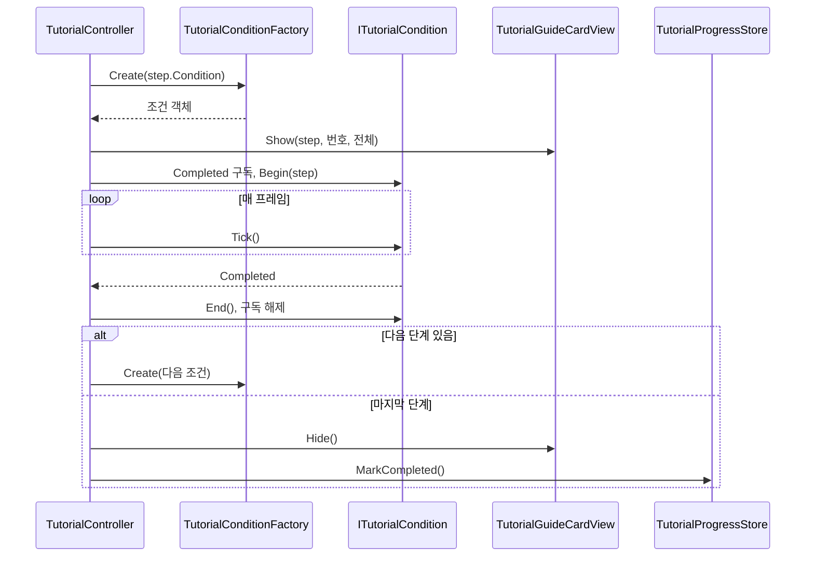

# 튜토리얼 조건 감시 구조와 완료 처리 — 구현 설계

> 상태: **설계 (미구현)** · 기준 브랜치 `feature/growth` · 작성일 2026-10-13
> 튜토리얼 구현 19단위 중 **1번 단위**이다. 기준 기획은 `Docs/Architecture/Tutorial/TutorialFlow.md`이다.

## 1. 기능 개요 및 요구사항

### 목적

튜토리얼 필수 10단계를 순서대로 진행시키는 뼈대를 만든다. 단계마다 "완료 조건"을 감시하고, 조건이 충족되면 다음 단계의 카드로 교체하며, 마지막 단계가 끝나면 완료를 저장한다. 이 단위에서는 완료 조건 중 `Move` 하나만 실제로 구현하고, 나머지 조건은 이후 단위가 구조에 파일을 추가하는 방식으로 채운다.

### 범위

- 조건 감시 구조: 조건 하나를 `ITutorialCondition` 구현체 하나로 표현하고, `TutorialConditionKind`로 생성한다.
- `Move` 조건 구현 (누적 이동 거리).
- 튜토리얼 시작 대기: 부팅 완료, 도착 연출 종료, 1층 준비 대기 상태 확인.
- 단계 전환과 마지막 단계 완료 시 종료 처리 (`TutorialProgressStore.MarkCompleted`).
- 최소 카드 뷰: 헤더(`NN / 전체`), 제목, 본문만 표시한다.

### 시작·종료 조건

- 시작: 이미 완료된 적이 없고, 1층이 "시작 석상 대기" 상태이며, 부팅이 끝나고, 플레이어 도착 연출이 끝났을 때 0번 단계를 시작한다.
- 종료: 마지막 단계의 조건이 충족되면 카드를 숨기고 완료를 저장한 뒤 컨트롤러를 끈다.
- 이미 완료 기록이 있으면 시작하지 않는다.

### 제외 범위

- 중도 이탈 처리 (2번 단위): 진행 중 씬 이탈, 진행 중 석상 선행, 정리 보강.
- 행동 행(키·마우스 아이콘), 키 힌트, 스포트라이트, 월드 마커 (3번 단위 이후).
- `Move` 외 조건 9종 (3~13번 단위).
- 튜토리얼 규칙(`TutorialRules`: 임무 고정, 실패 없음, 체력 하한, 룬석 지급, 룬북 잠금)과 건너뛰기, 상황 안내 카드, 협회 지침서.
- 본 기록 id 저장 (14번 단위).

### 확인 기준

1단계(`Move`)를 완료하면 카드가 2단계 내용으로 교체되고, 마지막 단계를 완료하면 카드가 사라지며 완료가 저장된다. 플레이를 다시 시작하면 튜토리얼이 실행되지 않는다.

## 2. 기존 코드 분석 및 변경 범위

### 확인된 사실

- `Assets/01_Scripts/Tutorial/`에는 `.meta`만 있고 스크립트가 없다. 이 단위는 새로 작성한다.
- `StageManager.Instance.IsWaitingForPreparation`: 시작 석상에서 출발 준비를 끝내기 전까지 참이다. 석상이 `BeginPreparedRun()`을 호출하면 거짓이 되고 1층이 시작된다. (`StageManager.cs`)
- `GameBootstrap.State`: `BootstrapState`(`NotStarted/Initializing/Ready/Failed`).
- `PortalPlayerHider.IsAnyHiding`: 도착 연출 등으로 플레이어를 숨기거나 조작을 막고 있는 hider가 있는지 나타내는 static 프로퍼티이다. **현재 커밋되지 않은 작업 트리 변경**이므로 이 단위의 커밋에 함께 포함해야 한다.
- 카드 프리팹 `Assets/10_UI/Prefabs/Tutorial/Cards/TutorialGuideCard.prefab`은 커스텀 스크립트 없는 순수 UI이다. 자식 이름은 `Header/HeaderLabel`, `TitleText`, `BodyText`, `ProgressBar/Fill`, `ActionRow`, `ConditionText`이다.
- `CombatScene.unity`의 한 게임 오브젝트(`fileID 2055402654`)에 삭제된 `TutorialGuideCardView`, `TutorialController` 컴포넌트가 Missing 상태로 남아 있다.
- 적과 플레이어 애니메이션이 `Rigidbody2D`를 사용한다. 플레이어 이동 스크립트는 확인하지 못했다.

### 제안 및 가정

- 이동 거리는 XY 평면 거리로 계산한다. 구현 시 실제 플레이어 이동 평면을 확인하고 다르면 평면을 맞춘다.
- `Move`의 기본 거리 값은 정하지 않았다. 임시 에셋에 3, 5 정도를 넣고 플레이하며 조정한다.

### 생성 파일 (`Assets/01_Scripts/Tutorial/`)

- `TutorialConditionKind.cs`
- `TutorialStepSO.cs`
- `TutorialProgressStore.cs`
- `ITutorialCondition.cs`
- `MoveCondition.cs`
- `TutorialConditionFactory.cs`
- `TutorialController.cs`
- `UI/TutorialGuideCardView.cs`

### 생성 에셋과 씬 변경

- `Assets/11_Data/Tutorial/`에 임시 `TutorialStepSO` 2개 (둘 다 `Move`).
- `CombatScene`: Missing 컴포넌트 제거, 컨트롤러·카드 뷰 추가, 카드 프리팹 인스턴스 배치.

### 영향 관계

기존 게임 코드는 수정하지 않는다. `StageManager`, `GameBootstrap`, `PortalPlayerHider`는 읽기만 한다. `MissionManager`에 남은 `SetNextMissionOverride(object)` 스텁은 7번 단위 소관이며 이 단위에서 건드리지 않는다.

## 3. 전체 실행 흐름 및 설계 구조

### 책임과 소유권

- `TutorialController`가 진행 상태(현재 단계 번호, 실행 여부, 현재 활성 조건)를 소유한다. 어떤 조건이 있는지는 모르고 `ITutorialCondition` 계약과 팩토리만 사용한다.
- 조건 객체가 자신의 감시 상태(이동 누적 거리 등)와 필요한 외부 참조를 소유한다.
- 단계 데이터(제목, 본문, 조건 종류, 조건 값)는 `TutorialStepSO`가 소유한다.
- 완료 여부의 영속 저장은 `TutorialProgressStore`(PlayerPrefs)가 소유한다.
- 화면 표시는 `TutorialGuideCardView`가 소유하며 진행 상태를 알지 못한다.

### 단계 진행 시퀀스



## 4. 단계별 구현 가이드

구현 순서는 컴파일 의존성을 따른다. 데이터·저장소 → 조건 계약과 `Move` → 팩토리 → 카드 뷰 → 컨트롤러 순서이며, 컨트롤러 안의 메서드는 실제 실행 순서대로 설명한다.

### 4.1 데이터와 저장소

`TutorialConditionKind`는 로드맵의 10개 값을 모두 정의한다. 구현되지 않은 값은 팩토리가 거부한다. 파일: `TutorialConditionKind.cs` (신규)

```csharp
public enum TutorialConditionKind
{
    Move,
    StatueInteract,
    ElementConfirm,
    RuneConfirm,
    MissionStart,
    Acknowledge,
    EnemyKill,
    Dash,
    RewardConfirm,
    PortalEnter
}
```

`TutorialStepSO`는 이 단위에 필요한 필드만 가진다. 단계 번호는 컨트롤러 배열의 인덱스에서 얻으므로 번호 필드는 두지 않는다. 행동 행, 오버레이 등은 해당 단위가 필요할 때 추가한다. 파일: `TutorialStepSO.cs` (신규)

```csharp
[CreateAssetMenu(menuName = "Scriptable Objects/Tutorial Step SO")]
public class TutorialStepSO : ScriptableObject
{
    [SerializeField] private string _title;
    [SerializeField, TextArea] private string _body;
    [SerializeField] private TutorialConditionKind _condition;
    [SerializeField] private float _conditionValue;

    public string Title => _title;
    public string Body => _body;
    public TutorialConditionKind Condition => _condition;
    public float ConditionValue => _conditionValue;
}
```

`ConditionValue`의 의미는 조건 종류마다 다르다. `Move`에서는 완료에 필요한 누적 이동 거리(월드 단위)이다.

`TutorialProgressStore`는 완료 여부만 다룬다. 파일: `TutorialProgressStore.cs` (신규)

```csharp
public static class TutorialProgressStore
{
    private const string CompletedKey = "Tutorial.Completed";

    public static bool IsCompleted { get; }
    public static void MarkCompleted();
    public static void ResetForDebug();
}
```

`IsCompleted`는 PlayerPrefs의 완료 키를 정수로 읽어 1이면 참을 돌려준다(없으면 0). `MarkCompleted`는 키를 1로 쓰고 즉시 저장한다. `ResetForDebug`는 키를 지우고 저장한다. 개발 중 튜토리얼을 다시 보기 위한 용도이다.

**Unity 에디터 작업**: `Assets/11_Data/Tutorial/` 폴더에서 `TutorialStepSO` 에셋 2개(예: `Step01_Move`, `Step02_Move`)를 만든다. 둘 다 조건을 `Move`로 하고 `ConditionValue`는 3과 5로 시작한다. 제목과 본문은 구분되는 임시 문구를 넣는다. 이 임시 에셋은 실제 10단계 에셋으로 교체한다.

### 4.2 조건 계약과 Move 조건

조건 계약은 컨트롤러와 모든 조건 구현체 사이의 유일한 접점이다. 파일: `ITutorialCondition.cs` (신규)

```csharp
public interface ITutorialCondition
{
    event Action Completed;
    void Begin(TutorialStepSO step);
    void Tick();
    void End();
}
```

`Begin`은 단계가 시작될 때 한 번, `Tick`은 활성 동안 매 프레임, `End`는 단계가 끝나거나 컨트롤러가 꺼질 때 한 번 호출된다. 이벤트 기반 조건은 `Begin`에서 구독하고 `End`에서 해제하며 `Tick`은 비워 둔다.

`MoveCondition`은 플레이어의 이동 거리를 누적한다. 파일: `MoveCondition.cs` (신규)

```csharp
public class MoveCondition : ITutorialCondition
{
    private Transform _player;
    private Vector3 _lastPosition;
    private float _movedDistance;
    private float _targetDistance;
    private bool _isActive;

    public event Action Completed;

    public void Begin(TutorialStepSO step);
    public void Tick();
    public void End();
}
```

`Begin`의 처리 순서:

1. 누적 거리를 0으로 초기화한다.
2. Player 태그를 가진 오브젝트를 찾는다. 찾지 못하면 오류를 로그로 남기고 비활성 상태로 둔 채 종료한다. 이 경우 조건은 완료되지 않는다.
3. 플레이어의 Transform과 현재 위치를 기록한다. 이후 이동량은 이 위치를 기준으로 잰다.
4. 단계의 `ConditionValue`를 목표 거리로 저장하고 활성 상태로 전환한다.

`Tick`의 처리 순서:

1. 비활성 상태이면 종료한다.
2. 현재 플레이어 위치와 직전 프레임 위치 사이의 XY 거리를 누적하고, 직전 위치를 현재 위치로 갱신한다.
3. 누적 거리가 목표 거리 미만이면 종료한다.
4. 목표 거리 이상이면 비활성 상태로 전환한 뒤 `Completed`를 발생시킨다. `Completed` 처리 중에 컨트롤러가 `End`를 호출하고 다음 조건으로 넘어가므로, 발생 이후에는 이 객체의 상태를 건드리지 않는다.

`End`는 비활성 상태로 전환하고 플레이어 참조와 누적 거리를 비운다.

### 4.3 조건 팩토리

팩토리는 조건 종류에서 구현체를 만드는 유일한 위치이다. 이후 단위는 이 `switch`에 한 줄을 추가한다. 파일: `TutorialConditionFactory.cs` (신규)

```csharp
public static class TutorialConditionFactory
{
    public static ITutorialCondition Create(TutorialConditionKind kind);
}
```

`Create`는 `Move`이면 새 `MoveCondition`을 돌려준다. 그 외 종류는 구현되지 않았다는 오류를 로그로 남기고 `null`을 돌려준다. 호출한 컨트롤러가 `null`을 실패로 처리한다.

### 4.4 카드 뷰

카드 뷰는 진행 상태를 모르고, 받은 데이터를 표시만 한다. 파일: `UI/TutorialGuideCardView.cs` (신규)

```csharp
public class TutorialGuideCardView : MonoBehaviour
{
    [SerializeField] private GameObject _cardRoot;
    [SerializeField] private TMP_Text _headerLabel;
    [SerializeField] private TMP_Text _titleText;
    [SerializeField] private TMP_Text _bodyText;

    private void Awake();
    public void Show(TutorialStepSO step, int number, int total);
    public void Hide();
}
```

`Awake`는 카드 루트를 비활성화한다. 튜토리얼이 시작되기 전이나 완료 후 재진입 시 카드가 잠깐 보이는 일을 막기 위해서이다. `Show`는 카드 루트를 활성화하고, 헤더에 두 자리 번호와 전체 수를 `NN / 전체` 형식으로, 제목과 본문에 단계 데이터를 넣는다. 이미 표시 중이어도 같은 방식으로 내용만 바꾸므로 "카드 교체"는 별도 처리 없이 `Show` 재호출로 이뤄진다. `Hide`는 카드 루트를 비활성화한다.

`_cardRoot`는 뷰 컴포넌트가 붙은 오브젝트 자신이 아니라 카드 프리팹 인스턴스여야 한다. 자기 자신을 비활성화하면 `Awake`와 이후 호출이 동작하지 않는다.

**Unity 에디터 작업**: 캔버스 아래에 `TutorialGuideCard` 프리팹 인스턴스를 놓는다. 컨트롤러 오브젝트에 `TutorialGuideCardView`를 붙이고 `_cardRoot`에 프리팹 인스턴스를, `_headerLabel`에 `Header/HeaderLabel`을, `_titleText`에 `TitleText`를, `_bodyText`에 `BodyText`를 연결한다. 프리팹의 행동 행, 진행 막대, 조건 텍스트는 이 단위에서 사용하지 않는다.

### 4.5 컨트롤러

컨트롤러가 시작 대기, 단계 전환, 종료를 담당한다. 파일: `TutorialController.cs` (신규)

```csharp
public class TutorialController : MonoBehaviour
{
    [SerializeField] private TutorialStepSO[] _steps;
    [SerializeField] private TutorialGuideCardView _guideCardView;
    [SerializeField] private GameBootstrap _bootstrap;

    private Coroutine _startRoutine;
    private ITutorialCondition _activeCondition;

    public int CurrentIndex { get; private set; }
    public bool IsRunning { get; private set; }

    public event Action<int, TutorialStepSO> StepStarted;
    public event Action Finished;

    private void Start();
    private void Update();
    private void OnDisable();
    private IEnumerator StartRoutine();
    private void BeginStep(int index);
    private void HandleConditionCompleted();
    private void CompleteStep();
    private void Finish();
    private void EndActiveCondition();

    [ContextMenu("Reset Progress")]
    private void ResetProgress();
}
```

`StepStarted`(단계 번호, 단계 데이터)와 `Finished`는 이후 단위의 규칙 객체가 구독하는 확장 지점이다. 예를 들어 4번 단계 시작 시 룬북을 열어 주는 처리가 `StepStarted`에 붙는다. 이 단위에서는 구독자가 없다.

`Start`의 처리 순서:

1. `TutorialProgressStore.IsCompleted`가 참이면 컴포넌트를 끄고 종료한다.
2. 단계 배열이 비어 있으면 오류를 로그로 남기고 컴포넌트를 끄고 종료한다.
3. 단계 배열에 `null` 항목이 있으면 같은 방식으로 처리한다.
4. 모두 통과하면 `StartRoutine`을 시작하고 핸들을 `_startRoutine`에 보관한다.

`StartRoutine`의 처리 순서 (각 실패 경로는 컴포넌트를 끄고 코루틴을 끝낸다):

1. 한 프레임 기다린다. 다른 오브젝트의 `Awake`와 `Start`가 먼저 끝나도록 하기 위해서이다.
2. `StageManager.Instance`가 없으면 경고를 남기고 종료한다.
3. `IsWaitingForPreparation`이 거짓이면 이미 1층이 시작된 것이므로 경고를 남기고 종료한다.
4. `GameBootstrap.State`가 `Ready`가 될 때까지 매 프레임 기다린다. 기다리는 동안 `Failed`가 되면 경고를 남기고 종료한다. 석상이 먼저 출발 준비를 끝내 `IsWaitingForPreparation`이 거짓이 되어도 종료한다.
5. `PortalPlayerHider.IsAnyHiding`이 거짓이 될 때까지 같은 방식으로 기다린다. 도착 연출 중에 카드가 먼저 뜨는 것을 막는다.
6. 기다림이 끝난 직후 `IsWaitingForPreparation`을 한 번 더 확인하고, 거짓이면 종료한다.
7. 모든 조건이 통과하면 `_startRoutine`을 비우고 `IsRunning`을 참으로 한 뒤 `BeginStep(0)`을 호출한다.

이후 단위에서 튜토리얼 규칙 적용(`TutorialRules.Apply`)이 7번 직전에 들어간다.

`BeginStep(index)`의 처리 순서:

1. `CurrentIndex`를 갱신하고 해당 단계 데이터를 가져온다.
2. 팩토리로 조건 객체를 만든다. `null`이면 오류를 로그로 남기고 컴포넌트를 끄고 종료한다. 이때 카드 표시와 이벤트 발생은 일어나지 않는다.
3. 만든 조건 객체를 `_activeCondition`에 저장하고 `StepStarted`를 발생시킨다.
4. 카드 뷰의 `Show`를 단계 데이터, 사람 기준 번호(`index + 1`), 전체 단계 수로 호출한다.
5. 조건의 `Completed`를 `HandleConditionCompleted`로 구독하고 `Begin`을 호출한다. 구독을 `Begin` 앞에 두는 이유는 `Begin` 중에 즉시 완료되는 조건이 있어도 놓치지 않기 위해서이다.

`Update`는 실행 중이 아니거나 활성 조건이 없으면 종료하고, 그렇지 않으면 활성 조건의 `Tick`을 호출한다.

`HandleConditionCompleted`는 `CompleteStep`을 호출한다. 조건 객체가 `Tick` 안에서 `Completed`를 발생시키므로 `CompleteStep`은 `Tick` 호출 스택 안에서 실행된다는 점에 유의한다.

`CompleteStep`의 처리 순서:

1. `EndActiveCondition`으로 현재 조건의 구독을 해제하고 `End`를 호출한 뒤 참조를 비운다.
2. 다음 단계가 있으면 `BeginStep(CurrentIndex + 1)`을 호출하고 종료한다.
3. 마지막 단계였다면 `Finish`를 호출한다.

`Finish`의 처리 순서:

1. 카드 뷰의 `Hide`를 호출한다.
2. `TutorialProgressStore.MarkCompleted`로 완료를 저장한다.
3. `IsRunning`을 거짓으로 한다.
4. `Finished`를 발생시킨다.
5. 컴포넌트를 끈다. `OnDisable`이 호출되지만 활성 조건이 이미 비어 있으므로 아무 일도 하지 않는다.

`EndActiveCondition`은 활성 조건이 있으면 `Completed` 구독을 해제하고 `End`를 호출한 뒤 `_activeCondition`을 비운다. 없으면 아무것도 하지 않는다.

`OnDisable`은 시작 코루틴이 남아 있으면 멈추고 핸들을 비운 뒤 `EndActiveCondition`을 호출한다. 진행 중 컴포넌트가 꺼지는 경우의 완전한 정리(카드 숨김, 상태 복구)는 2번 단위에서 보강한다.

`ResetProgress`는 `TutorialProgressStore.ResetForDebug`를 호출한다. Inspector 컨텍스트 메뉴로만 실행하는 개발 편의 기능이다.

**Unity 에디터 작업**:

1. `CombatScene`에서 `fileID 2055402654` 오브젝트를 찾아 Missing으로 남은 컴포넌트 2개를 제거한다.
2. 같은 오브젝트에 `TutorialController`를 추가한다. `_steps`에 4.1에서 만든 임시 에셋 2개를 순서대로 넣고, `_guideCardView`에 4.4의 뷰를, `_bootstrap`에 씬의 `GameBootstrap`을 연결한다.
3. 뷰와 컨트롤러가 같은 오브젝트에 있어도 괜찮다. 단 `_cardRoot`는 별도의 프리팹 인스턴스여야 한다.

## 5. 검증 기준 및 테스트 시나리오

각 시나리오 전에 필요하면 컨트롤러의 `Reset Progress` 컨텍스트 메뉴로 완료 기록을 지운다.

**정상: 두 단계 완료**
- 조건: 완료 기록 없음, `Step01_Move`(3), `Step02_Move`(5) 연결, 석상 대기 상태로 씬 시작.
- 행동: 도착 연출이 끝난 뒤 WASD로 이동한다.
- 결과: 도착 연출 중에는 카드가 보이지 않는다. 연출 후 `01 / 02` 카드가 뜬다. 약 3 이동하면 `02 / 02` 카드로 교체되고, 이어서 약 5 이동하면 카드가 사라진다. 완료가 저장되고 컨트롤러가 꺼진다.

**정상: 재시작 시 미실행**
- 조건: 위 시나리오 완료 직후.
- 행동: 플레이를 종료하고 다시 시작한다.
- 결과: 카드가 나타나지 않고 컨트롤러가 꺼진 상태로 시작한다.

**경계: 거리 누적 시작점**
- 조건: 2단계 시작 직후.
- 행동: 1단계에서 이동하던 방향으로 계속 이동한다.
- 결과: 2단계의 이동 거리는 2단계가 시작된 위치에서부터 다시 센다. 1단계에서 남은 거리가 넘어오지 않는다.

**경계: 정지 상태**
- 조건: 1단계 카드 표시 중.
- 행동: 이동하지 않고 대기한다.
- 결과: 카드가 바뀌지 않는다.

**예외: 부팅 실패**
- 조건: `GameBootstrap`이 `Failed`가 되는 상황.
- 행동: 씬 시작.
- 결과: 경고 로그가 남고 컨트롤러가 꺼지며 카드는 나타나지 않는다.

**예외: 1층이 이미 시작됨**
- 조건: 컨트롤러가 시작을 기다리는 중 석상 상호작용으로 출발 준비를 마쳐 1층이 시작된 경우.
- 행동: 석상과 상호작용한다.
- 결과: 컨트롤러가 꺼지고 카드는 나타나지 않는다. 이미 시작되어 있던 경우도 동일하다.

**예외: 단계 배열 문제**
- 조건: `_steps`가 비었거나 `null` 항목이 있다.
- 행동: 씬 시작.
- 결과: 오류 로그가 남고 컨트롤러가 꺼진다.

**예외: 미구현 조건**
- 조건: 단계 에셋의 조건이 `Move` 외 값이다.
- 행동: 해당 단계에 도달한다.
- 결과: 구현되지 않았다는 오류 로그가 남고 컨트롤러가 꺼진다. 카드는 바뀌지 않는다.

**예외: 플레이어 없음**
- 조건: Player 태그 오브젝트가 없다.
- 행동: 1단계 시작.
- 결과: 오류 로그가 남고, 카드는 표시되지만 단계가 완료되지 않는다.

## 구현 중 확인할 항목

- 플레이어 실제 이동 평면 (XY 가정 검증).
- `Move` 기본 거리 값.
- `PortalPlayerHider.IsAnyHiding` 미커밋 변경을 이 단위의 구현 커밋에 함께 포함.
