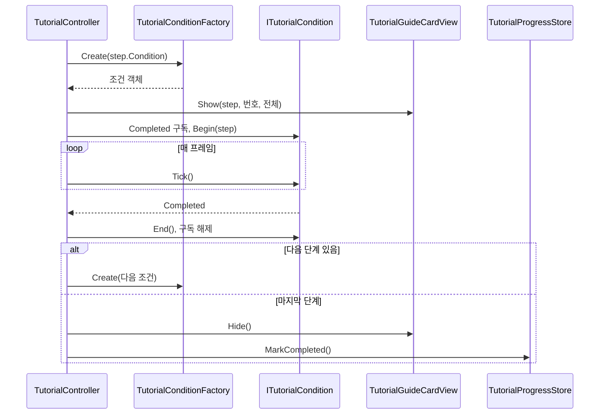

# 튜토리얼 조건 감시 구조와 완료 처리 — 구현 설계

> 상태: **구현됨 (Codex 리뷰 반영, Unity 실행 검증은 별도 확인)** · 기준 브랜치 `feature/growth` · 작성일 2026-10-13 · 구현 반영 갱신 2026-10-13
> 튜토리얼 구현 19단위 중 **1번 단위**이다. 기준 기획은 `Docs/Architecture/Tutorial/TutorialFlow.md`이다.
> 최초 설계 이후 바뀐 점: `GameBootstrap` 대기 제거(전투 씬에서 제거 예정), 카드 뷰 파일 위치(`Tutorial/` 직하), 팩토리 클래스 형태, 조건 생성 실패 시 정리 처리. 각 위치에 반영했다.

## 1. 기능 개요 및 요구사항

### 목적

튜토리얼 필수 10단계를 순서대로 진행시키는 뼈대를 만든다. 단계마다 "완료 조건"을 감시하고, 조건이 충족되면 다음 단계의 카드로 교체하며, 마지막 단계가 끝나면 완료를 저장한다. 이 단위에서는 완료 조건 중 `Move` 하나만 실제로 구현하고, 나머지 조건은 이후 단위가 구조에 파일을 추가하는 방식으로 채운다.

### 범위

- 조건 감시 구조: 조건 하나를 `ITutorialCondition` 구현체 하나로 표현하고, `TutorialConditionKind`로 생성한다.
- `Move` 조건 구현 (누적 이동 거리).
- 튜토리얼 시작 대기: 도착 연출 종료, 1층 준비 대기 상태 확인. (데이터 준비 대기는 하지 않는다. 아래 "확정 결정" 참조)
- 단계 전환과 마지막 단계 완료 시 종료 처리 (`TutorialProgressStore.MarkCompleted`).
- 최소 카드 뷰: 헤더(`NN / 전체`), 제목, 본문만 표시한다.

### 시작·종료 조건

- 시작: 이미 완료된 적이 없고, 1층이 "시작 석상 대기" 상태이며, 플레이어 도착 연출이 끝났을 때 0번 단계를 시작한다.
- 종료: 마지막 단계의 조건이 충족되면 카드를 숨기고 완료를 저장한 뒤 컨트롤러를 끈다.
- 이미 완료 기록이 있으면 시작하지 않는다.

### 제외 범위

- 중도 이탈 처리 (2번 단위): 진행 중 씬 이탈, 진행 중 석상 선행, 정리 보강.
- 행동 행(키·마우스 아이콘), 키 힌트, 스포트라이트, 월드 마커 (3번 단위 이후).
- `Move` 외 조건 9종 (3~13번 단위).
- 튜토리얼 규칙(`TutorialRules`: 임무 고정, 실패 없음, 체력 하한, 룬석 지급, 룬북 잠금)과 건너뛰기, 상황 안내 카드, 협회 지침서.
- 본 기록 id 저장 (14번 단위).

### 확인 기준

1단계(`Move`)를 완료하면 카드가 2단계 내용으로 교체되고, 마지막 단계를 완료하면 카드가 사라지며 완료가 저장된다. 플레이를 다시 시작하면 튜토리얼이 실행되지 않는다.

## 2. 기존 코드 분석 및 변경 범위

### 설계 시점에 확인한 사실

- `Assets/01_Scripts/Tutorial/`에는 `.meta`만 있고 스크립트가 없었다. 이 단위는 새로 작성했다.
- `StageManager.Instance.IsWaitingForPreparation`: 시작 석상에서 출발 준비를 끝내기 전까지 참이다. 석상이 `BeginPreparedRun()`을 호출하면 거짓이 되고 1층이 시작된다. (`StageManager.cs`)
- `GameBootstrap.State`: `BootstrapState`(`NotStarted/Initializing/Ready/Failed`). 정식 흐름에서는 `LoadingSceneController`가 `Ready`를 기다린 뒤 `CombatScene`으로 넘기고, `GameSession`은 씬이 바뀌어도 유지된다.
- `PortalPlayerHider.IsAnyHiding`: 도착 연출 등으로 플레이어를 숨기거나 조작을 막고 있는 hider가 있는지 나타내는 static 프로퍼티이다. 설계 시점에는 미커밋 변경이었고 이 단위의 첫 커밋에 포함됐다.
- 카드 프리팹 `Assets/10_UI/Prefabs/Tutorial/Cards/TutorialGuideCard.prefab`은 커스텀 스크립트 없는 순수 UI이다. 자식 이름은 `Header/HeaderLabel`, `TitleText`, `BodyText`, `ProgressBar/Fill`, `ActionRow`, `ConditionText`이다.
- `CombatScene.unity`의 한 게임 오브젝트(`fileID 2055402654`)에 삭제된 `TutorialGuideCardView`, `TutorialController` 컴포넌트가 Missing 상태로 남아 있다.
- 적과 플레이어 애니메이션이 `Rigidbody2D`를 사용한다. 플레이어 이동 스크립트는 확인하지 못했다.

### 확정 결정

- **`GameBootstrap` 대기를 하지 않는다.** `GameBootstrap`은 추후 전투 씬에서 제거할 예정이고, 데이터 준비는 로딩 씬에서 끝난 뒤 전투 씬이 시작되므로 컨트롤러는 `GameBootstrap`/`BootstrapState`를 참조하지 않는다. 전투 씬에서 바로 플레이하는 디버그 경로(`CombatSceneTestSetup`)가 데이터 준비를 기다리는 문제는 `GameBootstrap` 제거 시 그쪽에서 함께 다룬다.
- "전투 씬에서만 동작"은 씬 배치로 보장한다. 컨트롤러는 `CombatScene`에만 있고, 시작 시 `StageManager.Instance` 존재 확인이 추가 방어 역할을 한다.

### 제안 및 가정

- 이동 거리는 XY 평면 거리로 계산한다(`Vector2.Distance`). 실제 플레이어 이동 평면은 아직 확인하지 못했으므로 다르면 평면을 맞춘다.
- `Move`의 기본 거리 값은 정하지 않았다. 임시 에셋에 3, 5를 넣었고 플레이하며 조정한다.

### 생성 파일 (`Assets/01_Scripts/Tutorial/`)

- `TutorialConditionKind.cs`
- `TutorialStepSO.cs`
- `TutorialProgressStore.cs`
- `ITutorialCondition.cs`
- `MoveCondition.cs`
- `TutorialConditionFactory.cs`
- `TutorialController.cs`
- `TutorialGuideCardView.cs` (`UI/` 하위 폴더 없이 `Tutorial/` 직하에 둔다)

### 생성 에셋과 씬 변경

- `Assets/11_Data/Tutorial/`에 임시 `TutorialStepSO` 2개: `Step01_Move`(거리 3), `Step02_Move`(거리 5).
- `CombatScene`: Missing 컴포넌트 제거, 컨트롤러·카드 뷰 추가, 카드 프리팹 인스턴스 배치.

### 영향 관계

기존 게임 코드 중 `PortalPlayerHider`에는 `IsAnyHiding` 프로퍼티만 추가했다. `StageManager`는 읽기만 하고 `GameBootstrap`은 참조하지 않는다. `MissionManager`에 남은 `SetNextMissionOverride(object)` 스텁은 7번 단위 소관이며 이 단위에서 건드리지 않는다.

## 3. 전체 실행 흐름 및 설계 구조

### 책임과 소유권

- `TutorialController`가 진행 상태(현재 단계 번호, 실행 여부, 현재 활성 조건)를 소유한다. 어떤 조건이 있는지는 모르고 `ITutorialCondition` 계약과 팩토리만 사용한다.
- 조건 객체가 자신의 감시 상태(이동 누적 거리 등)와 필요한 외부 참조를 소유한다.
- 단계 데이터(제목, 본문, 조건 종류, 조건 값)는 `TutorialStepSO`가 소유한다.
- 완료 여부의 영속 저장은 `TutorialProgressStore`(PlayerPrefs)가 소유한다.
- 화면 표시는 `TutorialGuideCardView`가 소유하며 진행 상태를 알지 못한다.

### 단계 진행 시퀀스



## 4. 단계별 구현 가이드

구현 순서는 컴파일 의존성을 따른다. 데이터·저장소 → 조건 계약과 `Move` → 팩토리 → 카드 뷰 → 컨트롤러 순서이며, 컨트롤러 안의 메서드는 실제 실행 순서대로 설명한다.

### 4.1 데이터와 저장소

`TutorialConditionKind`는 로드맵의 10개 값을 모두 정의한다. 구현되지 않은 값은 팩토리가 거부한다. 파일: `TutorialConditionKind.cs` (신규)

```csharp
public enum TutorialConditionKind
{
    Move,
    StatueInteract,
    ElementConfirm,
    RuneConfirm,
    MissionStart,
    Acknowledge,
    EnemyKill,
    Dash,
    RewardConfirm,
    PortalEnter
}
```

`TutorialStepSO`는 이 단위에 필요한 필드만 가진다. 단계 번호는 컨트롤러 배열의 인덱스에서 얻으므로 번호 필드는 두지 않는다. 행동 행, 오버레이 등은 해당 단위가 필요할 때 추가한다. 파일: `TutorialStepSO.cs` (신규)

```csharp
[CreateAssetMenu(menuName = "Scriptable Objects/Tutorial Step SO")]
public class TutorialStepSO : ScriptableObject
{
    [SerializeField] private string _title;
    [SerializeField, TextArea] private string _body;
    [SerializeField] private TutorialConditionKind _condition;
    [SerializeField] private float _conditionValue;

    public string Title => _title;
    public string Body => _body;
    public TutorialConditionKind Condition => _condition;
    public float ConditionValue => _conditionValue;
}
```

`ConditionValue`의 의미는 조건 종류마다 다르다. `Move`에서는 완료에 필요한 누적 이동 거리(월드 단위)이다.

`TutorialProgressStore`는 완료 여부만 다룬다. 파일: `TutorialProgressStore.cs` (신규)

```csharp
public static class TutorialProgressStore
{
    private const string CompletedKey = "Tutorial.Completed";

    public static bool IsCompleted { get; }
    public static void MarkCompleted();
    public static void ResetForDebug();
}
```

`IsCompleted`는 PlayerPrefs의 완료 키를 정수로 읽어 1이면 참을 돌려준다(없으면 0). `MarkCompleted`는 키를 1로 쓰고 즉시 저장한다. `ResetForDebug`는 키를 지우고 저장한다. 개발 중 튜토리얼을 다시 보기 위한 용도이다.

**Unity 에디터 작업**: `Assets/11_Data/Tutorial/` 폴더에서 `TutorialStepSO` 에셋 2개(예: `Step01_Move`, `Step02_Move`)를 만든다. 둘 다 조건을 `Move`로 하고 `ConditionValue`는 3과 5로 시작한다. 제목과 본문은 구분되는 임시 문구를 넣는다. 이 임시 에셋은 실제 10단계 에셋으로 교체한다.

### 4.2 조건 계약과 Move 조건

조건 계약은 컨트롤러와 모든 조건 구현체 사이의 유일한 접점이다. 파일: `ITutorialCondition.cs` (신규)

```csharp
public interface ITutorialCondition
{
    event Action Completed;
    void Begin(TutorialStepSO step);
    void Tick();
    void End();
}
```

`Begin`은 단계가 시작될 때 한 번, `Tick`은 활성 동안 매 프레임, `End`는 단계가 끝나거나 컨트롤러가 꺼질 때 한 번 호출된다. 이벤트 기반 조건은 `Begin`에서 구독하고 `End`에서 해제하며 `Tick`은 비워 둔다.

`MoveCondition`은 플레이어의 이동 거리를 누적한다. 파일: `MoveCondition.cs` (신규)

```csharp
public class MoveCondition : ITutorialCondition
{
    private Transform _player;
    private Vector3 _lastPosition;
    private float _movedDistance;
    private float _targetDistance;
    private bool _isActive;

    public event Action Completed;

    public void Begin(TutorialStepSO step);
    public void Tick();
    public void End();
}
```

`Begin`의 처리 순서:

1. 누적 거리를 0으로 초기화한다.
2. Player 태그를 가진 오브젝트를 찾는다. 찾지 못하면 오류를 로그로 남기고 비활성 상태로 둔 채 종료한다. 이 경우 조건은 완료되지 않는다.
3. 플레이어의 Transform과 현재 위치를 기록한다. 이후 이동량은 이 위치를 기준으로 잰다.
4. 단계의 `ConditionValue`를 목표 거리로 저장하고 활성 상태로 전환한다.

`Tick`의 처리 순서:

1. 비활성 상태이면 종료한다.
2. 현재 플레이어 위치와 직전 프레임 위치 사이의 XY 거리를 누적하고, 직전 위치를 현재 위치로 갱신한다.
3. 누적 거리가 목표 거리 미만이면 종료한다.
4. 목표 거리 이상이면 비활성 상태로 전환한 뒤 `Completed`를 발생시킨다. `Completed` 처리 중에 컨트롤러가 `End`를 호출하고 다음 조건으로 넘어가므로, 발생 이후에는 이 객체의 상태를 건드리지 않는다.

`End`는 비활성 상태로 전환하고 플레이어 참조와 누적 거리를 비운다.

### 4.3 조건 팩토리

팩토리는 조건 종류에서 구현체를 만드는 유일한 위치이다. 이후 단위는 이 `switch`에 한 줄을 추가한다. 파일: `TutorialConditionFactory.cs` (신규)

```csharp
public class TutorialConditionFactory
{
    public static ITutorialCondition Create(TutorialConditionKind kind);
}
```

`Create`는 `Move`이면 새 `MoveCondition`을 돌려준다. 그 외 종류는 유효하지 않은 조건이라는 오류를 로그로 남기고 `null`을 돌려준다. 예외는 던지지 않으며, 호출한 컨트롤러가 `null`을 실패로 처리한다. 인스턴스 상태가 없으므로 구현은 일반 `class`의 static 메서드이다(`static class`로 바꿔도 동작은 같다).

### 4.4 카드 뷰

카드 뷰는 진행 상태를 모르고, 받은 데이터를 표시만 한다. 파일: `TutorialGuideCardView.cs` (신규, `Tutorial/` 직하)

```csharp
public class TutorialGuideCardView : MonoBehaviour
{
    [SerializeField] private GameObject _cardRoot;
    [SerializeField] private TMP_Text _headerLabel;
    [SerializeField] private TMP_Text _titleText;
    [SerializeField] private TMP_Text _bodyText;

    private void Awake();
    public void Show(TutorialStepSO step, int number, int total);
    public void Hide();
}
```

`Awake`는 카드 루트를 비활성화한다. 튜토리얼이 시작되기 전이나 완료 후 재진입 시 카드가 잠깐 보이는 일을 막기 위해서이다. `Show`는 카드 루트를 활성화하고, 헤더에 두 자리 번호와 전체 수를 `NN / 전체` 형식으로, 제목과 본문에 단계 데이터를 넣는다. 이미 표시 중이어도 같은 방식으로 내용만 바꾸므로 "카드 교체"는 별도 처리 없이 `Show` 재호출로 이뤄진다. `Hide`는 카드 루트를 비활성화한다.

`_cardRoot`는 뷰 컴포넌트가 붙은 오브젝트 자신이 아니라 카드 프리팹 인스턴스여야 한다. 자기 자신을 비활성화하면 `Awake`와 이후 호출이 동작하지 않는다.

**Unity 에디터 작업**: 캔버스 아래에 `TutorialGuideCard` 프리팹 인스턴스를 놓는다. 컨트롤러 오브젝트에 `TutorialGuideCardView`를 붙이고 `_cardRoot`에 프리팹 인스턴스를, `_headerLabel`에 `Header/HeaderLabel`을, `_titleText`에 `TitleText`를, `_bodyText`에 `BodyText`를 연결한다. 프리팹의 행동 행, 진행 막대, 조건 텍스트는 이 단위에서 사용하지 않는다.

### 4.5 컨트롤러

컨트롤러가 시작 대기, 단계 전환, 종료를 담당한다. 파일: `TutorialController.cs` (신규)

```csharp
public class TutorialController : MonoBehaviour
{
    [SerializeField] private TutorialStepSO[] _steps;
    [SerializeField] private TutorialGuideCardView _guideCardView;

    private Coroutine _startRoutine;
    private ITutorialCondition _activeCondition;

    public int CurrentIndex { get; private set; }
    public bool IsRunning { get; private set; }

    public event Action<int, TutorialStepSO> StepStarted;
    public event Action Finished;

    private void Start();
    private void Update();
    private void OnDisable();
    private IEnumerator StartRoutine();
    private void BeginStep(int index);
    private void HandleConditionCompleted();
    private void CompleteStep();
    private void Finish();
    private void EndActiveCondition();

    [ContextMenu("Reset Progress")]
    private void ResetProgress();
}
```

`StepStarted`(단계 번호, 단계 데이터)와 `Finished`는 이후 단위의 규칙 객체가 구독하는 확장 지점이다. 예를 들어 4번 단계 시작 시 룬북을 열어 주는 처리가 `StepStarted`에 붙는다. 이 단위에서는 구독자가 없다.

`Start`의 처리 순서:

1. `TutorialProgressStore.IsCompleted`가 참이면 컴포넌트를 끄고 종료한다.
2. 단계 배열이 비어 있으면 오류를 로그로 남기고 컴포넌트를 끄고 종료한다.
3. 단계 배열에 `null` 항목이 있으면 같은 방식으로 처리한다.
4. 모두 통과하면 `StartRoutine`을 시작하고 핸들을 `_startRoutine`에 보관한다.

`StartRoutine`의 처리 순서 (각 실패 경로는 컴포넌트를 끄고 코루틴을 끝낸다):

1. 한 프레임 기다린다. 다른 오브젝트의 `Awake`와 `Start`가 먼저 끝나도록 하기 위해서이다.
2. `StageManager.Instance`가 없으면 경고를 남기고 종료한다.
3. `IsWaitingForPreparation`이 거짓이면 이미 1층이 시작된 것이므로 경고를 남기고 종료한다.
4. `PortalPlayerHider.IsAnyHiding`이 거짓이 될 때까지 매 프레임 기다린다. 도착 연출 중에 카드가 먼저 뜨는 것을 막는다. 데이터 준비 상태(`GameBootstrap`)는 기다리지 않는다.
5. 기다림이 끝난 직후 `IsWaitingForPreparation`을 한 번 더 확인하고, 거짓이면 경고를 남기고 종료한다. 기다리는 동안 석상이 먼저 출발 준비를 끝낸 경우를 잡기 위해서이다.
6. 모든 조건이 통과하면 `_startRoutine`을 비우고 `IsRunning`을 참으로 한 뒤 `BeginStep(0)`을 호출한다.

이후 단위에서 튜토리얼 규칙 적용(`TutorialRules.Apply`)이 6번 직전에 들어간다.

`BeginStep(index)`의 처리 순서:

1. `CurrentIndex`를 갱신하고 해당 단계 데이터를 가져온다.
2. 팩토리로 조건 객체를 만든다. `null`이면 직전 단계 카드가 남지 않도록 카드 뷰의 `Hide`를 호출하고, `IsRunning`을 거짓으로 하며, 컴포넌트를 끄고 종료한다. 이때 새 카드 표시, `StepStarted` 발생, 완료 저장은 일어나지 않는다. 완료 저장을 하는 `Finish`는 사용하지 않는다. 첫 단계에서 실패하면 숨길 카드가 없어도 `Hide`는 무해하다.
3. 만든 조건 객체를 `_activeCondition`에 저장하고 `StepStarted`를 발생시킨다.
4. 카드 뷰의 `Show`를 단계 데이터, 사람 기준 번호(`index + 1`), 전체 단계 수로 호출한다.
5. 조건의 `Completed`를 `HandleConditionCompleted`로 구독하고 `Begin`을 호출한다. 구독을 `Begin` 앞에 두는 이유는 `Begin` 중에 즉시 완료되는 조건이 있어도 놓치지 않기 위해서이다.

`Update`는 실행 중이 아니거나 활성 조건이 없으면 종료하고, 그렇지 않으면 활성 조건의 `Tick`을 호출한다.

`HandleConditionCompleted`는 `CompleteStep`을 호출한다. 조건 객체가 `Tick` 안에서 `Completed`를 발생시키므로 `CompleteStep`은 `Tick` 호출 스택 안에서 실행된다는 점에 유의한다.

`CompleteStep`의 처리 순서:

1. `EndActiveCondition`으로 현재 조건의 구독을 해제하고 `End`를 호출한 뒤 참조를 비운다.
2. 다음 단계가 있으면 `BeginStep(CurrentIndex + 1)`을 호출하고 종료한다.
3. 마지막 단계였다면 `Finish`를 호출한다.

`Finish`의 처리 순서:

1. 카드 뷰의 `Hide`를 호출한다.
2. `TutorialProgressStore.MarkCompleted`로 완료를 저장한다.
3. `IsRunning`을 거짓으로 한다.
4. `Finished`를 발생시킨다.
5. 컴포넌트를 끈다. `OnDisable`이 호출되지만 활성 조건이 이미 비어 있으므로 아무 일도 하지 않는다.

`EndActiveCondition`은 활성 조건이 있으면 `Completed` 구독을 해제하고 `End`를 호출한 뒤 `_activeCondition`을 비운다. 없으면 아무것도 하지 않는다.

`OnDisable`은 시작 코루틴이 남아 있으면 멈추고, 핸들은 항상 비운 뒤, 코루틴 유무와 관계없이 `EndActiveCondition`을 호출한다. 정상 시작 후에는 핸들이 이미 비어 있으므로 코루틴 존재 여부로 조건 정리를 건너뛰면 안 된다. 진행 중 컴포넌트가 꺼지는 경우의 나머지 정리(카드 숨김, `IsRunning` 복구)는 2번 단위에서 보강한다.

`ResetProgress`는 `TutorialProgressStore.ResetForDebug`를 호출한다. Inspector 컨텍스트 메뉴로만 실행하는 개발 편의 기능이다.

**Unity 에디터 작업**:

1. `CombatScene`에서 `fileID 2055402654` 오브젝트를 찾아 Missing으로 남은 컴포넌트 2개를 제거한다.
2. 같은 오브젝트에 `TutorialController`를 추가한다. `_steps`에 4.1에서 만든 임시 에셋 2개를 순서대로 넣고, `_guideCardView`에 4.4의 뷰를 연결한다.
3. 뷰와 컨트롤러가 같은 오브젝트에 있어도 괜찮다. 단 `_cardRoot`는 별도의 프리팹 인스턴스여야 한다.

## 5. 검증 기준 및 테스트 시나리오

각 시나리오 전에 필요하면 컨트롤러의 `Reset Progress` 컨텍스트 메뉴로 완료 기록을 지운다.

**정상: 두 단계 완료**
- 조건: 완료 기록 없음, `Step01_Move`(3), `Step02_Move`(5) 연결, 석상 대기 상태로 씬 시작.
- 행동: 도착 연출이 끝난 뒤 WASD로 이동한다.
- 결과: 도착 연출 중에는 카드가 보이지 않는다. 연출 후 `01 / 02` 카드가 뜬다. 약 3 이동하면 `02 / 02` 카드로 교체되고, 이어서 약 5 이동하면 카드가 사라진다. 완료가 저장되고 컨트롤러가 꺼진다.

**정상: 재시작 시 미실행**
- 조건: 위 시나리오 완료 직후.
- 행동: 플레이를 종료하고 다시 시작한다.
- 결과: 카드가 나타나지 않고 컨트롤러가 꺼진 상태로 시작한다.

**경계: 거리 누적 시작점**
- 조건: 2단계 시작 직후.
- 행동: 1단계에서 이동하던 방향으로 계속 이동한다.
- 결과: 2단계의 이동 거리는 2단계가 시작된 위치에서부터 다시 센다. 1단계에서 남은 거리가 넘어오지 않는다.

**경계: 정지 상태**
- 조건: 1단계 카드 표시 중.
- 행동: 이동하지 않고 대기한다.
- 결과: 카드가 바뀌지 않는다.

**예외: 1층이 이미 시작됨**
- 조건: 컨트롤러가 시작을 기다리는 중 석상 상호작용으로 출발 준비를 마쳐 1층이 시작된 경우.
- 행동: 석상과 상호작용한다.
- 결과: 컨트롤러가 꺼지고 카드는 나타나지 않는다. 이미 시작되어 있던 경우도 동일하다.

**예외: 단계 배열 문제**
- 조건: `_steps`가 비었거나 `null` 항목이 있다.
- 행동: 씬 시작.
- 결과: 오류 로그가 남고 컨트롤러가 꺼진다.

**예외: 미구현 조건 (첫 단계)**
- 조건: 첫 단계 에셋의 조건이 `Move` 외 값이다.
- 행동: 씬 시작.
- 결과: 오류 로그가 남고 컨트롤러가 꺼지며 `IsRunning`은 거짓이다. 카드는 나타나지 않고 완료 기록도 남지 않는다.

**예외: 미구현 조건 (중간 단계)**
- 조건: `Move` 단계 다음에 `Move` 외 조건의 단계가 있다.
- 행동: `Move` 단계를 완료한다.
- 결과: 오류 로그가 남고 직전 단계 카드가 숨겨진다. `IsRunning`과 `enabled`가 모두 거짓이고 완료 기록은 남지 않는다.

**경계: 진행 중 컴포넌트 비활성화**
- 조건: 조건 감시 중(예: `Move` 진행 중).
- 행동: 컨트롤러 컴포넌트를 끈다.
- 결과: 조건의 `Completed` 구독이 해제되고 `End`가 한 번 호출된다. 카드 숨김 등 나머지 정리는 2번 단위 소관이다.

**예외: 플레이어 없음**
- 조건: Player 태그 오브젝트가 없다.
- 행동: 1단계 시작.
- 결과: 오류 로그가 남고, 카드는 표시되지만 단계가 완료되지 않는다.

## 남은 확인 항목

- 플레이어 실제 이동 평면 (XY 가정 검증).
- `Move` 기본 거리 값 (임시 3, 5 조정).
- 위 시나리오의 Unity 플레이 검증.
- `GameBootstrap`을 전투 씬에서 제거할 때 `CombatSceneTestSetup`의 데이터 준비 대기 경로 정리.

## 6. 2번 단위 — 중도 이탈 처리

> 상태: **구현됨** · 1번 단위(4장)의 `TutorialController`를 확장한다.

### 6.1 확정 요구사항

- 튜토리얼 중단 경로를 `OnDisable` 한 곳으로 통일한다. 시작 실패, 선행 행동, 조건 생성 실패, 씬 이탈 모두 컴포넌트가 꺼지면서 같은 정리를 거친다.
- **선행 행동은 튜토리얼을 중단한다.** 출발 준비 단계에서 1층이 먼저 시작되면 튜토리얼을 종료한다.
- **중단은 완료 기록을 남기지 않는다.** 다음 실행에서 처음부터 다시 시작한다. 완료 저장은 `Finish`에서만 한다. 건너뛰기(17번 단위)가 완료 기록을 담당한다.

### 6.2 선언

파일: `TutorialConditionKind.cs` (수정, 확장 클래스 추가)

```csharp
public static class TutorialConditionKindExtensions
{
    public static bool IsPreparationPhase(this TutorialConditionKind kind);
}
```

`IsPreparationPhase`는 `Move`, `StatueInteract`, `ElementConfirm`이면 참이다. 이 조건들은 1층이 시작되기 전(`StageManager.IsWaitingForPreparation`)에 진행된다. `RuneConfirm`은 시작 석상이 룬 확정 직후 `BeginPreparedRun`을 호출해 1층 시작과 겹칠 수 있으므로 제외한다. 6번 단위(`RuneConfirm`)에서 석상의 이벤트 순서를 확인하고 필요하면 이 판정을 조정한다.

파일: `TutorialController.cs` (수정)

```csharp
private StageManager _stageManager;
private bool IsStageStartedEarly();
```

`StageManager.Instance`는 인스턴스가 없으면 `null`을 돌려주지 않고 빈 GameObject를 만든 뒤 예외를 던진다. 그래서 컨트롤러는 `Instance`를 쓰지 않고, `StartRoutine`에서 `FindAnyObjectByType<StageManager>()`로 기존 인스턴스만 찾아 `_stageManager`에 보관한다. 이후 존재 확인은 이 참조의 Unity null(파괴 여부) 검사로 한다.

파일: `TutorialGuideCardView.cs` (수정): `Hide`가 카드 루트 파괴 여부를 확인한다.

### 6.3 처리 흐름

`Update`는 실행 중이고 활성 조건이 있으면, `Tick` 호출 전에 `IsStageStartedEarly`를 확인한다. 참이면 경고를 남기고 컴포넌트를 끈 뒤 종료한다.

`IsStageStartedEarly`의 처리 순서:

1. 현재 단계의 조건이 출발 준비 단계(`IsPreparationPhase`)가 아니면 거짓을 돌려준다.
2. 보관한 `_stageManager`가 파괴되었거나 `IsWaitingForPreparation`이 거짓이면 참을 돌려준다.

`StartRoutine`은 한 프레임 기다린 뒤 `FindAnyObjectByType`으로 `StageManager`를 찾아 보관한다(1번 단위의 `StageManager.Instance` 검사를 대체). 없으면 경고 후 컨트롤러를 끈다. 도착 연출 대기 뒤의 재확인도 보관한 참조의 파괴 여부와 `IsWaitingForPreparation`을 함께 본다.

`OnDisable`의 처리 순서:

1. 시작 코루틴이 남아 있으면 멈추고 핸들을 비운다.
2. `EndActiveCondition`으로 활성 조건의 구독 해제와 `End`를 수행한다.
3. `IsRunning`이 거짓이면(시작 전 종료, 정상 `Finish` 후) 여기서 종료한다.
4. 참이면 `Finish`를 거치지 않은 중단이다. `IsRunning`을 거짓으로 하고 카드 뷰가 파괴되지 않았다면 `Hide`를 호출한다. 씬 파괴 중에는 카드 뷰가 먼저 파괴되었을 수 있으므로 Unity null 검사를 한다. 완료 기록은 남기지 않는다.

`BeginStep`의 조건 생성 실패 분기는 컴포넌트만 끈다. 카드 숨김과 `IsRunning` 해제는 `OnDisable`이 맡는다.

### 6.4 검증 시나리오

**선행 행동**
- 조건: 1단계(`Move`) 진행 중.
- 행동: 이동을 끝내기 전에 시작 석상으로 출발 준비를 마쳐 1층을 시작한다.
- 결과: 경고 로그가 남고 카드가 사라지며 컨트롤러가 꺼진다. `IsRunning`은 거짓이고 완료 기록은 남지 않는다. 다음 실행에서 튜토리얼이 처음부터 시작된다.

**씬 이탈**
- 조건: 튜토리얼 진행 중.
- 행동: 다른 씬으로 이동하거나 플레이를 종료한다.
- 결과: 오류(MissingReferenceException) 없이 정리되고 완료 기록은 남지 않는다.

**정상 완료 후 비활성화**
- 조건: 마지막 단계 완료.
- 결과: `Finish`가 카드를 숨기고 완료를 저장한다. 이어지는 `OnDisable`은 추가 정리를 하지 않는다.

## 7. 3번 단위 — StatueInteract 조건과 키 힌트

> 상태: **구현됨** · 2번 단위(6장)까지의 구조를 확장한다.

### 7.1 확정 요구사항

- `StatueInteract` 조건: 시작 석상(`ExpeditionStatue`)과 상호작용해 주력 원소 선택 창이 열리면 완료한다.
- 카드에 "행동 행"(키 아이콘 + 행동 라벨)을 표시한다. 이 단위에서는 `Key` 종류만 지원하고, 나머지 종류(`Mouse`, `MultiKey`, `Steps`, `ConditionText`)는 필요한 단위에서 추가한다. 지원하지 않는 종류와 `None`은 행을 숨긴다.
- 키 힌트 알약 오버레이: **단계 SO가 알약 프리팹을 직접 참조**한다. 뷰는 프리팹을 생성해 `Label` 문구만 채우고, 단계가 끝나면 파괴한다. 키 아이콘은 프리팹 변형마다 고정되어 있다(기본 F, `_WASD`, `_Space`, `_Mouse`).
- 단계 문구는 `TutorialFlow.md`의 단계 설명을 바탕으로 한 **임시 문구**이다. 용어·말투 통일은 아직 미결이다.
- 임시 단계 에셋을 `Step01_Move`(WASD 알약), `Step02_StatueInteract`(F 알약, 카드 키 행)로 교체했고 `Step02_Move`는 삭제했다.

### 7.2 선언

파일: `TutorialActionRowKind.cs`, `TutorialOverlayKind.cs` (신규)

```csharp
public enum TutorialActionRowKind { None, Key, Mouse, MultiKey, Steps, ConditionText }
public enum TutorialOverlayKind { None, KeyHint, WorldMarker, Spotlight }
```

파일: `TutorialStepSO.cs` (수정, 필드 추가)

```csharp
[SerializeField] private TutorialActionRowKind _actionRow;
[SerializeField] private string[] _keyLabels;
[SerializeField] private string _actionLabel;
[SerializeField] private TutorialOverlayKind _overlay;
[SerializeField] private GameObject _overlayPrefab;
[SerializeField] private string _overlayText;

public TutorialActionRowKind ActionRow { get; }
public IReadOnlyList<string> KeyLabels { get; }
public string ActionLabel { get; }
public TutorialOverlayKind Overlay { get; }
public GameObject OverlayPrefab { get; }
public string OverlayText { get; }
```

파일: `StatueInteractCondition.cs` (신규)

```csharp
public class StatueInteractCondition : ITutorialCondition
{
    private ExpeditionStatue _statue;

    public event Action Completed;

    public void Begin(TutorialStepSO step);
    public void Tick();
    public void End();
    private void HandleInteracted();
}
```

`Begin`은 씬에서 `ExpeditionStatue`를 찾는다. 없으면 오류를 남기고 구독하지 않는다(조건은 완료되지 않는다). 있으면 `Interacted`를 구독한다. `Tick`은 비어 있다. `End`는 구독을 해제하고 참조를 비운다. `HandleInteracted`는 `Completed`를 발생시킨다. `Interacted`는 상호작용으로 선택 창이 열릴 때 발생하며, 이 이벤트 발생 이후에는 조건이 상태를 건드리지 않는다.

파일: `TutorialConditionFactory.cs` (수정): `Create`가 `StatueInteract`이면 `StatueInteractCondition`을 돌려준다.

파일: `TutorialGuideCardView.cs` (수정)

```csharp
[SerializeField] private GameObject _actionRow;
[SerializeField] private TMP_Text _keyText;
[SerializeField] private TMP_Text _actionLabel;

private void ShowActionRow(TutorialStepSO step);
```

`Show`는 마지막에 `ShowActionRow`를 호출한다. `ShowActionRow`는 행동 행 종류가 `Key`이면 행을 켜고, 키 라벨 첫 항목(없으면 빈 문자열)을 키 아이콘에, 행동 라벨을 라벨에 넣는다. 그 외 종류면 행을 숨긴다. 연결 대상은 카드 프리팹의 `ActionRow`, `ActionRow/KeyIcon/KeyText`, `ActionRow/ActionLabel`이다. `Awake`는 이 세 참조가 연결되었는지 검사해 하나라도 비어 있으면 오류를 한 번 남기고, `ShowActionRow`는 비어 있는 참조가 있으면 해당 표시를 생략해 조건 시작을 막지 않는다.

파일: `TutorialKeyHintView.cs` (신규)

```csharp
public class TutorialKeyHintView : MonoBehaviour
{
    private const string LabelName = "Label";

    [SerializeField] private RectTransform _hintRoot;

    private GameObject _current;

    public void Show(TutorialStepSO step);
    public void Hide();
}
```

`Show`는 먼저 이전 알약을 `Hide`로 정리한다. 단계의 오버레이 프리팹이 없으면 오류를 남기고 종료한다. 있으면 `_hintRoot` 아래에 생성하고, 자식 `Label`의 텍스트에 오버레이 문구를 넣는다. `Hide`는 현재 알약이 있으면 먼저 비활성화한 뒤 파괴하고 참조를 비운다. `Destroy`는 프레임 끝에 실행되므로, 단계 전환처럼 같은 프레임에 새 알약이 만들어져도 이전 알약이 함께 활성 상태로 남지 않게 하기 위해서이다.

파일: `TutorialController.cs` (수정)

```csharp
[SerializeField] private TutorialKeyHintView _keyHintView;

private void ShowOverlay(TutorialStepSO step);
private void HideOverlay();
```

`BeginStep`은 카드 `Show` 직후 `ShowOverlay`를 호출한다. `ShowOverlay`는 오버레이 종류가 `KeyHint`일 때만 동작한다(나머지 종류는 해당 단위에서 추가). 키 힌트 뷰가 연결되지 않았으면 오류를 남기고 반환해 조건 시작은 이어지며, 연결되어 있으면 뷰의 `Show`를 호출한다. `HideOverlay`는 키 힌트 뷰가 파괴되지 않았을 때 `Hide`를 호출한다. 오버레이 정리는 `EndActiveCondition`의 끝에서 수행하므로, 단계 완료·`Finish`·`OnDisable` 중단 모두 같은 경로로 정리된다.

### 7.3 Unity 에디터 작업

- `Canvas` 아래에 `TutorialKeyHintView` 오브젝트를 만든다(화면 하단 중앙 앵커, 위치 y=120). 컴포넌트를 붙이고 `_hintRoot`에 자기 `RectTransform`을 연결한다. 알약 위치는 이 오브젝트의 위치로 조정한다.
- 카드 뷰의 `_actionRow`, `_keyText`, `_actionLabel`을 `Canvas/TutorialGuideCard` 인스턴스의 해당 자식에 연결한다.
- 컨트롤러의 `_keyHintView`를 연결하고 `_steps`를 `Step01_Move`, `Step02_StatueInteract` 순서로 한다.

### 7.4 알려진 한계

2단계 전에 플레이어가 석상과 미리 상호작용하는 경우의 정체는 8장의 순서 감시(`TutorialPreparationWatcher`)로 해결했다.

### 7.5 검증 시나리오

**정상**
- 조건: 완료 기록 없음, 도착 연출 종료.
- 행동: WASD로 약 3 이동한 뒤 석상에서 F로 상호작용한다.
- 결과: 1단계에는 이동 알약과 카드(행동 행 숨김)가 보인다. 이동 후 2단계 카드로 교체되며 행동 행에 `F`와 "상호작용"이 표시되고 F 알약으로 바뀐다. 상호작용하면 카드와 알약이 사라지고 완료가 저장된다.

**오버레이 정리**
- 조건: 알약이 표시된 상태.
- 행동: 단계를 완료하거나 컨트롤러를 끈다.
- 결과: 알약이 남지 않고, 단계 전환 시 이전 알약이 새 알약과 겹치지 않는다.

**석상 없음**
- 조건: 씬에 `ExpeditionStatue`가 없다.
- 행동: 2단계 시작.
- 결과: 오류 로그가 남고 카드는 표시되지만 단계는 완료되지 않는다.

**프리팹 미지정**
- 조건: 오버레이 종류가 `KeyHint`인데 프리팹이 비어 있다.
- 행동: 해당 단계 시작.
- 결과: 오류 로그가 남고 알약은 표시되지 않지만 단계는 정상 진행된다.

## 8. 4번 단위 — ElementConfirm 조건과 선행 조작 즉시 중단

> 상태: **구현됨** · 6장의 선행 행동 정책(튜토리얼 중단)을 석상 조작 전반으로 확장한다.

### 8.1 확정 요구사항

- `ElementConfirm` 조건: 주력 원소 선택 창에서 원소를 확정하면 완료한다. 게임 코드는 수정하지 않는다. `MainElementSelectView.Confirmed`(`Action<ReactionElement>`)가 이미 public이므로 조건이 직접 구독한다.
- **선행 석상 조작은 즉시 중단한다.** 현재 단계보다 뒤 단계에 해당하는 석상 조작이 먼저 일어나면 튜토리얼을 중단한다(완료 기록 없음). 지난 단계의 조작은 무시한다. 예를 들어 이동 중 석상 상호작용은 중단이고, 취소 후 다시 상호작용하는 것은 무시한다.
- 3단계 문구는 임시 문구이고 카드 행동 행과 오버레이는 없다. 원소 점 표시(`TutorialElementDots`)는 이 단위에 포함하지 않는다.

### 8.2 선언

파일: `ElementConfirmCondition.cs` (신규)

```csharp
public class ElementConfirmCondition : ITutorialCondition
{
    private MainElementSelectView _view;

    public event Action Completed;

    public void Begin(TutorialStepSO step);
    public void Tick();
    public void End();
    private void HandleConfirmed(ReactionElement element);
}
```

`Begin`은 비활성 상태까지 포함해 씬에서 `MainElementSelectView`를 찾는다(팝업이라 평소에는 꺼져 있다). 없으면 오류를 남기고 구독하지 않는다. 있으면 `Confirmed`를 구독한다. `End`는 구독을 해제하고 참조를 비운다. `HandleConfirmed`는 `Completed`를 발생시킨다. `TutorialConditionFactory`는 `ElementConfirm`에 이 조건을 돌려준다.

파일: `TutorialPreparationWatcher.cs` (신규)

```csharp
public class TutorialPreparationWatcher
{
    private ExpeditionStatue _statue;
    private MainElementSelectView _elementView;
    private Func<TutorialConditionKind> _getCurrentKind;

    public event Action OutOfOrderDetected;

    public void Begin(Func<TutorialConditionKind> getCurrentKind);
    public void End();
    private void HandleStatueInteracted();
    private void HandleElementConfirmed(ReactionElement element);
    private void Check(TutorialConditionKind eventKind);
}
```

감시자는 조건 객체와 별개로 튜토리얼이 실행되는 동안 석상 상호작용(`Interacted`)과 원소 확정(`Confirmed`)을 계속 구독한다. 이벤트는 각각 `StatueInteract`, `ElementConfirm` 단계에 대응한다. `Check`는 이벤트가 나타내는 단계가 현재 단계보다 뒤이면 `OutOfOrderDetected`를 발생시킨다. 이 비교는 `TutorialConditionKind`의 선언 순서가 단계 진행 순서와 같다는 전제를 쓴다. 현재 단계는 `Begin`에서 받은 함수로 매번 조회하므로 단계가 바뀌어도 감시자를 다시 만들 필요가 없다. 석상이나 원소 선택 뷰를 찾지 못하면 경고만 남기고 해당 감시를 건너뛴다. `End`는 두 구독을 해제하고 참조를 비운다. 6번 단위(`RuneConfirm`)에서 룬 확정 이벤트를 같은 방식으로 추가한다.

파일: `TutorialController.cs` (수정)

```csharp
private TutorialPreparationWatcher _preparationWatcher;

private void HandleOutOfOrderDetected();
private void EndPreparationWatcher();
```

`StartRoutine`은 `IsRunning`을 켠 뒤 `BeginStep(0)` 전에 감시자를 만들어 `OutOfOrderDetected`를 구독하고 `Begin`을 호출한다. 현재 단계 조회 함수는 `_steps[CurrentIndex].Condition`이다. `HandleOutOfOrderDetected`는 경고를 남기고 컴포넌트를 끈다. `OnDisable`은 `EndActiveCondition` 다음에 `EndPreparationWatcher`를 호출해 감시자의 구독 해제와 참조 정리를 한다. 이벤트 처리 중에 구독을 해제하는 것은 안전하다.

### 8.3 Unity 에디터 작업

- `Assets/11_Data/Tutorial/Step03_ElementConfirm.asset`을 만든다(조건 `ElementConfirm`, 행동 행 `None`, 오버레이 `None`).
- 컨트롤러의 `_steps`에 이 에셋을 세 번째로 추가한다.

### 8.4 검증 시나리오

**정상**
- 조건: 2단계 완료 직후(원소 선택 창이 열린 상태).
- 행동: 원소를 선택하고 확정한다.
- 결과: 3단계가 완료되고 `_steps`의 마지막이면 카드가 사라지며 완료가 저장된다.

**선행 석상 상호작용**
- 조건: 1단계(`Move`) 진행 중.
- 행동: 이동을 끝내기 전에 석상과 상호작용한다.
- 결과: 경고 로그가 남고 카드와 알약이 사라지며 컨트롤러가 꺼진다. 완료 기록은 남지 않는다.

**선행 원소 확정**
- 조건: 2단계(`StatueInteract`) 진행 중. 석상 상호작용 없이 원소 선택 창이 열리는 디버그 경로를 사용한다.
- 행동: 원소를 확정한다.
- 결과: 원소 확정은 현재 단계(2)보다 뒤 단계(3)의 조작이므로 튜토리얼이 중단된다. 정상 플레이에서는 상호작용이 먼저 감지되어 그 시점에 중단된다.

**지난 단계 조작 무시**
- 조건: 3단계 진행 중.
- 행동: 원소 선택을 취소하고 다시 석상과 상호작용한다.
- 결과: 상호작용 이벤트는 지난 단계이므로 무시되고 튜토리얼은 계속된다.

**정리**
- 조건: 튜토리얼 실행 중.
- 행동: 컨트롤러를 끈다(완료·중단 포함).
- 결과: 조건과 감시자의 구독이 모두 해제되어 이후 석상 조작이 튜토리얼에 영향을 주지 않는다.

**뷰 없음**
- 조건: 씬에 `MainElementSelectView`가 없다.
- 행동: 3단계 시작.
- 결과: 조건이 오류를 남기고 완료되지 않으며, 감시자는 경고만 남긴다.

## 9. 5번 단위 — 룬북 잠금 규칙

> 상태: **구현됨** · 기존 게임 코드 2개 파일에 소규모 변경을 포함한다.

### 9.1 확정 요구사항

- 룬 장착 단계(`RuneConfirm`) 이전에는 룬북(Tab)을 열 수 없고, HUD의 [룬북][TAB] 힌트도 숨긴다.
- **잠금 해제 시점은 룬 장착 단계가 시작될 때**이다. 그 시점에 석상이 룬북을 열어 주며, 플레이어가 Confirm 없이 닫아도 Tab으로 다시 열 수 있어야 하기 때문이다. 튜토리얼이 끝나거나 중단될 때도 반드시 해제한다.
- 잠금은 **Tab 입력 경로만** 막는다. 석상이 코드로 부르는 `RuneBookV2Toggle.Open()`은 막지 않는다. 열린 룬북을 닫는 입력(Tab, Esc)도 막지 않는다.
- 기존 게임 코드 수정 범위(승인됨): 잠금 프로퍼티 추가와 HUD의 매 프레임 폴링. 이벤트·구독은 추가하지 않는다.
- 일시정지 힌트([일시정지][ESC])는 숨기지 않는다.

### 9.2 기존 코드 변경 (게임 코드)

파일: `UI/RuneBookV2/RuneBookV2Toggle.cs` (수정)

```csharp
public bool IsLocked { get; set; }
```

`HandleOpenRuneBookPressed`(Tab 입력 처리)가 `IsLocked`이면 열지 않고 반환한다. `Open()`과 닫기 경로는 변경하지 않는다.

파일: `UI/HUD/HudMenuHints.cs` (수정)

```csharp
private GameObject[] _runeBookHintObjects;
private bool _isRuneBookHintHidden;

private float AddKey(float right, string sprite, out Image image);
private void RefreshRuneBookHintVisibility();
```

`Build`가 룬북 힌트 오브젝트(TAB 키, 룬북 아이콘, 알림 빛)를 배열로 보관한다. 알림 점은 룬북 아이콘의 자식이라 함께 숨겨진다. 이를 위해 `AddKey`가 만든 이미지를 `out`으로 돌려주도록 시그니처를 바꿨다(호출은 두 곳). `Update`는 매 프레임 `RefreshRuneBookHintVisibility`를 먼저 호출하고, 이 메서드는 토글의 `IsLocked`가 직전 상태와 다를 때만 힌트 오브젝트의 활성 상태를 바꾼다.

### 9.3 튜토리얼 코드

파일: `TutorialRules.cs` (신규)

```csharp
public class TutorialRules
{
    private RuneBookV2Toggle _runeBookToggle;

    public void Apply();
    public void OnStepStarted(TutorialStepSO step);
    public void Release();
}
```

`Apply`는 비활성 오브젝트를 포함해 씬에서 `RuneBookV2Toggle`을 찾는다. 없으면 경고를 남기고 반환하며, 있으면 `IsLocked`를 참으로 한다. `OnStepStarted`는 시작한 단계의 조건이 `RuneConfirm`이면 `Release`를 호출한다. `Release`는 보관한 토글이 파괴되지 않았다면 `IsLocked`를 거짓으로 하고 참조를 비우며, 여러 번 불러도 안전하다.

파일: `TutorialController.cs` (수정)

```csharp
private TutorialRules _rules;

private void ReleaseRules();
```

`StartRoutine`은 감시자를 시작한 뒤 `BeginStep(0)` 전에 규칙을 만들어 `Apply`한다. `BeginStep`은 조건 생성에 성공한 직후 `StepStarted` 발생 전에 `_rules.OnStepStarted`를 호출한다. `OnDisable`은 감시자 정리 다음에 `ReleaseRules`를 호출해 완료·중단·씬 이탈 어느 경로든 잠금을 푼다.

### 9.4 알려진 한계

- HUD 힌트는 잠금이 걸리는 첫 프레임까지(씬 시작부터 도착 연출이 끝나 `Apply`가 불리기 전) 보일 수 있다. 이 구간은 층 전환 화면이 덮고 있어 눈에 띄지 않을 것으로 보지만 실행 확인이 필요하다.
- 현재 단계 에셋에는 `RuneConfirm` 단계가 아직 없어 `Finish`/중단에서만 잠금이 풀린다. 6번 단위에서 `RuneConfirm` 단계를 추가하면 설계대로 해당 단계 시작 시 풀린다.

### 9.5 검증 시나리오

**잠금**
- 조건: 튜토리얼 실행 중, 룬 장착 단계 이전.
- 행동: Tab을 누른다.
- 결과: 룬북이 열리지 않고, HUD에서 [룬북][TAB] 힌트가 보이지 않는다. [일시정지][ESC] 힌트는 보인다.

**석상은 잠금과 무관**
- 조건: 잠금 상태에서 원소를 확정한다.
- 행동: 석상 흐름이 룬북을 연다.
- 결과: 룬북이 정상적으로 열린다.

**해제 (룬 장착 단계 시작)**
- 조건: `RuneConfirm` 단계가 있는 단계 목록.
- 행동: 해당 단계가 시작된다.
- 결과: 룬북을 Esc로 닫은 뒤 Tab으로 다시 열 수 있고, [룬북][TAB] 힌트가 다시 보인다.

**해제 (완료·중단)**
- 조건: 튜토리얼이 완료되거나 중단된다(선행 조작, 컨트롤러 비활성화).
- 결과: 잠금이 풀리고 힌트가 복구된다.

**룬북 토글 없음**
- 조건: 씬에 `RuneBookV2Toggle`이 없다.
- 결과: 경고가 남고 튜토리얼은 진행된다.

