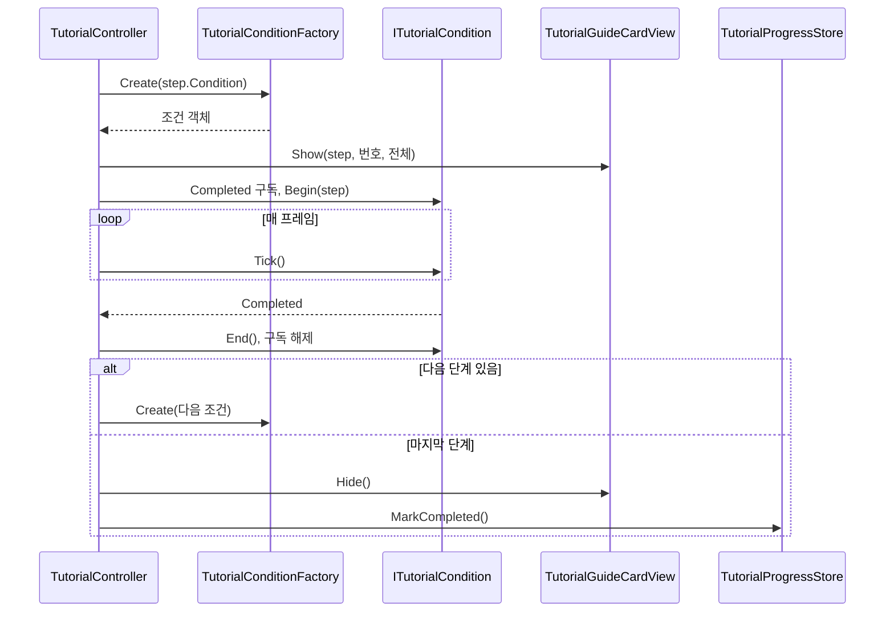

# 튜토리얼 조건 감시 구조와 완료 처리 — 구현 설계

> 상태: **구현됨 (Codex 리뷰 반영, Unity 실행 검증은 별도 확인)** · 기준 브랜치 `feature/growth` · 작성일 2026-10-13 · 구현 반영 갱신 2026-10-13
> 튜토리얼 구현 19단위 중 **1번 단위**이다. 기준 기획은 `Docs/Architecture/Tutorial/TutorialFlow.md`이다.
> 최초 설계 이후 바뀐 점: `GameBootstrap` 대기 제거(전투 씬에서 제거 예정), 카드 뷰 파일 위치(`Tutorial/` 직하), 팩토리 클래스 형태, 조건 생성 실패 시 정리 처리. 각 위치에 반영했다.

## 1. 기능 개요 및 요구사항

### 목적

튜토리얼 필수 10단계를 순서대로 진행시키는 뼈대를 만든다. 단계마다 "완료 조건"을 감시하고, 조건이 충족되면 다음 단계의 카드로 교체하며, 마지막 단계가 끝나면 완료를 저장한다. 이 단위에서는 완료 조건 중 `Move` 하나만 실제로 구현하고, 나머지 조건은 이후 단위가 구조에 파일을 추가하는 방식으로 채운다.

### 범위

- 조건 감시 구조: 조건 하나를 `ITutorialCondition` 구현체 하나로 표현하고, `TutorialConditionKind`로 생성한다.
- `Move` 조건 구현 (누적 이동 거리).
- 튜토리얼 시작 대기: 도착 연출 종료, 1층 준비 대기 상태 확인. (데이터 준비 대기는 하지 않는다. 아래 "확정 결정" 참조)
- 단계 전환과 마지막 단계 완료 시 종료 처리 (`TutorialProgressStore.MarkCompleted`).
- 최소 카드 뷰: 헤더(`NN / 전체`), 제목, 본문만 표시한다.

### 시작·종료 조건

- 시작: 이미 완료된 적이 없고, 1층이 "시작 석상 대기" 상태이며, 플레이어 도착 연출이 끝났을 때 0번 단계를 시작한다.
- 종료: 마지막 단계의 조건이 충족되면 카드를 숨기고 완료를 저장한 뒤 컨트롤러를 끈다.
- 이미 완료 기록이 있으면 시작하지 않는다.

### 제외 범위

- 중도 이탈 처리 (2번 단위): 진행 중 씬 이탈, 진행 중 석상 선행, 정리 보강.
- 행동 행(키·마우스 아이콘), 키 힌트, 스포트라이트, 월드 마커 (3번 단위 이후).
- `Move` 외 조건 9종 (3~13번 단위).
- 튜토리얼 규칙(`TutorialRules`: 임무 고정, 실패 없음, 체력 하한, 룬석 지급, 룬북 잠금)과 건너뛰기, 상황 안내 카드, 협회 지침서.
- 본 기록 id 저장 (14번 단위).

### 확인 기준

1단계(`Move`)를 완료하면 카드가 2단계 내용으로 교체되고, 마지막 단계를 완료하면 카드가 사라지며 완료가 저장된다. 플레이를 다시 시작하면 튜토리얼이 실행되지 않는다.

## 2. 기존 코드 분석 및 변경 범위

### 설계 시점에 확인한 사실

- `Assets/01_Scripts/Tutorial/`에는 `.meta`만 있고 스크립트가 없었다. 이 단위는 새로 작성했다.
- `StageManager.Instance.IsWaitingForPreparation`: 시작 석상에서 출발 준비를 끝내기 전까지 참이다. 석상이 `BeginPreparedRun()`을 호출하면 거짓이 되고 1층이 시작된다. (`StageManager.cs`)
- `GameBootstrap.State`: `BootstrapState`(`NotStarted/Initializing/Ready/Failed`). 정식 흐름에서는 `LoadingSceneController`가 `Ready`를 기다린 뒤 `CombatScene`으로 넘기고, `GameSession`은 씬이 바뀌어도 유지된다.
- `PortalPlayerHider.IsAnyHiding`: 도착 연출 등으로 플레이어를 숨기거나 조작을 막고 있는 hider가 있는지 나타내는 static 프로퍼티이다. 설계 시점에는 미커밋 변경이었고 이 단위의 첫 커밋에 포함됐다.
- 카드 프리팹 `Assets/10_UI/Prefabs/Tutorial/Cards/TutorialGuideCard.prefab`은 커스텀 스크립트 없는 순수 UI이다. 자식 이름은 `Header/HeaderLabel`, `TitleText`, `BodyText`, `ProgressBar/Fill`, `ActionRow`, `ConditionText`이다.
- `CombatScene.unity`의 한 게임 오브젝트(`fileID 2055402654`)에 삭제된 `TutorialGuideCardView`, `TutorialController` 컴포넌트가 Missing 상태로 남아 있다.
- 적과 플레이어 애니메이션이 `Rigidbody2D`를 사용한다. 플레이어 이동 스크립트는 확인하지 못했다.

### 확정 결정

- **`GameBootstrap` 대기를 하지 않는다.** `GameBootstrap`은 추후 전투 씬에서 제거할 예정이고, 데이터 준비는 로딩 씬에서 끝난 뒤 전투 씬이 시작되므로 컨트롤러는 `GameBootstrap`/`BootstrapState`를 참조하지 않는다. 전투 씬에서 바로 플레이하는 디버그 경로(`CombatSceneTestSetup`)가 데이터 준비를 기다리는 문제는 `GameBootstrap` 제거 시 그쪽에서 함께 다룬다.
- "전투 씬에서만 동작"은 씬 배치로 보장한다. 컨트롤러는 `CombatScene`에만 있고, 시작 시 `StageManager.Instance` 존재 확인이 추가 방어 역할을 한다.

### 제안 및 가정

- 이동 거리는 XY 평면 거리로 계산한다(`Vector2.Distance`). 실제 플레이어 이동 평면은 아직 확인하지 못했으므로 다르면 평면을 맞춘다.
- `Move`의 기본 거리 값은 정하지 않았다. 임시 에셋에 3, 5를 넣었고 플레이하며 조정한다.

### 생성 파일 (`Assets/01_Scripts/Tutorial/`)

- `TutorialConditionKind.cs`
- `TutorialStepSO.cs`
- `TutorialProgressStore.cs`
- `ITutorialCondition.cs`
- `MoveCondition.cs`
- `TutorialConditionFactory.cs`
- `TutorialController.cs`
- `TutorialGuideCardView.cs` (`UI/` 하위 폴더 없이 `Tutorial/` 직하에 둔다)

### 생성 에셋과 씬 변경

- `Assets/11_Data/Tutorial/`에 임시 `TutorialStepSO` 2개: `Step01_Move`(거리 3), `Step02_Move`(거리 5).
- `CombatScene`: Missing 컴포넌트 제거, 컨트롤러·카드 뷰 추가, 카드 프리팹 인스턴스 배치.

### 영향 관계

기존 게임 코드 중 `PortalPlayerHider`에는 `IsAnyHiding` 프로퍼티만 추가했다. `StageManager`는 읽기만 하고 `GameBootstrap`은 참조하지 않는다. `MissionManager`에 남은 `SetNextMissionOverride(object)` 스텁은 7번 단위 소관이며 이 단위에서 건드리지 않는다.

## 3. 전체 실행 흐름 및 설계 구조

### 책임과 소유권

- `TutorialController`가 진행 상태(현재 단계 번호, 실행 여부, 현재 활성 조건)를 소유한다. 어떤 조건이 있는지는 모르고 `ITutorialCondition` 계약과 팩토리만 사용한다.
- 조건 객체가 자신의 감시 상태(이동 누적 거리 등)와 필요한 외부 참조를 소유한다.
- 단계 데이터(제목, 본문, 조건 종류, 조건 값)는 `TutorialStepSO`가 소유한다.
- 완료 여부의 영속 저장은 `TutorialProgressStore`(PlayerPrefs)가 소유한다.
- 화면 표시는 `TutorialGuideCardView`가 소유하며 진행 상태를 알지 못한다.

### 단계 진행 시퀀스



## 4. 단계별 구현 가이드

구현 순서는 컴파일 의존성을 따른다. 데이터·저장소 → 조건 계약과 `Move` → 팩토리 → 카드 뷰 → 컨트롤러 순서이며, 컨트롤러 안의 메서드는 실제 실행 순서대로 설명한다.

### 4.1 데이터와 저장소

`TutorialConditionKind`는 로드맵의 10개 값을 모두 정의한다. 구현되지 않은 값은 팩토리가 거부한다. 파일: `TutorialConditionKind.cs` (신규)

```csharp
public enum TutorialConditionKind
{
    Move,
    StatueInteract,
    ElementConfirm,
    RuneConfirm,
    MissionStart,
    Acknowledge,
    EnemyKill,
    Dash,
    RewardConfirm,
    PortalEnter
}
```

`TutorialStepSO`는 이 단위에 필요한 필드만 가진다. 단계 번호는 컨트롤러 배열의 인덱스에서 얻으므로 번호 필드는 두지 않는다. 행동 행, 오버레이 등은 해당 단위가 필요할 때 추가한다. 파일: `TutorialStepSO.cs` (신규)

```csharp
[CreateAssetMenu(menuName = "Scriptable Objects/Tutorial Step SO")]
public class TutorialStepSO : ScriptableObject
{
    [SerializeField] private string _title;
    [SerializeField, TextArea] private string _body;
    [SerializeField] private TutorialConditionKind _condition;
    [SerializeField] private float _conditionValue;

    public string Title => _title;
    public string Body => _body;
    public TutorialConditionKind Condition => _condition;
    public float ConditionValue => _conditionValue;
}
```

`ConditionValue`의 의미는 조건 종류마다 다르다. `Move`에서는 완료에 필요한 누적 이동 거리(월드 단위)이다.

`TutorialProgressStore`는 완료 여부만 다룬다. 파일: `TutorialProgressStore.cs` (신규)

```csharp
public static class TutorialProgressStore
{
    private const string CompletedKey = "Tutorial.Completed";

    public static bool IsCompleted { get; }
    public static void MarkCompleted();
    public static void ResetForDebug();
}
```

`IsCompleted`는 PlayerPrefs의 완료 키를 정수로 읽어 1이면 참을 돌려준다(없으면 0). `MarkCompleted`는 키를 1로 쓰고 즉시 저장한다. `ResetForDebug`는 키를 지우고 저장한다. 개발 중 튜토리얼을 다시 보기 위한 용도이다.

**Unity 에디터 작업**: `Assets/11_Data/Tutorial/` 폴더에서 `TutorialStepSO` 에셋 2개(예: `Step01_Move`, `Step02_Move`)를 만든다. 둘 다 조건을 `Move`로 하고 `ConditionValue`는 3과 5로 시작한다. 제목과 본문은 구분되는 임시 문구를 넣는다. 이 임시 에셋은 실제 10단계 에셋으로 교체한다.

### 4.2 조건 계약과 Move 조건

조건 계약은 컨트롤러와 모든 조건 구현체 사이의 유일한 접점이다. 파일: `ITutorialCondition.cs` (신규)

```csharp
public interface ITutorialCondition
{
    event Action Completed;
    void Begin(TutorialStepSO step);
    void Tick();
    void End();
}
```

`Begin`은 단계가 시작될 때 한 번, `Tick`은 활성 동안 매 프레임, `End`는 단계가 끝나거나 컨트롤러가 꺼질 때 한 번 호출된다. 이벤트 기반 조건은 `Begin`에서 구독하고 `End`에서 해제하며 `Tick`은 비워 둔다.

`MoveCondition`은 플레이어의 이동 거리를 누적한다. 파일: `MoveCondition.cs` (신규)

```csharp
public class MoveCondition : ITutorialCondition
{
    private Transform _player;
    private Vector3 _lastPosition;
    private float _movedDistance;
    private float _targetDistance;
    private bool _isActive;

    public event Action Completed;

    public void Begin(TutorialStepSO step);
    public void Tick();
    public void End();
}
```

`Begin`의 처리 순서:

1. 누적 거리를 0으로 초기화한다.
2. Player 태그를 가진 오브젝트를 찾는다. 찾지 못하면 오류를 로그로 남기고 비활성 상태로 둔 채 종료한다. 이 경우 조건은 완료되지 않는다.
3. 플레이어의 Transform과 현재 위치를 기록한다. 이후 이동량은 이 위치를 기준으로 잰다.
4. 단계의 `ConditionValue`를 목표 거리로 저장하고 활성 상태로 전환한다.

`Tick`의 처리 순서:

1. 비활성 상태이면 종료한다.
2. 현재 플레이어 위치와 직전 프레임 위치 사이의 XY 거리를 누적하고, 직전 위치를 현재 위치로 갱신한다.
3. 누적 거리가 목표 거리 미만이면 종료한다.
4. 목표 거리 이상이면 비활성 상태로 전환한 뒤 `Completed`를 발생시킨다. `Completed` 처리 중에 컨트롤러가 `End`를 호출하고 다음 조건으로 넘어가므로, 발생 이후에는 이 객체의 상태를 건드리지 않는다.

`End`는 비활성 상태로 전환하고 플레이어 참조와 누적 거리를 비운다.

### 4.3 조건 팩토리

팩토리는 조건 종류에서 구현체를 만드는 유일한 위치이다. 이후 단위는 이 `switch`에 한 줄을 추가한다. 파일: `TutorialConditionFactory.cs` (신규)

```csharp
public class TutorialConditionFactory
{
    public static ITutorialCondition Create(TutorialConditionKind kind);
}
```

`Create`는 `Move`이면 새 `MoveCondition`을 돌려준다. 그 외 종류는 유효하지 않은 조건이라는 오류를 로그로 남기고 `null`을 돌려준다. 예외는 던지지 않으며, 호출한 컨트롤러가 `null`을 실패로 처리한다. 인스턴스 상태가 없으므로 구현은 일반 `class`의 static 메서드이다(`static class`로 바꿔도 동작은 같다).

### 4.4 카드 뷰

카드 뷰는 진행 상태를 모르고, 받은 데이터를 표시만 한다. 파일: `TutorialGuideCardView.cs` (신규, `Tutorial/` 직하)

```csharp
public class TutorialGuideCardView : MonoBehaviour
{
    [SerializeField] private GameObject _cardRoot;
    [SerializeField] private TMP_Text _headerLabel;
    [SerializeField] private TMP_Text _titleText;
    [SerializeField] private TMP_Text _bodyText;

    private void Awake();
    public void Show(TutorialStepSO step, int number, int total);
    public void Hide();
}
```

`Awake`는 카드 루트를 비활성화한다. 튜토리얼이 시작되기 전이나 완료 후 재진입 시 카드가 잠깐 보이는 일을 막기 위해서이다. `Show`는 카드 루트를 활성화하고, 헤더에 두 자리 번호와 전체 수를 `NN / 전체` 형식으로, 제목과 본문에 단계 데이터를 넣는다. 이미 표시 중이어도 같은 방식으로 내용만 바꾸므로 "카드 교체"는 별도 처리 없이 `Show` 재호출로 이뤄진다. `Hide`는 카드 루트를 비활성화한다.

`_cardRoot`는 뷰 컴포넌트가 붙은 오브젝트 자신이 아니라 카드 프리팹 인스턴스여야 한다. 자기 자신을 비활성화하면 `Awake`와 이후 호출이 동작하지 않는다.

**Unity 에디터 작업**: 캔버스 아래에 `TutorialGuideCard` 프리팹 인스턴스를 놓는다. 컨트롤러 오브젝트에 `TutorialGuideCardView`를 붙이고 `_cardRoot`에 프리팹 인스턴스를, `_headerLabel`에 `Header/HeaderLabel`을, `_titleText`에 `TitleText`를, `_bodyText`에 `BodyText`를 연결한다. 프리팹의 행동 행, 진행 막대, 조건 텍스트는 이 단위에서 사용하지 않는다.

### 4.5 컨트롤러

컨트롤러가 시작 대기, 단계 전환, 종료를 담당한다. 파일: `TutorialController.cs` (신규)

```csharp
public class TutorialController : MonoBehaviour
{
    [SerializeField] private TutorialStepSO[] _steps;
    [SerializeField] private TutorialGuideCardView _guideCardView;

    private Coroutine _startRoutine;
    private ITutorialCondition _activeCondition;

    public int CurrentIndex { get; private set; }
    public bool IsRunning { get; private set; }

    public event Action<int, TutorialStepSO> StepStarted;
    public event Action Finished;

    private void Start();
    private void Update();
    private void OnDisable();
    private IEnumerator StartRoutine();
    private void BeginStep(int index);
    private void HandleConditionCompleted();
    private void CompleteStep();
    private void Finish();
    private void EndActiveCondition();

    [ContextMenu("Reset Progress")]
    private void ResetProgress();
}
```

`StepStarted`(단계 번호, 단계 데이터)와 `Finished`는 이후 단위의 규칙 객체가 구독하는 확장 지점이다. 예를 들어 4번 단계 시작 시 룬북을 열어 주는 처리가 `StepStarted`에 붙는다. 이 단위에서는 구독자가 없다.

`Start`의 처리 순서:

1. `TutorialProgressStore.IsCompleted`가 참이면 컴포넌트를 끄고 종료한다.
2. 단계 배열이 비어 있으면 오류를 로그로 남기고 컴포넌트를 끄고 종료한다.
3. 단계 배열에 `null` 항목이 있으면 같은 방식으로 처리한다.
4. 모두 통과하면 `StartRoutine`을 시작하고 핸들을 `_startRoutine`에 보관한다.

`StartRoutine`의 처리 순서 (각 실패 경로는 컴포넌트를 끄고 코루틴을 끝낸다):

1. 한 프레임 기다린다. 다른 오브젝트의 `Awake`와 `Start`가 먼저 끝나도록 하기 위해서이다.
2. `StageManager.Instance`가 없으면 경고를 남기고 종료한다.
3. `IsWaitingForPreparation`이 거짓이면 이미 1층이 시작된 것이므로 경고를 남기고 종료한다.
4. `PortalPlayerHider.IsAnyHiding`이 거짓이 될 때까지 매 프레임 기다린다. 도착 연출 중에 카드가 먼저 뜨는 것을 막는다. 데이터 준비 상태(`GameBootstrap`)는 기다리지 않는다.
5. 기다림이 끝난 직후 `IsWaitingForPreparation`을 한 번 더 확인하고, 거짓이면 경고를 남기고 종료한다. 기다리는 동안 석상이 먼저 출발 준비를 끝낸 경우를 잡기 위해서이다.
6. 모든 조건이 통과하면 `_startRoutine`을 비우고 `IsRunning`을 참으로 한 뒤 `BeginStep(0)`을 호출한다.

이후 단위에서 튜토리얼 규칙 적용(`TutorialRules.Apply`)이 6번 직전에 들어간다.

`BeginStep(index)`의 처리 순서:

1. `CurrentIndex`를 갱신하고 해당 단계 데이터를 가져온다.
2. 팩토리로 조건 객체를 만든다. `null`이면 직전 단계 카드가 남지 않도록 카드 뷰의 `Hide`를 호출하고, `IsRunning`을 거짓으로 하며, 컴포넌트를 끄고 종료한다. 이때 새 카드 표시, `StepStarted` 발생, 완료 저장은 일어나지 않는다. 완료 저장을 하는 `Finish`는 사용하지 않는다. 첫 단계에서 실패하면 숨길 카드가 없어도 `Hide`는 무해하다.
3. 만든 조건 객체를 `_activeCondition`에 저장하고 `StepStarted`를 발생시킨다.
4. 카드 뷰의 `Show`를 단계 데이터, 사람 기준 번호(`index + 1`), 전체 단계 수로 호출한다.
5. 조건의 `Completed`를 `HandleConditionCompleted`로 구독하고 `Begin`을 호출한다. 구독을 `Begin` 앞에 두는 이유는 `Begin` 중에 즉시 완료되는 조건이 있어도 놓치지 않기 위해서이다.

`Update`는 실행 중이 아니거나 활성 조건이 없으면 종료하고, 그렇지 않으면 활성 조건의 `Tick`을 호출한다.

`HandleConditionCompleted`는 `CompleteStep`을 호출한다. 조건 객체가 `Tick` 안에서 `Completed`를 발생시키므로 `CompleteStep`은 `Tick` 호출 스택 안에서 실행된다는 점에 유의한다.

`CompleteStep`의 처리 순서:

1. `EndActiveCondition`으로 현재 조건의 구독을 해제하고 `End`를 호출한 뒤 참조를 비운다.
2. 다음 단계가 있으면 `BeginStep(CurrentIndex + 1)`을 호출하고 종료한다.
3. 마지막 단계였다면 `Finish`를 호출한다.

`Finish`의 처리 순서:

1. 카드 뷰의 `Hide`를 호출한다.
2. `TutorialProgressStore.MarkCompleted`로 완료를 저장한다.
3. `IsRunning`을 거짓으로 한다.
4. `Finished`를 발생시킨다.
5. 컴포넌트를 끈다. `OnDisable`이 호출되지만 활성 조건이 이미 비어 있으므로 아무 일도 하지 않는다.

`EndActiveCondition`은 활성 조건이 있으면 `Completed` 구독을 해제하고 `End`를 호출한 뒤 `_activeCondition`을 비운다. 없으면 아무것도 하지 않는다.

`OnDisable`은 시작 코루틴이 남아 있으면 멈추고, 핸들은 항상 비운 뒤, 코루틴 유무와 관계없이 `EndActiveCondition`을 호출한다. 정상 시작 후에는 핸들이 이미 비어 있으므로 코루틴 존재 여부로 조건 정리를 건너뛰면 안 된다. 진행 중 컴포넌트가 꺼지는 경우의 나머지 정리(카드 숨김, `IsRunning` 복구)는 2번 단위에서 보강한다.

`ResetProgress`는 `TutorialProgressStore.ResetForDebug`를 호출한다. Inspector 컨텍스트 메뉴로만 실행하는 개발 편의 기능이다.

**Unity 에디터 작업**:

1. `CombatScene`에서 `fileID 2055402654` 오브젝트를 찾아 Missing으로 남은 컴포넌트 2개를 제거한다.
2. 같은 오브젝트에 `TutorialController`를 추가한다. `_steps`에 4.1에서 만든 임시 에셋 2개를 순서대로 넣고, `_guideCardView`에 4.4의 뷰를 연결한다.
3. 뷰와 컨트롤러가 같은 오브젝트에 있어도 괜찮다. 단 `_cardRoot`는 별도의 프리팹 인스턴스여야 한다.

## 5. 검증 기준 및 테스트 시나리오

각 시나리오 전에 필요하면 컨트롤러의 `Reset Progress` 컨텍스트 메뉴로 완료 기록을 지운다.

**정상: 두 단계 완료**
- 조건: 완료 기록 없음, `Step01_Move`(3), `Step02_Move`(5) 연결, 석상 대기 상태로 씬 시작.
- 행동: 도착 연출이 끝난 뒤 WASD로 이동한다.
- 결과: 도착 연출 중에는 카드가 보이지 않는다. 연출 후 `01 / 02` 카드가 뜬다. 약 3 이동하면 `02 / 02` 카드로 교체되고, 이어서 약 5 이동하면 카드가 사라진다. 완료가 저장되고 컨트롤러가 꺼진다.

**정상: 재시작 시 미실행**
- 조건: 위 시나리오 완료 직후.
- 행동: 플레이를 종료하고 다시 시작한다.
- 결과: 카드가 나타나지 않고 컨트롤러가 꺼진 상태로 시작한다.

**경계: 거리 누적 시작점**
- 조건: 2단계 시작 직후.
- 행동: 1단계에서 이동하던 방향으로 계속 이동한다.
- 결과: 2단계의 이동 거리는 2단계가 시작된 위치에서부터 다시 센다. 1단계에서 남은 거리가 넘어오지 않는다.

**경계: 정지 상태**
- 조건: 1단계 카드 표시 중.
- 행동: 이동하지 않고 대기한다.
- 결과: 카드가 바뀌지 않는다.

**예외: 1층이 이미 시작됨**
- 조건: 컨트롤러가 시작을 기다리는 중 석상 상호작용으로 출발 준비를 마쳐 1층이 시작된 경우.
- 행동: 석상과 상호작용한다.
- 결과: 컨트롤러가 꺼지고 카드는 나타나지 않는다. 이미 시작되어 있던 경우도 동일하다.

**예외: 단계 배열 문제**
- 조건: `_steps`가 비었거나 `null` 항목이 있다.
- 행동: 씬 시작.
- 결과: 오류 로그가 남고 컨트롤러가 꺼진다.

**예외: 미구현 조건 (첫 단계)**
- 조건: 첫 단계 에셋의 조건이 `Move` 외 값이다.
- 행동: 씬 시작.
- 결과: 오류 로그가 남고 컨트롤러가 꺼지며 `IsRunning`은 거짓이다. 카드는 나타나지 않고 완료 기록도 남지 않는다.

**예외: 미구현 조건 (중간 단계)**
- 조건: `Move` 단계 다음에 `Move` 외 조건의 단계가 있다.
- 행동: `Move` 단계를 완료한다.
- 결과: 오류 로그가 남고 직전 단계 카드가 숨겨진다. `IsRunning`과 `enabled`가 모두 거짓이고 완료 기록은 남지 않는다.

**경계: 진행 중 컴포넌트 비활성화**
- 조건: 조건 감시 중(예: `Move` 진행 중).
- 행동: 컨트롤러 컴포넌트를 끈다.
- 결과: 조건의 `Completed` 구독이 해제되고 `End`가 한 번 호출된다. 카드 숨김 등 나머지 정리는 2번 단위 소관이다.

**예외: 플레이어 없음**
- 조건: Player 태그 오브젝트가 없다.
- 행동: 1단계 시작.
- 결과: 오류 로그가 남고, 카드는 표시되지만 단계가 완료되지 않는다.

## 남은 확인 항목

- 플레이어 실제 이동 평면 (XY 가정 검증).
- `Move` 기본 거리 값 (임시 3, 5 조정).
- 위 시나리오의 Unity 플레이 검증.
- `GameBootstrap`을 전투 씬에서 제거할 때 `CombatSceneTestSetup`의 데이터 준비 대기 경로 정리.

## 6. 2번 단위 — 중도 이탈 처리

> 상태: **구현됨** · 1번 단위(4장)의 `TutorialController`를 확장한다.

### 6.1 확정 요구사항

- 튜토리얼 중단 경로를 `OnDisable` 한 곳으로 통일한다. 시작 실패, 선행 행동, 조건 생성 실패, 씬 이탈 모두 컴포넌트가 꺼지면서 같은 정리를 거친다.
- **선행 행동은 튜토리얼을 중단한다.** 출발 준비 단계에서 1층이 먼저 시작되면 튜토리얼을 종료한다.
- **중단은 완료 기록을 남기지 않는다.** 다음 실행에서 처음부터 다시 시작한다. 완료 저장은 `Finish`에서만 한다. 건너뛰기(17번 단위)가 완료 기록을 담당한다.

### 6.2 선언

파일: `TutorialConditionKind.cs` (수정, 확장 클래스 추가)

```csharp
public static class TutorialConditionKindExtensions
{
    public static bool IsPreparationPhase(this TutorialConditionKind kind);
}
```

`IsPreparationPhase`는 `Move`, `StatueInteract`, `ElementConfirm`이면 참이다. 이 조건들은 1층이 시작되기 전(`StageManager.IsWaitingForPreparation`)에 진행된다. `RuneConfirm`은 시작 석상이 룬 확정 직후 `BeginPreparedRun`을 호출해 1층 시작과 겹칠 수 있으므로 제외한다. 6번 단위(`RuneConfirm`)에서 석상의 이벤트 순서를 확인하고 필요하면 이 판정을 조정한다.

파일: `TutorialController.cs` (수정)

```csharp
private StageManager _stageManager;
private bool IsStageStartedEarly();
```

`StageManager.Instance`는 인스턴스가 없으면 `null`을 돌려주지 않고 빈 GameObject를 만든 뒤 예외를 던진다. 그래서 컨트롤러는 `Instance`를 쓰지 않고, `StartRoutine`에서 `FindAnyObjectByType<StageManager>()`로 기존 인스턴스만 찾아 `_stageManager`에 보관한다. 이후 존재 확인은 이 참조의 Unity null(파괴 여부) 검사로 한다.

파일: `TutorialGuideCardView.cs` (수정): `Hide`가 카드 루트 파괴 여부를 확인한다.

### 6.3 처리 흐름

`Update`는 실행 중이고 활성 조건이 있으면, `Tick` 호출 전에 `IsStageStartedEarly`를 확인한다. 참이면 경고를 남기고 컴포넌트를 끈 뒤 종료한다.

`IsStageStartedEarly`의 처리 순서:

1. 현재 단계의 조건이 출발 준비 단계(`IsPreparationPhase`)가 아니면 거짓을 돌려준다.
2. 보관한 `_stageManager`가 파괴되었거나 `IsWaitingForPreparation`이 거짓이면 참을 돌려준다.

`StartRoutine`은 한 프레임 기다린 뒤 `FindAnyObjectByType`으로 `StageManager`를 찾아 보관한다(1번 단위의 `StageManager.Instance` 검사를 대체). 없으면 경고 후 컨트롤러를 끈다. 도착 연출 대기 뒤의 재확인도 보관한 참조의 파괴 여부와 `IsWaitingForPreparation`을 함께 본다.

`OnDisable`의 처리 순서:

1. 시작 코루틴이 남아 있으면 멈추고 핸들을 비운다.
2. `EndActiveCondition`으로 활성 조건의 구독 해제와 `End`를 수행한다.
3. `IsRunning`이 거짓이면(시작 전 종료, 정상 `Finish` 후) 여기서 종료한다.
4. 참이면 `Finish`를 거치지 않은 중단이다. `IsRunning`을 거짓으로 하고 카드 뷰가 파괴되지 않았다면 `Hide`를 호출한다. 씬 파괴 중에는 카드 뷰가 먼저 파괴되었을 수 있으므로 Unity null 검사를 한다. 완료 기록은 남기지 않는다.

`BeginStep`의 조건 생성 실패 분기는 컴포넌트만 끈다. 카드 숨김과 `IsRunning` 해제는 `OnDisable`이 맡는다.

### 6.4 검증 시나리오

**선행 행동**
- 조건: 1단계(`Move`) 진행 중.
- 행동: 이동을 끝내기 전에 시작 석상으로 출발 준비를 마쳐 1층을 시작한다.
- 결과: 경고 로그가 남고 카드가 사라지며 컨트롤러가 꺼진다. `IsRunning`은 거짓이고 완료 기록은 남지 않는다. 다음 실행에서 튜토리얼이 처음부터 시작된다.

**씬 이탈**
- 조건: 튜토리얼 진행 중.
- 행동: 다른 씬으로 이동하거나 플레이를 종료한다.
- 결과: 오류(MissingReferenceException) 없이 정리되고 완료 기록은 남지 않는다.

**정상 완료 후 비활성화**
- 조건: 마지막 단계 완료.
- 결과: `Finish`가 카드를 숨기고 완료를 저장한다. 이어지는 `OnDisable`은 추가 정리를 하지 않는다.

## 7. 3번 단위 — StatueInteract 조건과 키 힌트

> 상태: **구현됨** · 2번 단위(6장)까지의 구조를 확장한다.

### 7.1 확정 요구사항

- `StatueInteract` 조건: 시작 석상(`ExpeditionStatue`)과 상호작용해 주력 원소 선택 창이 열리면 완료한다.
- 카드에 "행동 행"(키 아이콘 + 행동 라벨)을 표시한다. 이 단위에서는 `Key` 종류만 지원하고, 나머지 종류(`Mouse`, `MultiKey`, `Steps`, `ConditionText`)는 필요한 단위에서 추가한다. 지원하지 않는 종류와 `None`은 행을 숨긴다.
- 키 힌트 알약 오버레이: **단계 SO가 알약 프리팹을 직접 참조**한다. 뷰는 프리팹을 생성해 `Label` 문구만 채우고, 단계가 끝나면 파괴한다. 키 아이콘은 프리팹 변형마다 고정되어 있다(기본 F, `_WASD`, `_Space`, `_Mouse`).
- 단계 문구는 `TutorialFlow.md`의 단계 설명을 바탕으로 한 **임시 문구**이다. 용어·말투 통일은 아직 미결이다.
- 임시 단계 에셋을 `Step01_Move`(WASD 알약), `Step02_StatueInteract`(F 알약, 카드 키 행)로 교체했고 `Step02_Move`는 삭제했다.

### 7.2 선언

파일: `TutorialActionRowKind.cs`, `TutorialOverlayKind.cs` (신규)

```csharp
public enum TutorialActionRowKind { None, Key, Mouse, MultiKey, Steps, ConditionText }
public enum TutorialOverlayKind { None, KeyHint, WorldMarker, Spotlight }
```

파일: `TutorialStepSO.cs` (수정, 필드 추가)

```csharp
[SerializeField] private TutorialActionRowKind _actionRow;
[SerializeField] private string[] _keyLabels;
[SerializeField] private string _actionLabel;
[SerializeField] private TutorialOverlayKind _overlay;
[SerializeField] private GameObject _overlayPrefab;
[SerializeField] private string _overlayText;

public TutorialActionRowKind ActionRow { get; }
public IReadOnlyList<string> KeyLabels { get; }
public string ActionLabel { get; }
public TutorialOverlayKind Overlay { get; }
public GameObject OverlayPrefab { get; }
public string OverlayText { get; }
```

파일: `StatueInteractCondition.cs` (신규)

```csharp
public class StatueInteractCondition : ITutorialCondition
{
    private ExpeditionStatue _statue;

    public event Action Completed;

    public void Begin(TutorialStepSO step);
    public void Tick();
    public void End();
    private void HandleInteracted();
}
```

`Begin`은 씬에서 `ExpeditionStatue`를 찾는다. 없으면 오류를 남기고 구독하지 않는다(조건은 완료되지 않는다). 있으면 `Interacted`를 구독한다. `Tick`은 비어 있다. `End`는 구독을 해제하고 참조를 비운다. `HandleInteracted`는 `Completed`를 발생시킨다. `Interacted`는 상호작용으로 선택 창이 열릴 때 발생하며, 이 이벤트 발생 이후에는 조건이 상태를 건드리지 않는다.

파일: `TutorialConditionFactory.cs` (수정): `Create`가 `StatueInteract`이면 `StatueInteractCondition`을 돌려준다.

파일: `TutorialGuideCardView.cs` (수정)

```csharp
[SerializeField] private GameObject _actionRow;
[SerializeField] private TMP_Text _keyText;
[SerializeField] private TMP_Text _actionLabel;

private void ShowActionRow(TutorialStepSO step);
```

`Show`는 마지막에 `ShowActionRow`를 호출한다. `ShowActionRow`는 행동 행 종류가 `Key`이면 행을 켜고, 키 라벨 첫 항목(없으면 빈 문자열)을 키 아이콘에, 행동 라벨을 라벨에 넣는다. 그 외 종류면 행을 숨긴다. 연결 대상은 카드 프리팹의 `ActionRow`, `ActionRow/KeyIcon/KeyText`, `ActionRow/ActionLabel`이다. `Awake`는 이 세 참조가 연결되었는지 검사해 하나라도 비어 있으면 오류를 한 번 남기고, `ShowActionRow`는 비어 있는 참조가 있으면 해당 표시를 생략해 조건 시작을 막지 않는다.

파일: `TutorialKeyHintView.cs` (신규)

```csharp
public class TutorialKeyHintView : MonoBehaviour
{
    private const string LabelName = "Label";

    [SerializeField] private RectTransform _hintRoot;

    private GameObject _current;

    public void Show(TutorialStepSO step);
    public void Hide();
}
```

`Show`는 먼저 이전 알약을 `Hide`로 정리한다. 단계의 오버레이 프리팹이 없으면 오류를 남기고 종료한다. 있으면 `_hintRoot` 아래에 생성하고, 자식 `Label`의 텍스트에 오버레이 문구를 넣는다. `Hide`는 현재 알약이 있으면 먼저 비활성화한 뒤 파괴하고 참조를 비운다. `Destroy`는 프레임 끝에 실행되므로, 단계 전환처럼 같은 프레임에 새 알약이 만들어져도 이전 알약이 함께 활성 상태로 남지 않게 하기 위해서이다.

파일: `TutorialController.cs` (수정)

```csharp
[SerializeField] private TutorialKeyHintView _keyHintView;

private void ShowOverlay(TutorialStepSO step);
private void HideOverlay();
```

`BeginStep`은 카드 `Show` 직후 `ShowOverlay`를 호출한다. `ShowOverlay`는 오버레이 종류가 `KeyHint`일 때만 동작한다(나머지 종류는 해당 단위에서 추가). 키 힌트 뷰가 연결되지 않았으면 오류를 남기고 반환해 조건 시작은 이어지며, 연결되어 있으면 뷰의 `Show`를 호출한다. `HideOverlay`는 키 힌트 뷰가 파괴되지 않았을 때 `Hide`를 호출한다. 오버레이 정리는 `EndActiveCondition`의 끝에서 수행하므로, 단계 완료·`Finish`·`OnDisable` 중단 모두 같은 경로로 정리된다.

### 7.3 Unity 에디터 작업

- `Canvas` 아래에 `TutorialKeyHintView` 오브젝트를 만든다(화면 하단 중앙 앵커, 위치 y=120). 컴포넌트를 붙이고 `_hintRoot`에 자기 `RectTransform`을 연결한다. 알약 위치는 이 오브젝트의 위치로 조정한다.
- 카드 뷰의 `_actionRow`, `_keyText`, `_actionLabel`을 `Canvas/TutorialGuideCard` 인스턴스의 해당 자식에 연결한다.
- 컨트롤러의 `_keyHintView`를 연결하고 `_steps`를 `Step01_Move`, `Step02_StatueInteract` 순서로 한다.

### 7.4 알려진 한계

2단계 전에 플레이어가 석상과 미리 상호작용하는 경우의 정체는 8장의 순서 감시(`TutorialPreparationWatcher`)로 해결했다.

### 7.5 검증 시나리오

**정상**
- 조건: 완료 기록 없음, 도착 연출 종료.
- 행동: WASD로 약 3 이동한 뒤 석상에서 F로 상호작용한다.
- 결과: 1단계에는 이동 알약과 카드(행동 행 숨김)가 보인다. 이동 후 2단계 카드로 교체되며 행동 행에 `F`와 "상호작용"이 표시되고 F 알약으로 바뀐다. 상호작용하면 카드와 알약이 사라지고 완료가 저장된다.

**오버레이 정리**
- 조건: 알약이 표시된 상태.
- 행동: 단계를 완료하거나 컨트롤러를 끈다.
- 결과: 알약이 남지 않고, 단계 전환 시 이전 알약이 새 알약과 겹치지 않는다.

**석상 없음**
- 조건: 씬에 `ExpeditionStatue`가 없다.
- 행동: 2단계 시작.
- 결과: 오류 로그가 남고 카드는 표시되지만 단계는 완료되지 않는다.

**프리팹 미지정**
- 조건: 오버레이 종류가 `KeyHint`인데 프리팹이 비어 있다.
- 행동: 해당 단계 시작.
- 결과: 오류 로그가 남고 알약은 표시되지 않지만 단계는 정상 진행된다.

## 8. 4번 단위 — ElementConfirm 조건과 선행 조작 즉시 중단

> 상태: **구현됨** · 6장의 선행 행동 정책(튜토리얼 중단)을 석상 조작 전반으로 확장한다.

### 8.1 확정 요구사항

- `ElementConfirm` 조건: 주력 원소 선택 창에서 원소를 확정하면 완료한다. 게임 코드는 수정하지 않는다. `MainElementSelectView.Confirmed`(`Action<ReactionElement>`)가 이미 public이므로 조건이 직접 구독한다.
- **선행 석상 조작은 즉시 중단한다.** 현재 단계보다 뒤 단계에 해당하는 석상 조작이 먼저 일어나면 튜토리얼을 중단한다(완료 기록 없음). 지난 단계의 조작은 무시한다. 예를 들어 이동 중 석상 상호작용은 중단이고, 취소 후 다시 상호작용하는 것은 무시한다.
- 3단계 문구는 임시 문구이고 카드 행동 행과 오버레이는 없다. 원소 점 표시(`TutorialElementDots`)는 이 단위에 포함하지 않는다.

### 8.2 선언

파일: `ElementConfirmCondition.cs` (신규)

```csharp
public class ElementConfirmCondition : ITutorialCondition
{
    private MainElementSelectView _view;

    public event Action Completed;

    public void Begin(TutorialStepSO step);
    public void Tick();
    public void End();
    private void HandleConfirmed(ReactionElement element);
}
```

`Begin`은 비활성 상태까지 포함해 씬에서 `MainElementSelectView`를 찾는다(팝업이라 평소에는 꺼져 있다). 없으면 오류를 남기고 구독하지 않는다. 있으면 `Confirmed`를 구독한다. `End`는 구독을 해제하고 참조를 비운다. `HandleConfirmed`는 `Completed`를 발생시킨다. `TutorialConditionFactory`는 `ElementConfirm`에 이 조건을 돌려준다.

파일: `TutorialPreparationWatcher.cs` (신규)

```csharp
public class TutorialPreparationWatcher
{
    private ExpeditionStatue _statue;
    private MainElementSelectView _elementView;
    private Func<TutorialConditionKind> _getCurrentKind;

    public event Action OutOfOrderDetected;

    public void Begin(Func<TutorialConditionKind> getCurrentKind);
    public void End();
    private void HandleStatueInteracted();
    private void HandleElementConfirmed(ReactionElement element);
    private void Check(TutorialConditionKind eventKind);
}
```

감시자는 조건 객체와 별개로 튜토리얼이 실행되는 동안 석상 상호작용(`Interacted`)과 원소 확정(`Confirmed`)을 계속 구독한다. 이벤트는 각각 `StatueInteract`, `ElementConfirm` 단계에 대응한다. `Check`는 이벤트가 나타내는 단계가 현재 단계보다 뒤이면 `OutOfOrderDetected`를 발생시킨다. 이 비교는 `TutorialConditionKind`의 선언 순서가 단계 진행 순서와 같다는 전제를 쓴다. 현재 단계는 `Begin`에서 받은 함수로 매번 조회하므로 단계가 바뀌어도 감시자를 다시 만들 필요가 없다. 석상이나 원소 선택 뷰를 찾지 못하면 경고만 남기고 해당 감시를 건너뛴다. `End`는 두 구독을 해제하고 참조를 비운다. 6번 단위(`RuneConfirm`)에서 룬 확정 이벤트를 같은 방식으로 추가한다.

파일: `TutorialController.cs` (수정)

```csharp
private TutorialPreparationWatcher _preparationWatcher;

private void HandleOutOfOrderDetected();
private void EndPreparationWatcher();
```

`StartRoutine`은 `IsRunning`을 켠 뒤 `BeginStep(0)` 전에 감시자를 만들어 `OutOfOrderDetected`를 구독하고 `Begin`을 호출한다. 현재 단계 조회 함수는 `_steps[CurrentIndex].Condition`이다. `HandleOutOfOrderDetected`는 경고를 남기고 컴포넌트를 끈다. `OnDisable`은 `EndActiveCondition` 다음에 `EndPreparationWatcher`를 호출해 감시자의 구독 해제와 참조 정리를 한다. 이벤트 처리 중에 구독을 해제하는 것은 안전하다.

### 8.3 Unity 에디터 작업

- `Assets/11_Data/Tutorial/Step03_ElementConfirm.asset`을 만든다(조건 `ElementConfirm`, 행동 행 `None`, 오버레이 `None`).
- 컨트롤러의 `_steps`에 이 에셋을 세 번째로 추가한다.

### 8.4 검증 시나리오

**정상**
- 조건: 2단계 완료 직후(원소 선택 창이 열린 상태).
- 행동: 원소를 선택하고 확정한다.
- 결과: 3단계가 완료되고 `_steps`의 마지막이면 카드가 사라지며 완료가 저장된다.

**선행 석상 상호작용**
- 조건: 1단계(`Move`) 진행 중.
- 행동: 이동을 끝내기 전에 석상과 상호작용한다.
- 결과: 경고 로그가 남고 카드와 알약이 사라지며 컨트롤러가 꺼진다. 완료 기록은 남지 않는다.

**선행 원소 확정**
- 조건: 2단계(`StatueInteract`) 진행 중. 석상 상호작용 없이 원소 선택 창이 열리는 디버그 경로를 사용한다.
- 행동: 원소를 확정한다.
- 결과: 원소 확정은 현재 단계(2)보다 뒤 단계(3)의 조작이므로 튜토리얼이 중단된다. 정상 플레이에서는 상호작용이 먼저 감지되어 그 시점에 중단된다.

**지난 단계 조작 무시**
- 조건: 3단계 진행 중.
- 행동: 원소 선택을 취소하고 다시 석상과 상호작용한다.
- 결과: 상호작용 이벤트는 지난 단계이므로 무시되고 튜토리얼은 계속된다.

**정리**
- 조건: 튜토리얼 실행 중.
- 행동: 컨트롤러를 끈다(완료·중단 포함).
- 결과: 조건과 감시자의 구독이 모두 해제되어 이후 석상 조작이 튜토리얼에 영향을 주지 않는다.

**뷰 없음**
- 조건: 씬에 `MainElementSelectView`가 없다.
- 행동: 3단계 시작.
- 결과: 조건이 오류를 남기고 완료되지 않으며, 감시자는 경고만 남긴다.

## 9. 5번 단위 — 룬북 잠금 규칙

> 상태: **구현됨** · 기존 게임 코드 2개 파일에 소규모 변경을 포함한다.

### 9.1 확정 요구사항

- 룬 장착 단계(`RuneConfirm`) 이전에는 룬북(Tab)을 열 수 없고, HUD의 [룬북][TAB] 힌트도 숨긴다.
- **잠금 해제 시점은 룬 장착 단계가 시작될 때**이다. 그 시점에 석상이 룬북을 열어 주며, 플레이어가 Confirm 없이 닫아도 Tab으로 다시 열 수 있어야 하기 때문이다. 튜토리얼이 끝나거나 중단될 때도 반드시 해제한다.
- 잠금은 **Tab 입력 경로만** 막는다. 석상이 코드로 부르는 `RuneBookV2Toggle.Open()`은 막지 않는다. 열린 룬북을 닫는 입력(Tab, Esc)도 막지 않는다.
- 기존 게임 코드 수정 범위(승인됨): 잠금 프로퍼티 추가와 HUD의 매 프레임 폴링. 이벤트·구독은 추가하지 않는다.
- 일시정지 힌트([일시정지][ESC])는 숨기지 않는다.

### 9.2 기존 코드 변경 (게임 코드)

파일: `UI/RuneBookV2/RuneBookV2Toggle.cs` (수정)

```csharp
public bool IsLocked { get; set; }
```

`HandleOpenRuneBookPressed`(Tab 입력 처리)가 `IsLocked`이면 열지 않고 반환한다. `Open()`과 닫기 경로는 변경하지 않는다.

파일: `UI/HUD/HudMenuHints.cs` (수정)

```csharp
private GameObject[] _runeBookHintObjects;
private bool _isRuneBookHintHidden;

private float AddKey(float right, string sprite, out Image image);
private void RefreshRuneBookHintVisibility();
```

`Build`가 룬북 힌트 오브젝트(TAB 키, 룬북 아이콘, 알림 빛)를 배열로 보관한다. 알림 점은 룬북 아이콘의 자식이라 함께 숨겨진다. 이를 위해 `AddKey`가 만든 이미지를 `out`으로 돌려주도록 시그니처를 바꿨다(호출은 두 곳). `Update`는 매 프레임 `RefreshRuneBookHintVisibility`를 먼저 호출하고, 이 메서드는 토글의 `IsLocked`가 직전 상태와 다를 때만 힌트 오브젝트의 활성 상태를 바꾼다.

### 9.3 튜토리얼 코드

파일: `TutorialRules.cs` (신규)

```csharp
public class TutorialRules
{
    private RuneBookV2Toggle _runeBookToggle;

    public void Apply();
    public void OnStepStarted(TutorialStepSO step);
    public void Release();
}
```

`Apply`는 비활성 오브젝트를 포함해 씬에서 `RuneBookV2Toggle`을 찾는다. 없으면 경고를 남기고 반환하며, 있으면 `IsLocked`를 참으로 한다. `OnStepStarted`는 시작한 단계의 조건이 `RuneConfirm`이면 `Release`를 호출한다. `Release`는 보관한 토글이 파괴되지 않았다면 `IsLocked`를 거짓으로 하고 참조를 비우며, 여러 번 불러도 안전하다.

파일: `TutorialController.cs` (수정)

```csharp
private TutorialRules _rules;

private void ReleaseRules();
```

`StartRoutine`은 감시자를 시작한 뒤 `BeginStep(0)` 전에 규칙을 만들어 `Apply`한다. `BeginStep`은 조건 생성에 성공한 직후 `StepStarted` 발생 전에 `_rules.OnStepStarted`를 호출한다. `OnDisable`은 감시자 정리 다음에 `ReleaseRules`를 호출해 완료·중단·씬 이탈 어느 경로든 잠금을 푼다.

### 9.4 알려진 한계

- HUD 힌트는 잠금이 걸리는 첫 프레임까지(씬 시작부터 도착 연출이 끝나 `Apply`가 불리기 전) 보일 수 있다. 이 구간은 층 전환 화면이 덮고 있어 눈에 띄지 않을 것으로 보지만 실행 확인이 필요하다.
- 현재 단계 에셋에는 `RuneConfirm` 단계가 아직 없어 `Finish`/중단에서만 잠금이 풀린다. 6번 단위에서 `RuneConfirm` 단계를 추가하면 설계대로 해당 단계 시작 시 풀린다.

### 9.5 검증 시나리오

**잠금**
- 조건: 튜토리얼 실행 중, 룬 장착 단계 이전.
- 행동: Tab을 누른다.
- 결과: 룬북이 열리지 않고, HUD에서 [룬북][TAB] 힌트가 보이지 않는다. [일시정지][ESC] 힌트는 보인다.

**석상은 잠금과 무관**
- 조건: 잠금 상태에서 원소를 확정한다.
- 행동: 석상 흐름이 룬북을 연다.
- 결과: 룬북이 정상적으로 열린다.

**해제 (룬 장착 단계 시작)**
- 조건: `RuneConfirm` 단계가 있는 단계 목록.
- 행동: 해당 단계가 시작된다.
- 결과: 룬북을 Esc로 닫은 뒤 Tab으로 다시 열 수 있고, [룬북][TAB] 힌트가 다시 보인다.

**해제 (완료·중단)**
- 조건: 튜토리얼이 완료되거나 중단된다(선행 조작, 컨트롤러 비활성화).
- 결과: 잠금이 풀리고 힌트가 복구된다.

**룬북 토글 없음**
- 조건: 씬에 `RuneBookV2Toggle`이 없다.
- 결과: 경고가 남고 튜토리얼은 진행된다.

## 10. 6번 단위 — RuneConfirm 조건과 룬석 지급

> 상태: **구현됨** · 원래 6번 단위의 절반이다. `???` 잠금과 장착 차단을 포함한 룬 선택 범위 제한은 룬북 UI 수정 규모가 커서 **별도 단위(6-2)로 분리**했다.

### 10.1 확정 요구사항

- `RuneConfirm` 조건: 룬북에서 장착을 확정하면 완료한다. 게임 코드는 수정하지 않는다. `RuneBookV2Presenter.Confirmed`(`Action`)가 이미 public이다. 이 이벤트는 확정이 실제로 성공했을 때만 발생한다(룬석 부족 등으로 실패하면 발생하지 않는다).
- 룬 장착 단계가 시작될 때 **허용 원소 룬 워드의 룬 문자를 지급**한다. 주력 원소는 석상에서 무료로 장착되고 두 번째 원소부터 룬 문자를 소모하므로, 지급은 두 번째 원소를 장착하기 위한 것이다.
- **허용 룬 워드는 바위(`rune_earth`)와 바람(`rune_wind`)** 이다. 각 단어의 룬 문자를 1회분씩 지급하며, 두 단어가 `ᚱ`를 함께 쓰므로 `ᚱ`는 2개가 된다. 단어 id는 컨트롤러 Inspector 필드로 두고, 코드에 고정하지 않는다.
- 지급한 룬석은 튜토리얼이 중단되어도 회수하지 않는다. 지급은 한 번만 한다.
- 룬 선택 범위 제한(허용 2개만 열고 나머지는 `???` 표시, 주력 원소 선택 창과의 정합)은 이 단위에 포함하지 않는다.

### 10.2 선언

파일: `RuneConfirmCondition.cs` (신규)

```csharp
public class RuneConfirmCondition : ITutorialCondition
{
    private RuneBookV2Presenter _presenter;

    public event Action Completed;

    public void Begin(TutorialStepSO step);
    public void Tick();
    public void End();
    private void HandleConfirmed();
}
```

`Begin`은 비활성 오브젝트까지 포함해 `RuneBookV2Presenter`를 찾는다(룬북은 평소 꺼져 있다). 없으면 오류를 남기고 구독하지 않는다. 있으면 `Confirmed`를 구독한다. `End`는 구독을 해제하고 참조를 비운다. `TutorialConditionFactory`는 `RuneConfirm`에 이 조건을 돌려준다.

파일: `TutorialRules.cs` (수정)

```csharp
private readonly IReadOnlyList<string> _grantedRuneWordIds;
private bool _runeStonesGranted;

public TutorialRules(IReadOnlyList<string> grantedRuneWordIds);
private void GrantRuneStones();
```

`OnStepStarted`는 시작한 단계의 조건이 `RuneConfirm`일 때만 동작해 `GrantRuneStones`를 호출한 뒤 `Release`(5번 단위의 룬북 잠금 해제)를 호출한다. 순서는 룬석을 먼저 주고 잠금을 푸는 것이다.

`GrantRuneStones`의 처리 순서:

1. 이미 지급했거나 지급 대상 id 목록이 없으면 종료한다.
2. `PlayerRuneManager.Instance`가 없거나 초기화되지 않았거나, `RuneEffectDatabase.Instance`가 없거나 `DatabaseReady`가 거짓이면 경고를 남기고 종료한다. DB가 준비되지 않으면 `TryGetById`가 정상 id도 찾지 못하므로 준비 여부를 함께 확인한다. 지급 완료로 기록하지 않지만, `OnStepStarted`는 단계 시작 때 한 번만 불리므로 **재시도 경로는 없다.** 4단계 시점에는 로딩이 끝나 있으므로 실제로는 일어나기 어려운 경우로 보고 경고만 남긴다.
3. 지급 완료로 기록한다.
4. 각 id를 확인한다. null이거나 빈 문자열이면 경고를 남기고 건너뛴다. DB에서 찾지 못하는 id도 경고를 남기고 다음 id로 넘어간다.
5. 찾은 룬 효과의 룬 워드 문자마다 `RuneStoneInventory.TryAddRuneStone(문자, 1)`을 호출한다. 같은 문자가 여러 단어에 있으면 그 수만큼 쌓인다.

파일: `TutorialController.cs` (수정): 룬석 지급 대상 id 배열 `_grantedRuneWordIds`를 Inspector 필드로 받아 `TutorialRules` 생성자에 넘긴다.

파일: `TutorialPreparationWatcher.cs` (수정): 룬 확정(`RuneBookV2Presenter.Confirmed`)을 `RuneConfirm` 단계 이벤트로 추가 감시한다. 8장의 규칙대로 현재 단계보다 뒤 단계의 이벤트만 중단 사유가 된다.

### 10.3 Unity 에디터 작업

- `Assets/11_Data/Tutorial/Step04_RuneConfirm.asset`을 만든다(조건 `RuneConfirm`, 행동 행 `None`, 오버레이 `None`). 컨트롤러 `_steps`의 네 번째에 추가한다.
- 컨트롤러 `_grantedRuneWordIds`에 `rune_earth`, `rune_wind`를 넣는다.

### 10.4 검증 시나리오

**지급**
- 조건: 룬 장착 단계가 시작된다.
- 결과: 바위·바람 룬 워드의 룬 문자가 각 1회분 지급되고(`ᚱ`는 2개), 룬북의 룬 문자 목록에 반영된다. 룬북 잠금이 풀린다.

**정상 완료**
- 조건: 두 번째 원소 룬 워드를 장착한다.
- 행동: 룬북에서 Confirm한다.
- 결과: 4단계가 완료된다. 룬석이 부족해 확정이 실패하면 완료되지 않는다.

**중복 지급 방지**
- 조건: 룬 장착 단계가 한 번 시작된 뒤.
- 행동: 같은 규칙 객체에서 단계 시작이 다시 알려진다.
- 결과: 룬 문자가 다시 지급되지 않는다.

**잘못된 id**
- 조건: 지급 목록에 DB에 없는 id, null 또는 빈 문자열이 있다.
- 결과: 예외 없이 경고가 남고 나머지 id의 지급과 잠금 해제, 조건 구독은 계속된다.

**룬 시스템·DB 미준비**
- 조건: 지급 시점에 `PlayerRuneManager`가 초기화되지 않았거나 효과 DB가 로딩 중이다.
- 결과: 경고만 남고 지급은 건너뛴다(재시도 없음). 튜토리얼은 계속되고 지급 완료로 기록되지 않는다.

**중단 시 회수 없음**
- 조건: 룬석 지급 후 튜토리얼이 중단된다.
- 결과: 지급된 룬석은 그대로 남는다.

## 11. 7번 단위 — MissionStart 조건과 1층 미션 고정

> 상태: **구현됨** · 기존 게임 코드(`MissionManager`)에 소규모 추가를 포함한다.

### 11.1 확정 요구사항

- `MissionStart` 조건: 시작 오브젝트(임무 표식)와 상호작용해 미션이 시작되면(`MissionManager.OnMissionStarted`) 완료한다. 시작 오브젝트의 자동 시작 타이머로 시작되어도 같은 이벤트이므로 완료된다.
- 1층 미션은 **영혼 수집(`SoulCollect`)으로 고정**한다. 시작 석상이 1층을 시작할 때 추첨되는 미션 한 번만 고정하며, 고정이 쓰이면 저절로 해제된다.
- 튜토리얼이 끝나거나 중단되었는데 고정이 아직 쓰이지 않았다면 해제한다(튜토리얼 밖의 추첨에 영향을 주지 않기 위해서).
- 이전에 되돌린 `SetNextMissionOverride(object)` 스텁 대신 올바른 시그니처로 새로 추가했다.

### 11.2 기존 코드 변경 (게임 코드)

파일: `Stage/MissionManager.cs` (수정)

```csharp
private MissionType? _nextMissionOverride;

public void SetNextMissionOverride(MissionType type);
public void ClearNextMissionOverride();
```

`PickMissionType`은 맨 앞에서 고정값이 있으면 그 값을 돌려주고 고정을 비운다. 기존의 강제 종류(`_useForcedMissionType`)와 셔플 백 로직은 그대로이며, 고정값이 있을 때는 셔플 백을 소모하지 않는다.

### 11.3 튜토리얼 코드

파일: `MissionStartCondition.cs` (신규)

```csharp
public class MissionStartCondition : ITutorialCondition
{
    private MissionManager _missionManager;

    public event Action Completed;

    public void Begin(TutorialStepSO step);
    public void Tick();
    public void End();
    private void HandleMissionStarted(MissionBase mission);
}
```

`Begin`은 `MissionManager.Instance` 대신 `FindAnyObjectByType`으로 기존 인스턴스만 찾는다(`Instance`는 없으면 새로 만든다). 없으면 오류를 남기고 구독하지 않는다. `End`는 구독을 해제하고 참조를 비운다.

파일: `TutorialRules.cs` (수정)

```csharp
private MissionManager _missionManager;

private void LockRuneBook();
private void ReleaseRuneBookLock();
private void FixFirstMission();
private void ReleaseMissionFix();
```

`Apply`는 룬북 잠금(`LockRuneBook`)과 미션 고정(`FixFirstMission`)을 적용한다. `OnStepStarted`의 룬 장착 단계 처리는 룬북 잠금만 푼다(`ReleaseRuneBookLock`). `Release`는 룬북 잠금과 미션 고정을 모두 푼다. 미션 고정은 룬 장착 단계에서 풀면 안 되므로(석상이 1층을 시작할 때 쓰인다) 잠금 해제와 분리했다.

### 11.4 Unity 에디터 작업

- `Step05_MissionStart.asset`(조건 `MissionStart`, 행동 행 `Key` F/"상호작용", 오버레이 `KeyHint` 기본 알약 "임무 시작")을 만들어 `_steps`의 다섯 번째에 추가한다.

### 11.5 검증 시나리오

**고정**
- 조건: 튜토리얼 실행 중.
- 행동: 석상 연출이 끝나 1층이 시작된다.
- 결과: 1층 미션이 영혼 수집이다.

**정상 완료**
- 행동: 임무 표식과 상호작용한다.
- 결과: 5단계가 완료된다.

**고정 해제**
- 조건: 고정이 쓰이기 전에 튜토리얼이 중단된다.
- 결과: 고정이 해제되어 이후 추첨은 원래대로 동작한다.

## 12. 8번 단위 — Acknowledge 조건과 스포트라이트

> 상태: **구현됨**

### 12.1 확정 요구사항

- `Acknowledge` 조건: 확인 입력으로 완료한다. 확정 입력은 F로 통일하고 Space는 대시 전용이므로 **F 키**를 쓴다. 단계가 시작된 프레임의 입력은 무시한다(이전 단계를 끝낸 같은 프레임의 F가 이어서 이 단계를 닫는 것을 막는다).
- 스포트라이트 오버레이: 프리팹(`TutorialSpotlight`)의 `Hole`을 대상 UI의 화면 영역에 맞추고 호출 문구를 단계 SO의 오버레이 문구로 바꾼다. 대상이 여러 개이면 영역을 합친다.
- 6단계는 타이머(`Canvas/TimerPanel`)와 목표(`Canvas/ObjectivePanel`)를 함께 비춘다.
- 임무 타이머는 **멈추지 않는다.** 기획의 "시간 정지 또는 미시작"은 구현하지 않고, 타이머가 0이 되어도 실패하지 않는 규칙(10번 단위)에 맡긴다.

### 12.2 선언

파일: `AcknowledgeCondition.cs` (신규)

```csharp
public class AcknowledgeCondition : ITutorialCondition
{
    private int _beginFrame;
    private bool _isActive;

    public event Action Completed;

    public void Begin(TutorialStepSO step);
    public void Tick();
    public void End();
}
```

`Begin`은 시작 프레임을 기록하고 활성화한다. `Tick`은 비활성이거나 시작과 같은 프레임이면 종료하고, F가 이번 프레임에 눌렸을 때만 비활성화한 뒤 `Completed`를 발생시킨다. `End`는 비활성화한다. 팩토리가 `Acknowledge`에 이 조건을 돌려준다.

파일: `TutorialStepSO.cs` (수정)

```csharp
[SerializeField] private string[] _spotlightTargetIds;

public IReadOnlyList<string> SpotlightTargetIds { get; }
```

파일: `TutorialSpotlightView.cs` (신규)

```csharp
public class TutorialSpotlightView : MonoBehaviour
{
    [SerializeField] private RectTransform _root;
    [SerializeField] private Canvas _canvas;
    [SerializeField] private Target[] _targets;

    private GameObject _current;

    public void Show(TutorialStepSO step);
    public void Hide();
    private bool TryGetTargetBounds(IReadOnlyList<string> targetIds, out Vector2 center, out Vector2 size);
}
```

`Target`은 대상 id(`Id`)와 실제 UI(`Rect`)를 잇는 직렬화 구조체이다. `Show`의 처리 순서:

1. 이전 스포트라이트를 `Hide`로 정리한다.
2. 오버레이 프리팹이 없으면 오류를 남기고 종료한다.
3. `TryGetTargetBounds`로 대상 영역을 구한다. 구하지 못하면(대상 id가 없거나 연결이 비어 있음) 오류를 남기고 종료한다.
4. 프리팹을 `_root` 아래에 생성하고, `Hole`의 위치를 영역 중심으로, 크기를 영역 크기에 여백을 더한 값으로 맞춘다.
5. 호출 문구 라벨에 단계의 오버레이 문구를 넣는다.

`TryGetTargetBounds`는 각 대상 UI의 월드 모서리를 화면 좌표로 바꾼 뒤 `_root` 기준 로컬 좌표로 변환해 모든 모서리의 최소·최대로 영역을 합친다. 캔버스가 오버레이 모드가 아니면 캔버스 카메라를 쓴다. `Hole`이 중앙 앵커이고 루트가 전체 화면이므로 로컬 좌표가 그대로 `anchoredPosition`이 된다. `Hide`는 키 힌트 뷰와 같이 비활성화한 뒤 파괴한다.

파일: `TutorialController.cs` (수정): `_spotlightView` 필드를 추가하고 `ShowOverlay`가 오버레이 종류별로 키 힌트·스포트라이트 뷰를 호출한다(뷰가 연결되지 않았으면 오류를 남기고 진행은 유지). `HideOverlay`는 두 뷰를 모두 정리한다.

### 12.3 Unity 에디터 작업

- `Canvas` 아래에 전체 화면으로 늘린 `TutorialSpotlightRoot`를 만들고 `TutorialSpotlightView`를 붙여 `_root`, `_canvas`, 대상 목록(`MissionTimer` → `TimerPanel`, `MissionObjective` → `ObjectivePanel`)을 연결한다.
- 컨트롤러의 `_spotlightView`를 연결한다.
- `Step06_MissionGoal.asset`(조건 `Acknowledge`, 행동 행 `Key` F/"확인", 오버레이 `Spotlight`, 프리팹 `TutorialSpotlight`, 대상 id 2개)을 `_steps`의 여섯 번째에 추가한다.

### 12.4 검증 시나리오

**정상**
- 조건: 5단계가 끝나 6단계가 시작된다.
- 결과: 타이머와 목표 영역이 밝게 비춰지고 나머지는 어두워진다. F를 누르면 6단계가 완료된다.

**입력 이월 방지**
- 조건: 5단계를 F 상호작용으로 완료한다.
- 결과: 같은 입력으로 6단계가 즉시 닫히지 않는다.

**대상 누락**
- 조건: 대상 id가 목록에 없거나 UI 연결이 비어 있다.
- 결과: 오류 로그가 남고 스포트라이트는 없지만 F로 단계는 진행된다.

**정리**
- 결과: 단계가 끝나거나 튜토리얼이 중단되면 스포트라이트가 사라진다.

## 13. 9번 단위 — EnemyKill 조건과 마우스 행동 행

> 상태: **구현됨**

### 13.1 확정 요구사항

- `EnemyKill` 조건: 적이 지정한 수만큼 죽으면 완료한다. 수는 단계의 `ConditionValue`(최소 1)이다. 정적 이벤트 `EnemyHealth.OnDeath`를 구독하며, 누가 죽였는지는 구분하지 않는다. 게임 코드는 수정하지 않는다.
- 카드 행동 행에 **마우스 종류**를 추가한다. 마우스 아이콘과 행동 라벨을 보이고 키 아이콘은 숨긴다.
- 7단계 문구는 임시 문구이다("마우스 좌클릭으로 사격해 정령을 처치하라").

### 13.2 선언

파일: `EnemyKillCondition.cs` (신규)

```csharp
public class EnemyKillCondition : ITutorialCondition
{
    private int _targetCount;
    private int _killCount;
    private bool _isActive;

    public event Action Completed;

    public void Begin(TutorialStepSO step);
    public void Tick();
    public void End();
    private void HandleEnemyDeath(EnemyHealth enemy);
}
```

`Begin`은 목표 수(반올림한 `ConditionValue`, 최소 1)를 정하고 처치 수를 0으로 두며 `EnemyHealth.OnDeath`를 구독한다. `HandleEnemyDeath`는 비활성이면 종료하고, 처치 수를 올려 목표에 닿으면 비활성화한 뒤 `Completed`를 발생시킨다. `End`는 구독을 해제한다. 팩토리가 `EnemyKill`에 이 조건을 돌려준다.

파일: `TutorialGuideCardView.cs` (수정)

```csharp
[SerializeField] private GameObject _mouseIcon;
```

`ShowActionRow`는 행동 행 종류가 `Key` 또는 `Mouse`일 때 행을 켠다. 키 아이콘(키 텍스트의 부모)은 `Key`일 때만, 마우스 아이콘은 `Mouse`일 때만 켠다. 라벨은 두 종류 모두 단계의 행동 라벨이고, 키 텍스트는 `Key`일 때만 채운다. 마우스 아이콘 참조는 선택 사항이라 비어 있으면 건너뛴다.

### 13.3 Unity 에디터 작업

- 카드 인스턴스의 `ActionRow` 아래에 `TutorialMouseIcon` 프리팹 인스턴스(`MouseIcon`)를 키 아이콘 자리에 넣고 비활성으로 둔다. 카드 뷰 `_mouseIcon`에 연결한다.
- `Step07_EnemyKill.asset`(조건 `EnemyKill`, 값 1, 행동 행 `Mouse`/"사격", 오버레이 없음)을 `_steps`의 일곱 번째에 추가한다.

### 13.4 검증 시나리오

**정상**
- 행동: 적을 한 마리 처치한다.
- 결과: 7단계가 완료된다. 카드에는 마우스 아이콘과 "사격"이 보이고 키 아이콘은 보이지 않는다.

**종류 전환**
- 결과: 키 행 단계에서 마우스 행 단계로, 다시 키 행 단계로 넘어가도 아이콘이 알맞게 바뀐다.

## 14. 10번 단위 — 임무 실패 없음

> 상태: **구현됨** · 기존 게임 코드 2개 파일에 소규모 훅을 추가한다. 확정되지 않은 수치는 임시값이다.

### 14.1 확정 요구사항

- 튜토리얼 동안 **임무 제한 시간이 0이 되어도 실패하지 않는다.** 타이머는 표시·진행하고, 0이 되면 실패 대신 남은 시간을 늘린다.
- **체력 하한**: 피해로는 최대 체력 대비 일정 비율 아래로 내려가지 않는다. 탐사 포기(`Kill`) 같은 강제 사망은 막지 않는다.
- 규칙은 튜토리얼이 끝나거나 중단될 때 반드시 해제한다(1층에서만 적용).
- **임시값**: 체력 하한 비율 0.2, 시간 연장 30초. 컨트롤러 Inspector 필드로 두고 정해지면 조정한다.
- "정령 추가 스폰"은 구현하지 않는다. 기존 몬스터 스포너가 임무 중 계속 스폰하므로 연장된 시간 동안 적이 이어진다. 연장을 알리는 안내 카드는 16번 단위에서 붙인다.

### 14.2 기존 코드 변경 (게임 코드)

파일: `Player/PlayerHealth.cs` (수정)

```csharp
public float MinHealthRatio { get; set; }
```

`ApplyDamage`의 체력 계산을 하한을 반영하도록 바꿨다. 하한 값은 `min(현재 체력, 최대 체력 × 비율)`이고, 다음 체력은 `max(하한, 현재 체력 - 피해)`이다. 다음 체력이 0 이하이면 기존처럼 사망 처리한다. 비율이 0이면 하한이 0이라 기존 동작과 같다. 이미 하한보다 낮은 체력은 올리지 않는다.

파일: `Stage/StageManager.cs` (수정)

```csharp
public Func<bool> MissionTimeoutHandler { get; set; }

public void ExtendMissionTime(float seconds);
```

`UpdateMissionTimer`는 제한 시간이 끝났을 때(생존 미션 제외) 실패 처리 전에 핸들러를 호출하고, 참을 돌려주면 실패 처리를 건너뛴다. 핸들러는 `ExtendMissionTime`으로 시간을 늘려야 다음 프레임에 같은 처리가 반복되지 않는다. 핸들러가 없으면 기존 동작이다.

### 14.3 튜토리얼 코드

파일: `TutorialRules.cs` (수정)

```csharp
private readonly float _minHealthRatio;
private readonly float _timeoutExtendSeconds;
private PlayerHealth _playerHealth;
private StageManager _stageManager;

public TutorialRules(IReadOnlyList<string> grantedRuneWordIds, float minHealthRatio, float timeoutExtendSeconds);
private void ApplyNoFailure();
private void ReleaseNoFailure();
private bool HandleMissionTimeout();
```

`Apply`는 룬북 잠금, 미션 고정에 이어 `ApplyNoFailure`를 호출한다. `ApplyNoFailure`는 `PlayerHealth`를 찾아 체력 하한을 걸고, `StageManager`를 `FindAnyObjectByType`으로 찾아(`Instance`는 없으면 새로 만든다) 제한 시간 초과 핸들러를 건다. 둘 중 못 찾으면 경고만 남긴다. `HandleMissionTimeout`은 남은 시간을 늘리고 참을 돌려준다. `Release`는 `ReleaseNoFailure`로 체력 하한을 0으로 되돌리고 핸들러를 해제한다.

파일: `TutorialController.cs` (수정): `_minHealthRatio`(0~1, 기본 0.2)와 `_timeoutExtendSeconds`(최소 1, 기본 30) Inspector 필드를 추가해 규칙 생성자에 넘긴다.

### 14.4 검증 시나리오

**체력 하한**
- 조건: 튜토리얼 진행 중.
- 행동: 체력이 하한 근처까지 피해를 계속 받는다.
- 결과: 하한 아래로 내려가지 않아 사망하지 않는다. 튜토리얼이 끝나면 다시 사망할 수 있다.

**시간 초과**
- 조건: 영혼 수집 임무가 진행 중이다.
- 행동: 제한 시간이 0이 될 때까지 기다린다.
- 결과: 실패하지 않고 남은 시간이 30초 늘어난다. 다시 0이 되면 또 늘어난다.

**해제**
- 조건: 튜토리얼이 끝나거나 중단된다.
- 결과: 체력 하한이 없어지고 제한 시간 초과가 기존대로 실패 처리된다.

**기존 동작 무회귀**
- 조건: 튜토리얼이 없는 일반 플레이.
- 결과: 체력이 0 이하가 되면 사망하고 제한 시간이 끝나면 실패한다.

## 15. 11번 단위 — Dash 조건

> 상태: **구현됨**

- `Dash` 조건: 플레이어가 대시를 한 번 시작하면 완료한다. 입력(`PlayerInputHandler.DashPressed`)이 아니라 대시가 실제로 시작될 때 발생하는 `Dash.DashStarted`를 구독하므로 쿨다운 중의 입력은 세지 않는다. 게임 코드는 수정하지 않는다.
- 피격을 기다리지 않는다. 안전한 시점에 Space를 한 번 누르면 완료된다(기획 확정 사항).
- 8단계 문구는 임시 문구이고, 카드 키 행은 `Space`/"대시", 오버레이는 Space 변형 알약(`TutorialKeyHintPill_Space`)이다.

파일: `DashCondition.cs` (신규)

```csharp
public class DashCondition : ITutorialCondition
{
    private Dash _dash;

    public event Action Completed;

    public void Begin(TutorialStepSO step);
    public void Tick();
    public void End();
    private void HandleDashStarted();
}
```

`Begin`은 씬에서 `Dash`를 찾는다. 없으면 오류를 남기고 구독하지 않는다. 있으면 `DashStarted`를 구독한다. `End`는 구독을 해제하고 참조를 비운다. 팩토리가 `Dash`에 이 조건을 돌려준다.

Unity 에디터 작업: `Step08_Dash.asset`(조건 `Dash`, 행동 행 `Key` Space/"대시", 오버레이 `KeyHint` Space 알약 "대시")을 `_steps`의 여덟 번째에 추가했다.

검증: 대시를 한 번 하면 8단계가 완료된다. 쿨다운 중에 Space를 눌러도 완료되지 않는다. 단계 전환 시 알약이 Space 알약으로 바뀐다.

## 16. 12번 단위 — RewardConfirm 조건

> 상태: **구현됨**

- `RewardConfirm` 조건: 임무 보상 선택 창에서 보상을 확정하면(`RewardSelectUI.OnOptionConfirmed`) 완료한다. 게임 코드는 수정하지 않는다.
- 9단계는 행동 행과 오버레이가 없는 임시 문구 단계이다. 보상 선택 화면에 스포트라이트를 쓸지는 시안 결정 후 `Spotlight` 오버레이로 확장할 수 있다(미결).

파일: `RewardConfirmCondition.cs` (신규)

```csharp
public class RewardConfirmCondition : ITutorialCondition
{
    private RewardSelectUI _rewardSelectUi;

    public event Action Completed;

    public void Begin(TutorialStepSO step);
    public void Tick();
    public void End();
    private void HandleOptionConfirmed(RewardOption option);
}
```

`Begin`은 비활성 오브젝트를 포함해 `RewardSelectUI`를 찾는다(보상 창은 평소 꺼져 있다). 없으면 오류를 남기고 구독하지 않는다. 있으면 `OnOptionConfirmed`를 구독한다. `End`는 구독을 해제한다. 팩토리가 `RewardConfirm`에 이 조건을 돌려준다. `Step09_RewardConfirm.asset`을 `_steps`의 아홉 번째에 추가했다.

검증: 보상을 확정하면 9단계가 완료된다. 확정 없이 창을 다른 방식으로 닫으면 완료되지 않는다.

## 17. 13번 단위 — PortalEnter 조건과 월드 표식

> 상태: **구현됨**

### 17.1 확정 요구사항

- `PortalEnter` 조건: 포탈을 써서 **다음 층이 시작되면**(`StageManager.StageStarted`, 깊이 2 이상) 완료한다. `Portal.OnPlayerEntered`는 포탈 범위에 들어갔을 때 발생하는 근접 이벤트라서 쓰지 않는다. 포탈 사용에서 새 층 시작까지의 연출 시간 뒤에 완료되며, 튜토리얼 규칙(체력 하한, 시간 연장)도 그때 해제된다.
- 월드 표식 오버레이: 대상 위에 표식을 띄우고, 화면 밖이면 가장자리에 붙이며 화살표로 방향을 알린다. 대상은 단계 SO의 `TutorialMarkerTarget`(`StartStatue`, `Portal`)으로 고르고, 대상이 아직 없으면(포탈은 임무 클리어 후 생성) 찾을 때까지 숨긴다.
- 10단계는 카드 키 행 `F`/"상호작용"과 포탈 월드 표식("다음 층")을 쓴다. 표식 문구는 기획의 "Descend" 한글화 요청에 따라 한글이다.

### 17.2 선언

파일: `TutorialMarkerTarget.cs` (신규): `enum TutorialMarkerTarget { None, StartStatue, Portal }`

파일: `TutorialStepSO.cs` (수정): `_markerTarget` 필드와 `MarkerTarget` 프로퍼티.

파일: `PortalEnterCondition.cs` (신규)

```csharp
public class PortalEnterCondition : ITutorialCondition
{
    private StageManager _stageManager;

    public event Action Completed;

    public void Begin(TutorialStepSO step);
    public void Tick();
    public void End();
    private void HandleStageStarted(int depth);
}
```

`Begin`은 `StageManager.Instance` 대신 `FindAnyObjectByType`으로 기존 인스턴스만 찾아(`Instance`는 없으면 새로 만든다) `StageStarted`를 구독한다. `HandleStageStarted`는 깊이가 2 이상일 때만 `Completed`를 발생시킨다. 팩토리가 `PortalEnter`에 이 조건을 돌려준다.

파일: `TutorialWorldMarkerView.cs` (신규)

```csharp
public class TutorialWorldMarkerView : MonoBehaviour
{
    [SerializeField] private RectTransform _root;
    [SerializeField] private Canvas _canvas;
    [SerializeField] private Vector3 _worldOffset;
    [SerializeField] private float _edgePadding;

    private GameObject _current;
    private RectTransform _currentRect;
    private GameObject _edgeArrow;
    private TutorialMarkerTarget _targetKind;
    private Transform _target;

    public void Show(TutorialStepSO step);
    public void Hide();
    private void LateUpdate();
    private Transform ResolveTarget();
}
```

`Show`는 이전 표식을 정리하고, 프리팹이 없으면 오류를 남기고 종료한다. 있으면 `_root` 아래에 생성해 라벨 문구를 넣고 대상을 찾을 때까지 비활성으로 둔다. `LateUpdate`의 처리 순서:

1. 표식이 없으면 종료한다.
2. 대상이 없으면 `ResolveTarget`으로 찾는다. 대상이나 카메라가 없으면 표식을 숨기고 종료한다.
3. 대상 위치에 오프셋을 더해 화면 좌표로 바꾼다. 카메라 뒤쪽이면 좌표를 뒤집어 같은 방향의 가장자리에 붙인다.
4. 화면 안(가장자리 여백 안쪽)인지 판정하고, 좌표를 여백 안으로 제한해 `_root` 기준 로컬 좌표로 표식 위치를 정한다.
5. 화면 밖이면 가장자리 화살표를 켜고 화면 중심에서 대상 방향으로 돌린다. 화면 안이면 끈다.

`ResolveTarget`은 대상 종류에 따라 시작 석상 또는 포탈의 Transform을 돌려준다. 대상이 파괴되면(Unity null) 다시 찾는다.

파일: `TutorialController.cs` (수정): `_worldMarkerView` 필드를 추가하고 `ShowOverlay`/`HideOverlay`가 `WorldMarker` 종류도 처리한다.

### 17.3 Unity 에디터 작업

- `Canvas` 아래에 전체 화면 `TutorialWorldMarkerRoot`를 만들고 `TutorialWorldMarkerView`를 붙여 `_root`, `_canvas`를 연결한다. 컨트롤러의 `_worldMarkerView`를 연결한다.
- `Step10_PortalEnter.asset`(조건 `PortalEnter`, 행동 행 `Key` F/"상호작용", 오버레이 `WorldMarker` `TutorialWorldMarker` 프리팹, 대상 `Portal`, 문구 "다음 층")을 `_steps`의 열 번째에 추가했다. 이로써 필수 10단계가 모두 연결되었다.

### 17.4 검증 시나리오

**정상**
- 조건: 9단계 완료 후 포탈이 생성된다.
- 결과: 포탈이 생기기 전에는 표식이 보이지 않다가, 생성되면 포탈 위에 "다음 층" 표식이 뜬다. 포탈을 쓰고 다음 층이 시작되면 10단계가 완료되고 튜토리얼이 끝난다.

**화면 밖**
- 조건: 포탈이 화면 밖에 있다.
- 결과: 표식이 가장자리에 붙고 화살표가 포탈 방향을 가리킨다. 화면 안으로 들어오면 화살표가 사라진다.

**근접 이벤트 무시**
- 조건: 포탈 범위에 들어가기만 하고 사용하지 않는다.
- 결과: 완료되지 않는다.

**정리**
- 결과: 단계가 끝나거나 튜토리얼이 중단되면 표식이 사라진다.

## 18. 14~16번 단위 — 상황 안내 카드(새 기록)

> 상태: **구현됨** · 세 단위(14 추적기·표시, 15 사건 감시, 16 긴박 카드)를 한 번에 구현했다. 기존 게임 코드 1곳에 정적 이벤트를 추가했다.

### 18.1 확정 요구사항

- 번호가 없는 상황 안내를 같은 카드 시스템("새 기록")으로 통일한다. 카드는 한 번만 보여주고, 본 기록은 저장해(`PlayerPrefs`) 다시 보여주지 않는다.
- 카드는 필수 단계와 독립적으로 동작한다. 튜토리얼 컨트롤러가 꺼진 뒤(완료·중단)에도 추적기가 동작해 첫 사건마다 안내한다.
- 사건 종류(`RecordTriggerKind`): 원소 반응 첫 발생(`FirstReaction`), 피격(`PlayerDamaged`), 룬석 획득(`RuneStoneAcquired`), 첫 적 명중(`FirstEnemyHit`), 임무 시작(`MissionTypeStarted`), 남은 시간 10초(`RemainingTimeLow`), 체력 위험(`HealthLow`), 시간 연장(`TimeExtended`).
- 카드 위치는 화면 오른쪽 위(안내 카드는 왼쪽 위로 옮겼다). 여러 장이 동시에 생기면 한 장씩 차례로 보여준다. 카드는 일정 시간 뒤 저절로 사라진다(기본 6초).
- 체력 위험 기준 0.3(최대 체력 대비)은 임시값이다. 문구는 임시 문구이고, 원소 반응 카드의 원소 점 색은 아직 반영하지 않았다.
- 21장을 에셋으로 만들었다: 임무 5, 원소 반응 10, 피격·룬석 획득·첫 명중 3, 경고 3.

### 18.2 기존 코드 변경 (게임 코드)

파일: `Bullet/Bullet.cs` (수정)

```csharp
public static event Action<ReactionElement, ReactionElement> ReactionExecuted;
```

`ExecuteReaction`의 맨 앞에서 이 이벤트를 발생시킨다. 모든 원소 반응이 이 메서드 한 곳을 거치므로 반응 종류별 클래스를 건드리지 않는다.

### 18.3 선언

파일: `RecordTriggerKind.cs`, `RecordCardSO.cs` (신규)

```csharp
public class RecordCardSO : ScriptableObject
{
    [SerializeField] private string _id;
    [SerializeField] private RecordTriggerKind _trigger;
    [SerializeField] private string _triggerKey;
    [SerializeField] private string _category;
    [SerializeField] private string _title;
    [SerializeField] private string _body;
    [SerializeField] private string _footer;
    [SerializeField] private GameObject _cardPrefab;
    [SerializeField] private float _displaySeconds;
}
```

`_triggerKey`는 사건을 더 좁히는 키이다. 원소 반응은 이름 순으로 정렬한 영문 쌍(예: `Fire+Water`), 임무 시작은 임무 종류 이름이고, 비우면 해당 사건 전체에 반응한다. `_cardPrefab`은 일반, 원소 반응, 경고 프리팹 중 하나이다.

파일: `TutorialProgressStore.cs` (수정)

```csharp
public static bool IsRecordSeen(string recordId);
public static int SeenRecordCount { get; }
public static void MarkRecordSeen(string recordId);
```

본 기록 id를 `|`로 이은 문자열로 저장한다. `ResetForDebug`는 완료 기록과 본 기록을 모두 지운다. `SeenRecordCount`는 협회 지침서(17번 단위)의 "기록 N/전체"에 쓴다.

파일: `TutorialRecordCardView.cs` (신규)

```csharp
public class TutorialRecordCardView : MonoBehaviour
{
    [SerializeField] private RectTransform _root;
    [SerializeField] private Vector2 _cardOffset;

    private readonly Queue<RecordCardSO> _queue;
    private Coroutine _playRoutine;
    private GameObject _current;

    public void Enqueue(RecordCardSO card);
    private IEnumerator PlayQueue();
    private IEnumerator ShowCard(RecordCardSO card);
}
```

`Enqueue`는 카드를 대기열에 넣고, 재생 코루틴이 없으면 시작한다. `PlayQueue`는 대기열이 빌 때까지 한 장씩 `ShowCard`를 기다린다. `ShowCard`의 처리 순서:

1. 카드 프리팹이 없으면 오류를 남기고 건너뛴다.
2. 프리팹을 `_root` 아래에 생성하고 화면 오른쪽 위 기준 위치(`_cardOffset`)에 놓는다.
3. 머리말("새 기록 / 분류"), 제목, 본문, 꼬리말의 텍스트를 이름으로 찾아 채운다. 문구가 비어 있는 칸은 숨긴다.
4. 표시 시간 동안 타이머 막대를 줄이며 기다린다. 룬북 등으로 게임이 멈춰 있어도 흘러야 하므로 실제 시간(`unscaledDeltaTime`)을 쓴다.
5. 카드를 파괴한다.

`OnDisable`은 대기열을 비우고 현재 카드를 파괴한다.

파일: `TutorialRecordTracker.cs` (신규)

```csharp
public class TutorialRecordTracker : MonoBehaviour
{
    [SerializeField] private RecordCardSO[] _cards;
    [SerializeField] private TutorialRecordCardView _view;
    [SerializeField] private float _remainingTimeWarningSeconds;
    [SerializeField] private float _healthDangerRatio;

    public void Notify(RecordTriggerKind trigger, string key = "");
}
```

`Notify`는 사건 종류와 키가 맞고 아직 보지 않은 카드를 모두 찾아 본 기록으로 저장한 뒤 뷰에 넘긴다. 사건 출처는 다음과 같다. 정적 이벤트(`Bullet.ReactionExecuted`, `EnemyHealth.OnDamageDealt`)는 `OnEnable`에서, 인스턴스 이벤트(`PlayerHealth.Damaged`, `MissionManager.OnMissionStarted`)는 `Start`에서 `FindAnyObjectByType`으로 찾아 구독한다(`Instance` 프로퍼티는 없으면 새로 만들기 때문). 룬석 인벤토리는 로딩 뒤에 준비되므로 `Update`에서 준비되는 때에 한 번 연결하고, 연결 시점의 보유량을 기준으로 삼아 이후 총량이 늘어날 때만 룬석 획득으로 본다. 남은 시간 10초와 체력 위험은 `Update`에서 매 프레임 확인하며, 조건에 처음 들어선 순간에만 알린다(조건을 벗어나면 다시 알릴 수 있게 되지만 본 기록이라 카드는 다시 뜨지 않는다). 시간 연장은 `TutorialRules`가 제한 시간 초과를 처리할 때 직접 `Notify`한다. `OnDisable`은 모든 구독을 해제한다.

파일: `TutorialRules.cs`, `TutorialController.cs` (수정): 컨트롤러에 `_recordTracker`(선택)를 두고 규칙에 넘긴다. 규칙은 제한 시간을 연장할 때 `TimeExtended`를 알린다.

### 18.4 Unity 에디터 작업

- `Assets/11_Data/Tutorial/Records/`에 기록 카드 21장을 만들었다.
- `Canvas` 아래에 전체 화면 `TutorialRecordCardRoot`(`TutorialRecordCardView`)와 `TutorialRecordTracker` 오브젝트를 만들고, 추적기에 카드 목록과 뷰를 연결했다. 컨트롤러의 `_recordTracker`를 연결했다.
- 안내 카드(`TutorialGuideCard`)를 기획대로 왼쪽 위(앵커·피벗 (0,1), 위치 (24,-24))로 옮겼다.

### 18.5 검증 시나리오

**한 번만 표시**
- 행동: 같은 사건(예: 불+물 반응)을 두 번 일으킨다.
- 결과: 첫 번째만 카드가 뜨고 저장된다. 재시작해도 다시 뜨지 않는다. `ResetForDebug`를 하면 다시 뜬다.

**차례 표시**
- 조건: 한 번에 여러 사건이 겹친다(예: 임무 시작과 룬석 획득).
- 결과: 카드가 한 장씩 차례로 뜬다.

**사건별**
- 피격, 첫 명중, 룬석 획득(총량 증가), 임무 시작(종류별), 원소 반응(원소 쌍별)에서 각각 알맞은 카드가 뜬다. 룬 시스템 준비 시점의 기존 보유량은 획득으로 세지 않는다.

**긴박 카드**
- 남은 시간이 10초 이하가 되면 경고 카드가 한 번 뜬다. 체력이 30% 이하가 되면 체력 위험 카드가 뜬다. 튜토리얼 중 제한 시간이 연장되면 시간 연장 카드가 뜬다.

**정리**
- 추적기나 뷰가 꺼질 때 구독이 해제되고 떠 있는 카드가 사라진다.

## 19. 17번 단위 — 튜토리얼 건너뛰기

> 상태: **구현됨** · 기존 게임 코드(`ExpeditionStatue`)에 소규모 메서드를 추가했다. 기본 룬 워드 값은 임시값이다.

### 19.1 확정 요구사항

- 일시정지 메뉴에 "튜토리얼 건너뛰기" 항목을 둔다. 튜토리얼이 진행 중(`IsRunning`)일 때만 보이고, 누르면 확인 대화상자(`TutorialSkipDialog`: "계속 진행"/"건너뛰기")를 연다. 길게 누르기 힌트는 상시 노출하지 않는다.
- 건너뛰면 **기본 원소(불)와 기본 룬 워드를 자동 장착**하고, 건너뛴 것도 **완료로 기록**한다(중단과 달리 다음 실행에서 튜토리얼이 뜨지 않는다).
- 아직 출발 준비 중이면(시작 석상 대기) 석상을 건너뛰어 1층을 시작한다. 주 원소가 이미 장착되어 있으면 기본 원소로 덮어쓰지 않는다. 기본 룬 워드는 비어 있는 칸이 있을 때만 추가한다.
- 건너뛰기는 `Finished`를 발생시키지 않으므로 완료 배너(20장)는 뜨지 않는다.
- 기본 룬 워드는 임시로 `rune_water`이다(Inspector 필드, 미정).

### 19.2 기존 코드 변경 (게임 코드)

파일: `Preparation/ExpeditionStatue.cs` (수정)

```csharp
public void SkipPreparation();
```

이미 무너지는 중이거나 1층이 시작됐으면 아무것도 하지 않는다. 아니면 원소 선택·룬 확정 대기 상태를 풀고 무너짐 상태로 바꾼 뒤 붕괴 연출 코루틴을 시작한다. 연출 중 기존 경로와 똑같이 `BeginRun`이 불려 1층이 시작된다.

### 19.3 튜토리얼 코드

파일: `TutorialController.cs` (수정)

```csharp
[SerializeField] private string _skipDefaultElementId;
[SerializeField] private string[] _skipDefaultRuneWordIds;

public void Skip();
private void EquipSkipDefaults();
```

`Skip`의 처리 순서:

1. 실행 중이 아니면 종료한다.
2. `EquipSkipDefaults`로 기본 장착을 한다.
3. 출발 준비 중이면 석상을 찾아 `SkipPreparation`을 부른다. 석상이 없으면 경고만 남긴다.
4. 완료로 기록한다.
5. 컨트롤러를 끈다. 규칙 해제(룬북 잠금, 미션 고정, 체력 하한, 시간 연장), 오버레이와 카드 정리는 `OnDisable`이 맡는다.

`EquipSkipDefaults`는 룬 시스템이 준비되지 않았으면 경고만 남긴다. 준비되었으면 주 원소 칸이 비어 있을 때만 기본 원소를 장착하고, 현재 장착 목록에 기본 룬 워드를 빈 칸 수만큼 추가해 확정한다. 이미 있는 것은 건너뛰고 바뀐 것이 있을 때만 확정한다.

파일: `TutorialSkipPresenter.cs` (신규)

```csharp
public class TutorialSkipPresenter : MonoBehaviour
{
    [SerializeField] private TutorialController _controller;
    [SerializeField] private Button _menuButton;
    [SerializeField] private GameObject _dialog;
}
```

`Awake`는 대화상자 안에서 이름(`ContinueButton`, `SkipButton`)으로 버튼을 찾고 대화상자를 꺼 둔다. 연결이 비어 있으면 오류를 남긴다. `OnEnable`/`OnDisable`이 버튼 클릭 리스너를 맺고 푼다. `LateUpdate`는 컨트롤러가 실행 중일 때만 메뉴 항목을 켜고, 메뉴가 닫혀 항목이 숨으면 대화상자도 닫는다. 메뉴 항목을 누르면 대화상자를 열고, "계속 진행"은 닫기만 하며, "건너뛰기"는 닫은 뒤 `Skip`을 부른다.

### 19.4 Unity 에디터 작업

- 일시정지 메뉴(`Canvas/PauseUI/Content/MenuPanel/Buttons`)에 탐사 포기 버튼을 본뜬 `TutorialSkipButton`을 만들었다(문구 "튜토리얼 건너뛰기", 위치 y=-282, 클릭 리스너 없음). 안내 문구(`Hint`)를 아래로 내렸다.
- `Content` 아래에 `TutorialSkipDialog` 프리팹 인스턴스를 비활성으로 두었다.
- `Canvas` 아래 `TutorialSkipPresenter` 오브젝트에 컨트롤러, 메뉴 버튼, 대화상자를 연결했다.

### 19.5 검증 시나리오

**표시 조건**
- 튜토리얼 진행 중에만 메뉴에 항목이 보인다. 완료·중단 후에는 보이지 않는다.

**출발 전 건너뛰기**
- 조건: 석상 상호작용 전.
- 행동: 메뉴에서 건너뛰기를 확인한다.
- 결과: 불 원소와 기본 룬 워드가 장착되고 석상이 붕괴하며 1층이 시작된다. 룬북 잠금이 풀리고 카드·알약이 사라진다. 재시작해도 튜토리얼이 뜨지 않는다.

**주 원소 보존**
- 조건: 이미 물을 주 원소로 장착했다.
- 결과: 불로 덮어쓰지 않는다.

**계속 진행**
- 대화상자에서 "계속 진행"을 누르면 아무 변화 없이 닫힌다.

## 20. 19번 단위 — 완료 배너

> 상태: **구현됨**

- 튜토리얼을 끝까지 마치면(`Finished`) 완료 배너(`TutorialCompletionBanner`)를 3초 동안 보여준다. 마지막 단계(`PortalEnter`)가 다음 층 시작 시 완료되므로 "다음 층 도착 시" 표시가 된다. 건너뛰기에서는 뜨지 않는다.
- 프리팹의 '다음 층 도착 시, 3초 표시' 라벨은 시안 설명이라 숨긴다. 배너 문구는 프리팹 기본 문구("협회 지침 완료", 지침서 안내)를 그대로 쓴다.

파일: `TutorialCompletionBannerView.cs` (신규)

```csharp
public class TutorialCompletionBannerView : MonoBehaviour
{
    [SerializeField] private TutorialController _controller;
    [SerializeField] private GameObject _bannerPrefab;
    [SerializeField] private RectTransform _root;
    [SerializeField] private float _displaySeconds;
}
```

`OnEnable`에서 컨트롤러의 `Finished`를 구독하고 `OnDisable`에서 해제하며 떠 있는 배너를 파괴한다. 컨트롤러가 완료 때 스스로 꺼져도 이 뷰는 별개의 오브젝트라 계속 동작한다. `Finished`가 오면 프리팹이 없으면 오류를 남기고, 있으면 이전 표시를 멈추고 배너를 생성해 설명 라벨을 숨긴 뒤 실제 시간으로 표시 시간만큼 기다렸다가 파괴한다.

Unity 에디터 작업: `Canvas` 아래 전체 화면 `TutorialCompletionBannerRoot`에 이 뷰를 붙이고 컨트롤러, 프리팹, 루트를 연결했다.

검증: 필수 10단계를 마치고 다음 층이 시작되면 배너가 3초 뜬 뒤 사라진다. 건너뛰면 뜨지 않는다. 중단되어도 뜨지 않는다.

## 21. 18번 단위 — 협회 지침서

> 상태: **구현됨** · 기존 게임 코드(`PauseController`)에 보조 화면 Esc 처리 API를 추가했다. "기록 N/전체"의 기준은 임시이다.

### 21.1 확정 요구사항

- 일시정지 메뉴에 "협회 지침서" 항목을 두고, 누르면 지침서 화면(`TutorialGuidebookScreen`)을 연다. 지침서는 장착용 룬북과 분리된 도감이다.
- 왼쪽 목록: **"기본 조작"**(튜토리얼 필수 단계 10개)과 **분류별 기록**(상황 안내 카드 21장). 본 기록은 제목으로, 아직 보지 못한 기록은 `???` 잠금 항목으로 보인다. 분류가 바뀔 때마다 분류 머리글을 넣는다. 프리팹의 견본 항목과 "미발견 N개" 표시는 쓰지 않는다.
- 오른쪽 상세: 분류, 제목, 본문, 조작 키 행(키 행동 행이 있는 단계), 꼬리말(기록의 꼬리말). 잠긴 항목은 "아직 만나지 못한 기록이다."를 보인다.
- 상단 "기록 N / 전체": N은 본 기록 카드 수, 전체는 기록 카드 수(21)이다. 목업의 31은 기준이 정해지지 않아 반영하지 않았다(미결).
- 지침서가 열려 있는 동안 **Esc는 메뉴 전체를 닫지 않고 지침서만 닫는다**(튜토리얼 건너뛰기 대화상자도 같다).
- 지침서는 열 때마다 목록을 새로 만든다.

### 21.2 기존 코드 변경 (게임 코드)

파일: `UI/Pause/PauseController.cs` (수정)

```csharp
private readonly List<Func<bool>> _subScreenCloseHandlers;

public void RegisterSubScreenCloseHandler(Func<bool> handler);
public void UnregisterSubScreenCloseHandler(Func<bool> handler);
private bool TryCloseSubScreen();
```

메뉴 상태에서 Esc가 눌리면 먼저 `TryCloseSubScreen`이 등록된 핸들러를 차례로 불러 하나라도 true(보조 화면을 닫음)를 돌려주면 이번 Esc로 메뉴를 닫지 않는다. 핸들러가 없거나 모두 false이면 기존처럼 재개한다.

### 21.3 선언

파일: `GuidebookPresenter.cs` (신규)

```csharp
public class GuidebookPresenter : MonoBehaviour
{
    [SerializeField] private TutorialStepSO[] _steps;
    [SerializeField] private RecordCardSO[] _records;
    [SerializeField] private PauseController _pauseController;
    [SerializeField] private Button _menuButton;
    [SerializeField] private GameObject _screen;
    [SerializeField] private GameObject _categoryPrefab;
    [SerializeField] private GameObject _itemPrefab;
    [SerializeField] private GameObject _lockedItemPrefab;
    [SerializeField] private GameObject _keyRowPrefab;

    private void Open();
    private bool HandleEscape();
    private void BuildEntries();
    private void BuildList();
    private void Select(Entry entry);
    private void BuildKeyRows(Entry entry);
}
```

`Entry`는 분류, 제목, 본문, 꼬리말, 잠금 여부, 키 행 목록을 가진 내부 클래스이다. 처리 순서:

- `Awake`: 화면 안에서 이름으로 목록 내용, 키 상자, 개수·분류·제목·본문·꼬리말 텍스트를 찾고 화면을 꺼 둔다. 화면이 연결되지 않았으면 오류를 남긴다.
- `OnEnable`/`OnDisable`: 메뉴 버튼 리스너와 `PauseController`의 Esc 핸들러를 맺고 푼다.
- `Open`: 항목 목록을 만들고 → 화면 목록을 그리고 → 화면을 켠 뒤 → 잠기지 않은 첫 항목을 고른다.
- `BuildEntries`: 필수 단계는 "기본 조작" 항목으로(키 행동 행이 있으면 키와 라벨을 키 행으로), 기록 카드는 본 여부에 따라 잠금 또는 제목·본문·꼬리말 항목으로 만든다.
- `BuildList`: 견본 항목을 지우고, 분류가 바뀔 때 분류 머리글을 넣고, 항목마다 잠금 여부에 맞는 프리팹을 만들어 클릭 시 `Select`를 연결한다. 개수 텍스트("기록 N / 전체")를 갱신한다.
- `Select`: 선택 표시를 갱신하고 오른쪽 상세와 키 행(`BuildKeyRows`)을 채운다.
- `HandleEscape`: 화면이 열려 있으면 닫고 true를 돌려준다.
- `LateUpdate`: 일시정지 메뉴가 닫혀 메뉴 항목이 숨으면 화면도 닫는다.

파일: `TutorialSkipPresenter.cs` (수정): `_pauseController`(선택)를 두고 Esc 핸들러를 등록해, 건너뛰기 대화상자가 열려 있으면 Esc가 그 대화상자만 닫게 한다.

### 21.4 Unity 에디터 작업

- 일시정지 메뉴에 `GuidebookButton`("협회 지침서")을 탐사 포기 버튼을 본떠 만들고 클릭 리스너를 비웠다. 항목이 6개로 늘어 패널 안에 들어가도록 간격을 66으로 줄였다(계속하기 22, 설정 -44, 협회 지침서 -110, 탐사 포기 -176, 게임 종료 -242, 튜토리얼 건너뛰기 -308, 안내 문구 -352). **화면에서 겹침이 없는지 확인이 필요하다.**
- `Content` 아래에 `TutorialGuidebookScreen` 프리팹 인스턴스를 비활성으로 맨 위에 두었다.
- `Canvas` 아래 `GuidebookPresenter`에 필수 단계 10개, 기록 카드 21장, 메뉴 버튼, 화면, 프리팹 4종, `PauseController`를 연결했다. `TutorialSkipPresenter`에도 `PauseController`를 연결했다.

### 21.5 검증 시나리오

**목록과 상세**
- 행동: 일시정지 메뉴에서 협회 지침서를 연다.
- 결과: "기본 조작" 항목과 분류별 기록이 보이고, 본 기록만 제목이 보인다. 항목을 고르면 오른쪽에 설명이 나온다. 키 행동 행이 있는 기본 조작은 키와 라벨이 나온다.

**개수**
- 기록 카드를 하나 더 보면 다음에 열 때 "기록 N / 21"의 N이 늘고 해당 항목이 잠금에서 풀린다.

**Esc**
- 지침서에서 Esc를 누르면 지침서만 닫히고 메뉴가 남는다. 한 번 더 누르면 기존처럼 재개한다. 건너뛰기 대화상자도 같다.

**메뉴 닫힘**
- 지침서가 열린 채 메뉴가 닫히면(예: 포커스 이동) 다음에 메뉴를 열 때 지침서는 닫혀 있다.
