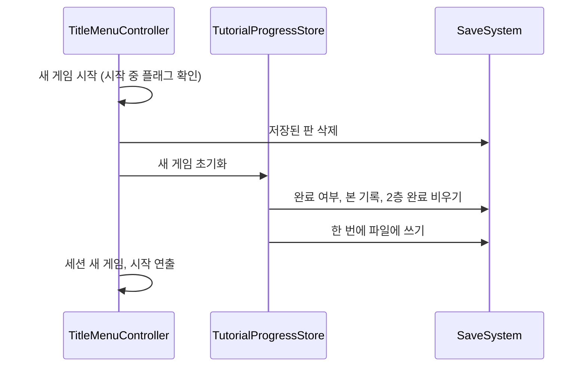

# 새 게임 시 튜토리얼 저장 정보 초기화 설계

> 상태: **설계 (미구현)** · 상세도 **Level 1** · 기준 브랜치 `feature/growth` · 작성일 2026-10-14
> 같은 날 작성한 [RuneBookTutorial](../RuneBookTutorial/RuneBookTutorialDesign.md)(2층 룬북 튜토리얼)의 선행 작업이다. 2층 튜토리얼 완료 플래그의 저장 필드를 이 문서에서 함께 선언한다.

## 1. 기능 개요 및 요구사항

타이틀에서 새 게임을 시작하면 튜토리얼 관련 저장 정보를 모두 초기화해, 튜토리얼을 처음부터 다시 보게 한다.

- **초기화 범위(확정):** 튜토리얼 완료 여부, 협회 지침서에서 본 기록, 2층 룬북 튜토리얼 완료 여부.
- **시점:** 타이틀의 새 게임 시작 처리 안에서, 저장된 판을 지우는 시점과 같은 곳이다. 이어하기에서는 초기화하지 않는다.
- **저장소(확정):** 튜토리얼 저장소를 저장 파일의 튜토리얼 영역 기반으로 복구한다.
- **제외 범위:** 룬북 공개 상태(메타), 설정, 엔딩 기록은 초기화하지 않는다. 예전 PlayerPrefs 값은 지우지 않는다.

## 2. 기존 코드 분석 및 변경 범위

### 확인된 사실

- 튜토리얼 저장소 [TutorialProgressStore.cs](../../../Assets/01_Scripts/Tutorial/Core/TutorialProgressStore.cs)는 지금 PlayerPrefs를 읽고 쓴다. 저장 기능 추가 커밋(`e69e7335e`)에서는 저장 파일의 튜토리얼 영역을 쓰도록 되어 있었으나 머지 복구 과정에서 PlayerPrefs 방식으로 되돌아갔다.
- 저장 파일 쪽에는 튜토리얼 영역(완료 여부, 본 기록 목록)과 접근자, 예전 PlayerPrefs 값을 한 번만 옮기는 마이그레이션이 이미 남아 있다. 지금은 아무도 이 영역을 읽지 않는다.
- 저장소를 쓰는 곳은 판 저장 컨트롤러(완료 여부로 저장 허용 판단), 튜토리얼 컨트롤러(완료 여부 확인과 기록), 협회 지침서 발표자와 기록 추적기(본 기록)이다. 모두 저장소의 정적 API를 통해서만 접근한다.
- 새 게임 시작 처리는 [TitleMenuController.cs](../../../Assets/01_Scripts/UI/Title/TitleMenuController.cs)에 있으며, 저장된 판 삭제 → 세션 새 게임 → 룬 워드 보유 초기화 → 시작 연출/씬 이동 순서다. 새 게임 확인 창의 확정과 즉시 시작 두 경로가 같은 처리를 부른다. 중복 시작은 시작 중 플래그로 막혀 있다.
- 저장된 판 삭제는 저장된 판이 없으면 아무것도 쓰지 않고 돌아온다.

### 변경 범위

| 구분 | 파일 | 내용 |
|---|---|---|
| 수정 | [TutorialProgressStore.cs](../../../Assets/01_Scripts/Tutorial/Core/TutorialProgressStore.cs) | 저장 파일 기반으로 복구, 2층 튜토리얼 완료 접근자와 새 게임 초기화 추가 |
| 수정 | [SaveData.cs](../../../Assets/01_Scripts/Save/SaveData.cs) | 튜토리얼 저장 영역에 2층 튜토리얼 완료 필드, 저장 파일에 튜토리얼 PlayerPrefs 이관 완료 필드 추가 |
| 수정 | [SaveSystem.cs](../../../Assets/01_Scripts/Save/SaveSystem.cs) | 튜토리얼 PlayerPrefs 값 일회성 이관 |
| 수정 | [TitleMenuController.cs](../../../Assets/01_Scripts/UI/Title/TitleMenuController.cs) | 새 게임 시작 처리에서 초기화 호출 |

### 추가 확인 (Codex 리뷰 반영)

- 저장 파일의 PlayerPrefs 마이그레이션은 "이미 옮겼는지" 플래그가 참이면 다시 실행되지 않는다. 그런데 머지 이후 현재 저장소는 PlayerPrefs에만 쓰고 있어, 이미 마이그레이션이 끝난 저장 파일에는 그 뒤의 튜토리얼 완료·본 기록이 없다. 저장소만 파일 기반으로 바꾸면 이 사용자들의 기록이 과거 상태로 돌아간다.

## 3. 전체 실행 흐름



초기화는 판 삭제 직후에 한 번만 파일에 쓴다. 판 삭제가 판이 없을 때 쓰기를 하지 않으므로 초기화 쪽이 항상 쓰기를 책임진다. 전투 씬의 튜토리얼 컨트롤러는 씬이 열릴 때 완료 여부를 새로 읽으므로 별도 알림이 필요 없다.

## 4. 단계별 구현 가이드

### 단계 1. 저장 필드 추가

파일: [SaveData.cs](../../../Assets/01_Scripts/Save/SaveData.cs) (수정)

튜토리얼 저장 영역(`TutorialSaveData`)에 필드를 추가한다.

```csharp
/// <summary>2층 룬북 튜토리얼을 마쳤는지</summary>
public bool IsRuneBookTutorialCompleted;
```

저장 파일 전체(`SaveFile`)에도 필드를 추가한다.

```csharp
/// <summary>튜토리얼 PlayerPrefs 값(완료, 본 기록)을 이 파일로 옮겼는지. 한 번만 옮긴다.</summary>
public bool IsTutorialPlayerPrefsImported;
```

저장 형식 번호는 올리지 않는다. 이 필드들이 없는 기존 파일은 읽을 때 거짓으로 채워지고, 튜토리얼 영역 전체가 없는 파일은 기존 로드 처리가 새 영역으로 채운다.

### 단계 1-2. 튜토리얼 PlayerPrefs 일회성 이관

파일: [SaveSystem.cs](../../../Assets/01_Scripts/Save/SaveSystem.cs) (수정)

```csharp
/// <summary>저장 파일을 처음 읽을 때 튜토리얼 PlayerPrefs 값을 한 번 합친다. 합쳤으면 true (파일에 써야 함)</summary>
private static bool ImportTutorialPlayerPrefs(SaveFile file);
```

1. 이미 이관한 파일이면 거짓을 돌려주고 끝낸다.
2. 이관 완료로 표시한다.
3. PlayerPrefs의 예전 튜토리얼 완료 값이 참이면 파일의 완료를 참으로 한다. (이미 참이면 그대로)
4. PlayerPrefs의 본 기록 목록 중 파일 목록에 없는 id를 추가한다. (합집합)
5. 참을 돌려준다.

호출 위치는 파일을 처음 읽어 오는 곳이다. 기존 마이그레이션이 하나라도 값을 바꿨으면 쓰던 흐름에 이어, 이 이관의 결과도 함께 보고 하나라도 참이면 한 번만 파일에 쓴다. 기존 마이그레이션이 튜토리얼 값을 옮기는 경로에서는 이관 완료 필드도 함께 참으로 표시해 중복으로 합치지 않게 한다. 테스트용 전체 삭제 후의 빈 저장도 이관 완료로 시작한다(지운 뒤 예전 값을 되살리지 않음). PlayerPrefs 값은 지우지 않는다.

이관은 새 게임 초기화보다 먼저 일어난다. 저장 파일에 처음 접근하는 시점(타이틀 진입 등)에 실행되므로, 이후 새 게임 초기화로 비워진 값을 다시 가져오는 일은 없다.

### 단계 2. 튜토리얼 저장소 복구

파일: [TutorialProgressStore.cs](../../../Assets/01_Scripts/Tutorial/Core/TutorialProgressStore.cs) (수정)

기존 공개 API의 이름과 시그니처는 유지하고 내부만 저장 파일 영역으로 바꾼다. 새로 추가하는 선언은 아래 셋이다.

```csharp
public static bool IsRuneBookTutorialCompleted { get; }
public static void MarkRuneBookTutorialCompleted();
public static void ResetForNewGame();
```

기존 `IsCompleted`, `MarkCompleted`, `IsRecordSeen`, `SeenRecordCount`, `MarkRecordSeen`, `ResetForDebug`는 시그니처를 그대로 둔다. 예전 PlayerPrefs 키와 구분자 상수는 삭제한다.

- **완료 여부 읽기:** 저장 파일의 튜토리얼 영역에서 해당 값을 돌려준다.
- **완료 표시(1층, 2층 공통 형태):** 이미 완료라면 아무것도 하지 않고, 아니면 값을 참으로 바꾼 뒤 파일에 쓴다.
- **본 기록 확인과 개수:** 영역의 본 기록 목록에서 포함 여부와 길이를 돌려준다.
- **본 기록 표시:** 기록 id가 비어 있거나 이미 목록에 있으면 종료하고, 아니면 목록에 추가한 뒤 파일에 쓴다.
- **새 게임 초기화:** 1층 완료 여부와 2층 완료 여부를 거짓으로, 본 기록 목록을 비운 뒤 파일에 한 번 쓴다.
- **디버그 초기화:** 새 게임 초기화와 같은 동작을 부른다. 튜토리얼 컨트롤러의 컨텍스트 메뉴가 계속 이 이름을 쓴다.

### 단계 3. 새 게임 시작 처리에서 초기화

파일: [TitleMenuController.cs](../../../Assets/01_Scripts/UI/Title/TitleMenuController.cs) (수정, 새 게임 시작 메서드)

기존 순서를 유지한 채 저장된 판을 지우는 줄 바로 다음에 튜토리얼 새 게임 초기화를 한 줄 추가한다. 이미 시작 중이면 앞부분에서 종료하므로 초기화가 중복 실행되지 않는다. 이어하기 처리는 바꾸지 않는다.

## 5. 검증 기준 및 테스트 시나리오

| # | 실행 조건 | 수행 행동 | 예상 결과 |
|---|---|---|---|
| 1 | 튜토리얼을 마친 저장 파일 | 타이틀에서 새 게임 선택(확인 창 거쳐 확정) | 저장 파일의 튜토리얼 완료, 2층 완료, 본 기록이 모두 비고 전투 씬에서 튜토리얼이 처음부터 시작 |
| 2 | 저장된 판이 없는 상태로 튜토리얼 완료 | 새 게임 선택 | 판 삭제가 쓰기를 하지 않아도 튜토리얼 정보는 초기화됨 |
| 3 | 판 저장과 튜토리얼 완료 | 이어하기 선택 | 튜토리얼 정보 유지, 튜토리얼 미실행 |
| 4 | 새 게임 확인 창이 떠 있음 | 취소 | 튜토리얼 정보 유지 |
| 5 | 기록을 본 상태 | 새 게임 후 협회 지침서 열기 | 기록 카운트 0부터 |
| 6 | 2층 튜토리얼 필드가 없는 기존 저장 파일 | 게임 시작 | 필드가 거짓으로 읽히고 오류 없음 |
| 7 | 룬북 공개 상태, 설정 값이 있음 | 새 게임 | 두 값은 변하지 않음 |
| 8 | 이미 PlayerPrefs 마이그레이션이 끝난 저장 파일, 그 뒤 PlayerPrefs에 튜토리얼 완료와 본 기록이 쌓임 | 새 빌드로 처음 실행 후 이어하기 | 완료와 본 기록이 파일에 합쳐져 유지됨 |
| 9 | 8번 이후 | 새 게임 후 다시 실행 | 초기화된 값이 PlayerPrefs에서 다시 복원되지 않음 |
| 10 | 이관이 끝난 파일 | 다시 실행 | 이관이 반복되지 않음 |
